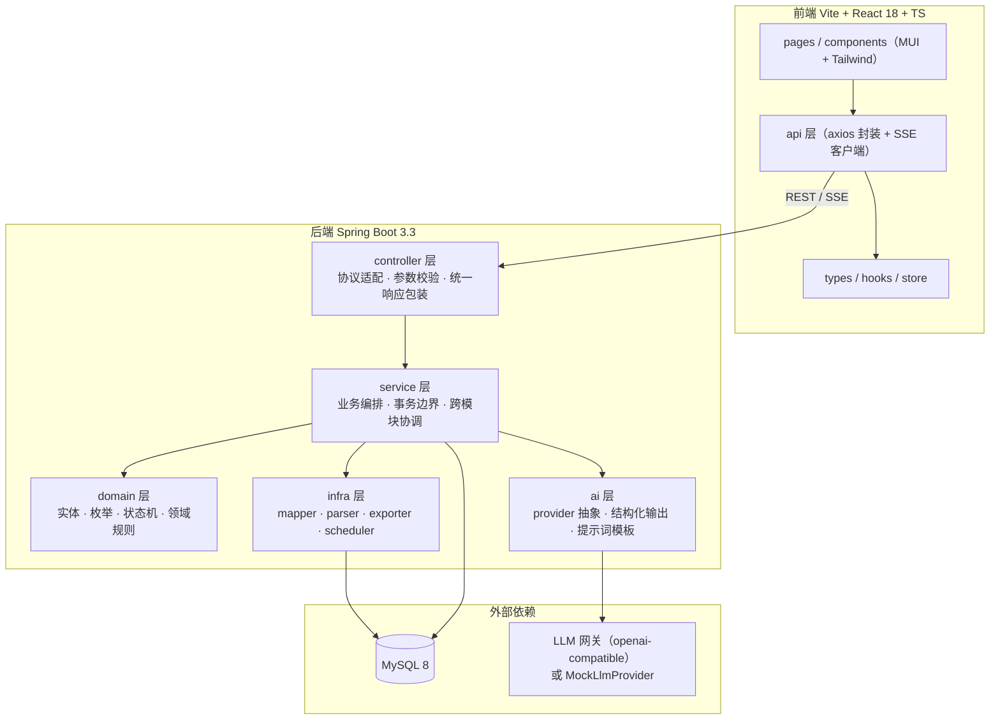
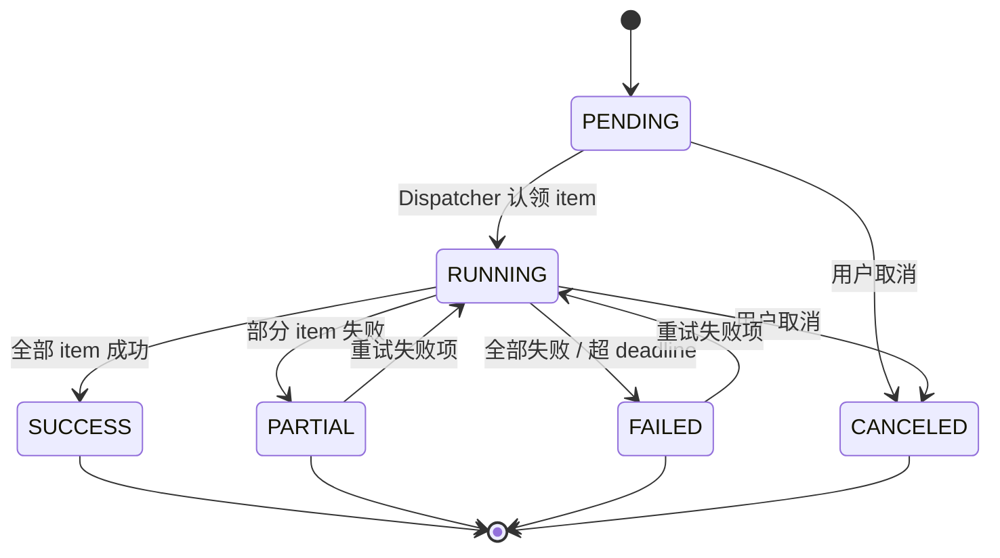
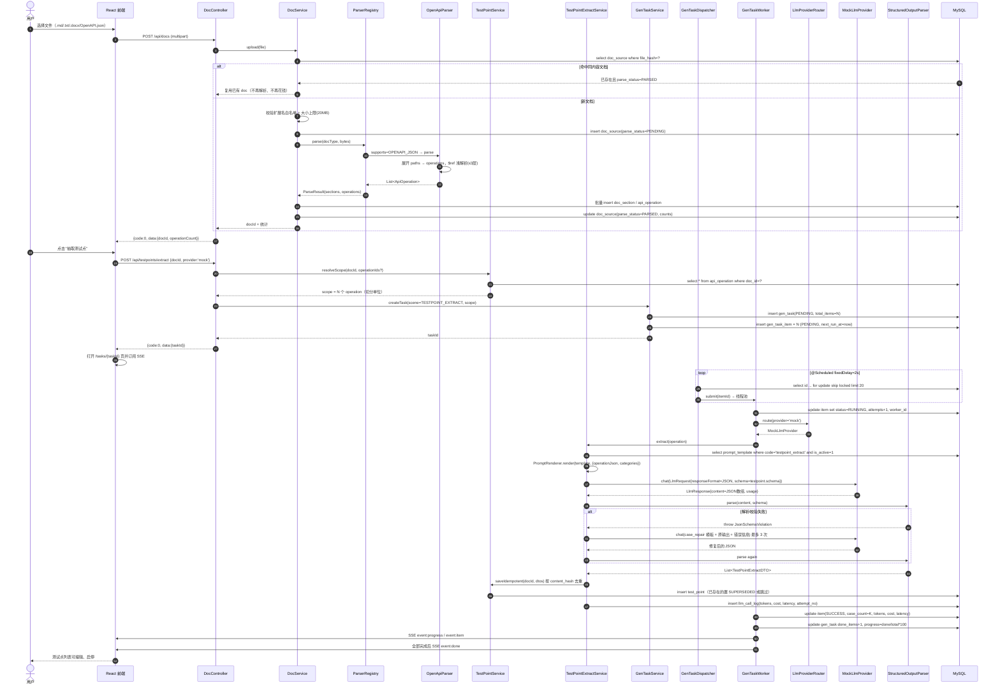
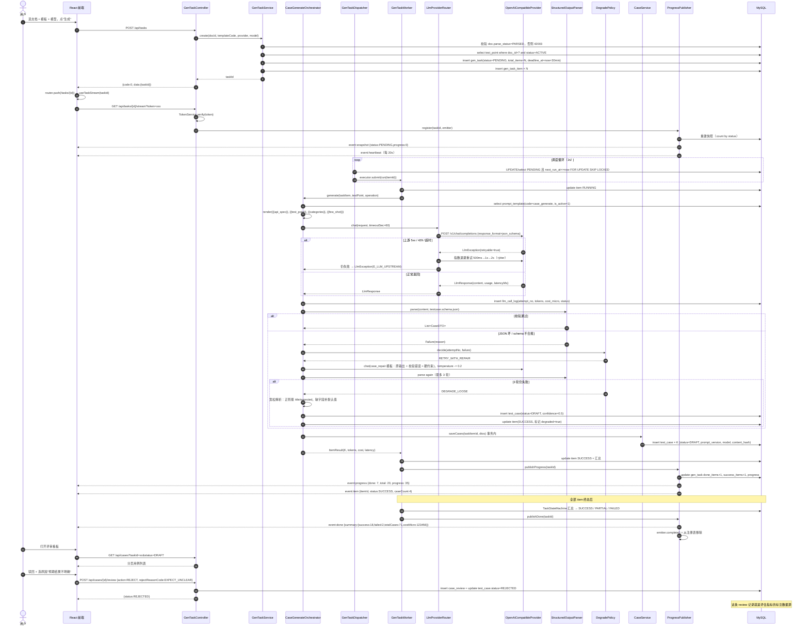
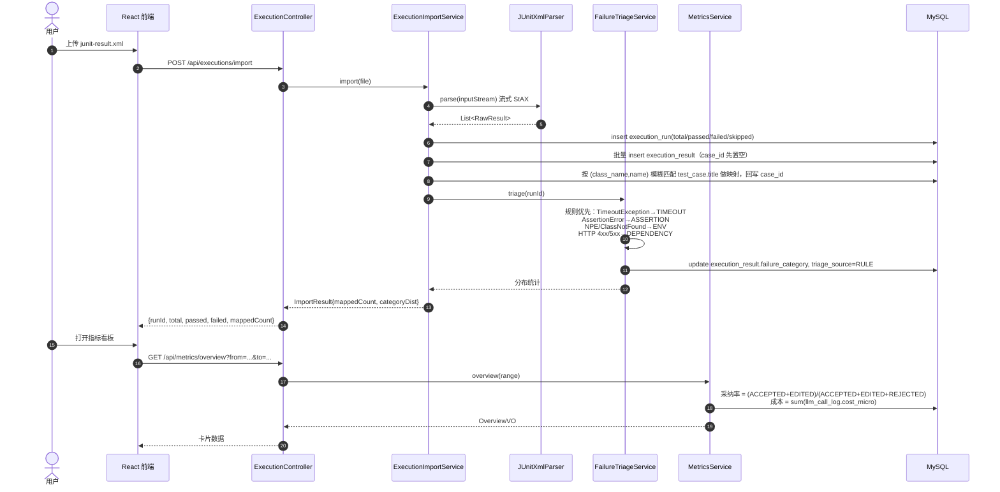
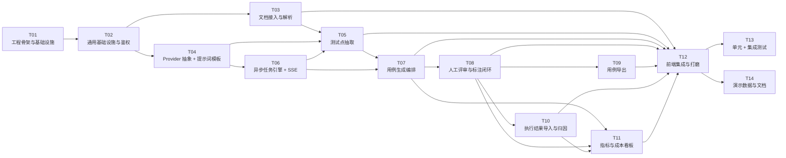

# AI 测试用例生成与评审平台 — 系统架构设计与任务分解

> 版本：v1.0 ｜ 架构：高见远 ｜ 技术栈基线：Java 17 + Spring Boot 3.3 + MyBatis-Plus + MySQL 8 ｜ Vite + React 18 + MUI + Tailwind + TypeScript
>
> 本文档同时承担两个职责：（1）作为可执行的工程蓝图交付给开发工程师；（2）作为简历项目的"设计说明"，每条设计决策都可被面试追问并站得住脚。

---

## 0. 一页速览

| 维度 | 结论 |
|---|---|
| 系统形态 | 前后端分离的单体应用（单机可跑，无 Redis / MQ / K8s） |
| 后端分层 | controller → service → domain / ai / infra 五层，模块按业务垂直切分（package by feature） |
| 核心难点 1：编排层 | `CaseGenerateOrchestrator` = 模板渲染 + JSON Schema 校验 + `JsonRepairer` + 三次修复重试 + 三级降级 |
| 核心难点 2：数据层 | 两级切分：文档 → 「测试点来源」（OpenAPI 按 operation 切、纯文本文档按 section 切），再按测试点逐条调模型 |
| 核心难点 3：异步流式 | `gen_task` + `gen_task_item` 双表任务机 + `@Scheduled` 轮询认领（`FOR UPDATE SKIP LOCKED`）+ 有界线程池 + SSE 推送 |
| 核心难点 4：评估可观测 | 采纳率分母 = **已评审数**（不含 DRAFT）；驳回原因走**字典码**归一化；成本按 `llm_call_log → task_item → task → doc` 四级归集 |
| 表数量 | 17 张（15 张业务表 + 2 张字典表） |
| REST 接口 | 47 个 + 1 个 SSE 端点 |
| 任务分解 | 14 个任务，最长依赖链 11 个节点，无环（见 §6.1） |

---

## 1. 实现方案与框架选型

### 1.1 技术难点拆解

| # | 难点 | 本质问题 | 本项目的解法 | 面试可讲的一句话 |
|---|---|---|---|---|
| 1 | 编排层可靠性 | LLM 输出是**概率性文本**，不是函数返回值 | 提示词模板版本化 + JSON Schema 强校验 + `JsonRepairer` 修补 + 修复式重试 + 三级降级 | "我把 LLM 当成一个**会失败的 RPC**来治理，而不是当成一个函数来调用。" |
| 2 | 上下文组织 | 一份 3000 行 OpenAPI 塞进 prompt 会超窗、会稀释注意力、会让成本失控 | 先做**结构化切分**（文档 → section / operation → test_point），一次调用只处理一个测试点粒度 | "模型的上下文不是越多越好，我先把文档编译成测试点，再让模型做它最擅长的扩写。" |
| 3 | 长耗时异步 | 单次调用 5~30s，HTTP 同步会打爆连接池与用户体验 | 任务表状态机 + 定时轮询认领 + 有界线程池 + 超时重试 + SSE 推流 | "我不引 MQ，用数据库当队列，靠 `SKIP LOCKED` 保证单机多线程安全认领。" |
| 4 | 效果与成本可量化 | 没有标注数据就没有指标，没有指标就不算 AI 工程 | 评审动作即标注；驳回原因字典化；`llm_call_log` 逐次记账 | "我的采纳率分母只算已评审的用例，否则生成量越大指标越假。" |

### 1.2 框架与依赖选型理由

| 能力 | 选型 | 理由 / 替代方案否决原因 |
|---|---|---|
| Web 框架 | Spring Boot 3.3.5 | 基线栈；`RestClient`、`@Scheduled`、`SseEmitter` 原生够用 |
| ORM | MyBatis-Plus 3.5.9 | 单表 CRUD 零 SQL；复杂聚合指标走 XML 手写 SQL，可控可优化。否决 JPA：指标看板的多表聚合用 JPA 很别扭 |
| 建表迁移 | Flyway 10（`flyway-mysql`） | 版本化 DDL 可回放，配合 `V100__demo_data.sql` 一键造演示数据。否决 `schema.sql` 自动执行：无版本、不可增量 |
| 文档解析 | Apache POI `poi-ooxml` 5.4.1（docx）+ 自研 Markdown/TXT/OpenAPI 解析 | 只抽纯文本 + 表格，不做版式还原。否决 mammoth：引入 Node 依赖链 |
| JSON Schema | `networknt:json-schema-validator` 1.5.2 | 支持 Draft 2020-12，能对模型输出做**声明式**校验，schema 文件与代码解耦 |
| Excel 导出 | 阿里 EasyExcel 4.0.3 | 注解式映射、低内存。否决 POI 裸写：样板代码多 |
| JUnit 代码生成 | Square `javapoet` 1.13.0 | 用 AST 生成而不是字符串拼接，天然规避转义/缩进问题 |
| HTTP 客户端（调模型） | OkHttp 4.12.0 | 需要按次设置 read timeout、连接池复用、可选流式。否决 RestClient：超时粒度控制不如 OkHttp 直观 |
| API 文档 | springdoc-openapi 2.6.0 | 自动产出 OpenAPI 3，顺带成为"自带样例输入" |
| 可观测 | Actuator + 自研 `llm_call_log` | 业务级可观测必须自己记账，通用 APM 看不到 token |
| 前端请求 | axios + @tanstack/react-query | query 层天然解决 loading/error/重试/失效，避免手写一堆 `useEffect` |
| 前端状态 | zustand | 只有 auth + 少量 UI 状态，Redux 过重 |
| 图表 | recharts | 与 React 亲和，够画折线/饼图/柱状 |
| 提示通知 | notistack | 与 MUI 同源，`enqueueSnackbar` 一行 |

### 1.3 分层结构



**为什么这样分层（三条硬理由）**

1. **ai 层必须独立成层**，因为它是唯一"不可靠"的依赖。把 provider 抽象、schema 校验、模板渲染全部收在这一层，上层 service 拿到的永远是"已经校验过的 DTO 或明确异常"。这样**换模型供应商只改一个实现类**，业务代码零改动——这就是能在面试里讲"可插拔"的物理证据。
2. **domain 与 infra 分离**，是为了让**状态机与指标口径**这类"最容易写散"的逻辑有唯一归属。状态枚举（`common.enums.TaskStatus` / `CaseStatus`）与转移规则（`TaskStateMachine`、`CaseReviewService`）分工明确：**枚举是数据，转移规则是行为**，任何 service 都不能绕过规则直接 UPDATE 状态。枚举本身收敛在 `common/enums`（见 §11.1 D-14），转移规则留在 domain/service 层。
3. **service 层只做编排，不做解析/不做 SQL**。例如 `GenTaskService` 负责"建任务 + 拆 item + 唤醒调度"，具体怎么调模型在 `ai` 层，怎么落库在 `mapper`。这样单测可以只测 `CaseGenerateOrchestrator`，用 Mock provider 完全离线。

**模块边界（package by feature，7 个业务包）**

| 模块 | 职责边界 | 不允许做的事 |
|---|---|---|
| `doc` | 文件接收、格式识别、解析为 section / api_operation | 不允许调用 LLM |
| `testpoint` | 测试点抽取、去重、启停 | 不允许直接生成用例 |
| `generation` | 任务创建、调度、进度、SSE | 不允许写 business 用例内容逻辑（交给 orchestrator） |
| `aicore` | provider、结构化输出、模板、**调用记账** | 不允许访问**业务**表；仅可访问 `prompt_template`（读模板）与 `llm_call_log`（写台账，见 §11.1 D-10）。这两张是"基础设施表"而非业务实体，因此不破坏单向依赖 |
| `case` | 用例存储、评审、标注 | 不允许发起 LLM 调用 |
| `export` | Excel / JUnit 导出 | 不允许改数据状态 |
| `execution` | 结果导入、归因、统计 | 不允许改用例评审状态 |
| `metrics` | 指标与成本聚合（只读） | 不允许写业务表 |

依赖方向严格单向：`controller → service → (domain | aicore | infra)`。`aicore` 不反向依赖任何业务模块，靠 `LlmRequest/LlmResponse` 这组 POJO 通信——这是整个架构里最重要的一条约束。

---

## 2. 文件列表

### 2.1 仓库根目录

```
ai-testcase-platform/
├── README.md                       # 三步启动指南 + 架构图 + 指标口径说明
├── CHANGELOG.md                    # 任务级变更记录（每个任务验收后追加一段）
├── LICENSE                         # MIT
├── .editorconfig                   # 跨编辑器编码/缩进/换行统一（UTF-8 + LF）
├── .env.example                    # 本机环境变量清单（入库）；新增配置项必须先加到这里
├── .gitignore                      # 忽略 target/ node_modules/ 以及 .env（本地真实值，禁止入库）
├── docs/
│   ├── 01-architecture.md          # 本文档（架构 + 任务分解 + §11 实施偏差记录）
│   ├── diagrams/
│   │   ├── class-diagram.mermaid              # 类图（可直接粘到 mermaid live / IDE 插件）
│   │   ├── sequence-doc-to-testpoint.mermaid  # 流程一：上传→解析→抽点
│   │   └── sequence-generate-sse.mermaid      # 流程二：异步生成 + SSE + 降级
│   ├── 02-api.md                   # 接口契约落地版（T14 产出）
│   ├── 03-runbook.md               # 排障手册：常见失败码与处置（T14 产出）
│   └── 04-interview-notes.md       # 四大难点的口述稿（T14 产出）
├── scripts/
│   ├── init-demo.sh                # 建库 + 跑 Flyway + 灌演示数据
│   └── reset-db.sh                 # 清库重来（演示前必用）
├── backend/
└── frontend/

# ⚠️ 目录树中不存在、但本机会有的文件：
#   .env   —— 本地真实密钥/密码，被 .gitignore 忽略，**永不入库**。
#            由开发者从 .env.example 复制后填值；加载机制见 §8.8。
```

### 2.2 后端目录树

```
backend/
├── pom.xml
└── src/
    ├── main/
    │   ├── java/com/aittest/
    │   │   ├── AiTestApplication.java              # 启动类，@EnableScheduling + @EnableAsync
    │   │   ├── common/
    │   │   │   ├── ApiResponse.java                # 统一响应体 {code,message,data,traceId} ★T01 已交付最小可用版本，T02 在其上扩展，禁止另建同名类
    │   │   │   ├── ErrorCode.java                  # 错误码枚举（唯一真源）
    │   │   │   ├── BizException.java               # 业务异常，携带 ErrorCode + 可读上下文
    │   │   │   ├── GlobalExceptionHandler.java     # @RestControllerAdvice，兜住所有异常映射为 ErrorCode
    │   │   │   ├── PageQuery.java                  # 分页入参基类（page/size/sort，size 上限 100）
    │   │   │   ├── PageResult.java                 # 分页出参 {list,total,page,size}
    │   │   │   ├── IdGen.java                      # 雪花 ID + 业务单号生成（T+yyyyMMdd+6位）
    │   │   │   ├── JsonUtils.java                  # 统一 ObjectMapper（UTC、忽略未知字段、Long→String）
    │   │   │   ├── CodeLabel.java                  # 通用「码+文案」轻量 DTO（code/label），字典接口与所有枚举下拉共用
    │   │   │   └── enums/                          # **全项目枚举唯一真源**（T02 交付）。业务包里禁止另建同义枚举
    │   │   │       ├── CodedEnum.java              # 接口：code() + label() + sortNo()；禁止用 ordinal() 存库
    │   │   │       ├── DocType.java                # MD / TXT / DOCX / OPENAPI_JSON（含扩展名白名单，42002 的唯一判据）
    │   │   │       ├── ParseStatus.java            # PENDING / PARSED / FAILED
    │   │   │       ├── TestPointStatus.java        # ACTIVE / DISABLED / SUPERSEDED
    │   │   │       ├── CaseType.java               # FUNCTIONAL / BOUNDARY / EXCEPTION / SECURITY / PERFORMANCE / COMPATIBILITY
    │   │   │       │                               # 注：测试点分类与用例类型**共用**本枚举（同名字段 category / case_type）
    │   │   │       ├── RiskLevel.java              # HIGH / MEDIUM / LOW
    │   │   │       ├── CaseStatus.java             # DRAFT / ACCEPTED / EDITED / REJECTED（采纳率分母只认后三者，见 §3.2 / §8.3）
    │   │   │       ├── CasePriority.java           # P0 / P1 / P2 / P3
    │   │   │       ├── TaskScene.java              # TESTPOINT_EXTRACT / CASE_GENERATE
    │   │   │       ├── TaskStatus.java             # PENDING / RUNNING / SUCCESS / PARTIAL / FAILED / CANCELED
    │   │   │       ├── ExecutionStatus.java        # PASSED / FAILED / SKIPPED
    │   │   │       └── TriageSource.java           # RULE / LLM / MANUAL
    │   │   ├── config/
    │   │   │   ├── MybatisPlusConfig.java          # 分页插件、乐观锁插件、字段自动填充
    │   │   │   ├── JacksonConfig.java              # Long 序列化为 String；LocalDateTime 为 ISO-8601 UTC ★T01 已交付最小可用版本，T02 在其上扩展，禁止另建同名类
    │   │   │   ├── WebMvcConfig.java               # 注册 AuthInterceptor、CORS、静态资源
    │   │   │   ├── AuthInterceptor.java            # 校验 Bearer Token / SSE 的 ?token=
    │   │   │   ├── AsyncConfig.java                # 生成线程池 + 调度线程池（有界队列 + 拒绝策略）
    │   │   │   ├── AiProperties.java               # @ConfigurationProperties("ai")：provider 链、超时、重试
    │   │   │   ├── ExportProperties.java           # 导出包名、类名规则、Excel 模板路径
    │   │   │   ├── StorageProperties.java          # @ConfigurationProperties("storage")：上传落盘根目录（T03 交付，见 §8.8）
    │   │   │   ├── TimezoneGuard.java              # ApplicationRunner：会话时区非 +00:00 时打 [TZ-GUARD] WARN，不阻断开机（T03）
    │   │   │   └── OpenApiConfig.java              # springdoc 分组与鉴权 scheme
    │   │   ├── auth/
    │   │   │   ├── AuthController.java             # POST /api/auth/login, GET /api/auth/me
    │   │   │   ├── AuthService.java                # 单用户校验（配置化账号 + BCrypt）
    │   │   │   ├── TokenService.java               # HMAC-SHA256 无状态 token 签发/验签
    │   │   │   └── AuthContext.java                # ThreadLocal 持有当前用户
    │   │   ├── doc/
    │   │   │   ├── controller/DocController.java   # 上传/列表/详情/重新解析/删除
    │   │   │   ├── service/DocService.java         # 落盘、格式判定、事务内解析入库
    │   │   │   ├── service/parser/DocumentParser.java      # 接口：supports(type) + parse(bytes)
    │   │   │   ├── service/parser/ParserRegistry.java      # 按 type 路由到具体 parser
    │   │   │   ├── service/parser/MarkdownParser.java      # 按 #/## 切成 section，保留标题层级
    │   │   │   ├── service/parser/TxtParser.java           # 按空行/章节关键字切分
    │   │   │   ├── service/parser/DocxParser.java          # POI 抽段落 + 表格，输出 section
    │   │   │   ├── service/parser/OpenApiParser.java       # 展开 paths → api_operation，$ref 浅解析(≤3层)
    │   │   │   ├── domain/DocSource.java           # 文档主表实体
    │   │   │   ├── domain/DocSection.java          # 文档章节（纯文本文档的切分结果）
    │   │   │   ├── domain/ApiOperation.java        # 接口操作（OpenAPI 的切分结果）
    │   │   │   └── mapper/{DocSourceMapper,DocSectionMapper,ApiOperationMapper}.java
    │   │   │                                          # 注：**不建 doc/domain/DocType.java**，直接复用 common/enums/DocType（见 §11.1 D-14）
    │   │   ├── testpoint/
    │   │   │   ├── controller/TestPointController.java     # POST /extract、GET /、GET /{id}、POST /、PATCH /{id}、POST /batch-status
    │   │   │   ├── service/TestPointService.java           # mergeExtraction（单元级去重合并）+ supersedeMissing（文档级取代）+ CRUD
    │   │   │   │                                          # 注：两者刻意分开——去重跟单元走、取代跟"一整轮抽取"走，时间尺度不同（见 §11.1 D-26）
    │   │   │   ├── service/TestPointExtractService.java    # 抽取内核：渲染→chat→修复→schema 校验→落库；safeExtract 是失败隔离边界（§11.1 D-27）
    │   │   │   ├── service/ExtractPlanner.java             # 把一篇文档切成 N 个待分析单元（OpenAPI 按 operation / 纯文本按 section，不混合）
    │   │   │   ├── domain/TestPoint.java                   # 14 字段实体
    │   │   │   ├── domain/TestPointHasher.java             # content_hash = sha256(doc_id \0 title \0 category)，纯工具
    │   │   │   ├── dto/{TestPointDraft,ExtractUnit,TestPointExtractResult,TestPointExtractReport}.java
    │   │   │   ├── dto/{TestPointVO,TestPointCreateReq,TestPointUpdateReq,BatchStatusReq}.java
    │   │   │   ├── mapper/TestPointMapper.java
    │   │   │   └── # 注：分类与状态**不建本地枚举**，直接用 common/enums/{CaseType,TestPointStatus,RiskLevel}
    │   │   ├── aicore/
    │   │   │   ├── LlmProvider.java                # 接口：name() + supports(model) + chat(LlmRequest)
    │   │   │   ├── LlmRequest.java                 # systemPrompt/messages/temperature/maxTokens/schema/timeoutMs/traceId
    │   │   │   ├── LlmResponse.java                # content/usage/finishReason/latencyMs/rawBody
    │   │   │   ├── LlmMessage.java                 # role + content
    │   │   │   ├── LlmUsage.java                   # promptTokens/completionTokens/totalTokens
    │   │   │   ├── LlmException.java               # 携带 ErrorCode + retryable 标记
    │   │   │   ├── LlmExceptionHandler.java        # @RestControllerAdvice：把 LlmException 的码原样映射（否则静默降级成 50000，见 §11.1 D-25）
    │   │   │   ├── provider/MockLlmProvider.java   # 无 Key 可跑：确定性返回合法 JSON，按输入 hash 选模板
    │   │   │   ├── provider/OpenAiCompatibleProvider.java  # /v1/chat/completions，支持 response_format
    │   │   │   ├── provider/LlmProviderRouter.java # 按 provider 名 + fallback 链选择实现
    │   │   │   ├── provider/LoggingLlmProvider.java # 装饰器：包住真实 provider，成功与异常都写 llm_call_log（见 §11.1 D-10）
    │   │   │   ├── log/LlmCallLog.java             # 调用台账实体（成本与质量真源，由 aicore 记账、metrics 只读聚合）
    │   │   │   ├── log/LlmCallLogMapper.java
    │   │   │   ├── log/{ModelPrice,ModelPriceMapper,ModelPriceCache}.java
    │   │   │   │                                    # 单价表 + 5 分钟 TTL 缓存；costMicro = tokens × 微元/1M
    │   │   │   ├── structured/StructuredOutputParser.java # 去 fence → 截取平衡括号 → 修复 → 校验 → 反序列化
    │   │   │   ├── structured/JsonRepairer.java    # 尾逗号、单引号、缺引号 key、截断补全（**仅对不配平文本**）
    │   │   │   ├── structured/JsonSchemaValidator.java     # networknt，加载 classpath:schema/*.json
    │   │   │   ├── prompt/PromptTemplateController.java    # GET 列表/详情、POST 新建版本、PUT 激活、POST /{id}/preview 试跑
    │   │   │   ├── prompt/dto/{PromptTemplateVO,PromptTemplateDetailVO,PromptTemplateCreateReq,PromptPreviewReq,PromptPreviewVO}.java
    │   │   │   └── prompt/{PromptTemplateService,PromptRenderer,PromptTemplateLoader,PromptTemplate}.java
    │   │   │                                          # Service 查库取活跃版本；Renderer 做 {{var}} 替换；Loader 启动时 seed
    │   │   ├── generation/                             # **T06 已交付 15 个文件**；T07 的 orchestrator 仍待交付
    │   │   │   ├── controller/GenTaskController.java   # POST /api/tasks、GET /{id}、POST /{id}/cancel、GET /{id}/stream（自验 ?token=）
    │   │   │   ├── domain/{GenTask,GenTaskItem}.java   # 任务主表 + 队列表；状态复用 common/enums/{TaskStatus,TaskScene}（D-14）
    │   │   │   ├── dto/{GenTaskCreateReq,GenTaskVO}.java # 显式 VO：实体 LocalDateTime(UTC) → VO Instant（§4.4）
    │   │   │   ├── mapper/{GenTaskMapper,GenTaskItemMapper}.java
    │   │   │   ├── service/GenTaskService.java         # 建任务（刻意不走大事务，D-17）/ claimBatch @Transactional / cancel
    │   │   │   ├── service/GenTaskDispatcher.java      # @Scheduled(fixedDelay=500)，按线程池空闲槽位认领、兜底 catch 只记不抛
    │   │   │   ├── service/GenTaskWorker.java          # 单 item 执行壳：attempts≤3、退避后移 next_run_at、条件更新抢占收尾
    │   │   │   ├── service/ProgressPublisher.java      # 原子 bumpCounters + SSE snapshot/progress/item/done（进度节流 200ms、终态不节流）
    │   │   │   ├── service/SseEmitterRegistry.java     # taskId → emitters，心跳、断线清理、complete
    │   │   │   ├── service/TaskStateMachine.java       # 唯一状态流转判定，非法流转抛 40901；terminalOf 推导 PARTIAL
    │   │   │   ├── service/TaskItemHandler.java        # 场景处理器接口：scene() / execute() / onTaskFinalize()
    │   │   │   ├── service/TestPointExtractHandler.java # T05↔T06 接缝：按 unitRef 抽单元、写 kept_hashes、收尾取代（D-30/D-31）
    │   │   │   └── orchestrator/{CaseGenerateOrchestrator,RetryPolicy,DegradePolicy,GenerationContext}.java
    │   │   │                                           # **T07 待交付**：以上 4 个编排类本次未落地
    │   │   ├── case/
    │   │   │   ├── controller/CaseController.java          # 列表/详情/编辑/评审/批量评审
    │   │   │   ├── service/CaseService.java                # 查询与编辑，维护 status
    │   │   │   ├── service/CaseReviewService.java          # 采纳/驳回/编辑三分支 + old/new 快照
    │   │   │   ├── domain/{TestCase,CaseReview,ReviewAction}.java
    │   │   │   │                                       # status/priority/case_type 用 common/enums；RejectReason 字典实体在 system/domain
    │   │   │   ├── dto/{TestCaseVO,CaseUpdateReq,ReviewReq}.java
    │   │   │   └── mapper/{TestCaseMapper,CaseReviewMapper}.java
    │   │   ├── export/
    │   │   │   ├── controller/ExportController.java        # /api/export/cases.xlsx, /api/export/junit.java
    │   │   │   ├── service/CaseSnapshotBuilder.java        # 组装导出模型（含任务/文档元信息）
    │   │   │   ├── service/ExcelExportService.java         # EasyExcel 双 sheet
    │   │   │   ├── service/JUnitExportService.java         # JavaPoet 生成 @Test 骨架，打包 zip
    │   │   │   ├── support/JUnitNaming.java                # 类名/方法名/包名规则与非法字符转义
    │   │   │   └── support/ExcelColumnDef.java             # 表头常量与样式
    │   │   ├── execution/
    │   │   │   ├── controller/ExecutionController.java     # import/list/detail/failures/remap
    │   │   │   ├── service/ExecutionImportService.java     # 文件识别 → 解析 → 批量入库 → 统计
    │   │   │   ├── service/FailureTriageService.java       # 规则 + 可选 LLM 归因
    │   │   │   ├── service/FailureStatsService.java        # 分类分布、模块分布、Top 失败
    │   │   │   ├── parser/ResultParser.java                # 接口
    │   │   │   ├── parser/JUnitXmlParser.java              # StAX 流式解析 testsuite/testcase/failure
    │   │   │   ├── parser/CsvResultParser.java             # 列名容错（class/name/status/时间）
    │   │   │   ├── domain/{ExecutionRun,ExecutionResult}.java
    │   │   │   │                                       # status 用 common/enums/ExecutionStatus；FailureCategory 字典实体在 system/domain
    │   │   │   └── mapper/{ExecutionRunMapper,ExecutionResultMapper}.java
    │   │   ├── metrics/
    │   │   │   ├── controller/MetricsController.java       # overview/acceptance/cost/quality
    │   │   │   ├── service/MetricsService.java             # 采纳率、编辑率、失败率、耗时 p50/p95
    │   │   │   ├── service/CostService.java                # token 与成本按 task/day/model 归集
    │   │   │   ├── service/ModelPriceService.java          # 单价表读取 + 本地缓存（TTL 5min）
    │   │   │   ├── domain/{ModelPrice,MetricSnapshot}.java
    │   │   │   ├── dto/{OverviewVO,AcceptancePointVO,CostPointVO,QualityVO}.java
    │   │   │   └── mapper/{ModelPriceMapper,MetricSnapshotMapper}.java
    │   │   │                                               # 注：LlmCallLog 实体与 mapper 已移至 aicore/log（见 §11.1 D-10）
    │   │   ├── system/                             # 系统与字典：**只读字典的唯一归属地**（T02 交付）
    │   │   │   ├── HealthController.java           # GET /api/health（不鉴权）★T01 新增（不在 T02 范围内）。
    │   │   │   │                                   # 后续扩展只加 dbOk/provider 探测，禁止重写路由
    │   │   │   ├── ConfigController.java           # GET /api/config/public（前端需要的枚举字典与开关）
    │   │   │   ├── DictController.java             # GET /api/dict/reject-reasons, /api/dict/failure-categories
    │   │   │   ├── domain/{RejectReason,FailureCategory}.java   # 两张字典表的实体（code/label/category|severity/sortNo/enabled）
    │   │   │   ├── mapper/{RejectReasonMapper,FailureCategoryMapper}.java  # 仅被 system 内部与 metrics 只读引用
    │   │   │   ├── service/ConfigService.java      # 白名单化输出公开配置（禁止整包 dump）
    │   │   │   ├── service/DictService.java        # 字典全量查询 + 本地缓存（TTL 5min）
    │   │   │   └── dto/PublicConfigVO.java         # /api/config/public 的出参契约
    │   │   │                                       # 注：case / execution 包**不要**再建 RejectReason/FailureCategory/Mapper（见 §11.1 D-15）
    │   │   └── logging/TraceFilter.java            # 生成 traceId 注入 MDC，响应头 X-Trace-Id
    │   │                                           # ★T01 已交付最小可用版本，T02 在其上扩展，禁止另建同名类
    │   └── resources/
    │       ├── application.yml                     # 公共配置（不含密钥）
    │       ├── application-dev.yml                 # 本地 MySQL + mock provider
    │       ├── application-prod.yml                # T14 交付：生产 profile，密钥全部走环境变量，禁止任何默认值兜底（见 §11.1 D-09）
    │       ├── prompts/
    │       │   ├── testpoint_extract.v1.md         # 测试点抽取模板（含 few-shot）
    │       │   ├── case_generate.v1.md             # 用例生成模板（含 JSON 输出约束 + few-shot）
    │       │   ├── case_repair.v1.md              # 修复式重试模板（贴错误 + 原输出，要求只回正确 JSON）
    │       │   └── failure_triage.v1.md            # 失败归因模板（可选能力，规则兜底）
    │       ├── schema/
    │       │   ├── testpoint.schema.json           # 测试点数组的 JSON Schema
    │       │   └── testcase.schema.json            # 用例数组的 JSON Schema
    │       ├── mapper/{GenTaskMapper.xml,GenTaskItemMapper.xml,TestCaseMapper.xml,LlmCallLogMapper.xml,MetricsMapper.xml}
    │       │                                       # 复杂聚合 SQL；**T06 已交付前两个**：GenTaskItemMapper.xml 的
    │       │                                       # FOR UPDATE SKIP LOCKED 认领（nowUtc 参数化）、GenTaskMapper.xml 的
    │       │                                       # 原子 bumpCounters 与带状态守卫的 markTerminal
    │       └── db/
    │           ├── migration/
    │           │   ├── V1__schema.sql              # 15 张业务表 DDL + 索引
    │           │   ├── V2__dict_and_config.sql     # 驳回原因、失败分类、模型单价、默认模板、默认账号
    │           │   ├── V3__seed_admin_user.sql     # 种子账号（时间列省略 INSERT，由 DDL 默认值填）
    │           │   ├── V4__fix_storage_path_comment.sql  # 覆盖 storage_path 列注释；**已应用的迁移文件一个字符都不许改**（Flyway CRC32 校验）
    │           │   └── V5__gen_task_item_unit_ref.sql    # **T06**：unit_ref / kept_hashes / uk_gen_task_item_task_unit（D-31）
    │           │   └── V6__gen_task_unit_ref_and_produced.sql # **T06 收尾**：gen_task 补 produced_items（D-34 相关，产出≠采纳）；unit_ref 64→200（D-31 补丁，防无 operationId 时 1406）
    │           └── demo/
    │               └── V100__demo_data.sql         # 1 份 OpenAPI + 1 个已完成任务 + 30 条用例 + 1 次执行结果
    └── test/
        ├── java/com/aittest/
        │   ├── doc/DocxParserTest.java
        │   ├── doc/OpenApiParserTest.java
        │   ├── aicore/StructuredOutputParserTest.java      # 坏 JSON 全家桶（fence/尾逗号/截断/单引号）
        │   ├── aicore/MockProviderTest.java
        │   ├── generation/CaseGenerateOrchestratorTest.java # 三档降级分支
        │   ├── generation/service/{GenTaskServiceTest,GenTaskWorkerTest,TaskCreateDeadlockRetryTest,CancelInFlightRaceTest}.java # T06 验收：状态机/退避/NPE 兜底/建任务死锁重试/取消竞态
        │   ├── generation/controller/GenTaskControllerStreamAuthTest.java # T06：SSE 无 token/owner 鉴权（覆盖 D-35 的服务端部分）
        │   ├── metrics/MetricsServiceTest.java             # 采纳率口径（含 EDITED 场景）
        │   ├── export/JUnitExportServiceTest.java          # 生成代码可编译
        │   └── api/ApiSmokeIT.java                         # mock 全链路：上传→抽点→生成→评审→导出→导入
        └── resources/
            ├── application-test.yml         # H2(MySQL 模式) + mock provider
            └── fixtures/{sample-openapi.json, sample.docx, junit-result.xml, result.csv}
```

### 2.3 前端目录树

```
frontend/
├── package.json
├── vite.config.ts                    # alias @、dev proxy → localhost:8080、SSE 不缓冲
├── tsconfig.json
├── tsconfig.node.json
├── tailwind.config.js                # corePlugins.preflight = false（与 MUI 共存的关键）
├── postcss.config.js
├── vitest.config.ts
├── index.html
├── .env.example                      # VITE_API_BASE
└── src/
    ├── main.tsx                      # QueryClientProvider + SnackbarProvider + ThemeProvider + Router
    ├── App.tsx                       # AppShell 挂载 + 路由出口
    ├── theme.ts                      # MUI 主题（中文字体栈、紧凑密度、Chip 色板）
    ├── index.css                     # Tailwind 三件套 + 少量全局变量
    ├── vite-env.d.ts
    ├── api/
    │   ├── http.ts                   # axios 实例：baseURL、token 注入、{code,data} 解包、401 跳登录、错误归一化
    │   ├── sse.ts                    # EventSource 封装：token query、事件分发、断线退避重连、快照回放
    │   ├── auth.ts
    │   ├── doc.ts
    │   ├── testpoint.ts
    │   ├── task.ts
    │   ├── cases.ts
    │   ├── exportApi.ts
    │   ├── execution.ts
    │   ├── metrics.ts
    │   └── prompt.ts
    ├── types/
    │   ├── common.ts                 # ApiResponse、PageResult、枚举字典类型
    │   ├── doc.ts
    │   ├── task.ts
    │   ├── cases.ts
    │   ├── execution.ts
    │   └── metrics.ts
    ├── store/
    │   └── authStore.ts              # zustand：token 持久化 localStorage、登录态、登出
    ├── hooks/
    │   ├── useTaskStream.ts          # SSE 订阅 + 进度状态 + 完成回调
    │   ├── usePagedQuery.ts          # 统一分页/筛选 → react-query
    │   └── useDict.ts                # 字典拉取与缓存
    ├── components/
    │   ├── layout/
    │   │   ├── AppShell.tsx          # SideNav + TopBar + 内容区
    │   │   ├── SideNav.tsx           # 6 个模块导航
    │   │   └── TopBar.tsx            # 面包屑 + 环境标识 + 登出
    │   ├── common/
    │   │   ├── DataTable.tsx         # 泛型表格：列定义 + 分页 + 空态 + 骨架屏
    │   │   ├── StatusChip.tsx        # 任务/用例/结果状态统一色板与文案
    │   │   ├── EmptyState.tsx
    │   │   ├── ErrorBoundary.tsx
    │   │   ├── ConfirmDialog.tsx
    │   │   ├── JsonViewer.tsx        # 用例步骤/模型原始输出查看
    │   │   └── PageHeader.tsx
    │   └── charts/ChartCard.tsx      # 统一图表容器（标题/单位/加载/空态）
    ├── pages/
    │   ├── Login.tsx
    │   ├── docs/{DocList.tsx, DocUploadDialog.tsx, DocDetail.tsx}
    │   ├── testpoints/TestPointReviewPage.tsx      # 表格内启停 + 分类筛选 + 手动补点
    │   ├── tasks/{TaskList.tsx, TaskCreateDialog.tsx, TaskDetail.tsx, ProgressTimeline.tsx}
    │   ├── cases/{CaseBoard.tsx, CaseReviewDrawer.tsx, RejectReasonPicker.tsx, CaseExportDialog.tsx}
    │   ├── execution/{ExecutionList.tsx, ExecutionDetail.tsx, FailurePie.tsx}
    │   ├── metrics/{OverviewDashboard.tsx, AcceptanceChart.tsx, CostChart.tsx}
    │   └── prompts/PromptTemplateList.tsx          # 模板查看/编辑/切版本
    └── routes/index.tsx                            # 路由守卫与懒加载注册的**唯一入口**，page 组件不得自建路由
                                                    # 路由是应用级基础设施，不属于 pages（pages 下全部是页面组件）
                                                    # **新增页面的固定动作**：在本文件加一条路由 + 在 pages/ 下建组件，两步缺一不可
                                                    # **T12 重排路由时只能搬运、不得改变已有路径**——路径是文档、快捷方式、
                                                    # 已导出报告里的外部契约，一改全失效
```

---

## 3. 数据结构设计

### 3.1 ER 图

```mermaid
erDiagram
    APP_USER ||--o{ DOC_SOURCE : uploads
    APP_USER ||--o{ CASE_REVIEW : performs
    DOC_SOURCE ||--o{ DOC_SECTION : contains
    DOC_SOURCE ||--o{ API_OPERATION : contains
    DOC_SOURCE ||--o{ TEST_POINT : produces
    API_OPERATION ||--o{ TEST_POINT : scopes
    DOC_SECTION ||--o{ TEST_POINT : scopes
    DOC_SOURCE ||--o{ GEN_TASK : triggers
    PROMPT_TEMPLATE ||--o{ GEN_TASK : applied
    GEN_TASK ||--o{ GEN_TASK_ITEM : splits
    TEST_POINT ||--o{ GEN_TASK_ITEM : per_point
    GEN_TASK_ITEM ||--o{ TEST_CASE : generates
    GEN_TASK ||--o{ TEST_CASE : aggregates
    TEST_CASE ||--o{ CASE_REVIEW : reviewed
    REJECT_REASON ||--o{ CASE_REVIEW : categorized
    GEN_TASK_ITEM ||--o{ LLM_CALL_LOG : emits
    GEN_TASK ||--o{ LLM_CALL_LOG : rolls_up
    MODEL_PRICE ||--o{ LLM_CALL_LOG : prices
    EXECUTION_RUN ||--o{ EXECUTION_RESULT : contains
    TEST_CASE |o--o| EXECUTION_RESULT : mapped_by
    FAILURE_CATEGORY ||--o{ EXECUTION_RESULT : triaged
    GEN_TASK |o--o| METRIC_SNAPSHOT : materialized

    APP_USER {
        bigint id PK
        varchar username
        varchar password_hash
        varchar display_name
        tinyint enabled
        datetime created_at
    }

    DOC_SOURCE {
        bigint id PK
        varchar doc_no
        varchar name
        varchar doc_type
        bigint file_size
        varchar file_hash
        varchar storage_path
        varchar parse_status
        varchar parse_error
        int section_count
        int operation_count
        bigint created_by FK
        tinyint deleted
        datetime created_at
    }

    DOC_SECTION {
        bigint id PK
        bigint doc_id FK
        varchar heading
        int level
        int seq_no
        mediumtext content
    }

    API_OPERATION {
        bigint id PK
        bigint doc_id FK
        varchar method
        varchar path
        varchar operation_id
        varchar summary
        varchar tags
        mediumtext request_schema
        mediumtext response_schema
        mediumtext param_schema
        int seq_no
    }

    TEST_POINT {
        bigint id PK
        bigint doc_id FK
        bigint operation_id FK
        bigint section_id FK
        varchar title
        varchar category
        varchar risk_level
        mediumtext description
        varchar source_ref
        varchar status
        varchar prompt_version
        varchar content_hash
        datetime created_at
    }

    PROMPT_TEMPLATE {
        bigint id PK
        varchar code
        int version
        varchar scene
        varchar name
        mediumtext content
        varchar output_schema
        varchar model_hint
        tinyint is_active
        datetime created_at
    }

    GEN_TASK {
        bigint id PK
        varchar task_no
        varchar scene
        bigint doc_id FK
        bigint template_id FK
        varchar provider
        varchar model
        varchar status
        int total_items
        int done_items
        int success_items
        int failed_items
        int accepted_cases
        int progress
        int retry_round
        varchar error_code
        varchar error_msg
        datetime deadline_at
        datetime started_at
        datetime finished_at
        bigint created_by FK
    }

    GEN_TASK_ITEM {
        bigint id PK
        bigint task_id FK
        bigint test_point_id FK
        varchar status
        int attempts
        int case_count
        tinyint degraded
        varchar error_code
        varchar error_msg
        int prompt_tokens
        int completion_tokens
        bigint cost_micro
        int latency_ms
        datetime next_run_at
        varchar worker_id
        datetime started_at
        datetime finished_at
    }

    TEST_CASE {
        bigint id PK
        bigint task_id FK
        bigint task_item_id FK
        bigint test_point_id FK
        bigint doc_id FK
        int seq_no
        varchar title
        mediumtext precondition
        mediumtext steps
        mediumtext expected
        varchar priority
        varchar case_type
        varchar status
        decimal confidence
        varchar prompt_version
        varchar model
        varchar content_hash
        datetime created_at
        datetime updated_at
    }

    CASE_REVIEW {
        bigint id PK
        bigint case_id FK
        varchar action
        varchar reject_reason_code FK
        varchar reason_text
        mediumtext old_content
        mediumtext new_content
        bigint reviewer_id FK
        datetime created_at
    }

    REJECT_REASON {
        varchar code PK
        varchar label
        varchar category
        int sort_no
        tinyint enabled
    }

    LLM_CALL_LOG {
        bigint id PK
        bigint task_id FK
        bigint task_item_id FK
        varchar trace_id
        varchar scene
        varchar provider
        varchar model
        int prompt_tokens
        int completion_tokens
        bigint cost_micro
        int latency_ms
        int attempt_no
        varchar status
        varchar error_code
        tinyint degraded
        datetime created_at
    }

    MODEL_PRICE {
        bigint id PK
        varchar model
        int input_price_micro
        int output_price_micro
        varchar currency
        date effective_from
        tinyint enabled
    }

    EXECUTION_RUN {
        bigint id PK
        varchar run_no
        varchar name
        varchar source_type
        varchar file_name
        int total_count
        int passed_count
        int failed_count
        int skipped_count
        int mapped_count
        bigint duration_ms
        datetime created_at
    }

    EXECUTION_RESULT {
        bigint id PK
        bigint run_id FK
        varchar class_name
        varchar case_name
        varchar status
        bigint duration_ms
        mediumtext failure_message
        mediumtext stack_trace
        bigint case_id FK
        varchar failure_category FK
        varchar triage_source
        datetime created_at
    }

    FAILURE_CATEGORY {
        varchar code PK
        varchar label
        varchar severity
        int sort_no
        tinyint enabled
    }

    METRIC_SNAPSHOT {
        bigint id PK
        date stat_date
        bigint doc_id FK
        bigint task_id FK
        int generated_cases
        int accepted_cases
        int edited_cases
        int rejected_cases
        bigint total_cost_micro
        int avg_latency_ms
        datetime created_at
    }
```



### 3.2 关键表字段与索引说明

| 表 | 关键字段 | 索引 | 设计要点 |
|---|---|---|---|
| `doc_source` | `file_hash`（SHA-256 前 32 位）、`storage_path`、`parse_status`、`deleted` | `uk(doc_no)`、`idx(created_at)`、`idx(file_hash)`、`idx(parse_status)` | `file_hash` 用于**重复上传秒回**（同内容直接复用解析结果，省一次 LLM 钱）；`storage_path` 记录落盘路径（原始文件可回溯，重解析不必让用户重传），**存的是相对 `storage.dir` 根的路径**（如 `docs/20260701/<uuid>.md`），读取时拼回；**不许存绝对路径**——绝对路径会把"根在当前机器上的取值"烧进每一行，于是"文件在哪"有了两个真源（配置 + 列值），换机器后全部失效，README 承诺的"新机器三步跑通"就不成立。早期版本写入的绝对路径行由双模式读取兼容（`Path.isAbsolute()` 则原样用），退役条件见 §9；`parse_status` = PENDING/PARSED/FAILED；`deleted` 为软删标记，由 MyBatis-Plus 逻辑删除接管（`logic-delete-field: deleted`），**手写 SQL 必须自己带 `deleted = 0`**，`DELETE` 端点只改标记不删行。<br/>**软删恢复（重要）**：`upload` 按 `file_hash` 查重时**必须绕过逻辑删过滤** —— 逻辑删除只注入到 `BaseMapper` 的内置方法，因此这里要用**手写 XML / `@Select` 自定义 SQL**（`WHERE file_hash = #{hash}`，**不带** `deleted` 条件），不能用 `LambdaQueryWrapper`。命中 `deleted=1` 的记录则**复用该记录并恢复**：置 `deleted=0`、重解析覆盖 `doc_section`/`api_operation`、不新建记录。理由见 §3.2.2 |
| `api_operation` | `method`+`path` 唯一确定一个接口 | `idx(doc_id, seq_no)`、`uk(doc_id, method, path)` | 这是"按接口维度切分调用"的物理载体；`request_schema` 存已裁剪的 JSON 片段（避免 $ref 循环） |
| `test_point` | `content_hash` = sha256(doc_id+title+category) | `idx(doc_id, status)`、`uk(doc_id, content_hash)` | **幂等去重**：重复抽取不产生重复点，老数据置 SUPERSEDED；`prompt_version` 记录是哪版模板抽出来的，便于回溯模板质量 |
| `prompt_template` | `code`+`version`、`is_active`、`model_hint` | `uk(code, version)`、`idx(code, is_active)`、`idx(scene)` | 同 code 只有一条 `is_active=1`（service 层保证，DB 不加唯一约束以便历史版本共存）；`model_hint` 来自模板 front-matter，仅作"推荐模型"提示，**不参与路由决策**（路由由任务参数或配置决定），避免模板改动意外改变成本模型 |
| `gen_task` | `scene`、`status`、`progress`、`deadline_at` | `idx(status, created_at)`、`idx(scene, status)`、`uk(task_no)` | `scene` = `TESTPOINT_EXTRACT` / `CASE_GENERATE`，让两类异步任务**复用同一套状态机、调度器与 SSE**；`progress` 是**冗余字段**（0-100），为了列表页不聚合子表；`deadline_at` 是任务级超时，防止僵尸任务 |
| `gen_task_item` | `status`、`next_run_at`、`worker_id`、`attempts`、`degraded` | `idx(status, next_run_at)` ← **认领索引，最重要**、`idx(task_id, status)`、`uk(task_id, test_point_id)` | 认领 SQL：`SELECT id FROM gen_task_item WHERE status='PENDING' AND next_run_at<=NOW() ORDER BY id LIMIT ? FOR UPDATE SKIP LOCKED`，靠 MySQL 8 行锁跳过，天然支持多线程/多实例；`degraded=1` 表示"宽松解析降级产出"，是**区分正常产出与兜底产出的开关**，指标可按它拆开看 |
| `test_case` | `status`、`seq_no`、`content_hash` | `idx(task_id, status)`、`idx(test_point_id)`、`uk(task_item_id, seq_no)` | `status` = DRAFT/ACCEPTED/EDITED/REJECTED。**统计分母只认后三者** |
| `case_review` | `action`、`reject_reason_code`、`old_content`/`new_content` | `idx(case_id, created_at)`、`idx(reject_reason_code)` | **只追加不更新**，是标注数据的唯一真源；用例当前状态是"最后一条 review 的投影" |
| `llm_call_log` | `cost_micro`、`prompt_tokens`、`attempt_no`、`trace_id`、`degraded` | `idx(task_id)`、`idx(created_at)`、`idx(model, created_at)`、`idx(trace_id)` | **每次 HTTP 调用一行**（含失败），失败也要记账（tokens 可能已消耗）；`cost_micro` 用整数存"百万分之一元"避免浮点误差；`degraded` 让成本台账能区分"正常调用"与"降级/兜底调用"的成本，否则降级率上去了也看不出来；`idx(trace_id)` 支持按 `X-Trace-Id` 反查一次请求的全部模型调用 |
| `model_price` | `input_price_micro`/`output_price_micro`（每 1M token 的微元） | `uk(model, effective_from)` | 单价可变 → 用生效日期做版本，历史成本不因调价而失真 |
| `execution_result` | `failure_category`、`case_id`、`triage_source` | `idx(run_id, status)`、`idx(run_id, failure_category)`、`idx(case_id)` | `case_id` 允许 NULL（映射不上就空着，逼着暴露映射率）；`triage_source` = RULE / LLM / MANUAL，归因可追溯来源 |
| `reject_reason` / `failure_category` | `code`（英文枚举，主键） | PK | **归一化的关键**：统计只按 `code` 聚合，自由文本永不进 GROUP BY |

#### 3.2.1 全局时间戳与软删约定（逐类表说明）

| 表类别 | `created_at` | `updated_at` | 说明 |
|---|---|---|---|
| 可变业务表（9 张）<br/>`app_user` `doc_source` `test_point` `prompt_template` `gen_task` `gen_task_item` `test_case` `model_price` `execution_run` | ✅ `DATETIME(3) NOT NULL DEFAULT CURRENT_TIMESTAMP(3)` | ✅ `DATETIME(3) NOT NULL DEFAULT CURRENT_TIMESTAMP(3) ON UPDATE CURRENT_TIMESTAMP(3)` | 由 `MetaObjectHandler` 自动填充，**业务代码禁止手写** |
| 只追加表（6 张）<br/>`doc_section` `api_operation` `case_review` `llm_call_log` `execution_result` `metric_snapshot` | ✅ 同上 | ❌ **刻意不设** | 写入后语义上不可变；不设 `updated_at` 等于在表结构上承诺"这些行不会被改"，也让误改无处藏身 |
| 静态字典表（2 张）<br/>`reject_reason` `failure_category` | ❌ 无 | ❌ 无 | 字典随 Flyway 脚本发版，不随时间演化，加时间戳只是噪音 |
| 所有 `DATETIME(3)` 一律存 **UTC**。**注意 `DEFAULT CURRENT_TIMESTAMP(3)` 取的是「会话时区」时间，光配 `serverTimezone=UTC` 不管用**（它只告诉驱动「怎么解读 DATETIME」，不修改会话 `time_zone`）。必须**两处**同时锁死：① JDBC URL `connectionTimeZone=UTC&forceConnectionTimeZoneToSession=true`（Connector/J 8.0.23+，本项目 8.4.0 满足）→ 强制会话 `time_zone='+00:00'`；② Jackson `spring.jackson.time-zone: UTC`。**DDL 默认值与写库 SQL 不需要、也不应该动**——它们用 `CURRENT_TIMESTAMP(3)` / `NOW(3)`，与会话同源，① 生效即为 UTC（用途分工见 §3.2.1.1）。两者缺一就会出现"DDL 默认值写本地 +08、应用按 UTC 读出"→ 数据看起来在**未来 8 小时**。**定稿（方案 A）：DDL 一律 `DEFAULT CURRENT_TIMESTAMP(3)` + `ON UPDATE CURRENT_TIMESTAMP(3)`，现状 25 处默认值 / 9 处 `ON UPDATE` 一个字都不要改；但 DDL 只是兜底，真正的护栏是两条——JVM 侧（`AuditMetaObjectHandler` 固定 `ZoneOffset.UTC`）与 DB 侧（连接层钉会话 UTC + `TimezoneIT` 断言），二者互不替代（详见 §3.2.1.1）。** 为什么不改成 `DEFAULT (UTC_TIMESTAMP(3))`：`ON UPDATE` 语法上换不动，只换 DEFAULT 必然变成"插入 UTC / 更新会话"的双轨，问题更难查 | | | |

**为什么这条值得单独记一笔**：MySQL 默认 `@@global.time_zone = SYSTEM`，开发机上是 +08。此时 `NOW(3)` = `11:31`、`UTC_TIMESTAMP(3)` = `03:31`，两者并存**不会报任何错**，只会让 `created_at` 全是"未来时间"。一旦上线到 UTC 机器，同一份代码行为又变了——所以这不是"本地环境问题"，是**口径没锁死**的问题。验证命令：`SELECT @@global.time_zone, @@session.time_zone, NOW(3), UTC_TIMESTAMP(3);`（会话应为 `+00:00`，两个时间应相同）。

#### 3.2.1.1 两个时间来源 + 两条护栏（"单轨"直觉为什么会骗人）

**先纠正本节早期版本的一处错误结论**：原来写的是「时区唯一真源 = 连接层钉会话 UTC，DDL 默认值随会话走所以自动正确」。这不完整——**它把 JVM 侧整个漏掉了**。

真实模型是**两个独立时间来源**：

| 来源 | 覆盖哪些写入 | 生效条件 | 失效后果 |
|---|---|---|---|
| **JVM 时钟**（`AuditMetaObjectHandler`，`MybatisPlusConfig` 内） | 走 MyBatis-Plus 的 insert / update —— **绝大多数业务写入** | 填充器里 `LocalDateTime.now(ZoneOffset.UTC)` | 机器 `TZ`、容器 `-Duser.timezone`、或有人写成无 Zone 的 `now()` → **业务数据整体偏** |
| **DB 会话时区** | ① 迁移脚本省略时间列的 INSERT（如 `V3__seed_admin_user.sql`）② 业务代码里的手写 `UPDATE` ③ 任何手写 SQL / 人工连库 | JDBC `forceConnectionTimeZoneToSession=true` 钉住会话 | 某条连接没钉住 → **只有这些路径偏，业务写入反而正常** |

**两条护栏互不替代**：连接层钉住了但 JVM 用了本地时区，业务数据照样偏；JVM 对了但手写 SQL 那条连接没钉住，种子数据与手写更新会偏。**必须两条都在。**

**"单轨"直觉为什么会骗人** —— 这句话是本节最该记住的：直觉假设「所有写入都走同一条路」，于是推出「会话漂了两处一起漂、断言一定抓得住」。实际是「MP 走 JVM 时钟、裸 SQL 走会话时区」两条路，**只有两者都对齐 UTC 时才收敛**；一旦会话漂了，只有后一条路漂 —— 这是**混合，不是单轨**。而断言若打在 MP 写的字段上（`created_at`），恰好测的是唯一不受影响的那条，于是"会话漂了它照样绿"。**断言必须打在非 MP 路径产出的值上，或者干脆直接问数据库。**

（本节模型改过三次，每次都是代码/实测推翻纸面推理：① "默认值由服务端求值、连接层管不到"——错；② "DDL 随会话走所以单轨"——不完整；③ 现版本"两个来源 + 两条护栏"。）

**判据只有一个：审计时间永远存 UTC 墙上时间。** 所以问题不是"跟着谁走"，而是"谁写都要写 UTC"：

| 写入路径 | 应该怎么写 |
|---|---|
| MP insert / update | 交给 `AuditMetaObjectHandler`（JVM 时钟 UTC），**业务代码禁止手写** |
| 业务代码里的手写 `UPDATE`（如 §3.2.2 步骤 3） | **必须显式 `updated_at = UTC_TIMESTAMP(3)`** —— 它绕过了填充器，不能依赖会话 |
| 迁移脚本省略时间列的 INSERT | 依赖 DDL 默认值（Flyway 与业务共用同一 DataSource，会话已钉住） |
| 人工连库 / 运维脚本 | 见 §3.2.1.2 |

**DDL 侧仍然一个字都不要改**：`DEFAULT CURRENT_TIMESTAMP(3)` + `ON UPDATE CURRENT_TIMESTAMP(3)`（现状 **25 处默认值 / 9 处 `ON UPDATE`**）。为什么不改成 `DEFAULT (UTC_TIMESTAMP(3))` 做"双重保险"——`ON UPDATE` 子句**只接受 `CURRENT_TIMESTAMP[(fsp)]`、不接受括号表达式**（实测 MySQL 8.0.45：`ON UPDATE (UTC_TIMESTAMP(3))` 与 `ON UPDATE UTC_TIMESTAMP(3)` 均 `ERROR 1064`），所以 DEFAULT 是**唯一换得动的一半**，换完就变成"插入 UTC / 更新会话"的双轨，比不改更糟。**9 处 `ON UPDATE` 列在会话已钉住的前提下是安全的，不要动。**

#### 3.2.1.2 缺口：绕过连接池的人工写库

方案 A 的前提是"写库的连接都来自我们的池"。**mysql CLI / Navicat / 运维脚本 / 数据修复 SQL 默认会话是 `SYSTEM(+08)`**，此时任何 `UPDATE` 都会让 `updated_at` 的 `ON UPDATE CURRENT_TIMESTAMP(3)` 写进**本地时间**，与表里其余行差整 8 小时。

**这不是理论风险，T03 实施时已经踩到并留下了数据**：工程师用默认 CLI 会话（`@@session.time_zone=SYSTEM`）执行了一句业务 `UPDATE doc_source SET file_hash='' ...`，结果是**同一行内 `created_at` 与 `updated_at` 差整 8 小时**：

```
doc_no             created_at            updated_at
D20261107-000009   2026-11-07 04:21:47   2026-11-07 12:23:03
D20261107-000008   2026-11-07 04:21:47   2026-11-07 12:23:03
```

`created_at` 是应用写的 UTC（04:21），`updated_at` 被 `ON UPDATE CURRENT_TIMESTAMP(3)` 按手工会话时区写成 +08（12:23）。**一行之内两个时间戳不同源** —— 这比"整表偏 8 小时"更难查，因为 `created_at` 看起来是对的。**而 T13 ⑤ 测不出来**：它断言的是应用连接，人工连接绕过它。

| 规范 | 做法 |
|---|---|
| **人工连库修数据，必须显式钉会话时区** | `mysql --init-command="SET time_zone='+00:00'" ...`；GUI 工具（Navicat/DBeaver）连上后先执行一次 `SET time_zone='+00:00'` 再动手 |
| **或：显式赋值而非依赖默认值** | 手写 `UPDATE` 里把时间列写全，用 `UTC_TIMESTAMP(3)` 显式赋值（**这是 `UTC_TIMESTAMP(3)` 的正确用法之一**——人工场景下没有"应用会话"可依赖，必须显式给 UTC） |
| **验收方式** | 修完数据跑一次 `SELECT id, updated_at, UTC_TIMESTAMP(3) FROM <表> ORDER BY updated_at DESC LIMIT 5;`，差值 > 2 秒即说明写歪了，立即回改 |
| **承接** | 写进 **T14 运行手册的排障章节**（"手工修数据"一节），并附上述自检 SQL |

**为什么不在应用侧"顺手修"**：应用无法替人工连接兜底。唯一能兜的是把"人工连接要设时区"变成运维规范 + 一次可复核的 SQL 自检；把它写成代码只会制造"以为已经免疫"的错觉。

**⚠️ `UTC_TIMESTAMP(3)` 的两个用法，必须区分清楚**：本文严禁的是「把 `UTC_TIMESTAMP(3)` 当**列 DEFAULT**」。它在另外三处**正确且必须用**：
- **读写手写 SQL 里的显式赋值**：绕过 `AuditMetaObjectHandler` 的 `UPDATE` 必须自己写 UTC（§3.2.2 步骤 3 属于此类）
- **人工/运维场景**：没有"应用会话"可依赖，只能显式给 UTC
- **读与断言的基准**：`CURRENT_TIMESTAMP(3)` vs `UTC_TIMESTAMP(3)` 是判断会话是否钉住的唯一手段

**反过来，MP 管理的写入不要手写时间**：那是 `AuditMetaObjectHandler` 的职责，手写会绕过 `strictInsertFill` 的存在性判断，也会让"只追加表不该有 `updated_at`"这条纪律失效。

一句话记忆：**审计时间的目标值永远是 UTC 墙上时间。谁写都要写 UTC —— MP 交给填充器，手写 SQL 自己写 `UTC_TIMESTAMP(3)`，DDL 默认值只在"会话已钉住"时作兜底。**

#### 3.2.2 软删后同文件重新上传：复用恢复，不新建

`doc_source` 是**唯一带软删**的表。当用户删掉文档后再次上传同一文件，`file_hash` 会命中那条 `deleted=1` 的记录。此处**唯一正确语义是「恢复原记录」**，不是「新建一份」。

**决策：复用并恢复**

| 步骤 | 动作 |
|---|---|
| 1 | `upload` 先算 `file_hash`，用**自定义 SQL** 查（见下方"查重 SQL 的三个必备条件"，不带 `deleted` 条件，绕过逻辑删注入） |
| 2 | 命中 `deleted=0` → 走"秒回"，直接复用，不解析、不花钱 |
| 3 | 命中 `deleted=1` → **复用该行**：`UPDATE ... SET deleted=0, parse_status='PENDING', parse_error='', updated_at=NOW(3)`，`doc_no` 保持不变 |
| 4 | 重新解析，**物理覆盖** `doc_section` / `api_operation`（先 `DELETE ... WHERE doc_id=?` 再批量插入），不残留旧章节 |
| 5 | **不新建** `doc_source` 行 |

**步骤 4 的两条实现约束（T03 会直接撞上，写清楚省一次返工）**

1. **这两张子表没有 `deleted` 列**（V1 里只有 `created_at`），所以全局 `logic-delete-field: deleted` 对它们**不生效** —— `DELETE FROM doc_section WHERE doc_id=?` 就是真物理删，**不需要**像查重 SQL 那样写自定义 XML 绕逻辑删注入。这是"只追加表不设 `deleted`"这个设计带来的直接便利。
2. **顺序必须是"先物理删子表、再解析插入"，不能反过来**：`api_operation` 上有 `uk_api_operation_doc_method_path (doc_id, method, path)`，同一文档重传时新旧 `(doc_id, method, path)` 完全相同 —— 先插会直接撞唯一键。`doc_section` 无此唯一键，但仍建议统一按"先删后插"写，避免两表两套逻辑。

**查重 SQL 的三个必备条件（少一个就出事故）**

```sql
SELECT * FROM doc_source
WHERE file_hash = #{fileHash}
  AND file_hash <> ''                                  -- ① 必须排除空串
ORDER BY deleted ASC, updated_at DESC                  -- ② 优先未删；同状态取最新
LIMIT 1
```

| # | 条件 | 漏了会怎样 |
|---|---|---|
| ① | **`file_hash <> ''`** | `file_hash` 是 `VARCHAR(64) NOT NULL DEFAULT ''`。凡 hash 为空串的行（算 hash 失败的历史数据、手工灌的演示数据）会**互相命中** → 恢复逻辑把 A 文档的内容覆盖到 B 文档上，且不报错。这是本路径**最危险**的一个坑 |
| ② | **`ORDER BY deleted ASC, updated_at DESC`** | `file_hash` 索引是 **`KEY idx_doc_source_file_hash`（非唯一）**，同一 hash 可能有多条 `deleted=1`（删过多次）。不排序就变成"随机捞一条恢复"，恢复出来的可能是最老的那份、`doc_no` 也对不上最近的导出记录 |
| ③ | **`LIMIT 1`** | 同 hash 多行时会取到多行，`selectOne` 直接抛 `TooManyResultsException` |

**刻意不加 `uk(file_hash)`，不要"顺手优化"**：① 物理上允许同一文件存在多条历史行，是"删→传→删→传"的自然结果，加唯一约束会让恢复路径报 `DuplicateKey`；② 并发上传同一文件时，唯一约束会把两个请求变成"一个成功一个 500"，而没有唯一约束时两个请求都能成功、只是多一条历史行——后者由 `ORDER BY ... LIMIT 1` 与步骤 3 的复用逻辑收敛，是可接受的；③ `DEFAULT ''` 与唯一索引天然冲突（多条空串直接撞键）。**代价**：并发上传可能短暂产生两条 `deleted=0` 的行，T03 不必为它加分布式锁，只要保证后续查询按上述 `ORDER BY` 取到稳定的那一条即可。

**边界约定**：若命中的记录 `deleted=1` **且** `parse_status='FAILED'`（当初就没解析成功），同样走恢复 + 重解析，不要分支处理——多一条分支就多一个没人测的路径。

**为什么不能新建（三条硬理由）**

1. **测试点会重复抽取**：`test_point` 的 `uk(doc_id, content_hash)` 只在**同 doc 内**去重。新 doc → 新 `doc_id` → 同一文件抽出两套测试点，后续按文档维度看就是"内容一样的两份文档"，指标无法解释。
2. **成本与采纳率会重复计数**：`llm_call_log` / `test_case` 都挂在 `doc_id` 上，同一文件两次解析 = 双倍 token、双倍用例数，`接受率` 的分母被无意义放大，`单用例成本` 被压低——**指标失真比功能缺失更危险**。
3. **`doc_no` 无法回收**：`uk(doc_no)` 用"日期 + 当日自增"生成，新建必然是新号；已导出的 Excel/JUnit 里若记录了旧 `doc_no`，恢复原记录才能保住这条追溯链。

**边界约定**：若命中的记录 `deleted=1` **且** `parse_status='FAILED'`（当初就没解析成功），同样走恢复 + 重解析，不要分支处理——多一条分支就多一个没人测的路径。

### 3.3 三个核心状态机



**item 级状态**：`PENDING → RUNNING → SUCCESS | FAILED | SKIPPED`，`attempts` 上限 3，失败后 `next_run_at = now + backoff`。`SKIPPED` 用于"测试点被人工禁用"或"上游文档已 superseded"。

**用例状态**：`DRAFT → (ACCEPTED | EDITED | REJECTED)`，`EDITED` 表示"改了之后采纳"，在指标里**同时算进分子，但单列编辑率**（见 §8.3）。

---

## 4. 接口契约

### 4.1 约定

- 统一前缀 `/api`，统一响应体 `{code, message, data, traceId}`，`code=0` 表示成功。
- 所有 `Long` 型 ID 在 JSON 中序列化为**字符串**（避免 JS `Number` 精度丢失，雪花 ID 会超 2^53）。
- 时间统一 ISO-8601 UTC（`2026-11-07T02:30:00.123Z`），前端用 dayjs 转本地时区展示。
- 分页入参：`page`（从 1 开始）、`size`（默认 20，上限 100）、`sort`（如 `createdAt,desc`）。

### 4.2 接口清单

| # | 模块 | 方法 | 路径 | 入参要点 | 出参要点 |
|---|---|---|---|---|---|
| 1 | 鉴权 | POST | `/api/auth/login` | `{username, password}` | `{token, expiresAt, displayName}` |
| 2 | 鉴权 | GET | `/api/auth/me` | — | 当前用户信息 |
| 3 | 系统 | GET | `/api/health` | — | `{status, dbOk, provider}`（**不鉴权**） |
| 4 | 系统 | GET | `/api/config/public` | — | 枚举字典（docType/caseType/priority/status） |
| 5 | 系统 | GET | `/api/dict/reject-reasons` | `enabledOnly` | 驳回原因字典 |
| 6 | 系统 | GET | `/api/dict/failure-categories` | `enabledOnly` | 失败分类字典 |
| 7 | 文档 | POST | `/api/docs` | `multipart file` + `docType?` | `{docId, docNo, parseStatus, sectionCount, operationCount}` |
| 8 | 文档 | GET | `/api/docs` | `page,size,keyword,docType,parseStatus` | 分页列表 |
| 9 | 文档 | GET | `/api/docs/{id}` | — | 文档详情 + 解析摘要 |
| 10 | 文档 | GET | `/api/docs/{id}/sections` | `page,size` | 章节列表（含内容预览） |
| 11 | 文档 | GET | `/api/docs/{id}/operations` | `page,size` | 接口列表（method/path/summary） |
| 12 | 文档 | POST | `/api/docs/{id}/reparse` | — | 重新解析，返回统计；同 `file_hash` 命中缓存则跳过 |
| 13 | 文档 | DELETE | `/api/docs/{id}` | — | 软删（级联需显式 `force=true`） |
| 14 | 测试点 | POST | `/api/testpoints/extract` | `{docId, provider?, model?, operationIds?, sectionIds?}` | `{taskId}`（**走异步任务**，与用例生成共用引擎） |
| 15 | 测试点 | GET | `/api/testpoints` | `docId,status,category,page,size` | 分页列表 |
| 16 | 测试点 | PATCH | `/api/testpoints/{id}` | `{title?, category?, riskLevel?, status?}` | 更新后的测试点 |
| 17 | 测试点 | POST | `/api/testpoints/batch-status` | `{ids[], status}` | `{updated}` |
| 18 | 测试点 | POST | `/api/testpoints` | 手动补点 `{docId, title, category, description}` | 新建测试点 |
| 19 | 模板 | GET | `/api/prompt-templates` | `scene,activeOnly` | 模板列表（含版本） |
| 20 | 模板 | GET | `/api/prompt-templates/{id}` | — | 模板全文 |
| 21 | 模板 | POST | `/api/prompt-templates` | `{code,name,scene,content,outputSchema}` | 新版本；同 code 自动 `version+1` |
| 22 | 模板 | PUT | `/api/prompt-templates/{id}/activate` | — | 同 code 其他版本自动置 inactive |
| 23 | 任务 | POST | `/api/tasks` | `{docId, templateCode, provider, model, testPointIds?, timeoutSec?}` | `{taskId, taskNo, totalItems}` |
| 24 | 任务 | GET | `/api/tasks` | `docId,status,page,size` | 分页列表（含进度、成功率、成本） |
| 25 | 任务 | GET | `/api/tasks/{id}` | — | 任务详情 + 汇总（items 计数、tokens、cost） |
| 26 | 任务 | GET | `/api/tasks/{id}/items` | `status,page,size` | item 列表（含 attempts、errorCode、caseCount） |
| 27 | 任务 | **GET** | `/api/tasks/{id}/stream` | `?token=`（EventSource 不能带 header） | **SSE 流**，见 §4.3 |
| 28 | 任务 | POST | `/api/tasks/{id}/retry` | `{itemIds?, onlyFailed=true}` | `{requeued}`；仅 PARTIAL/FAILED 可用 |
| 29 | 任务 | POST | `/api/tasks/{id}/cancel` | — | `{status:CANCELED}`；RUNNING 中的 item 不中断当前调用，只不再认领新 item |
| 30 | 用例 | GET | `/api/cases` | `taskId,docId,status,priority,caseType,keyword,page,size` | 分页列表 |
| 31 | 用例 | GET | `/api/cases/{id}` | — | 详情 + 评审历史 + 所属测试点上下文 |
| 32 | 用例 | PATCH | `/api/cases/{id}` | `{title?,precondition?,steps[]?,expected?,priority?,caseType?}` | 更新后内容（不改 status，需再提交评审） |
| 33 | 用例 | POST | `/api/cases/{id}/review` | `{action, rejectReasonCode?, reasonText?, content?}` | 评审后的用例状态；`action=EDIT` 时 `content` 必填 |
| 34 | 用例 | POST | `/api/cases/batch-review` | `{caseIds[], action, rejectReasonCode?}` | `{updated, skipped}` |
| 35 | 导出 | GET | `/api/export/cases.xlsx` | `taskId,docId?,statuses?` | `application/vnd.openxmlformats...` 二进制流 |
| 36 | 导出 | GET | `/api/export/junit.zip` | `taskId,packageName?` | zip（内含 `*.java` + `README.txt`） |
| 37 | 执行 | POST | `/api/executions/import` | `multipart file` + `name?` | `{runId, total, passed, failed, skipped, mappedCount}` |
| 38 | 执行 | GET | `/api/executions` | `page,size,sourceType` | 分页列表 |
| 39 | 执行 | GET | `/api/executions/{id}` | — | 运行详情 + 分类分布 |
| 40 | 执行 | GET | `/api/executions/{id}/results` | `status,category,page,size` | 结果明细（含堆栈前 500 字） |
| 41 | 执行 | PATCH | `/api/executions/results/{id}` | `{failureCategory?}` | 人工纠正归因，`triage_source=MANUAL` |
| 42 | 执行 | POST | `/api/executions/{id}/remap` | — | 重跑用例映射，返回 `mappedCount` |
| 43 | 指标 | GET | `/api/metrics/overview` | `from,to,docId?,taskId?` | 卡片数据：生成数/采纳率/编辑率/失败率/总成本/平均耗时 |
| 44 | 指标 | GET | `/api/metrics/acceptance` | `from,to,groupBy=day/template/model/category` | 采纳率趋势与分组 |
| 45 | 指标 | GET | `/api/metrics/reject-reasons` | `from,to,docId?` | 驳回原因分布（按 code 聚合） |
| 46 | 指标 | GET | `/api/metrics/cost` | `from,to,groupBy=task/day/model` | token 与成本聚合 + 单用例成本 |
| 47 | 指标 | GET | `/api/metrics/quality` | `from,to,groupBy=day` | 首次通过率、解析失败率、p50/p95 耗时 |
| 48 | 指标 | GET | `/api/metrics/execution` | `from,to` | 通过率趋势 + 失败分类 Top |

> 上表共 **48 个端点** = 47 个 REST + 1 个 SSE。其中导出类（#35、#36）返回二进制流，`Content-Disposition` 带文件名。

#### 4.2.1 文档上传/重解析的返回形态（含"部分成功"的处理约定）

同一个 `DocController` 里**两种返回形态并存**，这不是不一致，是两种用户意图：

| 端点 | 用户意图 | 前置校验失败（非白名单扩展名等） | 内容拿到了但解析不出来 |
|---|---|---|---|
| `POST /api/docs`（#7） | "**保存**这份文档"，解析只是附带 | `code=42002`，**连行都不建**，无 `data` | **`code=0`** + `data.parseStatus=FAILED` + `data.parseError` |
| `POST /api/docs/{id}/reparse`（#12） | "**再解析一次**"，解析是唯一目的 | — | `code=42001`；若该行已软删，`message` = "文档已删除，请重新上传" |

**判据是 HTTP 语义**：`upload` 的请求目的（接收并落盘建行）已达成，解析失败是**这个资源的状态**，不是请求失败。所以 `42001` 只属于 `reparse`——在那里解析失败确实等于请求失败。**落盘本身失败（磁盘满/权限）→ `50000`，不是 `42001`。**

**查重命中的四态（`reused` 的真实语义）**

| 命中行的状态 | 动作 | `reused` | `docNo` | 返回的 `parseStatus` |
|---|---|---|---|---|
| `deleted=1`（任意 parse_status） | 恢复 `deleted=0` + 重新解析 | `true` | **不变** | 新结果 |
| `deleted=0` + `PARSED` | **秒回**，不解析、不花钱 | `true` | 不变 | `PARSED`（原值） |
| `deleted=0` + `FAILED` | **原地重新解析** | `true` | 不变 | 新结果 |
| `deleted=0` + `PENDING` | **不得重复解析**，直接返回当前状态 | `true` | 不变 | `PENDING`（前端轮询或接 SSE） |

> **`reused` 的语义**：它只表达"**没有新建文档行**"，**不表达"没有做事"**。前端不得把 `reused:true` 当成"无需刷新"。
>
> **为什么 `PENDING` 必须禁止重复解析**：解析入库是"先删子表再批量插"（§3.2.2 步骤 4），两个解析并发交错会删掉对方刚插的行，而这个损坏要到 T05 抽点时才表现为"少了几条"，极难反查。

**为什么暂不引入 `PARTIAL` 解析状态**

失败时**整篇 `parse_status=FAILED`**，不做"跳过坏接口继续"。代价是部分失败时用户只看到"失败"，不知道哪些章节成功了、要不要重试。**解法不靠新增状态**（`PARTIAL` 此刻没有消费者：T05/T07 与前端都按二态写，加了就是死代码），而是：

- `parse_error` 里放**可读摘要**：如 `章节 3、7 解析失败：接口 path 长度 612 超过 500 上限`，并附机器可读的 `failedSections: [3,7]`
- 前端提示"3 个章节失败，可单独重试"，而不是一句"解析失败"

> **若将来前端需要"按章节重试"，再引入 `PARTIAL` 并回改本节** —— 那是设计变更，要走评审与 §11 留痕；**不要靠复用 `parse_error` 偷渡半成功语义**（否则三个月后没人知道"`parse_error` 非空但状态是 `PARSED`"是什么意思）。

### 4.3 SSE 端点详述

```
GET /api/tasks/{taskId}/stream?token=<jwt>
Accept: text/event-stream
```

| 项 | 约定 |
|---|---|
| 鉴权 | `EventSource` 无法自定义 header，故支持 `?token=`；`AuthInterceptor` 对该路径白名单放行 `Authorization` 校验，改由 controller 内 `TokenService.verify(token)`。**失败不走 HTTP 4xx**：鉴权/归属/找不到失败一律回 `200` + `event: error` 帧（见事件 5 与 §11.1 D-37；这是取代 D-29「无 token 必须 401」的契约变更） |
| 超时 | `SseEmitter` timeout = 30 min；每 20s 发一次 `event: heartbeat`（防网关/浏览器空闲断连） |
| 事件 1 | `event: snapshot` → 首帧全量：`{taskId,status,progress,done,total,success,failed,startedAt}`，客户端据此渲染，**不依赖增量拼装** |
| 事件 2 | `event: progress` → `{taskId,done,total,progress,success,failed}`，`done` 变化时推送（服务端节流：≥200ms 一次） |
| 事件 3 | `event: item` → `{itemId,testPointId,status,caseCount,attempts,errorCode,latencyMs}` 单个 item 终态 |
| 事件 4 | `event: done` → `{taskId,status,summary:{success,failed,totalCases,totalCostMicro,avgLatencyMs}}`，随后服务端 `complete()` |
| 事件 5 | `event: error` → data 为 `ApiResponse.fail(...)` 同形：`{code,message,data:null,traceId}`，随后 `complete()`。**执行失败**（`ProgressPublisher` 推）与**鉴权/归属/找不到失败**（`GenTaskController#reject` 推）都是这个帧、同形，前端靠 `code` 区分：`40101/40102`→跳登录、`40301`→无权限、`40401`→任务不存在、其余→展示 `message` 并按执行失败处理（D-37）。**不发 `id:` 行**（服务端从不发 id 是既有契约） |
| 断线重连 | 浏览器自带重连会带 `Last-Event-ID`；服务端收到后**先推 snapshot 再续推增量**（单机内存不保存完整事件历史，故用 DB 快照重建，这是刻意的简化） |
| 已知限制 | `SseEmitterRegistry` 是**进程内** `ConcurrentHashMap`，多实例部署下必须换成 Redis Pub/Sub 或网关广播。本项目单机部署，明确列为已知限制而非缺陷。 |

### 4.4 实体与 VO 的边界（**任何接口都不得直接返回实体**）

**全项目硬规则**：**所有对外接口一律返回显式 VO，禁用 `@JsonView`。** 不按"这个任务有没有敏感字段"逐任务判断——那条判据依赖人每次重新判断，而**判据的输入会变**（T05 今天没有 `created_by`，加多用户那天就有了，这个变化不会触发任何人回来复审 T05 的接口）。判据要人反复判断，就必然有一次在没人提醒时判错。

**为什么弃 `@JsonView`**：视图归属写在**实体**上，而"该暴露哪些字段"是**接口**的事；序列化结果还取决于调用方有没有传对 view，漏传即全字段直出、**且不报错**。这与 `ApiResponse` 上 `isSuccess()` 那次的失败模式同类——**默认行为就是危险的**。显式 VO + 逐字段赋值写的时候多几行，但泄露是**编译期不可能发生**，不是"运行期大概率不发生"。这是**失败模式的取舍，不是成本取舍**。

这条在 T03 第一次真正暴露：`doc/` 下有 `DocSource` / `DocSection` / `ApiOperation` 三个实体，而 §4.2 里文档列表与详情是两个完全不同的出参要求。规定如下。

**VO 拆分**

| VO | 用途 | 带什么 | 不带什么 |
|---|---|---|---|
| `DocSourceVO` | 列表（`GET /api/docs`） | id / docNo / fileName / docType / parseStatus / 统计摘要 / 时间 | **`storage_path`、`deleted`、`created_by`**；以及任何 `MEDIUMTEXT` |
| `DocDetailVO` | 详情（`GET /api/docs/{id}`） | `DocSourceVO` 全部字段 + `sections: List<DocSectionVO>` + `operations: List<ApiOperationVO>` | 同上 |
| `DocSectionVO` | 详情内嵌 | id / heading / level / seqNo / content | — |
| `ApiOperationVO` | 详情内嵌 | id / method / path / summary / tags / seqNo | **列表场景不带 schema 三兄弟**；详情带时须截断 |

**三条理由（都是 T03 会真实碰到的，不是泛泛而谈）**

1. **`doc_source` 的 `storage_path`、`deleted`、`created_by` 不得出现在任何响应里。** 前两个是纯实现细节（磁盘路径会泄露部署结构、`deleted` 是逻辑删的内部标记，前端拿它无从判断也无权判断）；`created_by` 在单用户形态下恒为同一个值，暴露出去只是给未来多用户化挖坑——一旦前端开始依赖它，之后想做权限就必须先改契约。
2. **`api_operation.request_schema` / `response_schema` / `param_schema` 是 `MEDIUMTEXT`。** 列表接口若直接返实体，一页 20 条 × 每条几百 KB 就是"白传几百 KB"，而列表页一个字都不显示这些内容。规定：**列表 VO 不带这三个字段，详情 VO 才带**，且详情返回时也应按需截断（前端要完整 schema 时再单独取，或至少给出长度提示）。
3. **`DocDetailVO` 与 `DocSourceVO` 必须分开。** 详情要带章节树与接口列表（嵌套结构），列表只要摘要。合成一个 VO 只有两种结局：列表接口为了"字段完整"拖全量（→ 理由 2 的性能问题），或者详情接口返回一堆 `null` 字段（→ 前端被迫做空值兼容）。**分开的成本只是多一个类，合并的成本是每次都多传或无谓地空转。**

**通用约定（其余任务同样适用）**：VO 是**出参契约**，实体是**持久化结构**，两者不共享父类、不做 `BeanUtils.copyProperties` 式全量拷贝（会顺手把新加的敏感字段也copy出去）。converter 显式逐字段赋值，多写几行换"新增字段默认不泄露"。

---

## 5. 程序调用流程

### 5.1 流程一：文档上传 → 解析 → 测试点抽取



### 5.2 流程二：用例生成（异步 + SSE + 重试降级）



### 5.3 流程三（补充）：执行结果导入与指标聚合



---

## 6. 任务列表

> 粒度原则：**一个任务 = 一个可独立启动、可独立验收的纵向切片**（后端 service + controller + 前端页面一起交付），而不是"先写所有 entity 再写所有 service"的横向切法。原因：横向切法下前 5 个任务都无法验收，且无法及早暴露联调问题。
>
> 并行机会：T03 / T04 可并行；T09 / T10 可并行；T13 / T14 可并行。

| ID | 任务名称 | 涉及文件（相对路径） | 依赖 | 优先级 | 验收标准 |
|---|---|---|---|---|---|
| **T01** | **工程骨架与基础设施** | `backend/pom.xml`<br/>`backend/src/main/resources/application.yml`<br/>`backend/src/main/resources/application-dev.yml`<br/>`backend/src/main/java/com/aittest/AiTestApplication.java`<br/>`backend/src/main/java/com/aittest/common/ApiResponse.java`（最小可用版本）<br/>`backend/src/main/java/com/aittest/config/JacksonConfig.java`（最小可用版本）<br/>`backend/src/main/java/com/aittest/logging/TraceFilter.java`（最小可用版本）<br/>`backend/src/main/java/com/aittest/system/HealthController.java`（最小可用版本）<br/>`backend/src/main/resources/db/migration/V1__schema.sql`<br/>`backend/src/main/resources/db/migration/V2__dict_and_config.sql`<br/>`frontend/package.json`<br/>`frontend/vite.config.ts`、`frontend/tsconfig.json`、`frontend/tsconfig.node.json`<br/>`frontend/tailwind.config.js`、`frontend/postcss.config.js`、`frontend/index.html`、`.env.example`<br/>`frontend/src/main.tsx`、`frontend/src/App.tsx`、`frontend/src/theme.ts`、`frontend/src/index.css`、`frontend/src/vite-env.d.ts`<br/><br/>**上述 4 个「最小可用版本」文件已交付，T02 只扩展不重写** | — | P0 | ① `mvn -q clean package` 成功，`spring-boot:run` 起得来；② Flyway 建出 17 张表（15 业务表 + 2 字典表）+ 索引 + 字典种子；③ `GET /api/health` 返回 `{code:0}`；④ `npm i && npm run dev` 页面打开无控制台报错；⑤ **MUI 与 Tailwind 同时生效**（`preflight:false`，验证 Button 样式未被重置）；⑥ vite dev proxy 到 8080 生效 |
| **T02** | **通用基础设施与鉴权闭环** | `common/{ApiResponse ★,ErrorCode,BizException,GlobalExceptionHandler,PageQuery,PageResult,IdGen,JsonUtils}.java`<br/>`common/enums/{CodedEnum,DocType,ParseStatus,TestPointStatus,CaseType,RiskLevel,CaseStatus,CasePriority,TaskScene,TaskStatus,ExecutionStatus,TriageSource}.java`（12 个，**全项目唯一枚举真源**，见 §11.1 D-14）<br/>`config/{MybatisPlusConfig,JacksonConfig ★,WebMvcConfig,AuthInterceptor,AsyncConfig,AiProperties,ExportProperties}.java`<br/>`auth/{AuthController,AuthService,TokenService,AuthContext}.java`<br/>`logging/TraceFilter.java ★`<br/>`system/{DictController,ConfigController}.java`<br/>`system/domain/{RejectReason,FailureCategory}.java`<br/>`system/mapper/{RejectReasonMapper,FailureCategoryMapper}.java`<br/>`system/service/{ConfigService,DictService}.java`<br/>`system/dto/PublicConfigVO.java`（字典归属见 §11.1 D-15）<br/>`frontend/src/api/{http.ts,auth.ts}`<br/>`frontend/src/store/authStore.ts`<br/>`frontend/src/pages/Login.tsx`<br/>`frontend/src/routes/index.tsx`（骨架）<br/><br/>**★ = 已由 T01 交付，T02 只扩展不重写（覆盖即违反 §11.3 追加纪律）** | T01 | P0 | ① **上述 3 个 ★ 文件被修改时，必须保留 T01 已有的行为（`X-Trace-Id` 回写、`Long→String`、`{code,message,data,traceId}` 结构），并跑一次 `/api/health` 回归**；② 无 token 访问 `/api/docs` 返回 `40101`；③ 登录后 token 可访问，过期/篡改返回 `40102`；④ 任意异常统一输出 `{code,message,traceId}`，且响应头有 `X-Trace-Id`；⑤ Long 型 ID 在 JSON 里是字符串（断言 `typeof id === 'string'`）；⑥ `PageQuery` 的 `size>100` 自动截断为 100；⑦ 前端 401 自动清 token 跳登录页；⑧ `GET /api/dict/{type}` 与 `GET /api/config/public` 返回全量枚举字典与公开配置，**且这两个端点在鉴权白名单内（未登录可访问——它们是登录页渲染所需，否则登录页拿不到字典会死锁）**；⑨ `common/enums` 的 12 个枚举全部 `implements CodedEnum`，且 `code()` 与 DDL 里 VARCHAR 列的取值一一对应（用 `grep -c` 核对数量） |
| **T03** | **文档接入与解析** | `doc/controller/DocController.java`<br/>`doc/service/DocService.java`<br/>`doc/service/parser/{DocumentParser,ParserRegistry,MarkdownParser,TxtParser,DocxParser,OpenApiParser}.java`<br/>`doc/domain/{DocSource,DocSection,ApiOperation}.java`（**不含 `DocType`**，直接用 `common.enums.DocType`，见 §11.1 D-14）<br/>`doc/mapper/*.java`<br/>`doc/dto/{DocSourceVO,DocDetailVO,DocSectionVO,ApiOperationVO}.java`（实体与 VO 边界见 §4.4）<br/>`config/TimezoneGuard.java`（验收⑨的启动自检，**`ApplicationRunner` 实现，不是 `@Configuration`**）<br/>`config/StorageProperties.java`（`@ConfigurationProperties(prefix = "storage")`，承载 §8.8 的 `STORAGE_DIR`；落盘根目录从 `java.io.tmpdir` 改为可配置持久目录——放 tmp 的话重启即丢，重解析功能直接失效）<br/>`frontend/src/api/doc.ts`、`frontend/src/types/doc.ts`<br/>`frontend/src/pages/docs/{DocList,DocUploadDialog,DocDetail}.tsx`<br/>`frontend/src/routes/index.tsx`（**★ 只扩展**：新增 `/docs`、`/docs/:id` 两条懒加载路由，**不得改动** T02 已有的 `/login`、`/` 与兜底逻辑，见 §2.3）<br/><br/>**范围约束**：验收⑨的 `TimezoneGuard` 只允许 **5~15 行**，**不得新建 `@Configuration` 类**、不得引入 actuator 端点、不得扩成"时区治理模块"、不得为它加配置项。**这条约束的适用范围只到 `TimezoneGuard` 为止**——同一次交付里的 `StorageProperties` 不在"不得新建类"之列（它承载的是 `STORAGE_DIR`，与⑨无关），别把两者混成一条 | T02 | P0 | ① 四种格式（md/txt/docx/OpenAPI json）均能上传并解析成功；② OpenAPI 解析出 method/path/summary 且 `$ref` 深度 ≤3 层无死循环；③ 上传非白名单扩展名返回 `42002`（**判据只能来自 `common.enums.DocType` 的扩展名白名单，禁止在 `DocService` 里再写一份 if-else 或另建枚举**）；④ 解析异常时 `parse_status=FAILED` 且 `parse_error` 是可读中文（不是堆栈）；⑤ 同 `file_hash` 重复上传命中缓存并返回 `reused:true`（查重 SQL 必须带 `file_hash <> ''`，见 §3.2.2）；⑥ 前端能展示章节树与接口列表；⑦ **含软删恢复路径的用例**：删除文档 A → 重新上传同一文件 → 断言 `docId` 与 `doc_no` **不变**、`deleted` 回到 0、`doc_section`/`api_operation` 被覆盖而非追加（条数不翻倍）、`doc_source` 表行数不增；⑧ **会话时区必须由数据库侧自证，而不是断言 MP 写的字段**：在**应用实际连接**上执行 `SELECT CURRENT_TIMESTAMP(3), UTC_TIMESTAMP(3), @@session.time_zone`，断言 `@@session.time_zone='+00:00'` 且前两者之差 < 2 秒。**禁止断言表里的 `created_at`** —— 那是 `AuditMetaObjectHandler` 用 JVM 时钟（`LocalDateTime.now(ZoneOffset.UTC)`）写进去的，与会话时区无关，会话漂成 +08 它**照样绿**（见 §3.2.1.1「测错对象」）。T03 是**第一个真正写业务数据**的任务，此债不留到 T13；⑨ **启动时区自检（告警网，不是修复手段）**：新增 `config/TimezoneGuard.java`，用 **`ApplicationRunner`**（**不用 `@PostConstruct`**——那个阶段 Flyway 未必迁移完、且抛异常会打挂 Spring 上下文，与"只告警不阻断"的要求直接冲突）在**应用自己的 `DataSource`**（**不得 `DriverManager.getConnection` 另开连接**，那断言的是另一条会话、等于没测）上执行 `SELECT @@session.time_zone`；返回值不是 `+00:00` 时打一条**固定关键字可 grep** 的 WARN：`[TZ-GUARD] session.time_zone=<实际值> expected=+00:00 -> 时间字段可能整体偏移，请检查 connectionTimeZone/forceConnectionTimeZoneToSession`，**不抛异常、不阻断开机**。它**不修时区，只保证漂移发生时不会静默**——这条自检的存在意义是把检测点从 T13（倒数第二个任务）提前到 T03（第一个写数据的任务），中间十来个任务若时区歪了，开机日志里就能看见 |
| **T04** | **模型 Provider 抽象层 + 提示词模板体系 + 调用记账** | `aicore/{LlmProvider,LlmRequest,LlmResponse,LlmMessage,LlmUsage,LlmException,LlmExceptionHandler}.java`<br/>`aicore/provider/{MockLlmProvider,OpenAiCompatibleProvider,LlmProviderRouter,LoggingLlmProvider}.java`<br/>`aicore/log/{LlmCallLog,LlmCallLogMapper,ModelPrice,ModelPriceMapper,ModelPriceCache}.java`<br/>`backend/src/main/resources/mapper/LlmCallLogMapper.xml`<br/>`aicore/structured/{StructuredOutputParser,JsonRepairer,JsonSchemaValidator}.java`<br/>`aicore/prompt/{PromptTemplateService,PromptRenderer,PromptTemplateLoader,PromptTemplate,PromptTemplateController}.java`<br/>`aicore/prompt/dto/{PromptTemplateVO,PromptTemplateDetailVO,PromptTemplateCreateReq,PromptPreviewReq,PromptPreviewVO}.java`<br/>`backend/src/main/resources/prompts/{testpoint_extract.v1.md,case_generate.v1.md,case_repair.v1.md,failure_triage.v1.md}`<br/>`backend/src/main/resources/schema/{testpoint.schema.json,testcase.schema.json,failure_triage.schema.json}`<br/>`frontend/src/api/prompt.ts`、`frontend/src/pages/prompts/PromptTemplateList.tsx`<br/>`common/{ErrorCode ★,GlobalExceptionHandler ★}.java`<br/><br/>**★ = T02 已交付，本任务只追加不重写**：`ErrorCode` 加两个枚举、`GlobalExceptionHandler` 加一个 `catch` 分支（见验收⑨）。覆盖式重写会丢掉 T02 已有的 `NoHandlerFoundException`/`NoResourceFoundException` 两条分支，而它们**没有任何其它验收项会覆盖** | T02 | P0 | ① `ai.provider=mock` 时**无需任何 API Key** 返回结构合法 JSON；② `ai.provider=openai-compatible` 时 base_url/api_key/model 全由配置注入，**代码零写死**，且 api_key 支持 `${ENV}` 占位；③ `StructuredOutputParser` 能处理 4 类坏输出：markdown fence、尾逗号、单引号 key、JSON 被截断到最后一个完整元素；④ schema 不合规抛 `E_SCHEMA_INVALID` 并带字段路径（如 `[2].priority`）；⑤ 启动时 4 个模板幂等 seed 到 `prompt_template`（重复启动不产生重复行）；⑥ 模板支持 `{{var}}` 渲染，缺失变量抛明确异常；⑦ **记账装饰器 `LoggingLlmProvider` 在 `mock` 与 `openai-compatible` 两种实现下，每次调用（含抛异常）都恰好落 1 条 `llm_call_log`**，字段齐全（`trace_id/scene/provider/model/prompt_tokens/completion_tokens/cost_micro/latency_ms/attempt_no/status/degraded`）；⑧ **重试时 `attempt_no` 递增而不是覆盖**（同一 item 的 3 次重试 → 3 行，`attempt_no` = 1/2/3）；⑨ **把 `1406`/`1062` 从 `50000` 里拆出来**（§8.1 定的契约，本任务落地——**文档目前走在代码前面是刻意的，这一条就是让它不再悬空**）：`common/ErrorCode` 新增 `E_FIELD_TOO_LONG(40004)` 与 `E_DUPLICATE(40902)`；`GlobalExceptionHandler` 新增 `DataIntegrityViolationException` 分支——`1406 Data too long` → `40004`，字段名**白名单化后**回显（比对实体已知字段名，**禁止把 SQL 原文吐给前端**，会泄露表结构）；`1062 Duplicate entry` → `40902`，`data.conflictOn` **只给冲突类型**（`doc_no`/`file_hash`/`other`），**不返回键值本身**；两者都带 `traceId`。**可复现断言**：往 `doc_source.doc_no` 插重复值 → `code=40902` 且 `data.conflictOn='doc_no'`；把 `test_case.title` 写超 500 字符 → `code=40004`，且 `message` 里出现的是 `title` 这一字段名，**不是** `Data too long for column 'title' at row 1`；两条都断言 `code != 50000`；⑩ **`50000` 的信噪比要正反各验一次**：上条是两个"该分流"的场景，再补一个"该兜底"的场景——故意抛 `NullPointerException`，断言 `code == 50000`。只做正向会让人以为"反正都能接住"，只有两边都断言过，才能证明这一步是**分流**而不是把兜底桶换个地方摆。**（T04 实测修正，不影响本条结论）**：这两条的实际可达性与原文设想不同——`doc_source.doc_no` 重复会被 `IdGen.generateWithRetry` 吸收（重播种 3 次后抛 `40901`），而 `test_case.title` 超长会被 `test_case` 的字段校验先挡（T05 才建表）。本期真实可达的 `1062` 只有一条：两个请求并发新建同 `code` 的模板版本（`MAX(version)+1` 撞 `uk_prompt_template_code_version`）。**结论不变、但定位要说清：`40004`/`40902` 是"最后一道网"而非"日常路径"**，验证方式相应改为「单测构造真实 MySQL 错误消息 + 一条真实并发 HTTP 断言」。⑪ `ai.provider=openai-compatible` 且 `AI_API_KEY` 为空时，预览端点返回 `code=50001`、`data.retryable=false`、台账 1 行 `FAILED/E_LLM_UPSTREAM`，且**不发任何网络请求**（`latency_ms < 1000`）——见 §11.1 D-25 |
| **T05** | **测试点抽取（结构化上下文切分）** | `testpoint/controller/TestPointController.java`<br/>`testpoint/service/{TestPointService,TestPointExtractService,ExtractPlanner}.java`<br/>`testpoint/domain/{TestPoint,TestPointHasher}.java`<br/>（分类与状态复用 `common.enums.{CaseType,TestPointStatus,RiskLevel}`，不另建枚举，见 §11.1 D-14）<br/>`testpoint/dto/{TestPointDraft,ExtractUnit,TestPointExtractResult,TestPointExtractReport,TestPointVO,TestPointCreateReq,TestPointUpdateReq,BatchStatusReq}.java`<br/>`testpoint/mapper/TestPointMapper.java`<br/>`frontend/src/pages/testpoints/TestPointReviewPage.tsx`、`frontend/src/api/testpoint.ts`、`frontend/src/types/testpoint.ts` | T03, T04, T06 | P0 | ① OpenAPI 文档**按 operation 逐个调用**（断言调用次数 = operation 数，不是 1 次全量塞）；② 纯文本文档按 section 切分调用；③ 抽出的点 `category` 落在枚举内、`sourceRef` 能反查回 operation/section；④ `content_hash` 去重生效：同一文档抽取两次，测试点数量不翻倍（老点置 SUPERSEDED）；⑤ 单 operation 抽取失败不影响其他（整体仍成功）；⑥ 前端可启停/编辑/手补测试点；⑦ **`POST /api/testpoints/extract` 立即返回 `taskId`，抽取进度可经 SSE 观察**，符合 §9 决策 5（抽点与用例生成共用同一套异步引擎）<br/><br/>**（T05 实测记录）①~⑥ 已验收**，端到端 36 条全绿（`D:/Temp/t05e2e.py`，mock，8097）。**⑦ 挂起等 T06**：本期 `POST /api/testpoints/extract` **同步返回 `TestPointExtractReport`**，不是 `{taskId}`——异步引擎尚不存在，先同步跑通语义再换传输层，见 §11.1 **D-26** 的临时契约说明。**③ 的断言口径修正**：不能要求"每个 section 都产出新点"——去重身份是 `doc_id+title+category`（不含来源），模型对不同章节返回同名同分类的点会被判成同一条，这是**设计语义**而非缺陷；正确断言是"每条点的 `source_ref = CONCAT('section:', s.seq_no)`（或 `operation:` + `o.operation_id`），能反查回它挂着的那一行"。同理 ④ 里"老点置 SUPERSEDED"要求**取代只在全部单元完成后做一次**，且**抽取失败的单元其原有点必须躲过取代**（超时 ≠ 原文里没有了），见 D-26 |
| **T06** | **异步任务引擎 + SSE 进度推送**（✅ **已交付**：后端 15 类 + V5 + 2 个 mapper XML；逐条落实见本格末尾） | `generation/controller/GenTaskController.java`<br/>`generation/service/{GenTaskService,GenTaskDispatcher,GenTaskWorker,ProgressPublisher,SseEmitterRegistry,TaskStateMachine}.java`<br/>`generation/domain/{GenTask,GenTaskItem}.java`<br/>（状态复用 `common.enums.{TaskStatus,TaskScene}`，不另建 `GenTaskStatus` / `GenTaskItemStatus`，见 §11.1 D-14）<br/>`generation/dto/*.java`、`generation/mapper/*.java`<br/>`backend/src/main/resources/mapper/{GenTaskMapper.xml,GenTaskItemMapper.xml}`<br/>`frontend/src/api/{task.ts,sse.ts}`、`frontend/src/hooks/useTaskStream.ts` | T04 | P0 | ① `POST /api/tasks` **立即**返回 taskId（P95 < 300ms，不阻塞等模型）；② 调度器用 `FOR UPDATE SKIP LOCKED` 认领，**8 个并发线程不重复消费同一 item**（并发测试断言每个 item 的 attempts 只 +1）；③ SSE 首帧推 `snapshot`，之后 `progress`/`item`/`done` 事件齐全；④ 客户端断开后重连能凭快照恢复进度（不依赖内存事件历史）；⑤ `POST /cancel` 后不再认领新 item，任务置 CANCELED；⑥ item 超时置 FAILED 且 `next_run_at` 按退避后移；⑦ 进程重启后 PENDING item 能被继续消费（不丢任务）；⑧ **SQL 里不许求当前时间**：认领条件写 `next_run_at <= #{nowUtc}`，`nowUtc` 由应用侧 `Instant.now(clock)` 计算后绑定为参数。**禁止** `NOW(3)` / `CURRENT_TIMESTAMP` / `DATE_ADD` / 任何时间字面量出现在认领 SQL 里。理由：`gen_task.next_run_at` 的默认值取自会话时区，若比较基准也在 SQL 里求，"写"和"读"都跟会话漂——应用连接钉了 UTC 时碰巧一致，一旦有人用 CLI 排查或连接池配置被改，认领窗口整体偏移 8 小时，表现为**"任务迟迟不被认领"或"一次性认领过量"，日志里看不出来**。参数化后连 DB 时钟都不依赖。⑨ **`next_run_at` 每次写入都必须显式赋值**（`Instant.now(clock).plusSeconds(backoff)`，沿用同一个 `Clock`），**禁止依赖 DDL 默认值** —— 否则就是"写入用会话时区、比较用应用时钟"的双轨换位。测试断言：用固定 `Clock` 造出的行，其 `next_run_at` **等于该 `Clock` 的时刻**（**不是"接近当前时间"**——后者在双轨下也能通过）。⑩ **`AuditMetaObjectHandler` 与 `IdGen` 统一注入同一个 `Clock` bean**（现为硬取 `LocalDateTime.now(ZoneOffset.UTC)`，不可做确定性测试）。不单独开补丁，随本任务一起改。**与 T03 ⑧、T13 ⑤ 的关系**：同一根因（时间基准与会话时区耦合）的三个落点——写入侧（T03）、比较侧（本任务）、验证侧（T13）<br/><br/>**【T06 交付落实 · 逐条对照本行验收标准】**① ✅ `POST /api/tasks` 立即返回 `{taskId,taskNo}`，不等执行（冒烟已验）；**P95 < 300ms 未量化（待补）**；② ✅ `GenTaskItemMapper.xml#claimPending` 用 `FOR UPDATE SKIP LOCKED`，`GenTaskService#claimBatch` 带 `@Transactional(rollbackFor = Exception.class)`，`markRunning` 更新条数不符时打 WARN 作竞态探针；**8 线程并发"同一 item 的 attempts 只 +1"仍未实测（待补）**；**事务与并发（D-34）**：建任务子项插入的 InnoDB 死锁已修——`insertItems` 收进 `TransactionTemplate` 单一事务边界（N 条 INSERT 一次提交、失败整体回滚，不靠 self-invocation 的 `@Transactional`）+ `create()` 对 `PessimisticLockingFailureException` 做**有界重试**（`MAX_ITEM_INSERT_ATTEMPTS=3`、退避 `50ms*attempt+random(0..50)`、保留中断标志），`markRunning` 改按 `taskIds` 去子查询；8×60 与 16×60 并发建任务压测全成功、`gen_task_item` 死锁日志 0（根因消除靠提交点 60→1，重试只是兜底）；③ ✅ 首帧 `snapshot`（`ProgressPublisher#snapshotOf` 从 DB 现读），之后 `progress`/`item`/`done`，执行失败走 `error`；进度 ≥200ms 节流、终态不节流（冒烟覆盖终态 `SUCCESS`）；**鉴权/归属/找不到同样走 `event: error`（D-35/D-37，改前是追异常吐 4xx JSON、在 `produces=text/event-stream` 下退化成 500 空 body），前端靠 `data.code` 分支**；④ ✅ 快照一律从 DB 现读、进程内不保存事件历史，结构上支持重连恢复；**已实测**：`t06sse.py` 验 `Last-Event-ID` 重连拿 DB 快照（46/46）；⑤ ✅ `cancel` 把 PENDING/RUNNING 置 SKIPPED、任务置 CANCELED，终态再取消由 `TaskStateMachine` 抛 `40901`（冒烟已验）；⑥ ⚠️ **部分落实**：失败退避靠后移 `next_run_at`（不 sleep）、`attempts≥3` 置 FAILED 已实现；但 `deadline_at` 只写不读、**没有超时扫描器**，"item 超时置 FAILED" 尚未实现；⑦ ✅ 队列状态全在 DB、无进程内事件历史，重启后 PENDING item 结构上可被继续认领；**重启复验未实测（待补）**；⑧ ⚠️ **部分落实**：认领条件确为 `next_run_at &lt;= #{nowUtc}`，SQL 内无 `NOW()` / `CURRENT_TIMESTAMP` / `DATE_ADD` / 时间字面量；但 `nowUtc` 由 `LocalDateTime.now(ZoneOffset.UTC)` 硬取，**不是 `Instant.now(clock)`**（见 §11.1 D-33）；⑨ ⚠️ **部分落实**：建 item、失败退避、认领 `started_at` 三处均显式赋值时间，未依赖 DDL 默认值；但**"等于注入 Clock 的时刻"这一确定性断言不可用**，因无 Clock bean；⑩ ❌ **未落实（未闭合）**：`AuditMetaObjectHandler` 与 `IdGen` 均未注入 `Clock`，仍是硬编码 UTC；见 §11.1 D-33。<br/>**范围外缺口**：`frontend/src/api/{task.ts,sse.ts}` 与 `frontend/src/hooks/useTaskStream.ts` **三个前端文件未交付（进 T07）**；**全量单测 170 / 0 fail / 0 error / 7 skipped（`BUILD SUCCESS`）**。<br/>**证据（验收实录，mock，8097，Flyway v6）**：`t06preflight` 8/8、`t06smoke` 12/12、`t06sse` 46/46、`t05e2e_async` 106/106、`t06negative` 61 PASS/0 FAIL/1 WARN/3 INCONCLUSIVE（3 条由 `CancelInFlightRaceTest`/`GenTaskWorkerTest`/`GenTaskControllerStreamAuthTest` 确定性覆盖，1 WARN = 终态后新订阅 emitter 无人 complete，见 T07）、`t06deadlock_stress` 8/8 与 16/16 并发全成功；**不写"测试全绿"**——`t06negative` 有 1 WARN + 3 INCONCLUSIVE，且 ⑥ 超时扫描器、① P95、② 认领并发 仍未实测（待补）；**D-35 SSE 错误响应已闭合**（`200` + `event: error`，真容器 curl 验四分支，契约变更见 D-37） |
| **T07** | **用例生成编排（重试 + 多级降级）** | `generation/orchestrator/{CaseGenerateOrchestrator,RetryPolicy,DegradePolicy,GenerationContext}.java`<br/>`case/domain/{TestCase,CaseStatus}.java`<br/>`case/mapper/TestCaseMapper.java`<br/>`backend/src/main/resources/mapper/TestCaseMapper.xml`<br/>`frontend/src/pages/tasks/{TaskList,TaskCreateDialog,TaskDetail,ProgressTimeline}.tsx` | T05, T06 | P0 | ① mock provider 下全链路跑出用例，N 个测试点 → ≥N 条用例；② 每个 item 的 `attempts`、`prompt_tokens`、`cost_micro`、`latency_ms` 正确回写；③ **三档降级可复现**：构造坏 JSON → 走 repair 重试（attempts>1）；构造持续坏 → 走宽松解析落库且 `confidence=0.5`；构造上游 500 → 走 provider 重试后置 FAILED；④ 部分 item 失败时任务终态是 **PARTIAL 而非 FAILED**；⑤ **验证 T04 的记账装饰器在编排链路中被真实触发**：每条成功 item 对应 ≥1 条 `llm_call_log`，重试 item 按 `attempt_no` 递增可见（记账本身由 T04 负责，此处只验证"被触发"）；⑥ 用例落库带 `prompt_version`/`model`/`content_hash`；⑦ 任务详情页能看到逐 item 的耗时与错误码 |
| **T08** | **人工评审与标注数据闭环** | `case/controller/CaseController.java`<br/>`case/service/{CaseService,CaseReviewService}.java`<br/>`case/domain/{CaseReview,ReviewAction}.java`<br/>`case/dto/{TestCaseVO,CaseUpdateReq,ReviewReq}.java`<br/>`case/mapper/CaseReviewMapper.java`<br/>（`RejectReason` 实体与 mapper **已在 T02 归入 `system/`**，本任务只读引用，见 §11.1 D-15）<br/>`frontend/src/pages/cases/{CaseBoard,CaseReviewDrawer,RejectReasonPicker}.tsx`、`frontend/src/api/cases.ts`、`frontend/src/types/cases.ts` | T07 | P0 | ① 采纳/驳回/编辑都落 `case_review` 并同步更新 `test_case.status`；② 驳回**必须**选字典原因码（不传返回 `40002`），自由文本选填；③ 编辑保存 `old_content`/`new_content` 完整快照（可 diff）；④ 批量评审返回 `{updated, skipped}`，跳过原因可查（如已终态）；⑤ 同一用例多次评审**只追加不覆盖**，当前状态取最后一条；⑥ 评审看板支持键盘快捷键（A 采纳 / R 驳回 / E 编辑）与自动下一条 |
| **T09** | **用例导出（Excel + JUnit 5 骨架）** | `export/controller/ExportController.java`<br/>`export/service/{CaseSnapshotBuilder,ExcelExportService,JUnitExportService}.java`<br/>`export/support/{JUnitNaming,ExcelColumnDef}.java`<br/>`frontend/src/pages/cases/CaseExportDialog.tsx`、`frontend/src/api/exportApi.ts` | T08 | P1 | ① `cases.xlsx` 可被 Excel/WPS 正常打开，含「用例」「统计」两个 sheet，中文不乱码；② 默认只导 ACCEPTED/EDITED，可通过 `statuses` 覆盖；③ JUnit 导出的 `.java` **能通过 `javac` 编译**（含中文 `@DisplayName` 正确转义）；④ 类名/方法名符合 Java 标识符规范（中文标题被转成拼音或 `case_001`，不留非法字符）；⑤ 空用例集返回 `40003` 而不是下载空文件；⑥ 导出文件名带任务号与时间戳 |
| **T10** | **执行结果导入与失败归因** | `execution/controller/ExecutionController.java`<br/>`execution/service/{ExecutionImportService,FailureTriageService,FailureStatsService}.java`<br/>`execution/parser/{ResultParser,JUnitXmlParser,CsvResultParser}.java`<br/>`execution/domain/{ExecutionRun,ExecutionResult}.java`<br/>（状态复用 `common.enums.ExecutionStatus`；`FailureCategory` 字典实体已在 T02 归入 `system/`，本任务只读引用，见 §11.1 D-14 / D-15）<br/>`execution/mapper/*.java`<br/>`frontend/src/pages/execution/{ExecutionList,ExecutionDetail,FailurePie}.tsx`、`frontend/src/api/execution.ts` | T08 | P1 | ① JUnit XML 与 CSV 都能导入并正确统计 total/passed/failed/skipped；② 大文件用 StAX 流式解析，50MB 文件不 OOM；③ 按 `classname+name` 映射到 `test_case`，页面展示**映射率**；④ 规则归因覆盖 TIMEOUT/ASSERTION/ENV/DEPENDENCY/DATA/UNKNOWN 六类；⑤ 归因结果允许人工纠正且 `triage_source` 变为 MANUAL；⑥ 失败分布饼图与明细表数据一致（同一 SQL 口径） |
| **T11** | **指标与成本看板** | `metrics/controller/MetricsController.java`<br/>`metrics/service/{MetricsService,CostService,ModelPriceService}.java`<br/>`metrics/domain/{ModelPrice,MetricSnapshot}.java`<br/>`metrics/dto/{OverviewVO,AcceptancePointVO,CostPointVO,QualityVO}.java`<br/>`metrics/mapper/*.java`、`backend/src/main/resources/mapper/MetricsMapper.xml`<br/>`frontend/src/pages/metrics/{OverviewDashboard,AcceptanceChart,CostChart}.tsx`、`frontend/src/api/metrics.ts`<br/><br/>**注**：`LlmCallLog` 实体/mapper 已由 T04 交付（见 §11.1 D-10），本任务**只读聚合**，不重复创建 | T07, T08, T10 | P0 | ① 采纳率口径与 §8.3 完全一致（**分母不含 DRAFT**），构造"3 采纳 1 编辑 2 驳回 4 未评审"数据，断言 accept_rate = 4/6 且 edited_rate = 1/6；② 驳回原因分布只按 `code` 聚合，未知归 OTHER；③ 成本按 task/day/model 三视角求和**与 `llm_call_log` 直接求和完全相等**（差值为 0）；④ 单用例成本 = 总成本 / 已采纳用例数，分母为 0 时返回 0 不返回 NaN；⑤ 所有指标接口支持 `from/to`，默认近 7 天；⑥ 耗时给出 p50/p95（用 SQL 近似或应用层排序）；⑦ **指标 SQL 必须在 `ONLY_FULL_GROUP_BY` 下可直接执行**：所有非聚合列显式列入 `GROUP BY`（确需"随便取一个"时写 `ANY_VALUE(col)` 显式表态，而不是靠 MySQL 宽容），**不许**用 `SET SESSION sql_mode = ''` / `SET sql_mode = REPLACE(@@sql_mode,'ONLY_FULL_GROUP_BY','')` 绕过。理由：MySQL **8.0 起 `ONLY_FULL_GROUP_BY` 是默认 `sql_mode` 的一部分**，本机恰好开着，所以"绕过"的写法在开发机看不出问题；一旦换到策略更严的托管实例（RDS/PolarDB 常在会话级再收紧），`GROUP BY t.status` 却 `SELECT t.id` 就报 `1055 Expression #1 of SELECT list is not in GROUP BY clause`，而这条链路（看板）恰恰是演示时第一个被打开的页面。**验收方式**：在 `@@sql_mode` 已含 `ONLY_FULL_GROUP_BY` 的会话里逐条跑 `MetricsMapper.xml` 的全部语句（含 `from/to` 绑定），并 `grep -c 'sql_mode' backend/src/main/resources/mapper/` **期望 0** —— 绕过语句的计数必须是 0，不是"有但没触发" |
| **T12** | **前端集成与交互打磨** | `frontend/src/components/layout/{AppShell,SideNav,TopBar}.tsx`<br/>`frontend/src/components/common/{DataTable,StatusChip,EmptyState,ErrorBoundary,ConfirmDialog,JsonViewer,PageHeader}.tsx`<br/>`frontend/src/components/charts/ChartCard.tsx`<br/>`frontend/src/routes/index.tsx`（完整路由 + 守卫；T02 建骨架，T12 补全）<br/>`frontend/src/hooks/{usePagedQuery,useDict}.ts`<br/>各页面接入统一组件 | T03, T05, T07, T08, T09, T10, T11 | P1 | ① 6 个模块全部可从左侧导航进入，URL 可直达可刷新；② 所有异步请求有 loading（骨架屏）/ error（重试按钮）/ empty（引导文案）三态；③ 全局错误统一走 `enqueueSnackbar`，不出现 `alert`；④ 表格分页/排序/筛选与后端 `PageQuery` 严格对齐；⑤ `tsc --noEmit` 零错误；⑥ 1280px 与 1920px 下布局无错位、无横向滚动条 |
| **T13** | **质量保障：单元 + 集成测试** | `backend/src/test/java/com/aittest/doc/{DocxParserTest,OpenApiParserTest}.java`<br/>`aicore/{StructuredOutputParserTest,MockProviderTest}.java`<br/>`generation/CaseGenerateOrchestratorTest.java`<br/>`metrics/MetricsServiceTest.java`<br/>`export/JUnitExportServiceTest.java`<br/>`backend/src/test/java/com/aittest/api/ApiSmokeIT.java`<br/>`backend/src/test/resources/{application-test.yml,fixtures/*}`<br/>`frontend/vitest.config.ts` + `frontend/src/**/__tests__/*.test.tsx` | T12 | P1 | ① `mvn test` 全绿，且覆盖：坏 JSON 修复 4 类、三档降级分支、采纳率口径、JUnit 生成可编译；② `ApiSmokeIT` 用 mock provider 跑通「上传→抽点→生成→评审→导出→导入→指标」全链路并断言关键数值；③ 测试**不依赖外网、不需要 API Key**（CI 友好）；④ 前端至少 3 个组件测试（CaseBoard 的键盘评审、StatusChip 色板、DataTable 分页）；⑤ **时区回归 `TimezoneIT`（MySQL-only，见下方⑥）——DB 侧与 JVM 侧必须各有一条**：
**(I) DB 侧**（测"会话是否被钉住"）：(a) 在应用实际连接上执行 `SELECT CURRENT_TIMESTAMP(3), UTC_TIMESTAMP(3), @@session.time_zone`，断言 `@@session.time_zone='+00:00'` **且前两者之差 < 2 秒**（`CURRENT_TIMESTAMP` 取会话时区、`UTC_TIMESTAMP` 会话无关，两者相等即会话已钉住）；(b) 从 `ApplicationContext` **枚举所有 `DataSource` bean**（当前 1 个，将来多数据源自动覆盖），对**每一个**池**逐条**取连接断言同一组值，逐个打到 WARN 日志；若只有一个 bean 也必须校验它 —— **不得用 `JdbcTemplate` 做这些断言**（池已被自己占满，再取连接会阻塞 `connectionTimeout` 默认 30s 后抛 `SQLTransientConnectionException`，测试会以一个与时区无关的异常红掉）；N 以**实际 acquire 到的条数**为准，不硬编码；测试 profile 把 `maximum-pool-size` 降到 2~4。如需覆盖"连接重建"，用 `evictConnection()` 时**必须断言其返回 `true`** 并在**踢完之后新取的那条连接**上断言（返回 `false` 表示该连接仍忙、没被踢掉；不检查就是空转），且 **`assertNotSame` 新旧连接**。
**(II) JVM 侧**（测"应用时钟是否仍是 UTC"）：临时把 JVM 默认时区改为 `Asia/Shanghai` 后做一次 MP insert，查回来的 `created_at` 仍须与 `UTC_TIMESTAMP(3)` 差 < 2 秒 —— 这条抓的是"有人把 `AuditMetaObjectHandler` 里的 `ZoneOffset.UTC` 改成无 Zone 的 `now()`"。
> **两条缺一不可**：只做 (I) 则 JVM 侧无人看管；只做 (II) 则会话侧无人看管。早期版本只写了"断言表里的 `created_at`"，而那正好测的是唯一不受会话影响的那条路径 —— 会话漂成 +08 它照样绿（§3.2.1.1「测错对象」）。
**(III) 跳过的条件必须显式**：`@Tag("mysql")` + `@EnabledIf` 判环境变量，**跳过时必须打 `WARN` 说明原因**（"未检测到 MySQL 连接，跳过时区回归"），不许静默 skip —— 静默 skip 会让"测试是绿的"变成"根本没用跑过"。
⑥ **T13 不许把 `TimezoneIT` 切到 H2**（原因见 §11.1 D-18）：H2 对 `@@session.time_zone` 与 `UTC_TIMESTAMP(3)` 都不支持；**且实测发现 H2 的 `FOR UPDATE SKIP LOCKED` 语义与 MySQL 不同**（H2 2.x 该语法标注 `@Deprecated`，语义是"失败时静默跳过、不阻塞"，MySQL 是"跳过已锁行、继续返回其余行"）——**方言差异会让并发测试变成假绿灯**，所以凡涉及时区与行锁的用例一律只跑真实 MySQL |
| **T14** | **演示数据、文档与一键启动** | `README.md`<br/>`scripts/{init-demo.sh,reset-db.sh}`<br/>`backend/src/main/resources/db/demo/V100__demo_data.sql`<br/>`docs/{02-api.md,03-runbook.md,04-interview-notes.md}`<br/>`docs/diagrams/*.mermaid`（三张图随代码演进同步更新）<br/>`backend/src/main/resources/application-prod.yml`（生产 profile，见 §11.1 D-09） | T12 | P2 | ① 新机器按 README 三步（起 MySQL → `mvn spring-boot:run` → `npm run dev`）一次跑通，无手工改配置；② demo 数据含 1 份 OpenAPI 文档 + 1 个 SUCCESS 任务（含 3 个 PARTIAL 场景）+ 30 条用例（采纳 12 / 编辑 4 / 驳回 6 / 待评审 8）+ 1 次执行结果，**指标看板打开即有真实曲线**；③ `reset-db.sh` 可一键回到干净状态；④ `04-interview-notes.md` 对四大难点各给出「问题→方案→取舍→量化结果」四段式口述稿；⑤ 运行手册列出所有错误码的含义与处置动作；⑥ **`application-prod.yml` 交付且可验证"失败"**：`--spring.profiles.active=prod` 且不提供 `DB_PASSWORD` 时**必须启动失败**（不允许任何默认值兜底），提供后才正常起；⑦ **运行手册必须有「手工修数据」一节**：写明人工连库须 `mysql --init-command="SET time_zone='+00:00'"`、GUI 工具连上先执行 `SET time_zone='+00:00'`，并附复核 SQL `SELECT id, updated_at, UTC_TIMESTAMP(3) ... LIMIT 5`（差值 > 2 秒即为写歪）。**必须点明"字面写 table、实际是行级"**：`ON UPDATE CURRENT_TIMESTAMP(3)` 只对被 `UPDATE` 命中的行求值，所以一次 `UPDATE ... WHERE id = 42` 污染的**恰好就是你正准备修的那一行**，`WHERE` 漏写才是整表污染 —— 这条不是"影响面小所以无所谓"，而是"你越急着修数据，越容易顺手把那一行的时间戳写歪 8 小时，而且复核 SQL 不跑就永远发现不了"。理由见 §3.2.1.2：任何人绕过连接池 `UPDATE`，`ON UPDATE CURRENT_TIMESTAMP(3)` 都会写进本地时间，而 T13 ⑤ 只测应用连接、抓不到这类脏数据；⑧ **`TimezoneGuard` 的 WARN 必须真的能被看见**：`application-prod.yml` 与服务启动参数里**不得把日志级别调到 WARN 以上**（`root: error` 之类会把 `[TZ-GUARD]` 整条吞掉），**不得新增 `logback-spring.xml` 之外的日志配置文件去覆盖级别**；README 的启动校验清单里加一条可执行验证——正常启动的日志中 `grep -c '\[TZ-GUARD\]'` **期望 0**（配置正确时不该出现），人为把 JDBC URL 里的 `forceConnectionTimeZoneToSession` 删掉后重启，`grep -c` **期望 ≥1**。理由：T03 ⑨ 的这条护栏本身只是 `log.warn`，一旦日志级别把它压掉，"有时区自检"就退化成"有个类叫 TimezoneGuard"，比没有更危险（见 §11.1 D-18 的同类现象：H2 的 `SKIP LOCKED` 也是"看着有、实际语义不对"）；⑨ **运行手册必须有一张「这些用例只能跑真实 MySQL」清单**（与 T13 ⑥ 同源，代码侧是约束、手册侧是给人看的）：`@@session.time_zone` 与 `UTC_TIMESTAMP(3)`（H2 直接语法/函数不存在）、`DEFAULT CURRENT_TIMESTAMP(3)` 的会话求值语义、`ON UPDATE CURRENT_TIMESTAMP(3)` 的触发路径、`FOR UPDATE SKIP LOCKED` 的并发语义（H2 标 `@Deprecated` 且"失败时静默跳过"≠ MySQL"跳过已锁行继续返回"）、`1406`/`1062` 的错误码映射（H2 错误码不同，映射失效）、`sql_mode` 的 `STRICT_TRANS_TABLES`/`ONLY_FULL_GROUP_BY`、唯一索引与 `utf8mb4` 字符长度语义。**可以留在 H2 的**：纯解析单测（`DocxParserTest`/`OpenApiParserTest`/`StructuredOutputParserTest`）与 `ApiSmokeIT`（mock provider 全链路） |

### 6.1 任务依赖图



**关键路径（最长链，11 个节点）**：`T01 → T02 → T04 → T06 → T05 → T07 → T08 → T10 → T11 → T12 → T13`

> 注意两点：① `T11` 同时依赖 `T07/T08/T10`，所以最长链**串过 T10** 而不是走 `T09` 分支；② `T05` 依赖 `T06`（抽点复用异步任务引擎，见 §9 决策 5），因此 `T06` 被拉进了关键路径，链路比上一版多 1 个节点。
> 若需压缩工期：`T03` 可在 `T04→T06` 推进时并行准备解析器（`T05` 真正开工仍要等 `T06`）；`T09` 与 `T10` 可完全并行。并行后关键路径可压到 9 个节点。

### 6.2 里程碑建议

| 里程碑 | 完成范围 | 可演示内容 |
|---|---|---|
| M1「能跑通」 | T01–T07 | 上传 OpenAPI → 自动抽点 → 异步生成用例 → 实时看进度 |
| M2「能讲效果」 | T08–T11 | 评审出采纳率与驳回分布 → 导出 Excel/JUnit → 导入执行结果 → 成本看板 |
| M3「能上简历」 | T12–T14 | 全站打通 + 测试覆盖 + 一键演示脚本 + 面试口述稿 |

---

## 7. 依赖包清单

### 7.1 Maven（`backend/pom.xml`）

| 依赖（groupId:artifactId） | 版本 | 对应能力 |
|---|---|---|
| `org.springframework.boot:spring-boot-starter-web` | 3.3.5（parent 管理） | REST + 内嵌 Tomcat |
| `org.springframework.boot:spring-boot-starter-validation` | 3.3.5 | `@Valid` / JSR-380 参数校验 |
| `org.springframework.boot:spring-boot-starter-actuator` | 3.3.5 | 健康检查与指标端点 |
| `com.baomidou:mybatis-plus-spring-boot3-starter` | 3.5.9 | ORM、分页插件、乐观锁、雪花 ID |
| `com.baomidou:mybatis-plus-jsqlparser` | 3.5.9（同版本，勿单独升级） | **3.5.9 起 JSqlParser 被拆成独立模块**，只引 starter 时 `PaginationInnerInterceptor` / `OptimisticLockerInnerInterceptor` 会**编译不过**（找不到 JSqlParser 符号）。T05/T06/T08/T11 只要用到分页或乐观锁都依赖它——**代码检查报"未使用"时不要删**，删了必崩 |
| `com.mysql:mysql-connector-j` | 8.4.0 | MySQL 驱动 |
| `org.flywaydb:flyway-core` + `flyway-mysql` | 10.17.0 | 版本化建表与种子数据 |
| `org.projectlombok:lombok` | 1.18.34 | 减少样板代码（provided） |
| `com.alibaba:easyexcel` | 4.0.3 | Excel 用例导出（注解式、低内存） |
| `com.squareup:javapoet` | 1.13.0 | JUnit 5 骨架代码 AST 生成 |
| `com.networknt:json-schema-validator` | 1.5.2 | 模型输出的 JSON Schema 强校验 |
| `com.squareup.okhttp3:okhttp` | 4.12.0 | 调 LLM 网关，按次设超时 |
| `org.apache.poi:poi-ooxml` | 5.4.1 | docx 解析（段落 + 表格） |
| `org.springdoc:springdoc-openapi-starter-webmvc-ui` | 2.6.0 | 自动生成 OpenAPI 3 + Swagger UI |
| `org.apache.commons:commons-lang3` | 3.17.0 | 字符串/集合工具 |
| `commons-codec:commons-codec` | 1.17.1 | SHA-256（file_hash / content_hash） |
| `org.springframework.security:spring-security-crypto` | **由 Spring Boot BOM 管理（3.3.5 → 实测 6.3.4），pom 中不写 `<version>`** | 仅用 `BCryptPasswordEncoder`，**不引 spring-security starter**（避免自动配置拖入整套过滤器链）。不钉版本是刻意的：钉了就要随 Boot 升级手动跟，且容易与 BOM 里的其他 security 工件版本错配 |
| `org.springframework.boot:spring-boot-starter-test` | 3.3.5 | JUnit 5 + AssertJ + Mockito（test） |
| `com.h2database:h2` | 2.3.232 | 集成测试内存库，`MODE=MySQL`（test） |

**Maven 构建配置要点**：`<java.version>17</java.version>`；`spring-boot-maven-plugin` 打可执行 jar；`maven-surefire-plugin` 配 `argLine` 支持 mockito-inline（如需）。

### 7.2 npm（`frontend/package.json`）

| 依赖 | 版本 | 对应能力 |
|---|---|---|
| `react` / `react-dom` | ^18.3.1 | UI 框架 |
| `react-router-dom` | ^6.26.2 | 路由与鉴权守卫 |
| `typescript` | ^5.6.2 | 类型系统（dev） |
| `vite` | ^5.4.8 | 构建工具（dev） |
| `@vitejs/plugin-react` | ^4.3.1 | React 插件（dev） |
| `@mui/material` | ^5.16.7 | 组件库（表格/抽屉/对话框/日期选择） |
| `@mui/icons-material` | ^5.16.7 | 图标 |
| `@emotion/react` / `@emotion/styled` | ^11.13.0 | MUI 样式引擎 |
| `tailwindcss` | ^3.4.13 | 原子化样式（dev） |
| `postcss` / `autoprefixer` | ^8.4.47 / ^10.4.20 | Tailwind 编译链（dev） |
| `axios` | ^1.7.7 | HTTP 客户端 + 拦截器 |
| `@tanstack/react-query` | ^5.59.0 | 服务端状态、缓存、loading/error 三态 |
| `zustand` | ^5.0.0 | 全局 auth 状态（持久化） |
| `dayjs` | ^1.11.13 | 时间格式化与时区转换 |
| `recharts` | ^2.13.0 | 指标图表（折线/柱状/饼图） |
| `notistack` | ^3.0.1 | 全局 snackbar 通知 |
| `vitest` + `@testing-library/react` + `jsdom` | ^2.1.2 / ^16.0.1 / ^25.0.1 | 前端测试（dev） |
| `eslint` + `typescript-eslint` + `eslint-plugin-react-hooks` | ^9.11 / ^8.8 / **^5.0** | 代码规范（dev） |

> ⚠️ **`eslint-plugin-react-hooks` 必须是 5.x，不能是 4.x。**
> 4.x 的 peerDependencies 声明为 `eslint: ^3 || ^4 || ^5 || ^6 || ^7 || ^8`，**不含 9**；而本项目 `eslint` 锁 `^9.11`，两者一起装会直接 `npm install` 失败：
> ```
> npm error ERESOLVE unable to resolve dependency tree
> npm error peer eslint@"^3 || ^4 || ^5 || ^6 || ^7 || ^8" from eslint-plugin-react-hooks@4.6.2
> ```
> 5.x 才把 peer 范围扩到 `^9`。这是**设计阶段写错的版本号，不是实施偏差**，已在附录 §11（D-06）留档，避免以后有人"顺手降回 4.x 求稳"反而装不上。


> **版本冻结建议**：`react@18` 不要升 19（MUI v5 兼容性风险）；`tailwindcss` 不要升 v4（配置格式与 preflight 策略全变，会破坏与 MUI 的共存方案）。

---

## 8. 共享知识（跨文件约定）

> 这部分是"工程师写任何新文件前必须先读"的契约。不一致就是 bug。

### 8.1 统一响应体与错误码

```json
{ "code": 0, "message": "ok", "data": { }, "traceId": "b3f1c2d4e5a6478b" }
```

- 成功：`code = 0`，`message = "ok"`，`data` 可为对象/数组/null。
- **`data` 字段必须始终出现在 JSON 里（即使为 `null`）**：`ApiResponse` 用 `@JsonInclude(ALWAYS)` 锁定，前端 axios 拦截器靠"`data` 键是否存在"判断响应体 schema 是否一致。**禁止**改成 `NON_NULL`——那会让 `{"code":0,"message":"ok","traceId":"..."}` 缺 `data`，前端解包拿到 `undefined` 而不是 `null`，`data.length` 之类判空会抛 `TypeError`。
- **`traceId` 依赖 MDC 键名常量 `TraceFilter.MDC_TRACE_ID = "traceId"`**：`ApiResponse.currentTraceId()` 从 MDC 取这个键。改名不会编译报错，只会让所有响应的 `traceId` **静默变成空串**——排查链路直接断掉。T02 扩展 `TraceFilter` 时不要动这个常量名与 finally 清理逻辑。
- **禁止在 `ApiResponse` 上加任何会形成 getter 的新方法**（如 `isSuccess()` / `getOK()` / `hasData()`），除非同时加 `@JsonIgnore`。原因：Jackson 默认按 getter 反射序列化，`isSuccess()` 会**凭空多出一个 `"success": true` 字段**。实测代价：`/api/health` 响应体从 4 个字段变成 5 个，而前端按"字段数恒定"写的 schema 断言直接红掉，排查方向却会先怀疑拦截器。加工具方法请一律标 `@JsonIgnore`，或改成 `static` 工具。
- 失败：`code != 0`，`message` 为**面向用户的中文**（可直接 toast），技术细节只进日志。
- HTTP 状态码策略：业务错误统一 `200` + `code!=0`（前端 axios 拦截器按 `code` 判断）；**仅**鉴权失败用 `401`、未找到用 `404`、限流用 `429` 以兼容网关与浏览器行为。
- **注意 Spring 6.1 起静态资源/路由不匹配走的是两条不同异常**：`NoHandlerFoundException`（需 `spring.mvc.throw-exception-if-no-handler-found: true`）与 `NoResourceFoundException`（`spring.web.resources.add-mappings: false` 时抛）。`GlobalExceptionHandler` **必须两个都接**并统一映射为 `40401`，只接前者会让不存在的路径返回 Spring 默认错误页（HTML + `{"timestamp",...}`，前端解包直接崩）。
- **`DataIntegrityViolationException` 必须单独接住，不能落到兜底 `Exception` → `50000`。** 现状（T02 交付）该异常没有对应分支，于是"用户输入超长"和"唯一键冲突"都会伪装成"系统内部错误"，有两个后果：① 错误码说谎，用户以为系统坏了；② **`50000` 失去信噪比** —— 它本应只在"我们确实没想到"时出现，一旦开始覆盖"我们想到了但没接"，这个码就废了。要求：
- `1406 Data too long` → **`40004 E_FIELD_TOO_LONG`**，字段名从异常消息里提取后**必须白名单化**再回显（比对实体已知字段名），**禁止把 SQL 原文吐给前端**（会泄露表结构）
- `1062 Duplicate entry` → **`40902 E_DUPLICATE`**，`data.conflictOn` 给冲突类型（`doc_no` / `file_hash` / 其它），不返回键值本身
- 两条都要带 `traceId`

> 注：`1406` 与 `1062` 都是**应用层校验漏网**的症状。正确顺序是"应用层先判（长度/唯一性）→ DB 约束只作最后一道网"，见 §3.2.1.2 与 §8.1.1 字段长度清单。**不要让用户输入走到数据库约束才被发现。**

| code | 常量 | 含义 | 前端处置 |
|---|---|---|---|
| 0 | `OK` | 成功 | — |
| 40001 | `E_PARAM_INVALID` | 参数校验失败 | toast 具体字段 |
| 40002 | `E_REQUIRED_MISSING` | 必填缺失（如驳回未选原因） | 表单内联提示 |
| 40003 | `E_EMPTY_RESULT` | 无可导出/可操作数据 | toast 引导 |
| 40004 | `E_FIELD_TOO_LONG` | 字段超长（DB `1406 Data too long` 的应用侧映射） | toast 具体字段与上限 |
| 40101 | `E_UNAUTHORIZED` | 未登录/token 缺失 | 清 token 跳登录 |
| 40102 | `E_TOKEN_INVALID` | token 过期或被篡改 | 清 token 跳登录 |
| 40301 | `E_FORBIDDEN` | 无权限操作该资源 | toast |
| 40401 | `E_NOT_FOUND` | 资源不存在 | 404 页/空态 |
| 40901 | `E_STATE_ILLEGAL` | 状态机拒绝（如对 SUCCESS 任务 cancel） | toast 当前状态 |
| 40902 | `E_DUPLICATE` | 唯一键冲突（DB `1062 Duplicate entry` 的应用侧映射），`data.conflictOn` 给出冲突类型（`doc_no` / `file_hash` / 其它） | toast 并高亮重复项 |
| 42001 | `E_DOC_PARSE_FAILED` | **仅 `POST /api/docs/{id}/reparse`**：文档已删除或拿到了内容但解析不出来 | 已删除 → 提示"文档已删除，请重新上传"；否则展示 `parse_error` |
| 42002 | `E_DOC_UNSUPPORTED` | 不支持的格式/超大小 | toast |
| 42003 | `E_DOC_NOT_PARSED` | 文档未解析完成就发起生成 | toast 并禁用按钮 |
| 43001 | `E_TASK_NOT_RETRYABLE` | 任务非 PARTIAL/FAILED 不可重试 | 禁用按钮 |
| 43002 | `E_TASK_DEADLINE` | 任务超 deadline | 提示重试 |
| 50001 | `E_LLM_UPSTREAM` | 上游 5xx/网络错误（重试耗尽） | 显示"模型服务异常"，可重试 |
| 50002 | `E_LLM_TIMEOUT` | 调用超时 | 同上，建议降级模型 |
| 50003 | `E_LLM_RATE_LIMIT` | 429 限流 | 提示稍后重试 |
| 50004 | `E_LLM_PARSE_EXHAUSTED` | 结构化输出 3 轮修复仍失败 | 展示原始输出供排查 |
| 50005 | `E_SCHEMA_INVALID` | schema 校验不通过 | 同上，含字段路径 |
| 50000 | `E_INTERNAL` | 未预期异常 | 通用提示 + traceId |

#### 8.1.1 字段长度清单（应用层先判，DB 约束兜底）

`V1__schema.sql` 里所有 `VARCHAR(n)` 都是**字符数**上限（`utf8mb4`，不是字节数），超一个字符就是 `1406`。本表只列**会被"外部内容"撑爆**的列——由代码生成的定长列（`doc_no` 16 字符、`file_hash` 64）不在内。

| 列 | 上限 | 内容从哪来 | 越界概率 | 处置 |
|---|---|---|---|---|
| `doc_source.name` | 255 | **用户上传的原始文件名** | 中。Linux 单段文件名上限恰好 255 **字节**，中文名 85 个汉字就到 255 字节但只有 85 字符（不炸）；可 macOS 允许 255 个**字符**，一个 300 字符的文件名在 Windows/macOS 上完全合法 | **拒绝** → `40004`，`message` 带实际上限与当前长度。不要自动截断：文件名是用户认领文件的唯一标识，截断后两个文件会同名 |
| `doc_source.storage_path` | 500 | 由文件名+ID 拼接生成 | **由上一行派生** | 校验 `name` 时一并校验拼接后的落盘路径长度。这是最容易漏的一条：`name` 过了 255 却把 `storage_path` 撑到 500+ |
| `doc_section.heading` | 500 | **文档内容**（解析器产出） | 高。真实需求文档的标题常带整段编号 | **截断** + WARN，保留前 500 字符。理由是"标题只是展示用，截断不影响解析"，而拒绝会让整份文档解析失败 |
| `api_operation.path` | 500 | **OpenAPI 文件的 `paths` key** | 高。实测踩过 612 字符的 path（见 §4.2.1 的 `parse_error` 示例） | **拒绝该 operation**（记入 `failedSections`），其余照常解析——单条 path 超长不该拖垮整份文档 |
| `test_point.title` / `test_case.title` | 500 | **LLM 输出** | 高，且**最容易被误判为"不是用户输入"**。模型完全可能把整段需求描述塞进 `title` | **截断** + `degraded=1`，并在 `llm_call_log` 记一条 WARN。理由是"拒掉整条 item 的代价远大于截断一个标题" |
| `case_review.reason_text` | 1000 | 用户自由文本 | 低（前端 `maxLength` 已限） | **拒绝** → `40004`。前端限了不代表后端可以不判：`curl` 与 Postman 直接打接口是绕过前端的 |
| `gen_task.error_msg` / `gen_task_item.error_msg` / `doc_source.parse_error` | 1000 | **异常消息 / 上游返回体** | 高。上游 5xx 的 HTML 错误页、`SQLException` 的长消息、`OpenAPI` 解析器的嵌套 cause 拼起来轻松过千 | **截断**，保留**头部 200 字符 + 尾部 200 字符**（中间 `…`）。只留头部会丢掉真正的根因——Java 异常链的 `Caused by` 往往在尾巴上 |

**为什么不能只靠 DB 约束**：`STRICT_TRANS_TABLES` 下报 `1406` 时，异常消息里的字段名是 **MySQL 的列名**（`Data too long for column 'title' at row 1`），把它直接回显给用户等于泄露表结构（所以 §8.1 要求白名单化）；更要紧的是**时机**——用户已经等了 LLM 十几秒，到落库才炸，整条 item 白跑，而校验本可以在起跑前做完。

**为什么不能只靠应用层校验**：写入路径不止一条（`BaseMapper`、手写 XML 批量插入、`V100__demo_data.sql`、运维手工 `INSERT`），任何一条漏判都会产生脏数据或 500。**DB 约束是唯一对所有路径都生效的一道网**，它的职责是"兜底"，不是"主要防线"。两层都要有，但**报错话术与错误码只由应用层决定**。

> 反过来，**如果 `sql_mode` 里没有 `STRICT_TRANS_TABLES`，这整张表就失去了意义** —— MySQL 会静默截断并返回成功，应用层以为存好了（见 §8.2 `sql_mode` 一行）。

### 8.2 ID 与时间

| 约定 | 规则 |
|---|---|
| 主键 | MyBatis-Plus 雪花 `bigint`。雪花策略在 `application.yml` 的 `mybatis-plus.global-config.db-config.id-type: assign_id` **全局声明**，实体上只需 `@TableId`（不必逐个写 `type`，但写了也不冲突）；**JSON 一律序列化为字符串**（`JacksonConfig` 全局注册 `Long → ToStringSerializer`），前端 TS 类型定义为 `string` |
| 业务单号 | `IdGen.docNo()` → `D20261107-000123`；`taskNo()` → `T20261107-000123`；`runNo()` → `R20261107-000123`。**分配机制 = 播种 + 重试，不是「撞库兜底」**：计数按「前缀 + 日期」隔离（三个前缀共用一个计数器会让 `doc_no` 跳号，而单号要写进 Excel 与 JUnit 注释供人追溯）；每个「前缀 + 日期」首次取号时由 `config/IdGenSeederConfig` 用**裸 `JdbcTemplate`** 查该表当日 `MAX(序号)` 作为起点（**SQL 不得带 `deleted = 0`**——唯一索引不看逻辑删标记，软删行照样占号，漏掉就播种偏小、重启继续撞键，与 §3.2.2 `file_hash <> ''` 是同一类陷阱）；撞键后**重新播种**（`nextAfterConflict`）而非 `++`，多实例才能一步收敛。写库调用点用 `generateWithRetry`，连续 3 次撞键抛 **40901**（不落 50000）；当日序号达 6 位上限（999999）同样抛 40901。**`generateWithRetry` 的 action 必须是一次独立事务边界**——事务内抛 `DuplicateKeyException` 后 Spring 已将其标记 rollback-only，同事务重试必然继续失败 |
| 数据库时间 | 所有 `datetime(3)` 字段**存 UTC**。锁死口径要**两处**：JDBC `connectionTimeZone=UTC&forceConnectionTimeZoneToSession=true`（强制会话 `time_zone='+00:00'`）＋ Jackson `time-zone: UTC`。**只配 `serverTimezone=UTC` 是不够的**——它不改会话时区（详见 §3.2.1）。**DDL 侧不需要动，也不许动**：保持 `DEFAULT CURRENT_TIMESTAMP(3)` / `ON UPDATE CURRENT_TIMESTAMP(3)`，它会随已锁死的会话自动成为 UTC。**不要用 `DEFAULT (UTC_TIMESTAMP(3))` 做"双重保险"**：`ON UPDATE` 子句只接受 `CURRENT_TIMESTAMP`、语法上换不动（`ERROR 1064`），只换 `DEFAULT` 必然造成"插入 UTC / 更新会话"的双轨（见 §3.2.1.1 与 §11.1 D-16）。**用途区分：写库用 `CURRENT_TIMESTAMP` / `NOW(3)`（与会话同源、与默认值同轨），读与断言用 `UTC_TIMESTAMP(3)`（唯一会话无关的真 UTC）。** `created_at` **全表必有**；`updated_at` **仅 9 张可变表有**，只追加表与字典表刻意不设。两者均由 `MetaObjectHandler` 自动填充，**业务代码禁止手写**；DDL 侧另有 `DEFAULT CURRENT_TIMESTAMP(3) [ON UPDATE ...]` 兜底，绕过 ORM 的批量 SQL 也不会漏填 |
| 数据库 `sql_mode` | **`STRICT_TRANS_TABLES` 是依赖，不是可选项。** 全项目假定 MySQL 的 `sql_mode` 含 `STRICT_TRANS_TABLES` 与 `ONLY_FULL_GROUP_BY`：前者决定"超长/类型不符"是**报 `1406` 错误**还是**静默截断**，后者决定 `GROUP BY` 的写法。**没有它，`40004`/`40902` 这套映射全部失效而且不报错** —— 120 个字符写进 `VARCHAR(100)` 会被 MySQL 悄悄砍成 100 后成功返回，应用层以为存好了，前端展示却少了尾巴，这类脏数据只有等导出 Excel 被业务发现。要求：① 本机/T14 交付的初始化脚本**显式写 `sql_mode`**，不依赖 MySQL 版本默认值（8.0 默认含 `STRICT_TRANS_TABLES`，但 5.7 与部分云实例的默认值不同）；② **测试 profile 必须与生产一致**（`application-test.yml` 不得关掉 strict 模式换取"测试好过"——那等于测了一个不存在的数据库）；③ 应用启动时若检测到 `sql_mode` 缺 `STRICT_TRANS_TABLES`，打 WARN（与 `TimezoneGuard` 同一类"告警网"，见 T03 ⑨），不做语法层面的修复 |
| 软删 | 只有 `doc_source` 有 `deleted` 字段，由 MyBatis-Plus 逻辑删除接管（`logic-delete-field: deleted` / `1` / `0`）。**含义**：`BaseMapper` 的 `selectById`/`updateById`/`deleteById` 自动带条件；但**手写 XML 的聚合与存在性校验必须自己加 `deleted = 0`**，否则会把已删文档的用例算进指标 |
| API 时间 | Jackson 全局 `WRITE_DATES_AS_TIMESTAMPS=false`，格式 `yyyy-MM-dd'T'HH:mm:ss.SSS'Z'`；前端 dayjs 转 `Asia/Shanghai` 展示 |
| 统计口径时间 | 指标接口的 `from/to` 按**用户本地日期**（`Asia/Shanghai`）解析后再转 UTC 查库，避免"昨天的数据算到今天"这类争议 |

### 8.3 指标口径（唯一真源，实现与文档必须一致）

| 指标 | 公式 | 说明 |
|---|---|---|
| 生成用例数 | `count(test_case)` | 含 DRAFT |
| 已评审数 | `count(status in (ACCEPTED, EDITED, REJECTED))` | **分母基准** |
| 采纳率 `accept_rate` | `(ACCEPTED + EDITED) / 已评审数` | EDITED 算"改后采纳" |
| 零修改采纳率 `strict_accept_rate` | `ACCEPTED / 已评审数` | 更严格的模型质量指标 |
| 编辑率 `edited_rate` | `EDITED / 已评审数` | 反映"可用但需修"的比例 |
| 驳回率 `reject_rate` | `REJECTED / 已评审数` | 三者之和为 1 |
| 测试点覆盖率 | `count(distinct test_point_id with ≥1 accepted case) / count(active test_point)` | 衡量"测全了没有" |
| 生成成功率 | `success_items / total_items` | item 级，不看内容质量 |
| 首次通过率 | `count(item.attempts=1 and status=SUCCESS) / total_items` | **模型一次输出可用率**，最能体现编排质量 |
| 解析失败率 | `count(llm_call_log.error_code like 'E_LLM_PARSE%') / count(llm_call_log)` | 反映模板/schema 设计水平 |
| 单用例成本 | `sum(cost_micro) / max(已采纳数, 1)` | 分母为 0 返回 0 |
| 平均生成耗时 | `p50 / p95 of item.latency_ms` | 不用 avg（长尾会骗人） |

**为什么分母不能是所有用例**：未评审的用例不代表模型失败，只代表"人还没看"。把 DRAFT 放进分母会让"生成越多、指标越差"，激励完全反向。

**驳回原因归一化流程**：前端**只能从字典选**（`reject_reason.code`）→ `case_review.reject_reason_code` 直接落码 → 统计 `GROUP BY code`。自由文本 `reason_text` 仅作定性参考，**永不参与聚合**。历史脏数据处理：一次性迁移脚本按关键词映射到 code，无法映射的归 `OTHER`，不引入 LLM 自动归类（会污染标注真源）。

### 8.4 包命名与代码规范

```
com.aittest.{module}.{layer}
  ├── controller/     只做「入参校验 → 调 service → 转 VO」，禁止写业务判断
  ├── service/        业务编排，@Transactional 只在这一层
  ├── domain/         实体 + 枚举 + 状态机（不放 DTO）
  ├── dto/            请求/响应模型（*Req / *VO / *DTO）
  ├── mapper/         MyBatis-Plus Mapper 接口
  └── support/        纯函数工具（无状态、无 Spring 依赖）
```

- 枚举一律 `UPPER_SNAKE_CASE`，DB 存字符串（不存 ordinal，避免顺序变更导致数据错乱）。
- `controller` 方法名与路径语义一致：`list / get / create / update / remove / import`。
- `null` 纪律：service 返回值**永不为 null**，查不到抛 `BizException(E_NOT_FOUND)`；集合返回空集合。
- 事务边界：只在 service 的**写方法**上加 `@Transactional(rollbackFor = Exception.class)`；LLM 调用**绝不放事务内**（长事务会锁表）。

### 8.5 前端 API 封装约定

```ts
// src/api/http.ts —— 唯一出口，所有 api/*.ts 必须用它
// 1) baseURL = import.meta.env.VITE_API_BASE ?? '/api'
// 2) 请求拦截：注入 Authorization: Bearer <token>
// 3) 响应拦截：res.data.code === 0 → return res.data.data（直接解包！）
//               code === 40101/40102 → 清 token + 跳 /login
//               其余 → enqueueSnackbar(message, {variant:'error'}) + reject
// 4) 所有函数返回 Promise<T>（T 是解包后的业务数据，不是 AxiosResponse）
```

- 组件里**永远不出现** `axios.get`，只 import `@/api/xxx`。
- 查询类接口统一走 `usePagedQuery(key, fetcher, params)`，不用手写 `useEffect`。
- 枚举文案统一从 `@/types/common.ts` 的 `*_LABELS` 常量取，不散落在组件里。
- 时间展示统一 `formatTime(iso)`（`@/utils/time`），不做 `new Date(...).toLocaleString()`。
- SSE 只用 `@/api/sse.ts` 的 `subscribeTask(taskId, handlers)`，内部处理 token query、重连退避、`snapshot` 对齐。

### 8.6 提示词模板规范

| 项 | 约定 |
|---|---|
| 存放路径 | `backend/src/main/resources/prompts/`（classpath，随 jar 发布） |
| 文件命名 | `{scene}_{verb}.v{major}.md`，例：`case_generate.v1.md`、`case_repair.v1.md`。**升级内容=新增文件+DB 新版本**，不改历史文件 |
| 文件结构 | YAML front-matter + Markdown 正文（正文即 prompt） |
| front-matter 字段 | `code`（= `prompt_template.code`）、`version`、`scene`（`TESTPOINT_EXTRACT`/`CASE_GENERATE`/`CASE_REPAIR`/`FAILURE_TRIAGE`）、`output_schema`（指向 `schema/*.json`）、`model_hint`（推荐模型，非强制） |
| 占位符 | 双大括号 `{{var}}`。`PromptRenderer` 渲染时**变量名必须完全匹配**，缺变量直接抛异常（不做静默空串替换，否则会生成看似成功实则错误的 prompt） |
| 变量契约 | `TESTPOINT_EXTRACT`: `{{doc_title}} {{operation_json}} {{categories}} {{max_points}}`；`CASE_GENERATE`: `{{api_spec}} {{test_point}} {{priority_rules}} {{case_types}} {{few_shot}}`；`CASE_REPAIR`: `{{original_output}} {{validation_error}} {{schema}}` |
| 版本生效 | `prompt_template.is_active=1` 的唯一版本被使用；激活新版本时同 code 其他版本自动置 0（service 层保证） |
| 可追溯 | `test_point.prompt_version` / `test_case.prompt_version` 记录产出时的模板版本 → 可做"模板 A/B 效果对比" |

### 8.7 AI 调用的硬性约束（防踩坑清单）

1. **temperature 分场景**：抽点 0.2、生成 0.4、修复 0.0。修复必须 0，否则修复本身又不稳定。
2. **超时必须三层都有**：OkHttp `readTimeout`（60s）+ `Future.get(timeout)`（75s）+ 任务 `deadline_at`（30min）。任一层兜住都行，三层都漏就会挂死线程池。
3. **thread pool 必须用 CallerRunsPolicy 之外的有界策略**：队列满 → 抛 `RejectedExecutionException` → 捕获后把 item 改回 PENDING 并 `next_run_at = now + 10s`。**绝不静默丢弃**。
4. **不在事务内调模型**：`@Transactional` 方法里出现 OkHttp 调用 = 长事务 = 连接池枯竭。
5. **失败也要写 `llm_call_log`**：上游 500 时 tokens 可能已消耗，不记账成本会失真。
6. **禁止 mock 兜底真实失败**：`provider=mock` 只能显式指定，**不允许**在真实 provider 失败后自动降级到 mock（会静默污染评估数据）。`ai.fallback.enabled` 默认 `false`。

### 8.8 本地配置 `.env` 的加载约定

> 这是新同学最容易踩、且踩了不容易发现的一环：**改 yml 里没有密码，改 `.env` 才有用。**

#### ① 加载机制：双候选路径

`backend/src/main/resources/application.yml` 通过 `spring.config.import` 导入 `.env`：

```yaml
spring:
  config:
    import:
      - optional:file:./.env[.properties]      # 从 backend/ 启动时命中
      - optional:file:../.env[.properties]     # 从仓库根启动时命中
```

| 细节 | 说明 |
|---|---|
| **两个候选路径** | 兼容 `cd backend && mvn spring-boot:run` 与 `mvn -f backend/pom.xml spring-boot:run` 两种启动方式，**不要求开发者必须在某个目录下启动** |
| `optional:` 前缀 | 文件不存在时不报错启动（CI / 生产无 `.env`，靠真实环境变量），否则新克隆仓库的人第一步就起不来 |
| `[.properties]` 扩展名提示 | `.env` 不是标准 properties 文件名，必须显式声明按 properties 格式解析（`KEY=VALUE` + `#` 注释）；**不要**写成 yaml 语法 |
| 优先级 | 真实环境变量 > `.env` > `application.yml` 占位符默认值 > 代码内默认值 |
| `.env` 位置 | 仓库根目录一份（见 §2.1）。**`.env` 被 `.gitignore` 忽略、永不入库**；入库的只有 `.env.example` |

#### ② 键名 ↔ 占位符对照表（新增配置时必须同步维护）

| `.env` 键 | `application.yml` 中的写法 | 缺省行为 | 是否敏感 |
|---|---|---|---|
| `AI_PROVIDER` | `${AI_PROVIDER:mock}` | `mock`（离线可跑） | ❌ |
| `AI_BASE_URL` | `${AI_BASE_URL:}` | 空 | ❌ |
| `AI_API_KEY` | `${AI_API_KEY:}` | 空 → 真实 provider 调用时抛 `E_LLM_UPSTREAM` 并给出可读原因 | ✅ **禁止入库** |
| `AI_MODEL` | `${AI_MODEL:mock-model}` | **`mock-model`（不能是空串）** | ❌ |
| `AI_TIMEOUT_SECONDS` | `${AI_TIMEOUT_SECONDS:60}` | 60 | ❌ |
| `AI_TEMPERATURE_TESTPOINT` / `_GENERATE` / `_REPAIR` | 同名占位符 | 0.2 / 0.4 / 0.0 | ❌ |
| `DB_HOST` / `DB_PORT` / `DB_NAME` / `DB_USERNAME` | 同名占位符 | `127.0.0.1` / `3306` / `ai_testcase` / `root` | ❌ |
| `DB_PASSWORD` | `${DB_PASSWORD:}` | **空字符串**（本地 root 空密码可直接跑） | ✅ **禁止入库** |
| `SPRING_PROFILES_ACTIVE` | `${SPRING_PROFILES_ACTIVE:dev}` | `dev` | ❌ |
| `SERVER_PORT` | `${SERVER_PORT:8080}` | `8080` | ❌ |
| `AUTH_TOKEN_SECRET` | `${AUTH_TOKEN_SECRET:}` | **空 → 启动期生成一次性随机密钥并 WARN**（克隆即跑；代价是重启后旧 token 全失效） | ✅ **禁止入库** |
| `AUTH_TOKEN_TTL_HOURS` | `${AUTH_TOKEN_TTL_HOURS:168}` | 168（7 天） | ❌ |
| `EXPORT_MAX_ROWS` | `${EXPORT_MAX_ROWS:5000}` | 5000（单次导出行数上限，防 OOM） | ❌ |
| `EXPORT_TEMP_DIR` | `${EXPORT_TEMP_DIR:exports}` | `exports`（相对后端工作目录；JUnit zip 的临时落盘位置） | ❌ |
| `EXPORT_JUNIT_PACKAGE` | `${EXPORT_JUNIT_PACKAGE:com.aittest.generated}` | `com.aittest.generated`（生成的 JUnit 5 骨架的默认包名，T09 可被请求参数覆盖） | ❌ |
| `EXPORT_JUNIT_TIMEOUT_SECONDS` | `${EXPORT_JUNIT_TIMEOUT_SECONDS:30}` | 30（单个 JUnit 方法骨架的 `@Timeout` 缺省值） | ❌ |
| `STORAGE_DIR` | `${STORAGE_DIR:uploads}` | `uploads`（相对后端工作目录；**原始上传文件的落盘根目录**，实际按 `uploads/docs/yyyyMMdd/uuid.ext` 分层。T03 引入 `config/StorageProperties`，`@ConfigurationProperties(prefix = "storage")`） | ❌ |

> **本表按前缀分组**，`STORAGE_DIR` 虽属运行时目录一类，仍放在表尾而不插进 `EXPORT_*` 中间——它和 `EXPORT_*` 的相近之处只有"都是相对路径"，语义上一个存**用户输入**（丢了要用户重传）、一个存**可再生的导出产物**（丢了重新导）。**混淆这两者的代价不对等**，所以宁可让表格分组的边界与语义边界一致。

**`AUTH_TOKEN_SECRET` 空值降级的取舍**：允许为空是刻意的——否则新克隆的仓库第一步就起不来，违背"零配置可跑"。但代价必须明确：**每次重启都会重新生成密钥，已签发的 token 全部失效**（演示时表现为"刚登录又被打回登录页"）。生产由 `application-prod.yml`（T14）用 `${AUTH_TOKEN_SECRET}` 无默认值形式强制注入，缺失即启动失败。

**相对路径配置项的坑（`EXPORT_TEMP_DIR` / `STORAGE_DIR` 同罪）**：两者都是**相对路径**，解析基准是**后端进程的工作目录**（`mvn spring-boot:run` 时是 `backend/`，`java -jar` 时是启动目录）。所以"从仓库根启动"和"从 `backend/` 启动"会落到两个不同目录——同一个 `STORAGE_DIR=uploads`，两处启动就是两个互不相见的文件库，症状是"刚传的文档打不开、重启后又好了"（其实是换了个目录）。要求固定**三条**：① `Path.of(dir).toAbsolutePath().normalize()` 后再用；② **在首次建出当日目录时打一行 INFO 实际绝对路径**（T03 已按此实现，实测从 `backend/` 启动落到 `backend/uploads/docs/20261107/…`）；③ **配置项本身要兜空**（见下方专段）。T09 的 zip 落盘照同一套做。**为什么不能只靠"约定从 backend/ 启动"**：约定是文档，`java -jar` 与 IDE 的运行配置都绕过它，而这类错误不会报错、只会让数据看起来"凭空消失"。

**第 ③ 条为什么必须单独写：`normalize()` 管路径形状，不管空值兜底。** 实测 `Path.of(x).toAbsolutePath().normalize()`（Java 17）：

| 输入 | 结果 | 说明 |
|---|---|---|
| `"uploads"` | `<工作目录>/uploads` | 正常 |
| `""`（空串） | **`<工作目录>` 本身** | **不报错**。文件落到 `backend/docs/…`，与预期的 `backend/uploads/docs/…` 只差一层，长得极像，**比换目录更难发现** |
| `"  "`（纯空白） | 抛 **`InvalidPathException`** | 它**不是** `IOException` 的子类——落在 `catch (IOException)` 之外就是 `50000`，且现场只有"系统内部错误" |
| `null` | 抛 `NullPointerException` | 同属"没接住就 50000" |

**触发路径很日常**：`.env` 里写成 `STORAGE_DIR=`（**有键无值**）。此时 Spring 绑定出的是**空串**，**不会**回落到 `${STORAGE_DIR:uploads}` 的默认值——占位符的 `:默认值` 只处理"键不存在/不可解析"，不处理"键存在但值为空"。环境变量被设成空串同样如此（"设了"就算存在）。

**要求**：`*_DIR` 类配置在**绑定的 setter 里**做 `isBlank()` 回落默认值 + `trim()`，不要在调用点散着判空；并在回落时打一行 DEBUG/INFO（"STORAGE_DIR 为空，回落 uploads"），否则"为什么落到工作目录"永远查不出来。**判据**：`.env` 写 `STORAGE_DIR=` 启动后，首个上传的落盘日志仍应显示 `…/uploads/docs/<日期>/`，而不是 `…/docs/<日期>/`。

> **✅ 实现状态：已落实（T03 `689286b` 之后的补丁）。** `StorageProperties.setDir` 已做 `isBlank()` 回落 + `trim()`，并在字段注释里写清两条失败路径（空串→工作目录、空白串→`InvalidPathException`）。实测（本机 Java 17 / Windows）：
> - `STORAGE_DIR=`（空串）→ 首次落盘日志 `[DOC-STORAGE] 原始文件根目录 dir=…\backend\uploads`，**回到 `uploads`**
> - `STORAGE_DIR='   '`（纯空白）→ 同样回落 `uploads`，日志中 `InvalidPathException` 计数 **0**
>
> 记录见 **§11.1 D-21（已闭合）**。

**`AI_MODEL` 的缺省值必须是 `mock-model`，不能是空串**——`V2__dict_and_config.sql` 的 `model_price` 种子行里 mock 的 `model` 正是 `mock-model`（单价 0/0）。若缺省为空串，`llm_call_log.model = ''` 与 `model_price.model` 关联不上 → 成本归集查不到单价，mock 演示的成本恒为 0 且**看不出是"算对了"还是"没算"**。这属于"明确非敏感值"，不违反下面"禁止默认密码/Key"的硬约束。

**`SERVER_PORT` 的特殊坑**：Spring 宽松绑定会把它直接映射成 `server.port`，且**环境变量优先级高于 `application.yml`**。本机沙箱注入 `SERVER__PORT=59173` 时应用会抢 59173 启动、vite proxy 打 8080 全部 404——这就是 §11.1 **D-07** 加 `spring-boot:run` 端口锁的直接原因。换端口请用 `SERVER_PORT=9090`（认这个）或 `mvn spring-boot:run -Dapp.port=9090`（绕过环境变量），不要两处混填。

**占位符一律写成 `${KEY:默认值}` 形式**，不写 `${KEY}`。理由：不写默认值时缺失即启动失败，而本项目要求"克隆下来零配置能跑起来"（mock provider + 本地空密码 MySQL）。

#### ③ 新增配置项的固定动作（四步，缺一不可）

```
① 先加 .env.example  →  ② 再加 yml 占位符  →  ③ 本地 .env 填值  →  ④ 写盘类配置另补 .gitignore
```

| 步骤 | 动作 | 漏了会怎样 |
|---|---|---|
| ① | 在 `.env.example` 追加 `KEY=` 并加注释说明可选值与来源 | 别人不知道该配什么，只能翻代码猜；新配置永远进不了新环境 |
| ② | 在 `application.yml` 写 `${KEY:默认值}`，**同时在上表登记一行** | 配置项存在但没人用；或用了 `${KEY}` 无默认值导致零配置启动失败 |
| ③ | 本地 `.env` 填真实值 | —（仅影响自己，不影响他人） |
| ④ | **仅当该配置项指向一个写盘目录**（`*_DIR`）：同一个 commit 里把它加进 `.gitignore` | 产物出现在 `git status` 里，`git add .` 迟早把它带进仓库。`exports/` 就是这么漏的（见下方硬约束） |

**硬约束**

- **禁止在 `application.yml` / `application-dev.yml` 里写任何默认密码、默认 API Key、默认 token**。默认值只能是"空字符串"或"明确非敏感的本地值（`127.0.0.1`、`3306`、`mock`）"。一旦写了，它会一路带到生产，且 code review 时很难被发现——因为它"看起来只是个默认值"。
- **禁止提交 `.env`**。`.gitignore` 已含 `.env`（规则在第 25 行）。若发现自己 commit 里出现 `.env`，必须 `git rm --cached .env` 并**轮换已泄露的所有凭据**（历史 commit 里删不掉）。
- **任何"写盘的配置项"必须与它的产物目录在同一次提交里进 `.gitignore`**（即上面第 ④ 步）。配置项解决"写哪儿"，`.gitignore` 解决"别提交"，漏了后者就是给下一个人埋雷。**现状核查**：`.gitignore` 已含 `data/` `uploads/` `exports/` `logs/`（`exports/` 于本批补齐，见 §11.1 D-20，已实测 `git check-ignore -v backend/exports/x.zip` → `.gitignore:39:exports/`）。**仍存的一处缺口**：`.env.example` 里有 `STORAGE_DIR`，**却没有 `EXPORT_TEMP_DIR`**（下面第 ① 步漏了一半）——列入 **T09**。**判据**：跑一次上传 + 一次导出后 `git status --short` 必须只显示源码改动；出现 `uploads/…` 或 `exports/…` 即为漏登记。
- `application-prod.yml`（T14 交付）**不允许出现任何 `${KEY:默认值}`**，一律 `${KEY}`——生产环境缺配置必须启动失败，而不是静默降级到本地默认值。

---

## 9. 风险与待明确事项

> 以下 8 项需要用户拍板。每项给出**默认建议 + 理由 + 不决策的后果**，未拍板时按"默认建议"执行。

| # | 待明确事项 | 默认建议 | 理由 | 若按默认执行的代价 |
|---|---|---|---|---|
| 1 | **docx 解析是否必须** | **必须，但只抽纯文本 + 表格**（POI，不做版式/图片/公式） | 真实需求文档大量是 docx，不支持会显得"只会玩 json"；POI 是加分项但不必做深 | 多约 0.5 天；若 POI 表格抽取遇合并单元格异常，降级为"只抽段落" |
| 2 | **是否要多用户 / RBAC** | **不做**。单用户 + 简单 Token；但所有主表**预留 `created_by`** 字段 | 多用户对测试岗简历是负分（偏离主线），预留字段成本近乎为零、且显得有前瞻性 | 前端无需用户管理页 |
| 3 | **模型供应商偏好** | **默认 `openai-compatible`**，文档给出 DeepSeek / Qwen / 本地 vLLM 三种 base_url 示例；`mock` 作为默认 provider 保证离线可跑 | OpenAI 协议已是事实标准，一套代码通吃所有网关；`mock` 默认开启可保证面试现场断网也能演示 | 需要用户自备一个 API Key 才能看到真实效果；成本约 0.5~2 元/百次调用 |
| 4 | **是否需要真实执行用例（跑 JUnit）** | **不做**。只做"结果回传导入" | 真跑测试需要沙箱隔离、依赖管理、安全审计，工程量是主线的 2 倍，且**面试价值低于"结果分析"**（分析才是 AI 能发挥的地方） | 需要在简历上明确写"结果回传分析"而非"测试执行" |
| 5 | **测试点抽取是否与用例生成共用异步引擎** | **共用**。`gen_task.scene` 区分 `TESTPOINT_EXTRACT` / `CASE_GENERATE` | 一套状态机 + SSE + 重试逻辑，省掉约 40% 重复代码；也让"抽点慢"不再是同步接口的痛点 | `gen_task_item.test_point_id` 在抽点场景下可空，需要 schema 允许 NULL |
| 6 | **指标是否物化（`metric_snapshot`）** | **MVP 不物化**，全部实时 SQL 聚合；表先建好但不写入 | 单机数据量（万级用例）实时聚合 < 100ms，物化会引入"数据不一致"的信任问题 | 若后续接真实大流量，需补一个夜间 `@Scheduled` 写入 snapshot 的任务 |
| 7 | **用例步骤的编辑形态** | **结构化数组 + 行编辑器**（每行一条步骤），不做富文本 | 富文本会产生 HTML 脏数据，导出 Excel 与生成 JUnit 都要额外清洗；结构化数组天然可 diff、可导出 | 复杂前置条件（含表格）表达能力受限，可在 `precondition` 里用纯文本兜住 |
| 8 | **OpenAPI 复杂 schema（oneOf/anyOf/discriminator）** | **只做一层浅展开，深度 ≤3 层截断**，超限处写 `"…(truncated)"` 并在 prompt 中提示"该参数结构复杂，请覆盖主要分支" | 完整展开会撑爆 prompt 并引入环；截断信息损失可通过"提示模型自行覆盖"部分补偿 | 复杂接口的测试点质量略低，属可接受折衷 |

**已识别但不阻塞的技术风险**

| 风险 | 影响 | 缓解 |
|---|---|---|
| SSE 注册表是进程内内存 | 多实例部署时客户端只连到一台，收不到其他实例的进度 | 明确标注为已知限制；单机部署不受影响；扩展点已留（`ProgressPublisher` 接口化） |
| MySQL 当队列用，`SKIP LOCKED` 依赖 MySQL 8 | 无法在 MySQL 5.7 运行 | `pom`/README 明确要求 MySQL 8.0+ |
| 长文档（>200 页）章节切分过粗 | 单次 prompt 超窗 | `DocService` 二次切分：超 6000 字 section 按段落切块并加 `chunk_index` |
| 模型输出中文用例质量波动 | 采纳率不稳定 | 模板内置 3 条 few-shot；`temperature=0.4`；指标看板按 `prompt_version` 分组对比，用数据驱动改模板 |
| **业务单号不是"序列"，是"播种 + 撞键重试"**（`IdGen`，见 §11.1 D-17） | ① 多实例/重启后的**首个**号一定撞一次键才收敛（多一次 `INSERT` 往返）；② 号码**不保证全局单调**——两个实例可能各拿到相邻号再靠重试错开，导出文件里单号大小与实际创建顺序可能不一致；③ 单日同一前缀 99.9 万次写入是硬上限 | **这是刻意的"不做什么"**：真正的序列要 `SELECT ... FOR UPDATE` 锁行或独立号段表，等于给每次创建都加一把跨实例的锁，而本项目单机部署、日写入量级在千级，**不值得**。明确写在 §9 而不是留给后人猜：**一旦要上多实例，必须换成 DB 序列表（或 Redis `INCR` 号段），届时回改 §8.2 并把上面三条一并删掉** |
| **`storage_path` 的双模式读取（相对 + 绝对兼容）是过渡态**（D-22） | 多一条 `Path.isAbsolute()` 分支，以及"同一个字段可能有两种格式"的认知负担；任何按 `storage_path` 做字符串处理的新代码都要记得这点 | **退役条件（写死，不靠记性）**：`SELECT COUNT(*) FROM doc_source WHERE storage_path LIKE '%:%' OR storage_path LIKE '/%'` **恒为 0** 之后即可删除该分支。三步执行：① 跑一次上述 SQL 确认 0；② 删 `resolveStoredPath` 里的 `isAbsolute()` 分支，改为直接 `baseDir().resolve(p)`；③ 回改本节与 §3.2 删掉"双模式"字样。**T14 的 `V100__demo_data.sql` 必须一开始就写相对路径**，否则这个过渡态会永远退不掉 |

---

## 10. 设计自检

| 检查项 | 结论 |
|---|---|
| 四大难点是否都有明确的代码落点 | ✅ 难点1→`aicore/structured` + `orchestrator`；难点2→`doc/parser` + `testpoint`；难点3→`generation`；难点4→`case/review` + `metrics` |
| 任务依赖是否存在悬空引用 | ✅ 所有前置任务号均在列表内（T01–T14） |
| 任务依赖是否成环 | ✅ 已用脚本对 14 个任务做 DFS 拓扑校验：无环、无自依赖、无悬空引用 |
| 最长依赖链 | ✅ `T01→T02→T04→T06→T05→T07→T08→T10→T11→T12→T13`，**11 个节点**（与 §6.1 及脚本实测一致） |
| 任务依赖图与依赖表是否同源 | ✅ 14 个节点在 §6.1 图与 §6 表中一一对应，无多无缺 |
| Mermaid 图是否可渲染 | ✅ 文档内 7 张图 + `docs/diagrams/` 下 3 张图，共 10 张已通过 mermaid v11 `parse()` 校验 |
| 每个任务是否 ≥3 个文件 | ✅ 最少的 T13 含 8 个测试文件 + 2 个资源文件 |
| 每个任务是否可独立验收 | ✅ 每条均给出可量化验收标准（含断言口径） |
| 是否引入了 PRD 之外的功能 | ✅ 未引入；仅新增 `system/dict` 只读接口（服务前端枚举，属必要基础设施） |
| 是否引入 Redis/MQ/外部中间件 | ✅ 无。队列=MySQL 表，推送=SSE，缓存=进程内 |
| 指标口径是否可被 SQL 直接验证 | ✅ §8.3 全部为 `count`/`sum` 表达式，无模糊表述 |
| 实施偏差是否留档 | ✅ §11 逐项记录 **37 条**偏差（D-01~D-37：6 个设计缺口补字段/文件、1 个设计阶段版本错误、1 个环境适配、1 个类型精度对齐、1 个职责倒挂调整、2 个文档表格与配置漂移、1 个时区配置不足、1 个运行期可选依赖、1 个枚举单一真源收敛、1 个字典归属调整、1 个时间列默认值方案定稿并修正前条错误结论、1 个业务单号分配机制由「撞库兜底」改为「播种+重试」、1 个测试环境方言差异（H2 不可替代真实 MySQL 的场景）、1 个落盘目录从 tmpdir 改为可配置持久目录、1 个运行时产物目录与 `.gitignore` 的联动规则、**1 个曾以「文档已要求、实现未落实」登记的开放项（D-21，已闭合）**、1 个 `storage_path` 取值语义（绝对→相对 + 双模式兼容）、1 个复用分支的文件自愈与脏路径降级、1 个设计未列的"提示词试跑"端点（D-24）、1 个 `LlmException` 无人接住导致 `50001` 静默降级成 `50000`（D-25）、1 个**去重与取代的时间尺度混淆**导致多单元文档 ACTIVE 数随机（D-26）、1 个**注释承诺的失败隔离被一次编辑悄悄删掉**（D-27））。**D-21 的存在方式与前 20 条不同**：它曾在登记时**就不成立**——留着是因为"文档写 A、代码是 B"正是本节要仲裁的情形，不登记就等于默许文档说谎；现已修复并按纪律保留编号。**D-24/D-25 也有一处特殊**：二者都不是"实现偏离文档"，而是**文档没有规定、但缺少它会让一个已定义的契约悬空**——`50001~50005` 五个码写在 §8.1 里却没有任何代码路径能产出（D-25），试跑端点不存在则模板质量无法在 T05 之前被单独观测（D-24）。按"文档走在代码前面"的纪律，这类缺口也一并登记。**D-26/D-27 都是 T05 端到端验收抓出来的，且都不是编译期可见的错误**：D-26 是设计层的时间尺度混淆（不抛异常、只是数字悄悄变，且只在 N≥2 单元时出现），D-27 是注释与实现脱节（异常照抛、类型对得上，症状只有"报告变成错误码"）。两者的共同教训是**验收必须真的跑起来**——单测绿不代表契约在，端到端第一次跑就各抓到一个。**T06 追加 6 条（D-28~D-33）**：抽取端点临时契约闭合（D-28）、SSE `?token=` 鉴权等价性（D-29）、异步化后 `kept` 持久化（D-30）、`gen_task_item` 增列（D-31）、同步 e2e 脚本契约变更（D-32）、**`Clock` 未注入 / §6 T06 ⑧⑨⑩ 未闭合的开放项（D-33）**。**T06 验收追加 3 条（D-34~D-36）**：建任务子项插入的 InnoDB 死锁（D-34，**已修复+已压测验证**，修复前 30 次建任务 2 次失败）、SSE 错误响应在浏览器式 `Accept` 下退化为 500 空 body（D-35，**已于 2026-11-08 修复**，改为 `200` + `event: error` 帧，真容器 curl 验四分支）、`INSERT INTO test_point` 并发死锁（D-36，**观测项，未专门处理**）。**D-37（契约变更，已实施）**：SSE 鉴权/归属/找不到失败的响应从「HTTP 4xx + JSON」改为「HTTP 200 + `event: error`」，**取代 D-29 的「无 token 必须 401」**（D-29 编号保留、结论作废）。D-33 仍**未闭合**；D-35 已闭合、D-37 为新契约。其中 **D-33 曾以「开放项」登记时就不成立**，按 §11.3 第 1 条例外留档，修好后追加「已于 X 修复」并保留编号 |
| 验收条目的隐性依赖是否显式登记 | ✅ §12 登记 **59 条**依赖（约束 14 / 口径 21 / 前置条件 24）。其中 **24 条属「前置条件」类**——依赖不成立时条目不会红、只会测到别的东西（如断言 `created_at` 测的是 JVM 时钟而非会话时区、并发测试迁到 H2 得到假绿灯）。这类条目是本章最需要留痕的部分，因为失败方式是"静默通过"而不是"失败" |

---

## 11. 实施偏差记录（附录）

> **用途**：设计与代码一旦分叉，三个月后没人分得清哪个是对的。本表是**唯一的仲裁记录**：凡"文档写 A、代码是 B"的情况，先查这里；表里没有的，一律以文档为准并视为 bug。
>
> 当前覆盖 **T01 工程骨架与基础设施**、**T02 通用基础设施与鉴权闭环**。后续每个任务验收时追加本节，不新建文件（保持"唯一真源"）。

### 11.1 偏差清单

| 编号 | 位置 | 设计原样 | 实施结果 | 原因 | 影响范围 |
|---|---|---|---|---|---|
| **D-01** | `V1__schema.sql` → `doc_source.deleted`<br/>同步 §3.1 ER、§3.2 | **无此字段** | `deleted TINYINT NOT NULL DEFAULT 0`，并配 `mybatis-plus.global-config.db-config.logic-delete-field: deleted` / `logic-delete-value: 1` / `logic-not-delete-value: 0` | §4.2 端点 #13 `DELETE /api/docs/{id}` 要求软删（文档被用例引用，硬删会破坏外键与历史可追溯），但 ER 图当时漏了这个字段——**设计缺口，非实施偏差** | 所有 `doc_source` 查询。`BaseMapper` 自动过滤；**手写 XML（指标聚合、文件名查重）必须自己加 `deleted = 0`**，否则已删文档的用例会被算进采纳率 |
| **D-02** | `V1__schema.sql` → `doc_source.storage_path`<br/>同步 §3.1 ER、§3.2 | **无此字段** | `storage_path VARCHAR(500) NOT NULL DEFAULT ''` | §5.1 流程图明确有"落盘"这一步，却没有承载落盘路径的字段——**设计缺口**。没有它，重解析只能让用户重传文件 | `DocService.reparse()` 从磁盘读原始文件，**不再依赖用户重传**；也让"删文档是否要删物理文件"变成一个可回答的问题（答：软删不删文件，清理靠独立脚本） |
| **D-03** | `V1__schema.sql` → `gen_task_item.degraded`<br/>同步 §3.1 ER、§3.2 | **无此字段** | `degraded TINYINT NOT NULL DEFAULT 0`（紧邻 `case_count`） | T07 验收③ 要求区分"模型正常产出"与"宽松解析降级产出"。原设计只在 `test_case.confidence=0.5` 里隐式表达，粒度太细且无法从 item 维度一眼看出 | 指标可拆出**降级率** = `sum(degraded)/count(*)`；item 列表能标红；没有它，"降级悄悄发生、采纳率悄悄下降"这条最难查的链路就断了 |
| **D-04** | `V1__schema.sql` → `llm_call_log.degraded`<br/>同步 §3.1 ER、§3.2 | **无此字段** | `degraded TINYINT NOT NULL DEFAULT 0` | 同 D-03。成本台账必须能区分**正常调用成本**与**失败/降级调用成本**——降级调用是"花了钱但质量打折"的那部分，混在一起会让单用例成本看起来变好而实际变差 | 成本看板可给出"有效成本"（只算非降级）与"总成本"两个数字；也是排查"模型是不是一直返回坏 JSON"的第一入口 |
| **D-05** | `V1__schema.sql` → `prompt_template.model_hint`<br/>同步 §3.1 ER、§3.2 | **无此字段**，§8.6 的 front-matter 却定义了 `model_hint` | `model_hint VARCHAR(64) NOT NULL DEFAULT ''` | front-matter 有、表里没有 → 模板 seed 时该字段会被**静默丢弃**。设计与 DDL 不一致，属**设计缺口** | 仅作"推荐模型"展示与提示，**不参与路由决策**（路由仍由任务参数或配置决定）。这是刻意收紧：否则改模板会意外改掉成本模型 |
| **D-06** | `frontend/package.json`<br/>同步 §7.2 | `eslint-plugin-react-hooks@^4.6` | `eslint-plugin-react-hooks@^5.0.0` | **不是实施偏差，是设计阶段写错的版本号。** 4.x 的 peer 范围是 `eslint: ^3 ‖ ^4 ‖ ^5 ‖ ^6 ‖ ^7 ‖ ^8`，**不含 9**；本项目 `eslint` 锁 `^9.11`，两者共存会 `npm install` 直接 ERESOLVE 失败；5.x 才把 peer 扩到 `^9` | 纯构建期。无运行时影响，但**决定了 `npm install` 能否成功**——版本写错会让新同学卡在第一步，且报错信息（ERESOLVE）指向的是 eslint 而非本插件，极难定位 |
| **D-07** | `backend/pom.xml` → `spring-boot-maven-plugin`<br/>（§2 / §7.1 均未涉及，属新增配置） | **无 `jvmArguments` 配置** | 加 `<jvmArguments>-Dserver.port=${app.port}</jvmArguments>`，`app.port` 默认 `8080`，可 `mvn spring-boot:run -Dapp.port=9090` 覆盖 | 本机沙箱注入了 `SERVER__PORT=59173`。Spring 宽松绑定会把它归一化成 `server.port`，而**环境变量优先级高于 `application.yml`**，导致应用抢 59173 启动、vite proxy 打 8080 全部 404。系统属性优先级高于环境变量，故在 `spring-boot:run` 时用 `-D` 锁定 | **仅影响 `mvn spring-boot:run`。** `java -jar` 不带这个参数，仍会被 `SERVER__PORT` 劫持——该环境下须 `java -Dserver.port=8080 -jar backend/target/ai-testcase-platform.jar`；正常部署机无此变量，不受影响。已写进 pom 注释与 README |
| **D-08** | `V1__schema.sql` / `V2__dict_and_config.sql` 的布尔型列 | 草稿口径写作 `TINYINT(1)` | 全库 **8 个**布尔列统一写作 `TINYINT`，`TINYINT(1)` 出现 **0 次**：`enabled` ×4（`app_user` / `model_price` / `reject_reason` / `failure_category`）、`deleted` ×1、`is_active` ×1、`degraded` ×2 | MySQL 8.0.17 起**显示宽度对整数类型已废弃**，8.0.19+ 写 `TINYINT(1)` 会告警并被改写；`(1)` 与 `(4)` 存储完全相同 | 无功能影响。§3.1 ER 用 `tinyint` 表述，与实际 DDL 一致。**唯一注意点**：MySQL Connector/J 仍会把 `TINYINT(1)` 优先映射为 `Boolean`，而 `TINYINT` 映射为 `Byte`/`Integer`——本项目实体统一用 `Integer`（0/1）而非 `Boolean`，避免"有人好心把 DDL 改成 `TINYINT(1)`、导致 DAO 反序列化炸掉" |
| **D-09** | `backend/src/main/resources/application-prod.yml`<br/>同步 §2.2 | §2.2 目录树列出该文件（"真实 provider，密钥走环境变量"） | **T01 未创建，文件不存在**。由 **T14** 承接交付；§2.2 已标注「T14 交付：生产 profile，密钥全部走环境变量，禁止任何默认值兜底」 | T01 阶段创建它没有意义：T02 才引入鉴权配置、T04 才引入 provider 配置，此时写 prod profile 只能是空壳；而空壳文件最危险——它会让人误以为"生产配置已就绪" | 不影响本机与 dev 启动（`spring.profiles.active` 默认 `dev`）。**风险点**：若 T14 漏交付，生产环境会静默使用 dev 的默认值。缓解：T14 验收必须包含"`--spring.profiles.active=prod` 且不提供 `DB_PASSWORD` 时启动失败" |
| **D-10** | `LlmCallLog` 实体归属<br/>同步 §2.2、§6 的 T04 / T07 / T11 | 实体 `metrics/domain/LlmCallLog.java` + `metrics/mapper/LlmCallLogMapper.java` 由 **T11** 创建；记账写在 T07 验收里 | 实体与 mapper 移至 **`aicore/log/`**、由 **T04** 交付；新增 `aicore/provider/LoggingLlmProvider`（**装饰器**包住真实 provider，成功与异常**都**写一条台账）。T07 验收⑤ 改为"验证装饰器被真实触发"，T11 只读聚合 | **职责倒挂 + 成环**。① 倒挂：台账是 AI 调用的副产物，`aicore` 若不负责记账就无法独立观测，成本也要等到 T11 才能验证；② 成环：T07 验收要求写台账，但 mapper 在 T11，而 T11 依赖 T07 → 给 T07 加 `→T11` 即环。装饰器还顺带统一了 mock 与真实 provider 的记账口径，避免两处各写一遍 | T11 的 `CostService` 改为读 `aicore/log/LlmCallLogMapper`（跨包只读，不反向依赖）；`llm_call_log` 表结构不变。**注意**：`aicore` 因此多了对 `llm_call_log` 表的依赖，但这仍是"基础设施"而非"业务模块"，不违反 §1.3 的单向依赖约束 |
| **D-11** | §8.8「键名↔占位符对照表」<br/>（文档自身写错，代码为准） | 表中写 `AI_MODEL` → `${AI_MODEL:}`（缺省空串）；且**整表漏了 `SERVER_PORT` 这一行** | 按实际 `application.yml` 更正：`AI_MODEL` → `${AI_MODEL:mock-model}`；补 `SERVER_PORT` → `${SERVER_PORT:8080}` 一行，并附端口劫持的坑 | ① `V2__dict_and_config.sql` 的 `model_price` 种子里 mock 的 `model` 就是 **`mock-model`**（单价 0/0）。缺省空串会让 `llm_call_log.model = ''` 与 `model_price.model` 关联不上，成本恒为 0 且**分不清是"算对了"还是"没算"**；② 漏 `SERVER_PORT` 是 §11.1 D-07 那个端口劫持的直接诱因，最该写进共享知识的一条反而没写 | 仅文档。§8.8 对照表现在 **17 行覆盖 22 个真实占位符键**（`AI_TEMPERATURE_*` 三键合并为一行、`DB_*` 四键合并为一行），与 `application.yml` 逐个核对一致（自查命令与期望输出见本表下方 §11.1 备注） |
| **D-12** | `application.yml` → JDBC URL<br/>同步 §3.2.1、§8.2 | §3.2.1 只写「JDBC URL 加 `serverTimezone=UTC`」，并断言这样就够了 | **不够。** 实配为 `serverTimezone=UTC&**connectionTimeZone=UTC&forceConnectionTimeZoneToSession=true**`，并**配套**两件事：Jackson `spring.jackson.time-zone: UTC`、SQL 里一律 `UTC_TIMESTAMP(3)` 而非 `NOW(3)`。三者缺一，时区就会歪 | **`serverTimezone` 只是"告诉驱动怎么解读"，不是"命令服务端用哪个时区"。** MySQL 8 的 `serverTimezone` 已被 `connectionTimeZone` 取代（前者只是别名），且默认不改变会话时区——会话仍跟随 `@@global.time_zone`（本机实测为 `SYSTEM`，即东八区）。于是 `NOW(3)` 落库的是本地时间、`created_at DEFAULT CURRENT_TIMESTAMP` 也是本地时间，而 Java 侧按 UTC 解读 → **同一行数据被平移 8 小时**。`forceConnectionTimeZoneToSession=true` 才真正 `SET time_zone='+00:00'`。实测：`NOW(3)=11:31` vs `UTC_TIMESTAMP(3)=03:31`，差整 8 小时 | **必须两处同时锁**：连接（本行，唯一真源）+ 序列化（Jackson）。验收口径：`SELECT created_at, UTC_TIMESTAMP(3)` 两值之差 < 2 秒；前端显示 `2024-01-01T03:31:00.000Z` 而非 `11:31`。**最容易漏也最容易搞反的是 `DEFAULT CURRENT_TIMESTAMP`** —— 它由**会话**时区求值，所以只要连接层 ① 修好，V1 现有的 **25 处 `DEFAULT CURRENT_TIMESTAMP(3)` 与 9 处 `ON UPDATE CURRENT_TIMESTAMP(3)` 全部自动是 UTC，一个字都不用改**。**绝对不要把它们换成 `DEFAULT (UTC_TIMESTAMP(3))` 做"双重保险"**：`ON UPDATE` 子句语法上只接受 `CURRENT_TIMESTAMP`（换成表达式直接 `ERROR 1064`），于是"只换 DEFAULT"成了唯一改得动的方案，而它必然造成"插入写 UTC / 更新写会话"的双轨 —— 比不改更糟。**9 处 `ON UPDATE` 列在方案 A 下是安全的，不要动它们。**（我最初在本栏写成"必须改成 `DEFAULT (UTC_TIMESTAMP(3))`"，是错的，已由 D-16 推翻并留档） |
| **D-13** | `backend/pom.xml` → `mybatis-plus-jsqlparser`<br/>同步 §7.1 | §7.1 依赖清单只有 `mybatis-plus-spring-boot3-starter` | 新增 **`com.baomidou:mybatis-plus-jsqlparser`**（版本由 MyBatis-Plus BOM 管理，不写死）。**IDE / `mvn dependency:analyze` 报「未使用」是误报，不许删** | MyBatis-Plus 3.5.9 起把 JSqlParser 拆成**可选依赖**（为了瘦身）。而分页插件 `PaginationInnerInterceptor` 在运行期要**靠它解析 SQL 才能改写 `LIMIT`**——编译期零引用，所以静态检查永远报「未使用」。删掉后的现象极具误导性：**编译通过、单测不涉及分页也全绿，一上分页接口就 `ClassNotFoundException: net.sf.jsqlparser...`** | 全部分页接口（§4.2 里所有 `?page=&size=` 的读接口）。验收：任一列表接口带 `page=2&size=10` 返回正确的第二页，且日志无 `NoClassDefFoundError` |
| **D-14** | `common/enums/` 包<br/>同步 §2.2、§6 的 T03 | §2.2 在 `doc/domain/` 下写了 `DocType.java`，T03 文件清单也要求新建它 | **删除该条目。** 枚举统一收敛到 **`com.aittest.common.enums`**（T02 已交付 **12 个**：`CodedEnum` 接口 + `DocType` `ParseStatus` `TestPointStatus` `CaseType` `RiskLevel` `CaseStatus` `CasePriority` `TaskScene` `TaskStatus` `ExecutionStatus` `TriageSource`）。T03 **直接复用** `common.enums.DocType`，不新建 | **同名不同义最贵。** 若 T03 在 `doc/domain` 再建一个 `DocType`，T05/T08 里同时 import 两个同名类只是时间问题；两者一旦字段不同（比如一个带 `ext()` 白名单、一个不带），`42002` 扩展名校验就会在不同链路上表现不一致，而这种 bug **编译期不报错、只在特定入口复现**。统一到 `common/enums` 还有个附加收益：`CodedEnum` 强制 `code()/label()/sortNo()` 三件套，堵死"有人用 `ordinal()` 存库"——枚举顺序一调整，历史数据立刻错乱 | `common/enums` 成为**全项目唯一枚举真源**，业务包内**禁止**再建同义枚举。附带同步：`testpoint` 不建 `TestPointCategory`（复用 `CaseType`）、不建 `TestPointStatus`；`generation` 不建 `GenTaskStatus`（复用 `TaskStatus` / `TaskScene`）；`case` 的 `CaseStatus`、`execution` 的 `ExecutionStatus` 同理。原文「枚举写在各自 domain 包」的设计约定**作废** |
| **D-15** | `system/` 包的职责<br/>同步 §2.2、§6 的 T02 / T08 / T10 | §2.2 的 `system/` 只有 `{HealthController, ConfigController, DictController}` 三个 controller；`RejectReason` 写在 `case/domain`，`FailureCategory` 写在 `execution/domain` | T02 实际交付 `system/` **10 个文件**：3 个 controller + `domain/{RejectReason,FailureCategory}` + `mapper/{RejectReasonMapper,FailureCategoryMapper}` + `service/{ConfigService,DictService}` + `dto/PublicConfigVO`。两个字典实体与 mapper 归 **`system`**，`case` / `execution` **只读引用，不再自建** | **字典是横切资源，不是某个业务模块的私产。** `reject_reason` 同时被 `case`（评审下拉）和 `metrics`（驳回原因归因）读，`failure_category` 同时被 `execution`（归因）和 `metrics`（失败分布）读——挂在任一业务包下都会让另一个包产生跨业务反向依赖，直接违反 §1.3 单向依赖约束。归到 `system`（基础设施层）后，业务模块与 `metrics` 都只是"读一张公共字典表"，依赖方向干净。`/api/dict/*` 与 `/api/config/public` 又必须在**鉴权白名单**内（否则登录页拿不到字典 → 拿不到字典就不能渲染 → 死锁），和字典归属同一处更便于集中维护白名单 | T08 / T10 的文件清单相应减项（不复建实体与 mapper）；§6 的 T02 文件清单补上这 4 个子包。**注意**：`LlmCallLog` 不在此列（见 D-10），它归 `aicore`，因为它是"AI 调用的副产物"而非"公共字典" |
| **D-16** | 时间列默认值的取舍<br/>同步 §3.2.1、§8.2<br/>（**修正 D-12 的一处错误结论**） | D-12「影响范围」原写：`DEFAULT CURRENT_TIMESTAMP(3)` **由服务端求值、连接层改了也管不到**，因此建表时必须写成 `DEFAULT (UTC_TIMESTAMP(3))` | **结论被实测推翻，定稿方案 A：全表保持 `DEFAULT CURRENT_TIMESTAMP(3)`，零 DDL 改动，靠 `forceConnectionTimeZoneToSession=true` 把会话钉在 `+00:00`。** 另在 T13 ⑤ 加护栏断言 `SELECT @@session.time_zone = '+00:00'`（在应用实际连接上、且覆盖连接池重建后的首插） | **① `CURRENT_TIMESTAMP` 取的是【会话】时区，不是"服务端求值、与会话无关"。** 我独立复现（MySQL 8.0.45，探针表两列对照）：会话 `SYSTEM`(+08) 时 `DEFAULT CURRENT_TIMESTAMP(3)` 给 `11:42:40.228`、`DEFAULT (UTC_TIMESTAMP(3))` 给 `03:42:40.228`、真实 UTC 为 `03:42:40.231`；`SET time_zone='+00:00'` 后两列同为 `03:42:40.231`。**它明确跟着 `SET time_zone` 走** —— 所以连接层锁住会话，DDL 默认值就自动是 UTC。② **改成表达式默认值反而更危险**：`DEFAULT (UTC_TIMESTAMP(3))` 不受会话影响，但 `ON UPDATE CURRENT_TIMESTAMP(3)` **仍受**会话影响，MySQL 8 对 `DEFAULT (UTC_TIMESTAMP(3)) ON UPDATE CURRENT_TIMESTAMP(3)` **静默接受**。实测同表两列（会话 SYSTEM）：插入后都为 `03:42:44.493`；UPDATE 后 `a`（纯表达式默认）保持 `03:42:44.493`、而 `b`（带 ON UPDATE）跳到 `11:42:44.497`、真实 UTC `03:42:44.501` —— **同一行两列差 8 小时**。③ `ON UPDATE` 子句**语法上只接受 `CURRENT_TIMESTAMP[(fsp)]`**，不接受括号表达式（实测 `ON UPDATE (UTC_TIMESTAMP(3))` 与 `ON UPDATE UTC_TIMESTAMP(3)` 均 `ERROR 1064`），所以 `updated_at` 在语言层面**没有**"会话无关"写法——这也是"只换 DEFAULT"成为唯一改得动方案的原因，而它必然双轨。④ 两个附加代价：表达式默认值属非确定性函数，`binlog_format=STATEMENT` 时被判 unsafe（本机 `ROW`，无事，但生产改 STATEMENT 会告警）；且需 MySQL ≥ 8.0.13，T14 若落到 5.7/旧 MariaDB，`mysqldump` 恢复直接失败 | **V1 实际规模（我逐列数过，供 T14 评估兼容性）**：`DEFAULT CURRENT_TIMESTAMP(3)` 共 **25 处** = `created_at` 15 + `updated_at` 9 + 业务字段 `gen_task.next_run_at` 1；`ON UPDATE CURRENT_TIMESTAMP(3)` 出现在 **9 张表**。这意味着"半量换"的高危面是 9 张表的 `updated_at`，而"全量换"要动 24 个约定列 + 1 个业务列，且必须同时删光 9 处 `ON UPDATE` 改由 `MetaObjectHandler` 承担 —— 得不偿失。**硬约束**：今后任何人不得以"双重保险"为由把默认值改成表达式形式；若真要走方案 B，必须一次性全量替换。**9 处 `ON UPDATE CURRENT_TIMESTAMP(3)` 的列在方案 A 下是安全的**（会话锁 UTC 时与 `DEFAULT` 同源、同时刻取值），不要"顺手"改成 `(UTC_TIMESTAMP(3))` —— 语法上改不动（`ERROR 1064`），而一旦有人因此只改了 `DEFAULT` 那一半，就变成双轨。**单轨 vs 双轨的完整论证与「`UTC_TIMESTAMP(3)` 到底能用在哪」的用法区分，见 §3.2.1.1**：方案 A 下会话漂了两处一起漂（可被 `TimezoneIT` 抓住），混用方案下永远只漂一半、且两半各自自洽、断言抓不住。**方案 A 还有一个未被覆盖的缺口——绕过连接池的人工写库**（CLI / Navicat / 运维脚本默认会话 `SYSTEM(+08)`，`UPDATE` 会把 `updated_at` 写成本地时间，而 T13 ⑤ 只测应用连接、测不出来）。规范与自检 SQL 见 §3.2.1.2，承接 **T14 运行手册的「手工修数据」章节**。<br/>→ 已回改 §3.2.1（新增 §3.2.1.1、§3.2.1.2）、§8.2 |
| **D-17** | `common/IdGen.java`<br/>新增 `config/IdGenSeederConfig.java`<br/>同步 §8.2 | §8.2 原写「日期 + 当日 6 位自增，**用 DB 唯一索引兜底冲突重试**」，代码注释写「调用方捕获唯一键冲突重试即可」 | **「撞库重试」不是分配机制，改成「播种 + 重试」**：① 计数器按 `前缀+日期` 隔离（原实现三个前缀共用 `currentDay`/`currentSeq` 两个字段，传 3 个文档后建任务会从 `T...000004` 起跳号）；② 新增 `SeqSeeder` 函数式接口 + `config/IdGenSeederConfig`，首次取号时用**裸 `JdbcTemplate`** 查该表当日 `MAX(序号)` 播种，**SQL 刻意不带 `deleted = 0`**；③ 撞键后 `nextAfterConflict` **重新播种**而非 `++`；④ `generateWithRetry(type, action)` 封装「取号→写库→撞键重播种」最多 3 次，耗尽抛 **40901**；⑤ 当日序号达 6 位上限也抛 40901（原实现无上限，`%06d` 到 7 位就破格式） | **实测复现**：旧实现重启后首次上传必撞 `uk_doc_source_doc_no`；软删行仍占号，而 MP 的 `BaseMapper` 会给查询自动注入 `deleted = 0`，用它播种必然偏小 → 热修等于没修（与 §3.2.2 `file_hash <> ''` 是同一类陷阱，故此处绕开 ORM）。**独立验收程序实跑 12 条断言全过**：前缀隔离 4 条、重启自愈 2 条、软删播种 2 条、多实例撞键重播种 4 条（真触发 `DuplicateKeyException`，日志 `WARN ... 第 1/3 次重试`，一次重试即收敛到 `库内最大值+1`）。**顺带修掉一处溢出**：原 `seed + 1 > SEQ_MAX` 在 `seed` 接近 `Integer.MAX_VALUE` 时溢出为负、判断恒不成立，会吐出负数序号；改为先比后加。**删掉 `seqPartOf` 死方法**（全仓无调用，且 Javadoc 称 `prefix.length() + DAY_LENGTH + 1`、实现写死 `1 + 8 + 1`，注释与代码自相矛盾）。**约束**：`generateWithRetry` 的 `action` 必须是独立事务边界——事务内抛 `DuplicateKeyException` 后 Spring 已标记 rollback-only，同事务重试必然继续失败，故调用点须在事务外或走 `REQUIRES_NEW` 代理方法 | **全项目三处单号生成**（`doc_no` / `task_no` / `run_no`）。① `generateWithRetry` 的调用点**必须**落在事务外或 `REQUIRES_NEW` 代理内 —— 这是正确性前提，不是建议；② 播种查询刻意绕开 ORM，意味着**新增任何带单号的表都要在 `IdGenSeederConfig` 里登记一个 `SeqSeeder`**，漏登记的症状是"重启后首次创建 500、日志 40901/1062"，**不是编译错误**；③ 多实例下的固有限制（不保证全局单调、首号必撞一次）另见 §9「已知局限」 |
| **D-18** | `backend/src/test/resources/application-test.yml`<br/>同步 §6 的 T13 ⑤⑥、T14 ⑨ | §6 T13 的测试策略默认「集成测试用 H2 内存库，CI 友好、不依赖外网与本机 MySQL」 | **分工而不是二选一**：H2 只承接**纯解析单测**与 `ApiSmokeIT`（mock provider 全链路，不碰时区与并发认领）；**时区、行锁、DB 错误码映射、`sql_mode` 四类一律真实 MySQL**（`@Tag("mysql")` + `@EnabledIf` 判环境变量，**跳过时必须打 WARN 说明原因**） | **实测 H2 2.3.232（`MODE=MySQL`）的四个缺口**：① `SELECT @@session.time_zone` → 语法错误 `[42001-232]`，时区断言根本写不出来；② `UTC_TIMESTAMP(3)` → 函数不存在 `[90022-232]`，与 `CURRENT_TIMESTAMP(3)` 的无从对照；③ `FOR UPDATE SKIP LOCKED` **能执行但语义不同**——H2 2.x 对该语法标注 `@Deprecated`，含义是"加锁失败就静默跳过、不阻塞"，MySQL 是"跳过已被其它事务锁住的行、继续返回其余行"。于是"8 线程不重复消费同一 item"的并发测试在 H2 上**只能测得'没有报错'，测不出'没有重复'**，结果永远绿——**假绿灯比报错更贵**，因为它会被写进验收结论；④ `1406`/`1062` 的错误码在 H2 上取值不同，`DataIntegrityViolationException → 40004/40902` 的映射在 H2 上验不出来（验的是 H2 的码，不是 MySQL 的） | `application-test.yml` 继续保留 H2 供快速单测；`TimezoneIT`（T13 ⑤）与并发认领测试（T06 ②）必须指向真实 MySQL，无 MySQL 时**跳过并 WARN**，不许静默 skip（静默 skip 会把"没跑过"读成"跑过了"）。**不引入 Testcontainers 的理由**：本机第一次拉 `mysql:8` 镜像几百 MB，而 T01 ① 已要求本地必装 MySQL 8，复用本地实例零成本；代价是 CI 上这两组用例会被跳过——已用 WARN + §12 的依赖登记显式承接这个缺口，而不是假装覆盖了。→ 已回改 T13 ⑥、T14 ⑨ |
| **D-19** | `application.yml` → `storage.dir`<br/>新增 `config/StorageProperties.java`<br/>同步 §8.8 ②、§2.2、§6 T03 | 设计只写到「落盘」这一步（§5.1 流程图有、`doc_source.storage_path` 有字段），**从未指定落盘根目录**；T03 初版实现落在 `java.io.tmpdir` | 新增 `config/StorageProperties`（`@ConfigurationProperties(prefix = "storage")`），`application.yml` 写 `storage.dir: ${STORAGE_DIR:uploads}`，`.env.example` 登记 `STORAGE_DIR=uploads`；实际按 `uploads/docs/yyyyMMdd/uuid.ext` 分层 | **`java.io.tmpdir` 会被系统清理**：Linux 的 `systemd-tmpfiles` 默认清理 `/tmp` 下长期未访问的文件，Windows 亦有清理策略。而 `doc_source.storage_path` 的语义是「原始文件可回溯、重解析不必让用户重传」（见 D-02）——放在 tmp 下演示没问题，但**只要机器重启或清理任务跑过一次，重解析就永久失败**，且现象是「文件不存在」，会被当成代码 bug 查很久。改成可配置持久目录 + 绝对路径归一化后，这个失败模式整个消失 | 重解析链路（`DocService.reparse()`）依赖它；T14 的 `reset-db.sh` 需明确「清库不清文件」还是两者都清。**`STORAGE_DIR` 是相对路径**（解析基准＝后端进程工作目录），踩坑说明见 §8.8「相对路径配置项的坑」 |
| **D-20** | `.gitignore` → 运行时产物目录<br/>同步 §8.8 ③④ | 设计**未规定**「写盘类配置项」与 `.gitignore` 的联动 | 运行时区原有 `data/` `uploads/` `logs/`，**缺 `exports/`**（`EXPORT_TEMP_DIR` 的默认值）。本批补上 `exports/` 与两行注释，并在 §8.8 ③ 增第 ④ 步：**写盘类配置项（`*_DIR`）必须在同一个 commit 里把产物目录加进 `.gitignore`** | 缺 `exports/` 时导出功能**完全正常**——失败只发生在「有人执行 `git add .`」那一刻，而那次提交的信息通常与导出无关，review 时根本看不出 zip 是被谁带进来的；一旦入库，此后每次导出都产生 diff。**这是典型的「零测试可发现」缺陷**，只能靠规则 + 判据（跑完上传与导出后 `git status --short` 只应显示源码改动）来兜 | 已实测 `git check-ignore -v backend/exports/x.zip` → `.gitignore:39:exports/`。**顺带查出同类缺口**：`.env.example` 有 `STORAGE_DIR` 但**没有 `EXPORT_TEMP_DIR`**（§8.8 ③ 第 ① 步漏一半），已转 T09。→ 已回改 §8.8 ③（三步→四步）与硬约束 |
| **D-21** | `config/StorageProperties.java` → `dir` 的空值兜底<br/>同步 §8.8 ① 第③条、§12 | §8.8 ① 原先只有两条要求（路径归一化 + 打印实际绝对路径），**未要求「配置值为空串时回落默认值」** | **文档已要求、实现未落实（开放项，未闭合）**：`StorageProperties` 只有 `private String dir = "uploads";` + Lombok `@Setter`，无 `isBlank()` 回落。`STORAGE_DIR=`（有键无值）时 Spring 绑出**空串** → `dir=""` → `Path.of("").toAbsolutePath().normalize()` = **工作目录本身**，文件落到 `backend/docs/…`。修法（待批）：`setDir` 里 `isBlank() ? "uploads" : dir.trim()` | **端到端实测（T03 `1a44cd8` 之后）**：`STORAGE_DIR= java -jar …` 上传 `demo.md` → `code=0`、`PARSED`、入库正常，日志 `[DOC-STORAGE] 原始文件目录已就绪 dir=…\backend\docs\20261107`（期望 `…\backend\uploads\docs\20261107`）。**上传/解析/列表全绿，只有重解析会 404**，而现场信息是「文件不存在」，会被当成代码 bug 查。另：纯空白串抛 `InvalidPathException`——它**不是** `IOException` 子类，落到兜底就是 `50000` | **已于 T03 收尾补丁修复**（`fix(T03)` 提交，`StorageProperties.setDir` 加 `isBlank()` 回落 + `trim()`）。按 §11.3 第 5 条编号保留、不回收。**保留独立编号不并入 D-19 的理由**：D-19 讲"持久性"（tmpdir 会被系统清理），D-21 讲"空值"（空串静默变工作目录），**失效模式不同**；合并后"以后新增第 N 个 `*_DIR` 要防什么"又会退回成一个形容词。**验证**：`grep -c isBlank backend/src/main/java/com/aittest/config/StorageProperties.java` = **1**；`STORAGE_DIR=` 与 `STORAGE_DIR='   '` 两种启动下首次落盘日志均为 `…/uploads`，`InvalidPathException` 计数 0 |
| **D-22** | `doc_source.storage_path` 的取值语义<br/>`DocService.store/resolveStoredPath`<br/>同步 §3.2、§9 | 只说"记录落盘相对路径"，而 T03 实现写入的是**绝对路径**（`D:\code\…\backend\uploads\docs\…`），DDL 注释也写"落盘相对路径"——**三处各说一套** | **改为一律存相对 `storage.dir` 根的路径**（`docs/yyyyMMdd/<uuid>.md`），读取时 `baseDir().resolve(p).normalize()` 拼回；对早期绝对路径行用 `Path.isAbsolute()` 双模式兼容。**不写存量数据迁移**：现存行是验收测试数据（21 行，随后清空），为它们写一次性迁移不划算；真正需要相对路径的是 T14 的 `V100__demo_data.sql`，它第一天就会是相对路径 | **判据是"一个事实只能有一个真源"**：`storage.dir` 是可配置的根，而绝对路径把"根在当前机器上的取值"烧进每一行，于是同一件事（文件在哪）有两个真源——配置改了只影响新写入，历史行永远绑死旧根。**决定性理由是跨机器可用性**：绝对路径带 `D:\code\Project\…`，换机器后全部失效，README 承诺的"新机器三步跑通"直接不成立。这才是现在改的原因，不是注释与实现不一致这种表面问题 | **实测（本机）**：新行 `storage_path=docs/20261107/<32hex>.md` 且文件真实落在 `backend/uploads/docs/20261107/`；手工把一行改回绝对路径后 `reparse` 仍 `code=0`（双模式生效）。**注意迁移脚本若将来要做**：`doc_source` 有 `ON UPDATE CURRENT_TIMESTAMP(3)`，`UPDATE` 会把 `updated_at` 抹成执行时刻，必须写 `updated_at = updated_at` 抑制——否则历史审计被静默改写且**没有任何测试会红**（与 §3.2.1.2 是同一个坑的自动化版本） |
| **D-23** | `DocService` 复用分支 + 脏路径降级<br/>`healStorageIfMissing` / `isStoredFileReadable` | 查重命中 `PARSED` 时直接秒回、**不再落盘**；`readStoredFile` 只 `catch IOException` | **① 补自愈**：命中 `PARSED` 时先判 `Files.isReadable`，不可读就用本次上传的字节重新落盘并 `UPDATE storage_path`（`updated_at = updated_at` 抑制触发）。**② 补脏值降级**：`storage_path` 是脏值时 `Path.of` 抛 `InvalidPathException`，它**不继承 `IOException`**，会一路冒到兜底 → 英文的 `50000`；统一归为"不可读"，按文件丢失返 `42001` + 中文文案 | **① 的理由**："行在、字节丢"原本是**永久不可自愈**的状态——用户把同一文件再传一次只会拿到 `reused:true`，路径仍指向空文件，只有主动点重解析才发现丢了。而 `storage_path` 的存在理由正是"原始文件可回溯"；回溯能力被外部因素破坏却没有恢复路径，等于这句话不成立。**② 的理由**：`InvalidPathException` 与"文件丢了"是同一件用户可处置的事，却给了个无法处置的错误码，且 `50000` 的信噪比被稀释 | **实测**：删掉落盘文件后重传 → `reused=true`、`docId` 不变、`storage_path` 更新为新文件名、新文件真实落盘；把 `storage_path` 改成 `D:broken<path>` 后 `reparse` 返回 `42001`、文案"原始文件已丢失，请重新上传该文件后再解析"，无英文异常字样 |
| **D-24** | `aicore/prompt/PromptTemplateController` + `POST /{id}/preview`<br/>新增 `prompt/dto/PromptPreview{Req,VO}`<br/>同步 §4.2 端点表、§2.2 | §4.2 的 T04 清单只有「模板 CRUD + 版本激活」，**没有"试跑"端点**；§6 的 T04 验收也只有「模板能 seed、能渲染」，把"这条提示词到底会调出什么"留给了 T05 才知道 | **新增 `POST /api/prompt-templates/{id}/preview`**：入参 `{variables, attemptNo, validateSchema}`，返回 `{provider, model, content, promptTokens, completionTokens, latencyMs, repaired, truncated, schemaValid, schemaError, parsedCount}`。**不落库、不改任何业务表**，只产生一条 `llm_call_log`（与正式调用同一条记账路径） | **没有试跑端点，模板质量就只能靠"生成结果不好用"来反推**，那时已经分不清是提示词写得差、还是模型不行、还是结构化解析把字段吃了。试跑把这三件事拆开：`schemaValid=false` 是模板/schema 的问题，`repaired=true` 是"模型没按只输出 JSON 的约束来"，`truncated=true` 是 `max_tokens` 或"一次要太多条"。**这三类退化都能让正式链路绿着跑完**，只有采纳率悄悄下滑，事后无法归因。另：`validateSchema=false` 时只返回原始输出与修复元信息，用于"我就想看模型原话"的场景 | 见本行「原因」栏；影响范围已由 T04 / T05 验收条目覆盖 |
| **D-25** | `aicore/LlmExceptionHandler`（新增 `@RestControllerAdvice`）<br/>同步 §8.1、`LlmException` 类注释 | §8.1 定义了 `50001 E_LLM_UPSTREAM` ~ `50005 E_SCHEMA_INVALID` 五个码，但 **没有任何处理器接住 `LlmException`**——它继承 `RuntimeException` 而非 `BizException`，一路冒到 `GlobalExceptionHandler` 的兜底分支 | **新增 `LlmExceptionHandler`**（放在 `aicore` 而不是 `common`，避免 `common → aicore → common` 包级循环），把 `LlmException.getErrorCode()` 原样映射成响应，并在 `data.retryable` 回传重试判定。**判断依据在于"账本与用户看到的两套码对不上"**：记账装饰器直接读异常对象，`error_code` 记的是 `E_LLM_UPSTREAM`；而用户拿到的是 `50000 系统内部错误`。于是**任何只看台账的监控都正常，只有用户在被误导**——真实原因可能是"没配 Key"，而文案让他以为服务器挂了。同时纠正 `LlmException` 类注释里"业务层必须自己转 `BizException`"的旧说法：四个调用点 × 成功/失败 = 8 条分支，逐个手写必有一条漏，与 D-10 同构 | **实测**：`AI_PROVIDER=openai-compatible` + 空 `AI_API_KEY` → `code=50001`、`data.retryable=false`、文案"未配置 AI_API_KEY…"、台账 1 行 `FAILED/E_LLM_UPSTREAM`、`latency_ms<1000`（未发起网络请求）。修复前同一条请求返回 `50000` | 见本行「原因」栏；影响范围已由 T04 / T05 验收条目覆盖 |
| **D-26** | `testpoint/service/{TestPointService,TestPointExtractService}.java`<br/>`mergeExtraction` + `supersedeMissing` 两阶段拆分<br/>同步 §2.2、§6 的 T05 | §6 的 T05 验收④ 只说"老点置 SUPERSEDED"，**没规定这个动作的时间尺度**；初版把"去重合并"与"取代消失的点"写在同一个 `applyExtraction` 里，按**单元**调用 | **拆成两个方法、两个时间尺度**：`mergeExtraction` 按**单元**做去重/插入/复活（`ACTIVE` 一字不动、`DISABLED` 一字不动、`SUPERSEDED` 复活）；`supersedeMissing(docId, keptHashes)` 在**全部单元完成后恰好调用一次**，只把本轮没再产出的 `ACTIVE` 置 `SUPERSEDED`。**另外两条同源的补丁**：① `mergeExtraction` 返回 `MergeOutcome(keptHashes, inserted)` 而不是只返回计数——报告的 `insertedCount` 与取代判定的 `kept` 来自同一次落库，拆开返回就等于让调用方重新猜一遍；② **抽取失败的单元，它已有的点必须算进 `kept`**（`keptHashesOfUnit`）——取代的语义是"原文里已经没有这个点了"，而一次模型超时给不出这个确认 | **根因是两个动作的时间尺度不同**：去重跟着单元走，取代跟着"一整轮抽取"走。写在一起时，文档有 N 个单元则第 1 个单元处理完就把后面 N-1 个单元的产出标成 `SUPERSEDED`，第 2 个单元再把它们救回来并反手标掉第 1 个的——互相踩，**最终 ACTIVE 数随机**（实测第二轮抽取 `insertedCount=0` 而 ACTIVE 从 4 掉到 3）。这类 bug 的可怕之处在于**不抛异常、不报错，只是数字悄悄变**，且只在 N≥2 时出现。② 的理由同构：漏掉它则一次上游抖动就把该单元的测试点整批静默废掉，与"提前取代"是同一类事故；而"任一单元失败就整篇跳过取代"被否决，因为一个永久抽挂的接口会让整篇文档永远无法清理 | **实测（端到端 36 条全绿）**：3 单元文档第二轮抽取 `insertedCount=0`、总量不变、ACTIVE 不掉；造一个幽灵点后下一轮被置 `SUPERSEDED` 且**行仍在**（`COUNT(*)=1`）；人工修订的 `description`/`risk_level` 在重抽后原样保住（它们不进哈希）。**单测锁 2 条**（`TestPointServiceTest`）：`mergeNeverSupersedesAcrossUnits`（后面的单元不得标掉前面单元的产出）、`supersedesOnceAfterAllUnits`（取代只在全部单元完成后统一判定）。**临时契约**：T05 阶段 `POST /api/testpoints/extract` **同步返回 `TestPointExtractReport`**，不是 §4.2 写的 `{taskId}`——异步引擎要等 T06，先同步跑通语义再换传输层。**T06 改造点已明确**：`extractDocument` 的循环体就是天然的进度上报点，换成"认领 item → 逐单元执行 → 每单元推一次 progress"即可，去重与取代的两阶段语义**不需要动** |
| **D-27** | `testpoint/service/TestPointExtractService.safeExtract`（新增）<br/>新增 `TestPointExtractServiceTest`<br/>同步 §6 的 T05 验收⑤ | 类注释白纸黑字写着"**失败不抛异常、返回 `failed(...)`**（验收 ⑤）"，但代码里的 `catch LlmException` **不存在**——`doExtract` 抛出的异常一路冒到 `LlmExceptionHandler` | **补回失败隔离边界 `safeExtract`**：把预期内的失败（上游抖动、输出修不好、schema 不合规）收进 `TestPointExtractResult.failed(sourceRef, 中文原因)`，`extractDocument` 继续处理下一个单元；真正的程序错误（NPE 之类）照旧抛出，不吞。同时新增 `TestPointExtractServiceTest` 3 条**专门锁这个契约** | **"契约写在注释里、实现在代码里"的典型漏洞**：验收⑤ 有端到端覆盖，但端到端要起服务连库、跑一次几十秒，回归时最容易被跳过；而丢失它的那次编辑**没有任何编译错误**（异常照抛、类型对得上），只有"整篇文档的抽取报告变成一个错误码"这一个症状。实测症状：模型返回一次坏 JSON → 响应体只有 `{"retryable": true}`，**前面已落库的单元白干，用户只看到"请重试"，看不出是哪个接口抽挂了**；而 `llm_call_log` 里 3 次调用都在，**只看台账的检查不会红**（与 D-25 是同一种"两套观测对不上"）。**这正是单元测试该干的事**：跑得快、跑得勤、专盯注释里写死的那句约定。3 条断言分别是「返回 `failed` 而不抛」「一个单元抽挂兄弟单元照常出结果且顺序不变」「抽挂单元的原有点躲过取代」 | 见本行「原因」栏；影响范围已由 T04 / T05 验收条目覆盖 |
| **D-28** | `testpoint/controller/TestPointController.java` → `POST /api/testpoints/extract`<br/>同步 §4.2、§6 的 T05 验收⑦ / T06 验收① | T05 阶段该端点**同步返回 `TestPointExtractReport`**，§11.1 D-26 已把它登记为"引擎还没有时的临时契约"，与 §6 验收⑦「立即返回 taskId + SSE 进度」冲突 | **临时契约已闭合**：端点改为立即返回 `{taskId, taskNo}`，由 `TestPointExtractService#unitRefsOf(docId)` 建 `TESTPOINT_EXTRACT` 任务；抽取语义（单元级去重 / 文档级取代 / 失败隔离）仍全部由 T05 的 `TestPointExtractService` 与 `TestPointService` 保证，`TestPointExtractHandler` 不重写其中任何一环 | 不闭合就会留两个入口：一个同步、一个异步，各自的 `kept` 边界与失败隔离规则必然漂移；而 §6 验收⑦ 会一直挂着一个"等 T06"的空承诺。**抽取仍然是同一轮语义，只是从"请求内跑完"变成"任务内跑完"** | §4.2 端点表、§6 T05 ⑦ / T06 ①、`D:/Temp/t05e2e.py` 的同步断言（见 D-32） |
| **D-29** | `config/WebMvcConfig.java` → `AUTH_WHITELIST` 新增 `/api/tasks/*/stream`<br/>`GenTaskController#stream` 自验 token<br/>同步 §4.3 | 设计只写"鉴权由 `AuthInterceptor` 统一拦"，未规定 SSE 端点怎么带 token | **鉴权换位置、不减量**：浏览器原生 `EventSource` 无法自定义请求头，token 只能放查询串 `?token=`，故该路径进白名单，改由 controller 调 `TokenService.verify(token)` 并 `require(taskId)` 校验任务存在；缺 token 抛 `40101` | 若把该路径从白名单摘掉，浏览器"连上就 401"，而控制台只报一个不带上下文的 `EventSource error`，排查方向会先怀疑 SSE 实现；**反过来若整条 `/api/tasks/**` 加白名单**，创建与取消端点就一起失去鉴权。等价性的判据是"校验仍发生且仍用同一个 `TokenService`"，不是"走同一个拦截器" | §4.3 SSE 端点详述、T06 ③、`WebMvcConfig.AUTH_WHITELIST`。**（已于 2026-11-08 被 D-37 取代：`无 token 必须 401` 改为 `200 + event: error` 帧；本条编号保留、结论作废）** |
| **D-30** | `gen_task_item.kept_hashes`（V5）<br/>`TestPointExtractHandler#execute` / `#onTaskFinalize`<br/>`TestPointService#keptHashesOfUnitRef`<br/>同步 §6 T06、§11.1 D-26 | D-26 把"本轮产出去重键 `kept`"定义为**内存中跨单元累加**的集合，`applyExtraction` 拆成 `mergeExtraction` + `supersedeMissing` 后这个假设仍成立——因为同步路径下所有单元在同一次调用里 | **异步化后必须持久化**：每个 item 各自执行、可能跨进程重启，`kept` 只能从库里汇总。成功 item 把本单元 `content_hash` 写进 `kept_hashes`；任务收尾时汇总成完整 `kept`，**恰好一次**调文档级 `supersedeMissing`。失败单元改用 `keptHashesOfUnitRef(docId, unitRef)` 按 `sourceRef` 保全原有点 | 不持久化就会把"本轮没产出"误判成"原文里消失了"，一次模型超时可静默废掉有效测试点（D-26 同一类事故）。**曾踩过一次**：handler 调的是 `keptHashesOfUnit(docId, operationId, sectionId)`，而 item 只存 `unit_ref` 字符串，两个 FK 传 null → 查询恒返空集 → 失败单元保全集合为空 | §11.1 D-26、§6 T06、`V5__gen_task_item_unit_ref.sql` |
| **D-31** | `V5__gen_task_item_unit_ref.sql` → `unit_ref VARCHAR(64)` / `kept_hashes TEXT` / `uk_gen_task_item_task_unit`<br/>同步 §3.1 ER、§3.2、§2.2 | V1 的 `gen_task_item` 只预留 `test_point_id`（注释写"抽点场景为 NULL"），worker 拿到 item 时**不知道该抽哪个接口/哪一节** | 新增 `unit_ref`（取值就是 T05 的 `sourceRef`：`operation:<operationId>` / `section:<seqNo>` / `testpoint:<id>`）与 `kept_hashes`；唯一键取 `(task_id, unit_ref)`，**`unit_ref` 用 NULL 而非空串**（MySQL 唯一索引把多个 NULL 视为互不冲突，用例生成场景不填才不会第二条就 1062） | 不加 `unit_ref` 就只能把整篇文档重抽一遍，异步引擎退化成同步语义、`SKIP LOCKED` 毫无意义。**否决"再加 `operation_id` / `section_id` 两个外键"**：`sourceRef` 已是单元的规范身份，第二套表达必然漂移；且重解析后行 id 会变而 `operationId` 字符串稳定 | §3.1 ER、§3.2、`GenTaskItem` 类注释、`GenTaskService#insertItems` |
| **D-32** | `D:/Temp/t05e2e.py`（同步契约，需改）<br/>新增 `D:/Temp/t05e2e_async.py`、`D:/Temp/t06smoke.py`<br/>同步 §12 | 现有端到端脚本按"`POST /api/testpoints/extract` 同步返回报告"写断言，直接读 `insertedCount` / `failedUnits` | **脚本契约随 D-28 一起变更**：新脚本改为「建任务 → 轮询 `GET /api/tasks/{id}` 到终态（或订阅 SSE）→ 再查库断言」；`t06smoke.py` 已跑通（taskId / SUCCESS / 2 item / 落库 / `operation:` sourceRef / 重复抽取不翻倍 / 取消终态 40901），`t05e2e_async.py` 与 `t06sse.py` **进行中** | 不改脚本的话，异步化后的响应体里根本没有 `insertedCount`，断言会以 `KeyError` 红掉——**失败原因指向脚本而不是实现**，容易被误判成"T06 把抽取改坏了"。同步 e2e 的"36 条全绿"结论**只对 T05 时点成立**，不得外推到 T06 | §12 验收依赖索引、`D:/Temp/t06smoke.py`；**全量单测与端到端回归结果待补，本条不写"测试全绿"** |
| **D-33** | `generation/service/GenTaskService#claimBatch` / `GenTaskWorker`<br/>`config/MybatisPlusConfig.AuditMetaObjectHandler`、`common/IdGen`<br/>`frontend/src/api/{task.ts,sse.ts}`、`hooks/useTaskStream.ts`<br/>同步 §6 T06 ⑥⑧⑨⑩、§12 | §6 T06 要求：`nowUtc` 由 `Instant.now(clock)` 算出、`next_run_at` 断言**等于**注入的 `Clock`、`AuditMetaObjectHandler` 与 `IdGen` 共用同一个 `Clock` bean；并要求 item 超时置 FAILED、交付 3 个前端 SSE 文件 | **未闭合（开放项）**：① `nowUtc` 由 `LocalDateTime.now(ZoneOffset.UTC)` 硬取，**无 `Clock` bean**（⑧ 只落实"SQL 内不求时间"这一半）；② `next_run_at` 各处均显式赋值、未依赖 DDL 默认值，但"等于注入 Clock"的确定性断言不可用（⑨ 部分落实）；③ `AuditMetaObjectHandler` 与 `IdGen` 均未注入 `Clock`（⑩ 未落实）；④ `deadline_at` 只写不读、无超时扫描器（⑥ 部分落实）；⑤ 三个前端文件未交付 | **⑧⑨⑩ 的结论仍是设计口径，不能因为 T06 标已交付就当作已满足**：无 `Clock` 时，固定时钟测试只能断言"接近当前时间"，而这在双轨下也能通过（与 T03 ⑧「测错对象」同源）。按 §11.3 第 1 条「开放项」例外登记，修好后在此追加「已于 X 修复」并**保留编号** | **未闭合**。§6 T06 行的逐条落实、JOURNAL 阶段 8「下一步」第 4 条、§12 的 T06 前置条件行均指向本条；`backend/src/test/java/com/aittest/generation/` 已有 5 个单测文件，**全量结果待补** |
| **D-34** | `generation/service/GenTaskService#create` / `#insertItems` / `#markRunningByItemIds`<br/>新增 `GenTaskItemMapper.selectTaskIdsByItemIds`<br/>新增 `TaskCreateDeadlockRetryTest`、`GenTaskServiceTest#claimBatchSkipsTaskUpdateWhenNoTaskIds`<br/>同步 §6 T06 ②、§12 | §6 T06 ② 只要求「`FOR UPDATE SKIP LOCKED` 认领不重复消费同一 item」，**未覆盖建任务子项插入与认领更新之间的跨表锁序**；`create()` 原实现逐条 `insert`（60 条 = 60 个 autocommit 提交点） | **已修复 + 已压测验证**。三件套：① `insertItems` 收进 `TransactionTemplate` 独立事务（N 条 INSERT 一次提交、失败整体回滚），类注释写明「这是 item 插入的唯一事务边界、为何不能用 self-invocation 的 `@Transactional`」；② `create()` 对插入做**有界重试** `MAX_ITEM_INSERT_ATTEMPTS=3`，只 catch Spring `PessimisticLockingFailureException`，退避 `50ms*attempt + random(0..50)`、`InterruptedException` 保留中断标志；③ `markRunningByItemIds` 参数由 `itemIds` 改 `taskIds` 去掉子查询，配套 `selectTaskIdsByItemIds`（MVCC 快照读、不加 `FOR UPDATE`） | **并发写子表 vs 认领更新锁序交叉**：`insert` 逐条提交（60 个提交点）与 `claimBatch`（`FOR UPDATE SKIP LOCKED` 锁 `gen_task_item` → `UPDATE gen_task` 带子查询）在两张表上锁序相反，`UPDATE` 子查询又对已锁子表叠共享锁 → `MySQLTransactionRollbackException: Deadlock found` 落在 `INSERT INTO gen_task_item`，被 `create()` 的 catch 兜成 50000。**根因消除靠提交点从 60 降到 1，重试只是兜底** | **实测量化**：修复前同一实例 30 次建任务 2 次失败（≈6.7%），`/api/health` 仍 `dbOk=true`；修复后自然流量 19 次 0 失败、8×60 与 16×60（960 插入）并发压测全成功、`gen_task_item` 死锁日志 0。回归护栏 `TaskCreateDeadlockRetryTest` 4 例（重试成功/耗尽/非锁异常不重试/多 item 整批重试）+ `claimBatchSkipsTaskUpdateWhenNoTaskIds`（防 `IN ()` 语法错） |
| **D-35** | `generation/controller/GenTaskController#stream`（`@GetMapping(produces = text/event-stream)`）<br/>`common/GlobalExceptionHandler`<br/>新增 `generation/service/SseErrorResponder`、`SseErrorResponderTest`、`GenTaskControllerStreamAuthTest`（9 例）<br/>同步 §6 T06 ③、§4.3、D-37 | 设计只规定「异常统一由 `@RestControllerAdvice` 吐 `{code,message,traceId}` JSON」+「无 token 必须 401」（D-29），**未考虑 `produces=text/event-stream` 下的内容协商失败** | **已修复（2026-11-08）**：原缺陷是异常响应与 `produces` 冲突 → `HttpMediaTypeNotAcceptableException: No acceptable representation` → **HTTP 500 + 空 body**（实例内 5 次）。修复按用户裁决走「`200` + `event: error`」：新增 `SseErrorResponder#writeError(SseEmitter, ErrorCode, String)`（载荷复用 `ApiResponse.fail(...)`：`code/message/data=null/traceId`、traceId 同源 `MDC`；事件名 `error`；**不发 `id:` 行**；`data(payload, APPLICATION_JSON)` → 前端 `JSON.parse` 直接可用；`IOException` 改 `completeWithError` 不外抛）；`GenTaskController#stream()` 新增私有 `reject(id,code,message)` 作**唯一拒绝出口**（空 token 短路 → `verify`/`require`/归属校验进 `try`、`catch (BizException) → reject`；`register`/`pushSnapshot`/终态 `complete` 严格在 `try` 之后，拒绝路径零注册）。**`E_TOKEN_INVALID(40102)` 也走 error 帧**（`verify()` 抛 `BizException`，漏掉就是"token 过期仍 500 空 body"） | **真容器 `curl -i` 实测（新 jar，同一 taskId）**：四条拒绝分支均 `HTTP 200` + 单帧 `event:error` + 立即关流 —— 无/空 token `40101`「缺少 token，无法订阅任务进度」、伪造/过期 `40102`「登录状态异常，请重新登录」、任务不存在 `40401`「任务不存在」、owner 不匹配 `40301`「无权订阅他人的任务进度」（仅单测，库内只有 admin）。示例 body：`{"code":40101,"message":"缺少 token，无法订阅任务进度","data":null,"traceId":"f91bd9ca8ed44435"}`。`Accept: */*` 与 `Accept: text/event-stream` 输出完全一致。**口径：此改动不是修重连**（`EventSource` 对非 200 本就是 `fail the connection`），而是让前端拿到 `code/message/traceId` | **已闭合（按 §11.3 第 5 条追加"已于 2026-11-08 修复"，编号保留）**。契约变更登记为 **D-37**，D-29「无 token 必须 401」被 D-37 取代。回归：`SseErrorResponderTest`(3) 锁载荷同形/不发 id/IO 不外抛；`GenTaskControllerStreamAuthTest` 扩到 9 例（新增 `invalidToken…` 40102、`missingTask…` 40401 走 error 帧）；`t06sse.py` 46/46（④ 段新增 7 条契约断言）、`t06negative.py` 61 PASS。**仍未覆盖**：`GenTaskControllerStreamAuthTest` 只测服务端 controller 逻辑，浏览器 `Accept` 协商那一层靠真容器 curl 实测兜住 |
| **D-36** | `testpoint/service/TestPointService`（`INSERT INTO test_point`）<br/>同步 T07 待办 | 设计未讨论「多 worker 并发为同一文档写 `test_point`」的插入死锁 | **观测项，未专门处理**：修复 D-34 后实例里仍有 **3 次** `Deadlock found` 落在 `INSERT INTO test_point`，由 item 级 `attempts` 重试吸收，**未观察到任务失败或 item 卡住** | 多 worker 并发 `INSERT` 同文档测试点，二级索引插入冲突 | **不写成"已解决"**。若要治，方向是给 `test_point` 插入加重试或按 `doc` 串行化；当前靠 `attempts` 自然重试兜住，无用户可见后果 |
| **D-37** | `generation/controller/GenTaskController#stream`（鉴权/归属/找不到失败分支）<br/>`generation/service/SseErrorResponder`<br/>同步 §4.3 SSE 端点、§6 T06 ③、D-29、D-35 | §4.3 / D-29 规定「SSE 端点鉴权失败 → 抛 `BizException` → 全局处理器吐 HTTP 401/403 + JSON」，即失败走 **HTTP 4xx + JSON body** | **已实施（契约变更，用户拍定）**：SSE 端点的鉴权/归属/找不到失败从「HTTP 4xx + JSON」改为 **「HTTP 200 + `event: error` 帧」**——事件名 `error`、`data` 为 `ApiResponse.fail(...)` 同形 JSON 对象（`code/message/data=null/traceId`）、不发 `id:` 行、写完立即关流；拒绝路径零 `register` | **触发原因**：D-35 的根因（`produces=text/event-stream` 下异常响应内容协商失败 → 500 空 body）。修 D-35 有两条路，用户选了「`200` + error 帧」，因为它让前端能拿到 `code`/`message`/`traceId`。**不是为修重连**（`EventSource` 对非 200 本就是 `fail the connection`）。**D-29 的「无 token 必须 401」被本条取代**（D-29 编号保留、在该行注明"已被 D-37 取代"） | **前端契约（T07 的 `useTaskStream.ts` 按此实现）**：`data.code ∈ {40101,40102}` → 跳登录页并置空 token；`40301` → 提示无权限；`40401` → 提示任务不存在；其余 code → 展示 `data.message` 并按"任务执行失败"处理（与 `ProgressPublisher` 推的执行失败 `error` 帧同形，靠 `code` 区分） |

**D-11 的自查命令**（新增/修改 §8.8 后跑一次，确认 **22** 个键一个不漏）：

```bash
# 必须先滤掉注释行，否则会多出一个 ENV——
# 那是 application.yml 第 3 行注释里讲解 ${ENV:默认值} 写法时出现的字面量，不是真占位符
grep -v '^\s*#' backend/src/main/resources/application.yml \
  | grep -oE '\$\{[A-Z_]+' | sed 's/\${//' | sort -u
```

当前期望输出 **22** 个键（T02 新增 `AUTH_*` 2 个与 `EXPORT_*` 4 个，T03 新增 `STORAGE_DIR` 1 个）：
`AI_API_KEY AI_BASE_URL AI_MODEL AI_PROVIDER AI_TEMPERATURE_GENERATE AI_TEMPERATURE_REPAIR AI_TEMPERATURE_TESTPOINT AI_TIMEOUT_SECONDS AUTH_TOKEN_SECRET AUTH_TOKEN_TTL_HOURS DB_HOST DB_NAME DB_PASSWORD DB_PORT DB_USERNAME EXPORT_JUNIT_PACKAGE EXPORT_JUNIT_TIMEOUT_SECONDS EXPORT_MAX_ROWS EXPORT_TEMP_DIR SERVER_PORT SPRING_PROFILES_ACTIVE STORAGE_DIR`

> 对照表现在 **17 行覆盖 22 个键**（`AI_TEMPERATURE_*` 三键合一行、`DB_HOST/PORT/NAME/USERNAME` 四键合一行）。**加 `STORAGE_DIR` 时又验证了一次这张表的用途**：实现里先有了 `storage.dir: ${STORAGE_DIR:uploads}`，表里却没有——这类漏项不会报错，只会在下一个人配 `.env` 时被无声忽略。

### 11.2 一条与指令不符的说明（必须留痕）

指令要求补写全局约定"**所有表**均有 `created_at`"。核对实际 DDL 后**并非如此**，因此 §3.2.1 按事实写成三档，而不是一句"所有表都有"：

> **处置已确认**：主理人已同意按三档口径执行，字典表（`reject_reason` / `failure_category`）**保持不加时间戳**。此条不再是待决项，留档原因仅为说明"为什么不照字面执行"。

| 事实 | 张数 | 说明 |
|---|---|---|
| 有 `created_at` + 有 `updated_at` | 9 | 可变业务表 |
| 有 `created_at` + **无** `updated_at` | 6 | 只追加表（`doc_section` `api_operation` `case_review` `llm_call_log` `execution_result` `metric_snapshot`）——不设 `updated_at` 是**在表结构上承诺不可变** |
| **无** `created_at`、**无** `updated_at` | 2 | 静态字典表（`reject_reason` `failure_category`），随 Flyway 发版，不随时间演化 |

合计 17 张，与 §0「17 张表（15 业务 + 2 字典）」一致。若后续 T02 给字典表补了时间戳，请回来同步本表与 §3.2.1。

### 11.3 追加本节的纪律

1. 只在**任务验收通过后**追加，不预先写"计划中的偏差"。
   **唯一例外——「开放项」**：当**文档新增或收紧了要求、而已交付的实现未满足**时，必须**立即**登记，并在「影响范围」首词标 **未闭合**（D-21 即此例）。理由：这不是"计划中的偏差"，而是**已实测的不一致**；而文档一旦写下要求却不登记，"文档写 A、代码是 B"就没人仲裁了——按本节开头那句话，读者会「以文档为准并视为 bug」，也就是**读到一条读起来像已满足的要求**，比不写更危险。开放项修好后照第 5 条追加"已于 X 修复"，编号不回收。
2. 每条必须能被一条命令验证（`grep` 表名/字段名/版本号即可），不写无法验证的模糊描述。
3. 「原因」必须回答"如果不这么做会怎样"，而不是复述"做了什么"。
4. 偏差若推翻了原设计的**结论**（而不只是细节），要同时回改对应章节正文，并在本节标注 `→ 已回改 §x.y`。
5. 本节只增不改：已发生的偏差不因后来修好而删除，只在「影响范围」追加"已于 X 修复"。
6. **追加/修改本节任一条后，必须去 §12 验收依赖索引搜一遍依赖对象名**（如 `D-16`）：偏差记录的结论一旦变了，挂在它上面的验收条目可能变成"测了个不成立的前提"，而那种失败**不会红**。

---

## 12. 验收依赖索引

> **为什么单开一节**：验收条目写的是"要看到什么"，但很多条目背后压着一个**没有写进条目的前提**——某个口径、某个偏差记录、某个配置。前提一旦被人"顺手改好"，条目就会**以错误的方式变绿**（或红得莫名其妙，修的人去改测试而不是改实现）。这一节把隐性依赖显式登记：**改 §11 的某条、或改 §8 的某个口径之前，先查这张表，看会牵连哪些验收条目。**
>
> **依赖方式只有三个取值**，不要自创：
> - **约束**：条目本身是"不许那么做"，依赖对象就是那条约束的出处。
> - **口径**：条目的期望值/字段定义抄自依赖对象，对象改了口径，期望值必须同步改，否则断言是错的。
> - **前置条件**：依赖对象不成立时，该条目**测不到它说要测的东西**（最危险的一类——它不会红，只会测了别的）。

| 任务号 | 验收条目（摘要） | 依赖对象 | 依赖方式 | 若依赖对象失效的后果 |
|---|---|---|---|---|
| T01 | ② 建出 17 张表（15 业务 + 2 字典） | §3.1 ER、§11.2 三档表分类 | 口径 | 张数与文档不符时，后续 13 个任务全按错的表结构写代码。**注意**：数字 17 有两个来源（ER 图 / `V1__schema.sql`），改一处不改另一处就先红在 T01 ②，而不是红在真正错的地方 |
| T01 | ③ `GET /api/health` 返回 `{code:0}` | §8.1 响应体（`data` 必须始终存在） | 口径 | `data` 被改成 `NON_NULL` 后 `code:0` 仍成立，但前端 `data.xxx` 抛 `TypeError`。本条**测不出**这个回归，只能靠 §8.1 的约定与 T02 ④ 兜 |
| T02 | ① 三个 ★ 文件保留 T01 已有行为 | T01 交付物 | 前置条件 | 覆盖式重写后 T01 的 `X-Trace-Id` 回写静默消失，而 T02 自己的条目全绿 |
| T02 | ⑤ Long 型 ID 序列化为字符串 | §8.2 主键约定 | 口径 | 去掉 `ToStringSerializer` 后前端 `typeof id === 'string'` 立刻红，属**可发现**；但如果同时改了前端 TS 类型为 `number`，两侧一起错、一起绿 |
| T02 | ⑧ 字典与公开配置在鉴权白名单内 | §11.1 D-15（字典归属 `system`） | 约束 | 白名单漏登记 → 登录页拿不到字典 → 页面空白，且日志只有 `40101`，排查方向会先怀疑 token |
| T02 | ⑨ 12 个枚举 `code()` 与 DDL 取值一一对应 | §11.1 D-14（枚举单一真源） | 约束 | 在业务包内另建同义枚举后，本条仍能通过（它只数 `common/enums`），而 `42002` 会在某些入口失效 |
| T03 | ③ 非白名单扩展名返回 `42002` | §11.1 D-14（`DocType` 扩展名白名单） | 约束 | `DocService` 里再写一份 if-else → 两处白名单漂移，扩展名放行的入口不一致 |
| T03 | ⑤ 同 `file_hash` 命中缓存返回 `reused:true` | §3.2.2 ①（`file_hash <> ''`） | 约束 | 去掉 `<> ''` 后空 hash 行互相命中，恢复逻辑把 A 的内容覆盖到 B 上**且不报错**；条目本身仍绿 |
| T03 | ⑦ 软删后重传：`docId`/`doc_no` 不变、子表覆盖不追加 | §3.2.2 与 §4.2.1 四态去重矩阵 | 口径 | 若把 `PENDING` 纳入"可重复解析"，两个并发请求会互相删掉对方的子行；本条不覆盖 `PENDING`，靠 §4.2.1 的矩阵约束 |
| T03 | ⑧ 会话时区由 DB 侧自证（禁断言 `created_at`） | §3.2.1.1 两个时间来源、§11.1 D-16 | 前置条件 | **这是本节存在的典型理由**：改成断言 `created_at` 后，会话漂成 `+08` 依然绿（因为 `created_at` 由 JVM 时钟写入），护栏名存实亡 |
| T03 | 上传落盘到 `storage.dir`（`STORAGE_DIR`） | §8.8 ① 第 ③ 条、§11.1 D-21（**已落实**） | 前置条件 | `.env` 写成 `STORAGE_DIR=` 时 Spring 绑出**空串**、**不**回落到 `:uploads`，`Path.of("")` 等于工作目录**且不抛异常**，文件静默落到 `backend/docs/…`；纯空白串则抛 `InvalidPathException`（**不是** `IOException`）→ `50000`。上传与解析全程成功，**没有任何条目会红**。已在 `StorageProperties.setDir` 兜住，判据：空值/空白值启动后首次落盘日志仍为 `…/uploads` |
| T03 | `storage_path` 的相对路径语义与双模式读取 | §3.2 `doc_source` 行、§11.1 D-22 | 口径 | 若有人"顺手"把绝对路径写回去（手写 SQL、脚本导入、旧代码残留），本机能跑、换机器全失效，**且上传/解析/列表全部正常**，只有换机器重解析才暴露 |
| T03 | 复用分支的文件自愈与脏路径降级 | §11.1 D-23 | 前置条件 | 去掉自愈后"行在、字节丢"永久不可恢复：重传只得 `reused:true`，只有主动重解析才报错；去掉脏值降级后 `InvalidPathException` 落 `50000` 并带英文文案 |
| T03 | 重解析直接读磁盘原始文件（不要求用户重传） | §11.1 D-19（`storage.dir` 持久落盘目录） | 前置条件 | 落在 `java.io.tmpdir` 时，机器重启或系统清理任务跑过一次后重解析**永久失败**，现象是「文件不存在」——会被当成代码 bug 查很久，而上传与首次解析**全程正常**，没有任何条目会红 |
| T03 | ⑨ `TimezoneGuard` 启动自检 | §3.2.1.1 两条护栏、T14 ⑧（日志级别） | 前置条件 | 日志级别被调到 `error` 后 WARN 被吞，"有时区自检"退化为"有个类叫 TimezoneGuard"，且**没有任何条目会红** |
| T04 | ② `api_key` 支持 `${ENV}` 占位、代码零写死 | §8.8 ② 键名 ↔ 占位符对照表 | 前置条件 | 新增配置项忘记登记对照表 → 缺省值静默生效（如 `AI_MODEL` 空串），`llm_call_log.model` 与 `model_price.model` 关联不上，**成本恒为 0 且分不清"算对了"还是"没算"** |
| T04 | ⑦⑧ 每次调用（含异常）恰好 1 条台账、重试 `attempt_no` 递增 | §11.1 D-10（`LoggingLlmProvider` 装饰器） | 约束 | 记账逻辑漏到 T07 编排层后，mock 与真实 provider 各写一遍、口径分叉；T11 ③ "成本与台账求和完全相等"随即失去意义 |
| T04 | ③④ 四类坏输出修完仍过 schema；失败必须带字段路径 | `structured/JsonRepairer` + `StructuredOutputParser`（§8.3 解析失败率口径） | 口径 | 修复器若对**已配平**的 JSON 也跑"截断补全"，会把尾字段切掉而输出**依然合法**、依然能解析，只是静默少字段——本项实测抓到过一次（`failure_triage` 的 `reason` 消失，schema 报"未找到所需属性"）。这是"半个用例被当成完整用例入库"的成因，且**没有任何异常会抛** |
| T04 | ⑥ 缺变量一次列全、且值不二次展开 | `prompt/PromptRenderer`（单趟 `appendReplacement` + `quoteReplacement`） | 约束 | 退回 `String.replace` 循环替换后：① 缺一个变量只报第一个，用户要试 4 次才能填完；② 变量值里出现 `{{x}}` 会被二次展开、出现 `$`/`\` 会被当成组引用，渲染结果与模板作者看到的不是一回事 |
| T04 | 新增 `POST /api/prompt-templates/{id}/preview` 试跑端点 | §11.1 **D-24**、§4.2 端点表 | 口径 | 删掉试跑后，模板质量的三个独立信号（`schemaValid` / `repaired` / `truncated`）只能等 T05 出结果后靠"生成得不好用"反推，届时无法区分是提示词差、模型差、还是解析吃字段 |
| T04 | ⑨ `40004` / `40902` 在本期页面**不可达**，定位是"最后一道网" | §8.1 错误码表、`common/ColumnWhitelist`、§11.1 D-17 | 口径 | **这是本条要防的具体误动作**：发现"没有 HTTP 路径能产出 40004"，很容易顺手删掉 DTO 的 `@Size`/解析器的 `requireFitsColumn` 来"让它可达"。那等于把校验从"进库前、能给出字段名和上限"降级成"进库后、只能靠 1406 猜列名"——用户拿到的修复信息更少，且超长内容已经在事务里跑了一半。`40902` 在本期唯一可达路径是并发新建同版本（`MAX(version)+1` 撞 `uk_prompt_template_code_version`），窗口在毫秒级，验收时用外部行锁把窗口撑开才复现（详见 §11.1 D-25 同批实测记录） |
| T04 | 模型失败的对外码必须是 `50001~50005`，不能是 `50000` | §11.1 **D-25**、`aicore/LlmExceptionHandler` | 前置条件 | 去掉该 advice 后 `LlmException` 落进兜底分支：**HTTP 仍是 200、台账仍记 `E_LLM_UPSTREAM`**，只有用户看到"服务器开小差了"。任何只看台账/只看 HTTP 状态的检查都不会红——实测修复前正是 `50000` |
| T05 | 去重与取代必须分两个时间尺度 | §11.1 **D-26**、`TestPointService#mergeExtraction` / `#supersedeMissing` | 前置条件 | 合回 `applyExtraction` 一个方法后，多单元文档的单元互相踩：第 1 个单元处理完就标掉后面 N-1 个单元的产出，第 2 个再救回来并反手标掉第 1 个的，**ACTIVE 数随机**（实测第二轮 `insertedCount=0` 而 ACTIVE 从 4 掉到 3）。不抛异常、不报错，只有数字悄悄变，且 **N=1 时永远复现不了** |
| T05 | 抽取失败的单元，其原有点必须躲过取代 | §11.1 **D-26**、`TestPointService#keptHashesOfUnit` | 前置条件 | 去掉后一次上游超时就把该单元的测试点整批置 `SUPERSEDED`——**取代的语义是"原文里没有了"，而超时给不出这个确认**。症状是"模型抖一下，评审页上少几条"，且下一轮模型若仍漏抽就永久埋掉 |
| T05 | 失败隔离边界 `safeExtract`：失败收成 `failed(...)` 不抛 | §11.1 **D-27**、`TestPointExtractService` 类注释、`TestPointExtractServiceTest` | 口径 | 去掉 catch 后模型返回一次坏 JSON 就炸掉整篇抽取：响应体只有 `{"retryable":true}`，**前面已落库的单元白干**，用户只看到"请重试"看不出是哪个接口抽挂了。而 `llm_call_log` 里调用都在——**只看台账的检查不会红**（与 D-25 同一种"两套观测对不上"）。本条**必须由单测锁住**（3 条），端到端要起服务连库、回归时最容易被跳过 |
| T05 | 验收脚本必须自清理上一轮产物 | `D:/Temp/t05e2e.py` 开头的 cleanup 块、`DocService` 的"命中缓存秒回" | 口径 | `DocService` 对同名同哈希文件**复用 `docId`**，脚本第二轮跑时上一轮的 `test_point`（手补点 `source_ref=''`、幽灵点 `id=900000000000000001`）全串进本轮断言：`GROUP_CONCAT(source_ref)` 冒空前缀、主键撞车、ACTIVE 计数失真。**断言的是历史残留而不是本轮行为**，且失败信息指向完全错误的方向 |
| T05 | ⑦ 抽点与用例生成共用异步引擎 | §9 决策 5 | 前置条件 | 改回同步接口后本条无从验收，且 T06 的 SSE/重试逻辑要写两遍 |
| T06 | ② 8 个并发线程不重复消费同一 item | MySQL 8 行锁 + §11.1 D-18 | 前置条件 | 把这条并发测试迁到 H2 上，H2 的 `SKIP LOCKED` 语义是"失败即静默跳过" → **测不出重复**，永远绿。这是"假绿灯"最贵的一次 |
| T06 | ⑧ 认领条件 `next_run_at <= #{nowUtc}`，SQL 内不求时间 | §3.2.1.1（JVM 时钟与会话时区是两个来源） | 约束 | 改回 `NOW(3)` 后，"写入用会话时区、比较用应用时钟"变成双轨，表现为**任务迟迟不被认领或一次认领过量，日志里看不出来** |
| T06 | ⑨ `next_run_at` 每次写入显式赋值，断言**等于**注入的 `Clock` | §3.2.1「数据库时间」、⑧ | 口径 | 断言写成"接近当前时间"后，双轨下也能通过——与 T03 ⑧ 是同一类"测了个宽松到必然成立的条件" |
| T06 | ⑩ `AuditMetaObjectHandler` 与 `IdGen` 注入同一个 `Clock` bean | §11.1 D-17（`IdGen` 热修） | 前置条件 | `Clock` 只注入给填充器、`IdGen` 仍用 `LocalDateTime.now()`，则 T06 ⑨ 的确定性断言覆盖不到单号生成里的日期前缀 |
| T06 | ①⑦ 抽取端点立即返回 `taskId`，SSE 订阅进度 | §11.1 **D-28**、`D-28`/`D-32`、`D:/Temp/t05e2e_async.py`（进行中） | 口径 | 端点若退回同步报告，§6 验收⑦ 无从成立；`t05e2e.py` 的同步断言会以 `KeyError` 红掉，**失败原因指向脚本而非实现** |
| T06 | ② 认领的行锁必须包在事务里 | §11.1 **D-18**、`GenTaskService#claimBatch` 的 `@Transactional`、`GenTaskItemMapper.xml#claimPending` | 约束 | `FOR UPDATE SKIP LOCKED` 的行锁在**语句结束即释放**；漏掉事务注解时两个 worker 会拿到同一批 id，且 H2 上「失败即静默跳过」的方言差异会给出**假绿灯** |
| T06 | ③ SSE 首帧快照 + `?token=` 自验 | §11.1 **D-29**（**已被 D-37 取代**）、**D-37**、`WebMvcConfig.AUTH_WHITELIST`、`GenTaskController#stream` | 前置条件 | 把 stream 路径从白名单摘掉 → 连上就 401，浏览器只报一个无上下文的 `EventSource error`；放整条 `/api/tasks/**` → 创建与取消一起失去鉴权。**两种失效都不会让服务端报错** |
| T06 | ⑤ / D-26 失败单元保全按 `unitRef` 匹配 | §11.1 **D-30** / **D-31**、`V5__gen_task_item_unit_ref.sql`、`TestPointService#keptHashesOfUnitRef` | 前置条件 | 曾把两个 FK 传 null 导致保全集合恒为空 → 一次模型超时就静默把该单元的活动测试点整批置 `SUPERSEDED`；去重与取代的时间尺度再次被混淆 |
| T06 | ⑧⑨⑩ 时间参数化与 `Clock` 注入 | §11.1 **D-33**（**未闭合**）、§3.2.1.1 两个时间来源 | 前置条件 | 当前 `nowUtc` 硬取 `LocalDateTime.now(ZoneOffset.UTC)`、无 `Clock` bean；只验"SQL 里没有 `NOW()`"会绿，而"写入基准与比较基准同源"这条**根本没被测到** |
| T06 | ② 建任务子项插入的单一事务边界 + 有界重试（D-34） | §11.1 **D-34**、`GenTaskService#insertItems` 的 `TransactionTemplate`、`GenTaskItemMapper#selectTaskIdsByItemIds` | 约束 | `insert` 逐条 autocommit（60 个提交点）与 `claimBatch` 的 `UPDATE ... 子查询` 锁序交叉 → InnoDB 死锁兜成 50000（修复前 30 次建任务 2 次失败）。用 self-invocation 的 `@Transactional` 不生效，必须走 `TransactionTemplate`/代理 |
| T06 | ③ 无 token / 鉴权失败的错误响应不能退化成 500 空 body（D-35） | §11.1 **D-35**（**已闭合**）、**D-37**、`SseErrorResponder`、`GenTaskControllerStreamAuthTest`（9 例） | 前置条件 | 浏览器 `EventSource` 发 `Accept: text/event-stream`，异常响应用 `@RestControllerAdvice` 吐 JSON 会内容协商失败 → **500 空 body**；`curl`（`Accept: */*`）看不到，只有真实浏览器/真容器能复现。修后改走 `200` + `event: error` |
| T06 | ⑤ 多 worker 并发写 `test_point` 的死锁由 `attempts` 吸收（D-36） | §11.1 **D-36**、`TestPointService` 的 `INSERT INTO test_point` | 口径 | 观测项：修复 D-34 后仍有 3 次死锁落 `INSERT INTO test_point`，由 item 重试吸收、无任务失败。**不写成"已解决"**；若要治需给插入加重试或按 `doc` 串行化 |
| T06 | ③ SSE 鉴权/归属/找不到失败必须以 `200` + `event: error` 表达，前端靠 `data.code` 分支（D-37） | §11.1 **D-37**、`SseErrorResponder#writeError`、`GenTaskController#stream#reject` | 约束 | 改回"抛异常吐 4xx JSON"会重新踩 D-35（`produces=text/event-stream` 下 500 空 body）；前端若按 HTTP 状态码判断，则 `200` 下所有失败都进不了 `onerror`，鉴权过期/无权限/任务不存在三类全部变成"静默无反应" |
| T06 | ③ error 帧载荷必须与 `ApiResponse` 同形（`code/message/data/traceId`），且不发 `id:` 行（D-37） | §11.1 **D-37**、§8.1 统一响应体 | 口径 | 载荷若与 `/api/*` 不同形，前端要为 SSE 错误单写一套解析；若发了 `id:` 行，会污染 `Last-Event-ID` 重连语义（服务端从不发 id 是既有契约，D-37 沿用） |
| T06 | 验收证据与脚本路径 | `t06preflight.py`（8/8）/ `t06smoke.py`（12/12）/ `t06sse.py`（46/46）/ `t05e2e_async.py`（106/106）/ `t06negative.py`（61 PASS/0 FAIL/1 WARN/3 INCONCLUSIVE）/ `t06deadlock_stress.py`（8/8、16/16）<br/>全量单测 **170 / 0 fail / 0 error / 7 skipped** | 口径 | 冒烟只覆盖主链路成功路径；即便有验收实录，`t06negative` 仍有 1 WARN + 3 INCONCLUSIVE，且超时扫描器/认领并发/P95 **仍无实测**，据此写「测试全绿」就是把未验证结论写进文档 |
| T07 | ④ 部分 item 失败时任务终态是 `PARTIAL` 而非 `FAILED` | §3.3 三个核心状态机 | 口径 | 状态机新增状态后本条期望值不同步，就会出现"实现对了、测试红了"或反之 |
| T08 | ② 驳回必须选字典原因码，不传返回 `40002` | §8.1 错误码表、§11.1 D-15 | 约束 | 若把驳回原因改成自由文本为主，T11 ② 的"按 code 聚合、未知归 `OTHER`"整条失效 |
| T08 | ⑤ 同一用例多次评审只追加不覆盖 | §3.1 `case_review`（只追加表） | 口径 | 改成"就地更新"后，`old_content/new_content` 的 diff 能力与"当前状态取最后一条"同时崩 |
| T09 | 导出产物落盘到 `EXPORT_TEMP_DIR`（默认 `exports`） | §8.8 ③ 第 ④ 步、§11.1 D-20 | 前置条件 | `exports/` **已补**（D-20），此处登记的是**规则本身**：新增任何写盘目录若不同步进 `.gitignore`，导出/上传功能**照常成功**，只是产物出现在 `git status` 里、被 `git add .` 带进仓库——不会有任何测试变红 |
| T11 | ① 采纳率口径（分母不含 `DRAFT`） | §8.3 指标口径（唯一真源） | 口径 | 两边口径分叉是本章最贵的漂移：文档 4/6、代码 4/10 时，看板"越生成越差"，却不报错 |
| T11 | ⑦ 指标 SQL 在 `ONLY_FULL_GROUP_BY` 下直接可执行 | §8.2 `sql_mode` | 前置条件 | 用 `SET sql_mode=''` 绕过时，开发机绿、策略更严的托管实例报 `1055`；而本条若在关掉 `sql_mode` 的会话里验收，**同样绿** |
| T12 | ④ 表格分页/排序/筛选与后端 `PageQuery` 严格对齐 | §8.1 `PageQuery` 截断（`size>100 → 100`） | 口径 | 前端按"传多少返多少"断言，后端截断到 100 → 前端看起来"少返了"，而 `total` 又是对的 |
| T13 | ⑤(I) 会话被钉住（`@@session.time_zone='+00:00'`） | §3.2.1.1、§11.1 D-16 | 前置条件 | 只断言 `created_at` → 会话侧无人看管（同 T03 ⑧） |
| T13 | ⑤(I)(b) 枚举所有 `DataSource` 且不得用 `JdbcTemplate` | §3.2.1.2（连接池占用） | 前置条件 | 用 `JdbcTemplate` 取连接会把池占满再向自己要连接，30s 后抛 `SQLTransientConnectionException` —— 测试以**与时区无关的异常**红掉，修的人会去查连接池 |
| T13 | ⑤(II) 翻转 JVM 默认时区后 `created_at` 仍是 UTC | `AuditMetaObjectHandler` 的 `ZoneOffset.UTC` | 前置条件 | (I) 与 (II) 只做一条就是"换了个空洞"：(I) 管 DB 侧、(II) 管 JVM 侧，**互不替代** |
| T13 | ⑤(III) 跳过必须 WARN，不许静默 skip | §11.1 D-18 | 约束 | 静默 skip 会让"测试是绿的"变成"根本没跑过"，而 CI 上恰好是它唯一会发生的事 |
| T13 | ⑥ 时区与行锁用例不许切 H2 | §11.1 D-18 | 约束 | H2 缺 `@@session.time_zone` / `UTC_TIMESTAMP(3)`，且 `SKIP LOCKED` 语义不同 → 假绿灯 |
| T14 | ⑥ `prod` profile 缺 `DB_PASSWORD` 必须启动失败 | §11.1 D-09（prod profile 由 T14 交付） | 前置条件 | 加了默认值兜底后本条会红，这是**设计意图**；但若把校验写成"启动打 WARN"，条目形同虚设 |
| T14 | ⑦ 运行手册「手工修数据」一节 | §3.2.1.2、§11.1 D-16 | 约束 | 缺这一节，T13 ⑤ 的覆盖缺口（绕过连接池的写入）就彻底无人承接 |
| T14 | ⑧ `root` 日志级别不得调到 WARN 以上 | T03 ⑨ `TimezoneGuard` | 前置条件 | 级别压掉后自检静默失效，且 T03 ⑨ 仍绿 |
| T14 | ⑨ 运行手册「只能跑真实 MySQL」清单 | §11.1 D-18 | 口径 | 与 T13 ⑥ 同源：代码侧是约束、手册侧是给人看的，漏一处就会有人把并发测试搬回 H2 |
| §9 已知局限 | 业务单号"播种 + 撞键重试"的上限 | §11.1 D-17、§8.2 | 口径 | 上多实例后若不回改 §8.2，单号不保证全局单调、首号必撞一次，而**没有任何验收条目会因多实例而红** |

**维护规则**：新增/修改 §11.1 的任一偏差记录、或改动 §8.1/§8.2/§8.3 的任一约定后，先在本表搜依赖对象名（如 `D-16`、`§8.3`），把受影响的条目逐条复核一遍。**表里没有登记的依赖，视为不存在**——所以"我觉得这条不依赖任何东西"时，请回去读第三列的定义：多数时候它依赖的是**前置条件**，而不是某个具体的数。

SELF_CHECK: PASS
