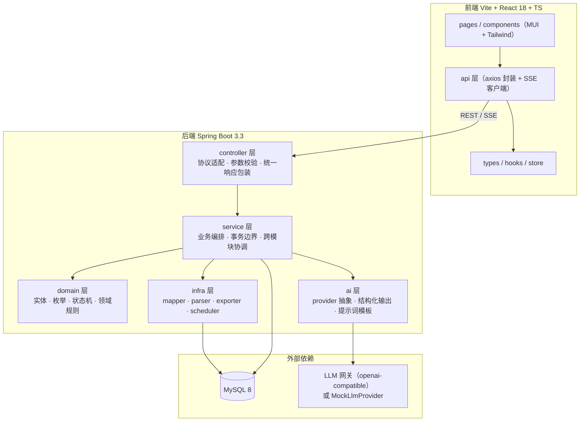
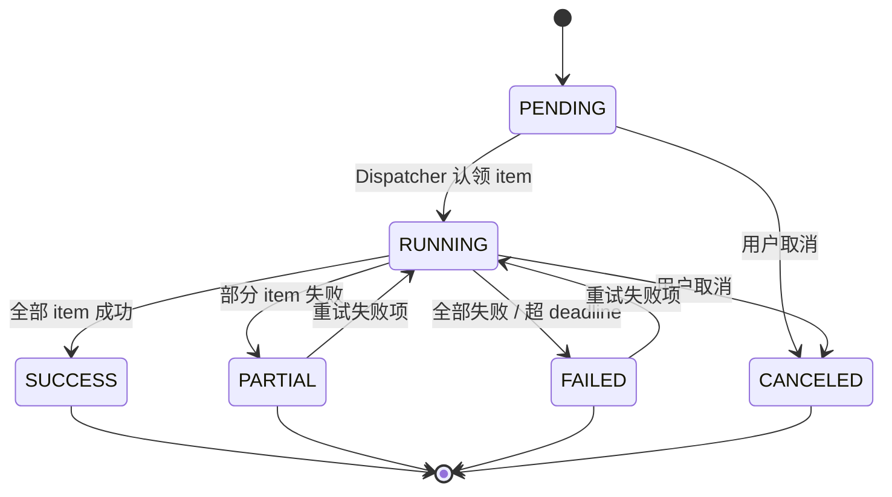
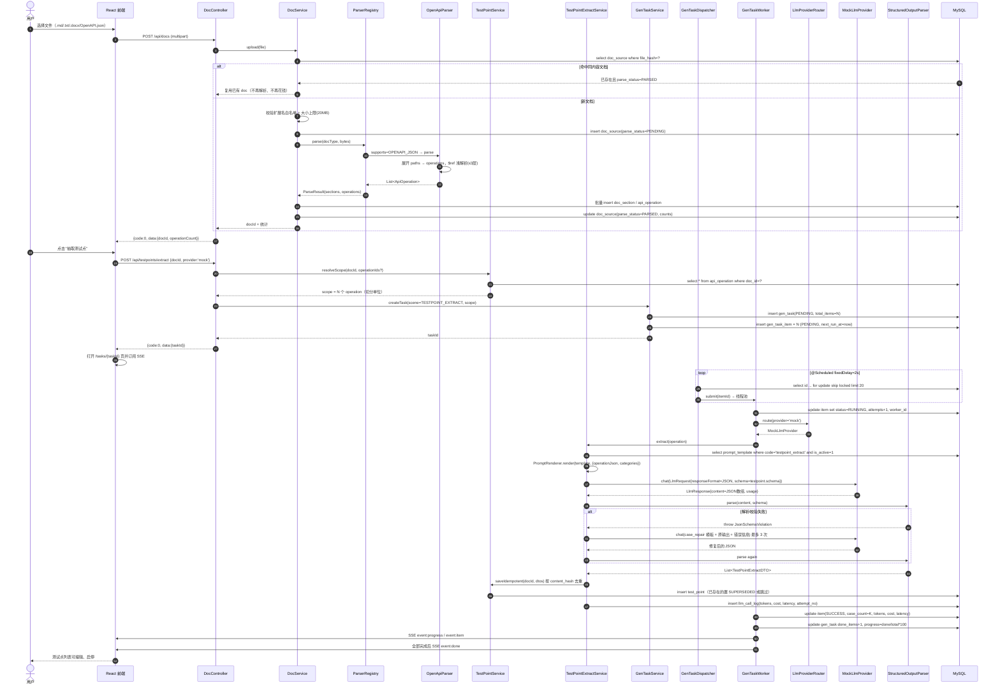
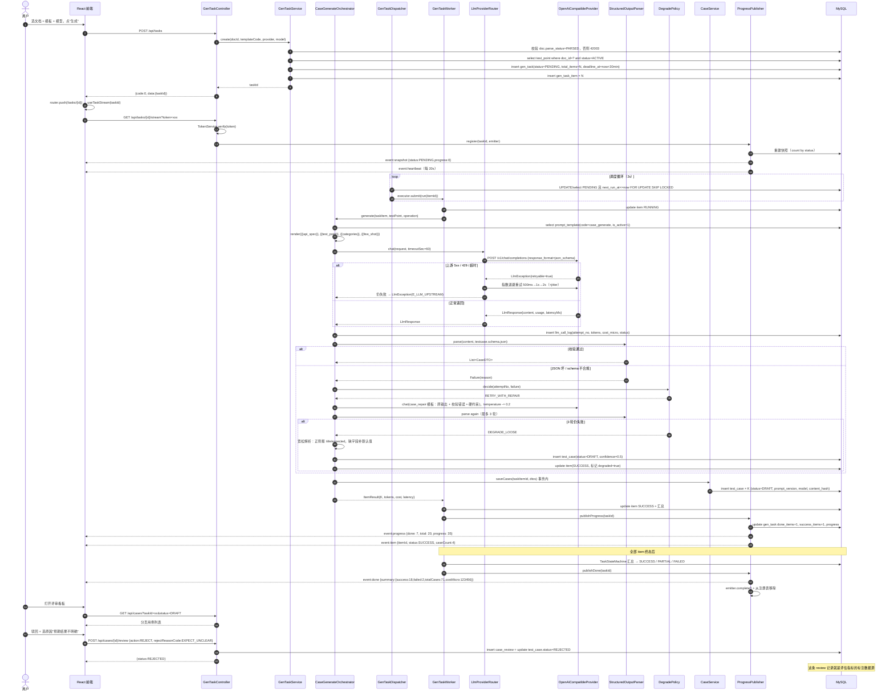
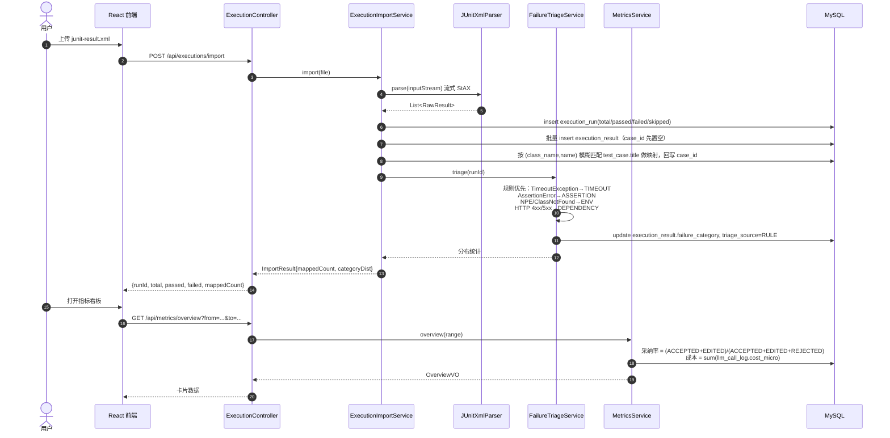
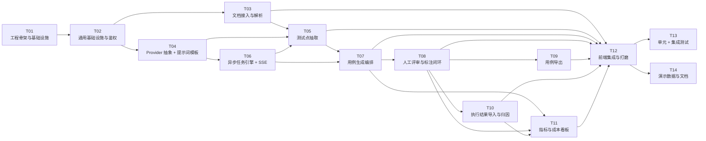

# AI 测试用例生成与评审平台 — 系统架构设计与任务分解

> 版本：v1.0 ｜ 架构：高见远 ｜ 技术栈基线：Java 17 + Spring Boot 3.3 + MyBatis-Plus + MySQL 8 ｜ Vite + React 18 + MUI + Tailwind + TypeScript
>
> 本文档同时承担两个职责：（1）作为可执行的工程蓝图交付给开发工程师；（2）作为简历项目的"设计说明"，每条设计决策都可被面试追问并站得住脚。

---

## 0. 一页速览

| 维度 | 结论 |
|---|---|
| 系统形态 | 前后端分离的单体应用（单机可跑，无 Redis / MQ / K8s） |
| 后端分层 | controller → service → domain / ai / infra 五层，模块按业务垂直切分（package by feature） |
| 核心难点 1：编排层 | `CaseGenerateOrchestrator` = 模板渲染 + JSON Schema 校验 + `JsonRepairer` + 三次修复重试 + 三级降级 |
| 核心难点 2：数据层 | 两级切分：文档 → 「测试点来源」（OpenAPI 按 operation 切、纯文本文档按 section 切），再按测试点逐条调模型 |
| 核心难点 3：异步流式 | `gen_task` + `gen_task_item` 双表任务机 + `@Scheduled` 轮询认领（`FOR UPDATE SKIP LOCKED`）+ 有界线程池 + SSE 推送 |
| 核心难点 4：评估可观测 | 采纳率分母 = **已评审数**（不含 DRAFT）；驳回原因走**字典码**归一化；成本按 `llm_call_log → task_item → task → doc` 四级归集 |
| 表数量 | 17 张（15 张业务表 + 2 张字典表） |
| REST 接口 | 47 个 + 1 个 SSE 端点 |
| 任务分解 | 14 个任务，最长依赖链 11 个节点，无环（见 §6.1） |

---

## 1. 实现方案与框架选型

### 1.1 技术难点拆解

| # | 难点 | 本质问题 | 本项目的解法 | 面试可讲的一句话 |
|---|---|---|---|---|
| 1 | 编排层可靠性 | LLM 输出是**概率性文本**，不是函数返回值 | 提示词模板版本化 + JSON Schema 强校验 + `JsonRepairer` 修补 + 修复式重试 + 三级降级 | "我把 LLM 当成一个**会失败的 RPC**来治理，而不是当成一个函数来调用。" |
| 2 | 上下文组织 | 一份 3000 行 OpenAPI 塞进 prompt 会超窗、会稀释注意力、会让成本失控 | 先做**结构化切分**（文档 → section / operation → test_point），一次调用只处理一个测试点粒度 | "模型的上下文不是越多越好，我先把文档编译成测试点，再让模型做它最擅长的扩写。" |
| 3 | 长耗时异步 | 单次调用 5~30s，HTTP 同步会打爆连接池与用户体验 | 任务表状态机 + 定时轮询认领 + 有界线程池 + 超时重试 + SSE 推流 | "我不引 MQ，用数据库当队列，靠 `SKIP LOCKED` 保证单机多线程安全认领。" |
| 4 | 效果与成本可量化 | 没有标注数据就没有指标，没有指标就不算 AI 工程 | 评审动作即标注；驳回原因字典化；`llm_call_log` 逐次记账 | "我的采纳率分母只算已评审的用例，否则生成量越大指标越假。" |

### 1.2 框架与依赖选型理由

| 能力 | 选型 | 理由 / 替代方案否决原因 |
|---|---|---|
| Web 框架 | Spring Boot 3.3.5 | 基线栈；`RestClient`、`@Scheduled`、`SseEmitter` 原生够用 |
| ORM | MyBatis-Plus 3.5.9 | 单表 CRUD 零 SQL；复杂聚合指标走 XML 手写 SQL，可控可优化。否决 JPA：指标看板的多表聚合用 JPA 很别扭 |
| 建表迁移 | Flyway 10（`flyway-mysql`） | 版本化 DDL 可回放，配合 `V100__demo_data.sql` 一键造演示数据。否决 `schema.sql` 自动执行：无版本、不可增量 |
| 文档解析 | Apache POI `poi-ooxml` 5.4.1（docx）+ 自研 Markdown/TXT/OpenAPI 解析 | 只抽纯文本 + 表格，不做版式还原。否决 mammoth：引入 Node 依赖链 |
| JSON Schema | `networknt:json-schema-validator` 1.5.2 | 支持 Draft 2020-12，能对模型输出做**声明式**校验，schema 文件与代码解耦 |
| Excel 导出 | 阿里 EasyExcel 4.0.3 | 注解式映射、低内存。否决 POI 裸写：样板代码多 |
| JUnit 代码生成 | Square `javapoet` 1.13.0 | 用 AST 生成而不是字符串拼接，天然规避转义/缩进问题 |
| HTTP 客户端（调模型） | OkHttp 4.12.0 | 需要按次设置 read timeout、连接池复用、可选流式。否决 RestClient：超时粒度控制不如 OkHttp 直观 |
| API 文档 | springdoc-openapi 2.6.0 | 自动产出 OpenAPI 3，顺带成为"自带样例输入" |
| 可观测 | Actuator + 自研 `llm_call_log` | 业务级可观测必须自己记账，通用 APM 看不到 token |
| 前端请求 | axios + @tanstack/react-query | query 层天然解决 loading/error/重试/失效，避免手写一堆 `useEffect` |
| 前端状态 | zustand | 只有 auth + 少量 UI 状态，Redux 过重 |
| 图表 | recharts | 与 React 亲和，够画折线/饼图/柱状 |
| 提示通知 | notistack | 与 MUI 同源，`enqueueSnackbar` 一行 |

### 1.3 分层结构



**为什么这样分层（三条硬理由）**

1. **ai 层必须独立成层**，因为它是唯一"不可靠"的依赖。把 provider 抽象、schema 校验、模板渲染全部收在这一层，上层 service 拿到的永远是"已经校验过的 DTO 或明确异常"。这样**换模型供应商只改一个实现类**，业务代码零改动——这就是能在面试里讲"可插拔"的物理证据。
2. **domain 与 infra 分离**，是为了让**状态机与指标口径**这类"最容易写散"的逻辑有唯一归属。`GenTaskStatus`、`CaseStatus`、`ReviewAction` 是枚举 + 转移规则，放在 domain 层，任何 service 都不能绕过它直接 UPDATE 状态。
3. **service 层只做编排，不做解析/不做 SQL**。例如 `GenTaskService` 负责"建任务 + 拆 item + 唤醒调度"，具体怎么调模型在 `ai` 层，怎么落库在 `mapper`。这样单测可以只测 `CaseGenerateOrchestrator`，用 Mock provider 完全离线。

**模块边界（package by feature，7 个业务包）**

| 模块 | 职责边界 | 不允许做的事 |
|---|---|---|
| `doc` | 文件接收、格式识别、解析为 section / api_operation | 不允许调用 LLM |
| `testpoint` | 测试点抽取、去重、启停 | 不允许直接生成用例 |
| `generation` | 任务创建、调度、进度、SSE | 不允许写 business 用例内容逻辑（交给 orchestrator） |
| `aicore` | provider、结构化输出、模板、**调用记账** | 不允许访问**业务**表；仅可访问 `prompt_template`（读模板）与 `llm_call_log`（写台账，见 §11.1 D-10）。这两张是"基础设施表"而非业务实体，因此不破坏单向依赖 |
| `case` | 用例存储、评审、标注 | 不允许发起 LLM 调用 |
| `export` | Excel / JUnit 导出 | 不允许改数据状态 |
| `execution` | 结果导入、归因、统计 | 不允许改用例评审状态 |
| `metrics` | 指标与成本聚合（只读） | 不允许写业务表 |

依赖方向严格单向：`controller → service → (domain | aicore | infra)`。`aicore` 不反向依赖任何业务模块，靠 `LlmRequest/LlmResponse` 这组 POJO 通信——这是整个架构里最重要的一条约束。

---

## 2. 文件列表

### 2.1 仓库根目录

```
ai-testcase-platform/
├── README.md                       # 三步启动指南 + 架构图 + 指标口径说明
├── CHANGELOG.md                    # 任务级变更记录（每个任务验收后追加一段）
├── LICENSE                         # MIT
├── .editorconfig                   # 跨编辑器编码/缩进/换行统一（UTF-8 + LF）
├── .env.example                    # 本机环境变量清单（入库）；新增配置项必须先加到这里
├── .gitignore                      # 忽略 target/ node_modules/ 以及 .env（本地真实值，禁止入库）
├── docs/
│   ├── 01-architecture.md          # 本文档（架构 + 任务分解 + §11 实施偏差记录）
│   ├── diagrams/
│   │   ├── class-diagram.mermaid              # 类图（可直接粘到 mermaid live / IDE 插件）
│   │   ├── sequence-doc-to-testpoint.mermaid  # 流程一：上传→解析→抽点
│   │   └── sequence-generate-sse.mermaid      # 流程二：异步生成 + SSE + 降级
│   ├── 02-api.md                   # 接口契约落地版（T14 产出）
│   ├── 03-runbook.md               # 排障手册：常见失败码与处置（T14 产出）
│   └── 04-interview-notes.md       # 四大难点的口述稿（T14 产出）
├── scripts/
│   ├── init-demo.sh                # 建库 + 跑 Flyway + 灌演示数据
│   └── reset-db.sh                 # 清库重来（演示前必用）
├── backend/
└── frontend/

# ⚠️ 目录树中不存在、但本机会有的文件：
#   .env   —— 本地真实密钥/密码，被 .gitignore 忽略，**永不入库**。
#            由开发者从 .env.example 复制后填值；加载机制见 §8.8。
```

### 2.2 后端目录树

```
backend/
├── pom.xml
└── src/
    ├── main/
    │   ├── java/com/aittest/
    │   │   ├── AiTestApplication.java              # 启动类，@EnableScheduling + @EnableAsync
    │   │   ├── common/
    │   │   │   ├── ApiResponse.java                # 统一响应体 {code,message,data,traceId} ★T01 已交付最小可用版本，T02 在其上扩展，禁止另建同名类
    │   │   │   ├── ErrorCode.java                  # 错误码枚举（唯一真源）
    │   │   │   ├── BizException.java               # 业务异常，携带 ErrorCode + 可读上下文
    │   │   │   ├── GlobalExceptionHandler.java     # @RestControllerAdvice，兜住所有异常映射为 ErrorCode
    │   │   │   ├── PageQuery.java                  # 分页入参基类（page/size/sort，size 上限 100）
    │   │   │   ├── PageResult.java                 # 分页出参 {list,total,page,size}
    │   │   │   ├── IdGen.java                      # 雪花 ID + 业务单号生成（T+yyyyMMdd+6位）
    │   │   │   └── JsonUtils.java                  # 统一 ObjectMapper（UTC、忽略未知字段、Long→String）
    │   │   ├── config/
    │   │   │   ├── MybatisPlusConfig.java          # 分页插件、乐观锁插件、字段自动填充
    │   │   │   ├── JacksonConfig.java              # Long 序列化为 String；LocalDateTime 为 ISO-8601 UTC ★T01 已交付最小可用版本，T02 在其上扩展，禁止另建同名类
    │   │   │   ├── WebMvcConfig.java               # 注册 AuthInterceptor、CORS、静态资源
    │   │   │   ├── AuthInterceptor.java            # 校验 Bearer Token / SSE 的 ?token=
    │   │   │   ├── AsyncConfig.java                # 生成线程池 + 调度线程池（有界队列 + 拒绝策略）
    │   │   │   ├── AiProperties.java               # @ConfigurationProperties("ai")：provider 链、超时、重试
    │   │   │   ├── ExportProperties.java           # 导出包名、类名规则、Excel 模板路径
    │   │   │   └── OpenApiConfig.java              # springdoc 分组与鉴权 scheme
    │   │   ├── auth/
    │   │   │   ├── AuthController.java             # POST /api/auth/login, GET /api/auth/me
    │   │   │   ├── AuthService.java                # 单用户校验（配置化账号 + BCrypt）
    │   │   │   ├── TokenService.java               # HMAC-SHA256 无状态 token 签发/验签
    │   │   │   └── AuthContext.java                # ThreadLocal 持有当前用户
    │   │   ├── doc/
    │   │   │   ├── controller/DocController.java   # 上传/列表/详情/重新解析/删除
    │   │   │   ├── service/DocService.java         # 落盘、格式判定、事务内解析入库
    │   │   │   ├── service/parser/DocumentParser.java      # 接口：supports(type) + parse(bytes)
    │   │   │   ├── service/parser/ParserRegistry.java      # 按 type 路由到具体 parser
    │   │   │   ├── service/parser/MarkdownParser.java      # 按 #/## 切成 section，保留标题层级
    │   │   │   ├── service/parser/TxtParser.java           # 按空行/章节关键字切分
    │   │   │   ├── service/parser/DocxParser.java          # POI 抽段落 + 表格，输出 section
    │   │   │   ├── service/parser/OpenApiParser.java       # 展开 paths → api_operation，$ref 浅解析(≤3层)
    │   │   │   ├── domain/DocSource.java           # 文档主表实体
    │   │   │   ├── domain/DocSection.java          # 文档章节（纯文本文档的切分结果）
    │   │   │   ├── domain/ApiOperation.java        # 接口操作（OpenAPI 的切分结果）
    │   │   │   ├── domain/DocType.java             # 枚举 MD / TXT / DOCX / OPENAPI_JSON
    │   │   │   └── mapper/{DocSourceMapper,DocSectionMapper,ApiOperationMapper}.java
    │   │   ├── testpoint/
    │   │   │   ├── controller/TestPointController.java     # 列表/编辑/启停/批量启停
    │   │   │   ├── service/TestPointService.java           # CRUD + 幂等去重 + superseded 标记
    │   │   │   ├── service/TestPointExtractService.java    # 按接口/章节维度调 LLM 抽点 + 校验 + 落库
    │   │   │   ├── domain/TestPoint.java
    │   │   │   ├── domain/TestPointCategory.java   # FUNCTIONAL/BOUNDARY/EXCEPTION/SECURITY/PERFORMANCE/COMPATIBILITY
    │   │   │   ├── domain/TestPointStatus.java     # ACTIVE / DISABLED / SUPERSEDED
    │   │   │   ├── dto/TestPointExtractDTO.java    # 模型输出的强类型映射（对应 testpoint.schema.json）
    │   │   │   └── mapper/TestPointMapper.java
    │   │   ├── aicore/
    │   │   │   ├── LlmProvider.java                # 接口：name() + supports(model) + chat(LlmRequest)
    │   │   │   ├── LlmRequest.java                 # systemPrompt/messages/temperature/maxTokens/schema/timeoutMs/traceId
    │   │   │   ├── LlmResponse.java                # content/usage/finishReason/latencyMs/rawBody
    │   │   │   ├── LlmMessage.java                 # role + content
    │   │   │   ├── LlmUsage.java                   # promptTokens/completionTokens/totalTokens
    │   │   │   ├── LlmException.java               # 携带 ErrorCode + retryable 标记
    │   │   │   ├── provider/MockLlmProvider.java   # 无 Key 可跑：确定性返回合法 JSON，按输入 hash 选模板
    │   │   │   ├── provider/OpenAiCompatibleProvider.java  # /v1/chat/completions，支持 response_format
    │   │   │   ├── provider/LlmProviderRouter.java # 按 provider 名 + fallback 链选择实现
    │   │   │   ├── provider/LoggingLlmProvider.java # 装饰器：包住真实 provider，成功与异常都写 llm_call_log（见 §11.1 D-10）
    │   │   │   ├── log/LlmCallLog.java             # 调用台账实体（成本与质量真源，由 aicore 记账、metrics 只读聚合）
    │   │   │   ├── log/LlmCallLogMapper.java
    │   │   │   ├── structured/StructuredOutputParser.java # 去 fence → 截取平衡括号 → 修复 → 校验 → 反序列化
    │   │   │   ├── structured/JsonRepairer.java    # 尾逗号、单引号、缺引号 key、截断补全
    │   │   │   ├── structured/JsonSchemaValidator.java     # networknt，加载 classpath:schema/*.json
    │   │   │   └── prompt/{PromptTemplateService,PromptRenderer,PromptTemplateLoader,PromptTemplate}.java
    │   │   │                                          # Service 查库取活跃版本；Renderer 做 {{var}} 替换；Loader 启动时 seed
    │   │   ├── generation/
    │   │   │   ├── controller/GenTaskController.java       # create/status/items/retry/cancel/stream
    │   │   │   ├── service/GenTaskService.java             # 建任务 + 拆 item（每个测试点一条）
    │   │   │   ├── service/GenTaskDispatcher.java          # @Scheduled(2s) 认领到期 item 并提交线程池
    │   │   │   ├── service/GenTaskWorker.java              # 单个 item 的执行壳：超时、异常转换、状态回写
    │   │   │   ├── service/ProgressPublisher.java          # 聚合进度 → 推 SSE + 落库节流
    │   │   │   ├── service/SseEmitterRegistry.java         # taskId → emitters，心跳、断线清理、快照回放
    │   │   │   ├── service/TaskStateMachine.java           # 状态转移合法性判定 + 终态汇总
    │   │   │   ├── orchestrator/CaseGenerateOrchestrator.java # 核心：渲染→调用→校验→修复→降级→落库
    │   │   │   ├── orchestrator/RetryPolicy.java           # 指数退避 + 温度递减
    │   │   │   ├── orchestrator/DegradePolicy.java         # 三档降级决策
    │   │   │   ├── domain/{GenTask,GenTaskItem,GenTaskStatus,GenTaskItemStatus}.java
    │   │   │   ├── dto/{GenTaskCreateReq,GenTaskVO,GenTaskItemVO}.java
    │   │   │   └── mapper/{GenTaskMapper,GenTaskItemMapper}.java
    │   │   ├── case/
    │   │   │   ├── controller/CaseController.java          # 列表/详情/编辑/评审/批量评审
    │   │   │   ├── service/CaseService.java                # 查询与编辑，维护 status
    │   │   │   ├── service/CaseReviewService.java          # 采纳/驳回/编辑三分支 + old/new 快照
    │   │   │   ├── domain/{TestCase,CaseStatus,CaseReview,ReviewAction,RejectReason}.java
    │   │   │   ├── dto/{TestCaseVO,CaseUpdateReq,ReviewReq}.java
    │   │   │   └── mapper/{TestCaseMapper,CaseReviewMapper,RejectReasonMapper}.java
    │   │   ├── export/
    │   │   │   ├── controller/ExportController.java        # /api/export/cases.xlsx, /api/export/junit.java
    │   │   │   ├── service/CaseSnapshotBuilder.java        # 组装导出模型（含任务/文档元信息）
    │   │   │   ├── service/ExcelExportService.java         # EasyExcel 双 sheet
    │   │   │   ├── service/JUnitExportService.java         # JavaPoet 生成 @Test 骨架，打包 zip
    │   │   │   ├── support/JUnitNaming.java                # 类名/方法名/包名规则与非法字符转义
    │   │   │   └── support/ExcelColumnDef.java             # 表头常量与样式
    │   │   ├── execution/
    │   │   │   ├── controller/ExecutionController.java     # import/list/detail/failures/remap
    │   │   │   ├── service/ExecutionImportService.java     # 文件识别 → 解析 → 批量入库 → 统计
    │   │   │   ├── service/FailureTriageService.java       # 规则 + 可选 LLM 归因
    │   │   │   ├── service/FailureStatsService.java        # 分类分布、模块分布、Top 失败
    │   │   │   ├── parser/ResultParser.java                # 接口
    │   │   │   ├── parser/JUnitXmlParser.java              # StAX 流式解析 testsuite/testcase/failure
    │   │   │   ├── parser/CsvResultParser.java             # 列名容错（class/name/status/时间）
    │   │   │   ├── domain/{ExecutionRun,ExecutionResult,FailureCategory,ResultStatus}.java
    │   │   │   └── mapper/{ExecutionRunMapper,ExecutionResultMapper,FailureCategoryMapper}.java
    │   │   ├── metrics/
    │   │   │   ├── controller/MetricsController.java       # overview/acceptance/cost/quality
    │   │   │   ├── service/MetricsService.java             # 采纳率、编辑率、失败率、耗时 p50/p95
    │   │   │   ├── service/CostService.java                # token 与成本按 task/day/model 归集
    │   │   │   ├── service/ModelPriceService.java          # 单价表读取 + 本地缓存（TTL 5min）
    │   │   │   ├── domain/{ModelPrice,MetricSnapshot}.java
    │   │   │   ├── dto/{OverviewVO,AcceptancePointVO,CostPointVO,QualityVO}.java
    │   │   │   └── mapper/{ModelPriceMapper,MetricSnapshotMapper}.java
    │   │   │                                               # 注：LlmCallLog 实体与 mapper 已移至 aicore/log（见 §11.1 D-10）
    │   │   ├── system/
    │   │   │   ├── HealthController.java           # GET /api/health（不鉴权）★T01 新增（不在 T02 范围内）。
    │   │   │   │                                   # 后续扩展只加 dbOk/provider 探测，禁止重写路由
    │   │   │   ├── ConfigController.java           # GET /api/config/public（前端需要的枚举字典）
    │   │   │   └── DictController.java             # GET /api/dict/reject-reasons, /api/dict/failure-categories
    │   │   └── logging/TraceFilter.java            # 生成 traceId 注入 MDC，响应头 X-Trace-Id
    │   │                                           # ★T01 已交付最小可用版本，T02 在其上扩展，禁止另建同名类
    │   └── resources/
    │       ├── application.yml                     # 公共配置（不含密钥）
    │       ├── application-dev.yml                 # 本地 MySQL + mock provider
    │       ├── application-prod.yml                # T14 交付：生产 profile，密钥全部走环境变量，禁止任何默认值兜底（见 §11.1 D-09）
    │       ├── prompts/
    │       │   ├── testpoint_extract.v1.md         # 测试点抽取模板（含 few-shot）
    │       │   ├── case_generate.v1.md             # 用例生成模板（含 JSON 输出约束 + few-shot）
    │       │   ├── case_repair.v1.md              # 修复式重试模板（贴错误 + 原输出，要求只回正确 JSON）
    │       │   └── failure_triage.v1.md            # 失败归因模板（可选能力，规则兜底）
    │       ├── schema/
    │       │   ├── testpoint.schema.json           # 测试点数组的 JSON Schema
    │       │   └── testcase.schema.json            # 用例数组的 JSON Schema
    │       ├── mapper/{GenTaskMapper.xml,GenTaskItemMapper.xml,TestCaseMapper.xml,LlmCallLogMapper.xml,MetricsMapper.xml}
    │       │                                       # 复杂聚合 SQL（含 FOR UPDATE SKIP LOCKED 认领语句）
    │       └── db/
    │           ├── migration/
    │           │   ├── V1__schema.sql              # 15 张业务表 DDL + 索引
    │           │   └── V2__dict_and_config.sql     # 驳回原因、失败分类、模型单价、默认模板、默认账号
    │           └── demo/
    │               └── V100__demo_data.sql         # 1 份 OpenAPI + 1 个已完成任务 + 30 条用例 + 1 次执行结果
    └── test/
        ├── java/com/aittest/
        │   ├── doc/DocxParserTest.java
        │   ├── doc/OpenApiParserTest.java
        │   ├── aicore/StructuredOutputParserTest.java      # 坏 JSON 全家桶（fence/尾逗号/截断/单引号）
        │   ├── aicore/MockProviderTest.java
        │   ├── generation/CaseGenerateOrchestratorTest.java # 三档降级分支
        │   ├── metrics/MetricsServiceTest.java             # 采纳率口径（含 EDITED 场景）
        │   ├── export/JUnitExportServiceTest.java          # 生成代码可编译
        │   └── api/ApiSmokeIT.java                         # mock 全链路：上传→抽点→生成→评审→导出→导入
        └── resources/
            ├── application-test.yml         # H2(MySQL 模式) + mock provider
            └── fixtures/{sample-openapi.json, sample.docx, junit-result.xml, result.csv}
```

### 2.3 前端目录树

```
frontend/
├── package.json
├── vite.config.ts                    # alias @、dev proxy → localhost:8080、SSE 不缓冲
├── tsconfig.json
├── tsconfig.node.json
├── tailwind.config.js                # corePlugins.preflight = false（与 MUI 共存的关键）
├── postcss.config.js
├── vitest.config.ts
├── index.html
├── .env.example                      # VITE_API_BASE
└── src/
    ├── main.tsx                      # QueryClientProvider + SnackbarProvider + ThemeProvider + Router
    ├── App.tsx                       # AppShell 挂载 + 路由出口
    ├── theme.ts                      # MUI 主题（中文字体栈、紧凑密度、Chip 色板）
    ├── index.css                     # Tailwind 三件套 + 少量全局变量
    ├── vite-env.d.ts
    ├── api/
    │   ├── http.ts                   # axios 实例：baseURL、token 注入、{code,data} 解包、401 跳登录、错误归一化
    │   ├── sse.ts                    # EventSource 封装：token query、事件分发、断线退避重连、快照回放
    │   ├── auth.ts
    │   ├── doc.ts
    │   ├── testpoint.ts
    │   ├── task.ts
    │   ├── cases.ts
    │   ├── exportApi.ts
    │   ├── execution.ts
    │   ├── metrics.ts
    │   └── prompt.ts
    ├── types/
    │   ├── common.ts                 # ApiResponse、PageResult、枚举字典类型
    │   ├── doc.ts
    │   ├── task.ts
    │   ├── cases.ts
    │   ├── execution.ts
    │   └── metrics.ts
    ├── store/
    │   └── authStore.ts              # zustand：token 持久化 localStorage、登录态、登出
    ├── hooks/
    │   ├── useTaskStream.ts          # SSE 订阅 + 进度状态 + 完成回调
    │   ├── usePagedQuery.ts          # 统一分页/筛选 → react-query
    │   └── useDict.ts                # 字典拉取与缓存
    ├── components/
    │   ├── layout/
    │   │   ├── AppShell.tsx          # SideNav + TopBar + 内容区
    │   │   ├── SideNav.tsx           # 6 个模块导航
    │   │   └── TopBar.tsx            # 面包屑 + 环境标识 + 登出
    │   ├── common/
    │   │   ├── DataTable.tsx         # 泛型表格：列定义 + 分页 + 空态 + 骨架屏
    │   │   ├── StatusChip.tsx        # 任务/用例/结果状态统一色板与文案
    │   │   ├── EmptyState.tsx
    │   │   ├── ErrorBoundary.tsx
    │   │   ├── ConfirmDialog.tsx
    │   │   ├── JsonViewer.tsx        # 用例步骤/模型原始输出查看
    │   │   └── PageHeader.tsx
    │   └── charts/ChartCard.tsx      # 统一图表容器（标题/单位/加载/空态）
    ├── pages/
    │   ├── Login.tsx
    │   ├── docs/{DocList.tsx, DocUploadDialog.tsx, DocDetail.tsx}
    │   ├── testpoints/TestPointReviewPage.tsx      # 表格内启停 + 分类筛选 + 手动补点
    │   ├── tasks/{TaskList.tsx, TaskCreateDialog.tsx, TaskDetail.tsx, ProgressTimeline.tsx}
    │   ├── cases/{CaseBoard.tsx, CaseReviewDrawer.tsx, RejectReasonPicker.tsx, CaseExportDialog.tsx}
    │   ├── execution/{ExecutionList.tsx, ExecutionDetail.tsx, FailurePie.tsx}
    │   ├── metrics/{OverviewDashboard.tsx, AcceptanceChart.tsx, CostChart.tsx}
    │   └── prompts/PromptTemplateList.tsx          # 模板查看/编辑/切版本
    └── routes/index.tsx                            # 路由守卫与懒加载注册的**唯一入口**，page 组件不得自建路由
                                                    # 路由是应用级基础设施，不属于 pages（pages 下全部是页面组件）
```

---

## 3. 数据结构设计

### 3.1 ER 图


### 3.2 关键表字段与索引说明

| 表 | 关键字段 | 索引 | 设计要点 |
|---|---|---|---|
| `doc_source` | `file_hash`（SHA-256 前 32 位）、`storage_path`、`parse_status`、`deleted` | `uk(doc_no)`、`idx(created_at)`、`idx(file_hash)`、`idx(parse_status)` | `file_hash` 用于**重复上传秒回**（同内容直接复用解析结果，省一次 LLM 钱）；`storage_path` 记录落盘相对路径（原始文件可回溯，重解析不必让用户重传）；`parse_status` = PENDING/PARSED/FAILED；`deleted` 为软删标记，由 MyBatis-Plus 逻辑删除接管（`logic-delete-field: deleted`），**手写 SQL 必须自己带 `deleted = 0`**，`DELETE` 端点只改标记不删行。<br/>**软删恢复（重要）**：`upload` 按 `file_hash` 查重时**必须绕过逻辑删过滤** —— 逻辑删除只注入到 `BaseMapper` 的内置方法，因此这里要用**手写 XML / `@Select` 自定义 SQL**（`WHERE file_hash = #{hash}`，**不带** `deleted` 条件），不能用 `LambdaQueryWrapper`。命中 `deleted=1` 的记录则**复用该记录并恢复**：置 `deleted=0`、重解析覆盖 `doc_section`/`api_operation`、不新建记录。理由见 §3.2.2 |
| `api_operation` | `method`+`path` 唯一确定一个接口 | `idx(doc_id, seq_no)`、`uk(doc_id, method, path)` | 这是"按接口维度切分调用"的物理载体；`request_schema` 存已裁剪的 JSON 片段（避免 $ref 循环） |
| `test_point` | `content_hash` = sha256(doc_id+title+category) | `idx(doc_id, status)`、`uk(doc_id, content_hash)` | **幂等去重**：重复抽取不产生重复点，老数据置 SUPERSEDED；`prompt_version` 记录是哪版模板抽出来的，便于回溯模板质量 |
| `prompt_template` | `code`+`version`、`is_active`、`model_hint` | `uk(code, version)`、`idx(code, is_active)`、`idx(scene)` | 同 code 只有一条 `is_active=1`（service 层保证，DB 不加唯一约束以便历史版本共存）；`model_hint` 来自模板 front-matter，仅作"推荐模型"提示，**不参与路由决策**（路由由任务参数或配置决定），避免模板改动意外改变成本模型 |
| `gen_task` | `scene`、`status`、`progress`、`deadline_at` | `idx(status, created_at)`、`idx(scene, status)`、`uk(task_no)` | `scene` = `TESTPOINT_EXTRACT` / `CASE_GENERATE`，让两类异步任务**复用同一套状态机、调度器与 SSE**；`progress` 是**冗余字段**（0-100），为了列表页不聚合子表；`deadline_at` 是任务级超时，防止僵尸任务 |
| `gen_task_item` | `status`、`next_run_at`、`worker_id`、`attempts`、`degraded` | `idx(status, next_run_at)` ← **认领索引，最重要**、`idx(task_id, status)`、`uk(task_id, test_point_id)` | 认领 SQL：`SELECT id FROM gen_task_item WHERE status='PENDING' AND next_run_at<=NOW() ORDER BY id LIMIT ? FOR UPDATE SKIP LOCKED`，靠 MySQL 8 行锁跳过，天然支持多线程/多实例；`degraded=1` 表示"宽松解析降级产出"，是**区分正常产出与兜底产出的开关**，指标可按它拆开看 |
| `test_case` | `status`、`seq_no`、`content_hash` | `idx(task_id, status)`、`idx(test_point_id)`、`uk(task_item_id, seq_no)` | `status` = DRAFT/ACCEPTED/EDITED/REJECTED。**统计分母只认后三者** |
| `case_review` | `action`、`reject_reason_code`、`old_content`/`new_content` | `idx(case_id, created_at)`、`idx(reject_reason_code)` | **只追加不更新**，是标注数据的唯一真源；用例当前状态是"最后一条 review 的投影" |
| `llm_call_log` | `cost_micro`、`prompt_tokens`、`attempt_no`、`trace_id`、`degraded` | `idx(task_id)`、`idx(created_at)`、`idx(model, created_at)`、`idx(trace_id)` | **每次 HTTP 调用一行**（含失败），失败也要记账（tokens 可能已消耗）；`cost_micro` 用整数存"百万分之一元"避免浮点误差；`degraded` 让成本台账能区分"正常调用"与"降级/兜底调用"的成本，否则降级率上去了也看不出来；`idx(trace_id)` 支持按 `X-Trace-Id` 反查一次请求的全部模型调用 |
| `model_price` | `input_price_micro`/`output_price_micro`（每 1M token 的微元） | `uk(model, effective_from)` | 单价可变 → 用生效日期做版本，历史成本不因调价而失真 |
| `execution_result` | `failure_category`、`case_id`、`triage_source` | `idx(run_id, status)`、`idx(run_id, failure_category)`、`idx(case_id)` | `case_id` 允许 NULL（映射不上就空着，逼着暴露映射率）；`triage_source` = RULE / LLM / MANUAL，归因可追溯来源 |
| `reject_reason` / `failure_category` | `code`（英文枚举，主键） | PK | **归一化的关键**：统计只按 `code` 聚合，自由文本永不进 GROUP BY |

#### 3.2.1 全局时间戳与软删约定（逐类表说明）

| 表类别 | `created_at` | `updated_at` | 说明 |
|---|---|---|---|
| 可变业务表（9 张）<br/>`app_user` `doc_source` `test_point` `prompt_template` `gen_task` `gen_task_item` `test_case` `model_price` `execution_run` | ✅ `DATETIME(3) NOT NULL DEFAULT CURRENT_TIMESTAMP(3)` | ✅ `DATETIME(3) NOT NULL DEFAULT CURRENT_TIMESTAMP(3) ON UPDATE CURRENT_TIMESTAMP(3)` | 由 `MetaObjectHandler` 自动填充，**业务代码禁止手写** |
| 只追加表（6 张）<br/>`doc_section` `api_operation` `case_review` `llm_call_log` `execution_result` `metric_snapshot` | ✅ 同上 | ❌ **刻意不设** | 写入后语义上不可变；不设 `updated_at` 等于在表结构上承诺"这些行不会被改"，也让误改无处藏身 |
| 静态字典表（2 张）<br/>`reject_reason` `failure_category` | ❌ 无 | ❌ 无 | 字典随 Flyway 脚本发版，不随时间演化，加时间戳只是噪音 |
| 所有 `DATETIME(3)` 一律存 **UTC**；`DEFAULT CURRENT_TIMESTAMP(3)` 取的是**连接会话时区**的时间，故 JDBC URL 必须带 `serverTimezone=UTC`，且 Jackson 配 `spring.jackson.time-zone: UTC`。两者缺一，就会出现"写入 UTC、读出被加 8 小时"的经典错位 | | | |

#### 3.2.2 软删后同文件重新上传：复用恢复，不新建

`doc_source` 是**唯一带软删**的表。当用户删掉文档后再次上传同一文件，`file_hash` 会命中那条 `deleted=1` 的记录。此处**唯一正确语义是「恢复原记录」**，不是「新建一份」。

**决策：复用并恢复**

| 步骤 | 动作 |
|---|---|
| 1 | `upload` 先算 `file_hash`，用**自定义 SQL** 查（见下方"查重 SQL 的三个必备条件"，不带 `deleted` 条件，绕过逻辑删注入） |
| 2 | 命中 `deleted=0` → 走"秒回"，直接复用，不解析、不花钱 |
| 3 | 命中 `deleted=1` → **复用该行**：`UPDATE ... SET deleted=0, parse_status='PENDING', parse_error='', updated_at=NOW(3)`，`doc_no` 保持不变 |
| 4 | 重新解析，**物理覆盖** `doc_section` / `api_operation`（先 `DELETE ... WHERE doc_id=?` 再批量插入），不残留旧章节 |
| 5 | **不新建** `doc_source` 行 |

**查重 SQL 的三个必备条件（少一个就出事故）**

```sql
SELECT * FROM doc_source
WHERE file_hash = #{fileHash}
  AND file_hash <> ''                                  -- ① 必须排除空串
ORDER BY deleted ASC, updated_at DESC                  -- ② 优先未删；同状态取最新
LIMIT 1
```

| # | 条件 | 漏了会怎样 |
|---|---|---|
| ① | **`file_hash <> ''`** | `file_hash` 是 `VARCHAR(64) NOT NULL DEFAULT ''`。凡 hash 为空串的行（算 hash 失败的历史数据、手工灌的演示数据）会**互相命中** → 恢复逻辑把 A 文档的内容覆盖到 B 文档上，且不报错。这是本路径**最危险**的一个坑 |
| ② | **`ORDER BY deleted ASC, updated_at DESC`** | `file_hash` 索引是 **`KEY idx_doc_source_file_hash`（非唯一）**，同一 hash 可能有多条 `deleted=1`（删过多次）。不排序就变成"随机捞一条恢复"，恢复出来的可能是最老的那份、`doc_no` 也对不上最近的导出记录 |
| ③ | **`LIMIT 1`** | 同 hash 多行时会取到多行，`selectOne` 直接抛 `TooManyResultsException` |

**刻意不加 `uk(file_hash)`，不要"顺手优化"**：① 物理上允许同一文件存在多条历史行，是"删→传→删→传"的自然结果，加唯一约束会让恢复路径报 `DuplicateKey`；② 并发上传同一文件时，唯一约束会把两个请求变成"一个成功一个 500"，而没有唯一约束时两个请求都能成功、只是多一条历史行——后者由 `ORDER BY ... LIMIT 1` 与步骤 3 的复用逻辑收敛，是可接受的；③ `DEFAULT ''` 与唯一索引天然冲突（多条空串直接撞键）。**代价**：并发上传可能短暂产生两条 `deleted=0` 的行，T03 不必为它加分布式锁，只要保证后续查询按上述 `ORDER BY` 取到稳定的那一条即可。

**边界约定**：若命中的记录 `deleted=1` **且** `parse_status='FAILED'`（当初就没解析成功），同样走恢复 + 重解析，不要分支处理——多一条分支就多一个没人测的路径。

**为什么不能新建（三条硬理由）**

1. **测试点会重复抽取**：`test_point` 的 `uk(doc_id, content_hash)` 只在**同 doc 内**去重。新 doc → 新 `doc_id` → 同一文件抽出两套测试点，后续按文档维度看就是"内容一样的两份文档"，指标无法解释。
2. **成本与采纳率会重复计数**：`llm_call_log` / `test_case` 都挂在 `doc_id` 上，同一文件两次解析 = 双倍 token、双倍用例数，`接受率` 的分母被无意义放大，`单用例成本` 被压低——**指标失真比功能缺失更危险**。
3. **`doc_no` 无法回收**：`uk(doc_no)` 用"日期 + 当日自增"生成，新建必然是新号；已导出的 Excel/JUnit 里若记录了旧 `doc_no`，恢复原记录才能保住这条追溯链。

**边界约定**：若命中的记录 `deleted=1` **且** `parse_status='FAILED'`（当初就没解析成功），同样走恢复 + 重解析，不要分支处理——多一条分支就多一个没人测的路径。

### 3.3 三个核心状态机



**item 级状态**：`PENDING → RUNNING → SUCCESS | FAILED | SKIPPED`，`attempts` 上限 3，失败后 `next_run_at = now + backoff`。`SKIPPED` 用于"测试点被人工禁用"或"上游文档已 superseded"。

**用例状态**：`DRAFT → (ACCEPTED | EDITED | REJECTED)`，`EDITED` 表示"改了之后采纳"，在指标里**同时算进分子，但单列编辑率**（见 §8.3）。

---

## 4. 接口契约

### 4.1 约定

- 统一前缀 `/api`，统一响应体 `{code, message, data, traceId}`，`code=0` 表示成功。
- 所有 `Long` 型 ID 在 JSON 中序列化为**字符串**（避免 JS `Number` 精度丢失，雪花 ID 会超 2^53）。
- 时间统一 ISO-8601 UTC（`2026-11-07T02:30:00.123Z`），前端用 dayjs 转本地时区展示。
- 分页入参：`page`（从 1 开始）、`size`（默认 20，上限 100）、`sort`（如 `createdAt,desc`）。

### 4.2 接口清单

| # | 模块 | 方法 | 路径 | 入参要点 | 出参要点 |
|---|---|---|---|---|---|
| 1 | 鉴权 | POST | `/api/auth/login` | `{username, password}` | `{token, expiresAt, displayName}` |
| 2 | 鉴权 | GET | `/api/auth/me` | — | 当前用户信息 |
| 3 | 系统 | GET | `/api/health` | — | `{status, dbOk, provider}`（**不鉴权**） |
| 4 | 系统 | GET | `/api/config/public` | — | 枚举字典（docType/caseType/priority/status） |
| 5 | 系统 | GET | `/api/dict/reject-reasons` | `enabledOnly` | 驳回原因字典 |
| 6 | 系统 | GET | `/api/dict/failure-categories` | `enabledOnly` | 失败分类字典 |
| 7 | 文档 | POST | `/api/docs` | `multipart file` + `docType?` | `{docId, docNo, parseStatus, sectionCount, operationCount}` |
| 8 | 文档 | GET | `/api/docs` | `page,size,keyword,docType,parseStatus` | 分页列表 |
| 9 | 文档 | GET | `/api/docs/{id}` | — | 文档详情 + 解析摘要 |
| 10 | 文档 | GET | `/api/docs/{id}/sections` | `page,size` | 章节列表（含内容预览） |
| 11 | 文档 | GET | `/api/docs/{id}/operations` | `page,size` | 接口列表（method/path/summary） |
| 12 | 文档 | POST | `/api/docs/{id}/reparse` | — | 重新解析，返回统计；同 `file_hash` 命中缓存则跳过 |
| 13 | 文档 | DELETE | `/api/docs/{id}` | — | 软删（级联需显式 `force=true`） |
| 14 | 测试点 | POST | `/api/testpoints/extract` | `{docId, provider?, model?, operationIds?, sectionIds?}` | `{taskId}`（**走异步任务**，与用例生成共用引擎） |
| 15 | 测试点 | GET | `/api/testpoints` | `docId,status,category,page,size` | 分页列表 |
| 16 | 测试点 | PATCH | `/api/testpoints/{id}` | `{title?, category?, riskLevel?, status?}` | 更新后的测试点 |
| 17 | 测试点 | POST | `/api/testpoints/batch-status` | `{ids[], status}` | `{updated}` |
| 18 | 测试点 | POST | `/api/testpoints` | 手动补点 `{docId, title, category, description}` | 新建测试点 |
| 19 | 模板 | GET | `/api/prompt-templates` | `scene,activeOnly` | 模板列表（含版本） |
| 20 | 模板 | GET | `/api/prompt-templates/{id}` | — | 模板全文 |
| 21 | 模板 | POST | `/api/prompt-templates` | `{code,name,scene,content,outputSchema}` | 新版本；同 code 自动 `version+1` |
| 22 | 模板 | PUT | `/api/prompt-templates/{id}/activate` | — | 同 code 其他版本自动置 inactive |
| 23 | 任务 | POST | `/api/tasks` | `{docId, templateCode, provider, model, testPointIds?, timeoutSec?}` | `{taskId, taskNo, totalItems}` |
| 24 | 任务 | GET | `/api/tasks` | `docId,status,page,size` | 分页列表（含进度、成功率、成本） |
| 25 | 任务 | GET | `/api/tasks/{id}` | — | 任务详情 + 汇总（items 计数、tokens、cost） |
| 26 | 任务 | GET | `/api/tasks/{id}/items` | `status,page,size` | item 列表（含 attempts、errorCode、caseCount） |
| 27 | 任务 | **GET** | `/api/tasks/{id}/stream` | `?token=`（EventSource 不能带 header） | **SSE 流**，见 §4.3 |
| 28 | 任务 | POST | `/api/tasks/{id}/retry` | `{itemIds?, onlyFailed=true}` | `{requeued}`；仅 PARTIAL/FAILED 可用 |
| 29 | 任务 | POST | `/api/tasks/{id}/cancel` | — | `{status:CANCELED}`；RUNNING 中的 item 不中断当前调用，只不再认领新 item |
| 30 | 用例 | GET | `/api/cases` | `taskId,docId,status,priority,caseType,keyword,page,size` | 分页列表 |
| 31 | 用例 | GET | `/api/cases/{id}` | — | 详情 + 评审历史 + 所属测试点上下文 |
| 32 | 用例 | PATCH | `/api/cases/{id}` | `{title?,precondition?,steps[]?,expected?,priority?,caseType?}` | 更新后内容（不改 status，需再提交评审） |
| 33 | 用例 | POST | `/api/cases/{id}/review` | `{action, rejectReasonCode?, reasonText?, content?}` | 评审后的用例状态；`action=EDIT` 时 `content` 必填 |
| 34 | 用例 | POST | `/api/cases/batch-review` | `{caseIds[], action, rejectReasonCode?}` | `{updated, skipped}` |
| 35 | 导出 | GET | `/api/export/cases.xlsx` | `taskId,docId?,statuses?` | `application/vnd.openxmlformats...` 二进制流 |
| 36 | 导出 | GET | `/api/export/junit.zip` | `taskId,packageName?` | zip（内含 `*.java` + `README.txt`） |
| 37 | 执行 | POST | `/api/executions/import` | `multipart file` + `name?` | `{runId, total, passed, failed, skipped, mappedCount}` |
| 38 | 执行 | GET | `/api/executions` | `page,size,sourceType` | 分页列表 |
| 39 | 执行 | GET | `/api/executions/{id}` | — | 运行详情 + 分类分布 |
| 40 | 执行 | GET | `/api/executions/{id}/results` | `status,category,page,size` | 结果明细（含堆栈前 500 字） |
| 41 | 执行 | PATCH | `/api/executions/results/{id}` | `{failureCategory?}` | 人工纠正归因，`triage_source=MANUAL` |
| 42 | 执行 | POST | `/api/executions/{id}/remap` | — | 重跑用例映射，返回 `mappedCount` |
| 43 | 指标 | GET | `/api/metrics/overview` | `from,to,docId?,taskId?` | 卡片数据：生成数/采纳率/编辑率/失败率/总成本/平均耗时 |
| 44 | 指标 | GET | `/api/metrics/acceptance` | `from,to,groupBy=day/template/model/category` | 采纳率趋势与分组 |
| 45 | 指标 | GET | `/api/metrics/reject-reasons` | `from,to,docId?` | 驳回原因分布（按 code 聚合） |
| 46 | 指标 | GET | `/api/metrics/cost` | `from,to,groupBy=task/day/model` | token 与成本聚合 + 单用例成本 |
| 47 | 指标 | GET | `/api/metrics/quality` | `from,to,groupBy=day` | 首次通过率、解析失败率、p50/p95 耗时 |
| 48 | 指标 | GET | `/api/metrics/execution` | `from,to` | 通过率趋势 + 失败分类 Top |

> 上表共 **48 个端点** = 47 个 REST + 1 个 SSE。其中导出类（#35、#36）返回二进制流，`Content-Disposition` 带文件名。

### 4.3 SSE 端点详述

```
GET /api/tasks/{taskId}/stream?token=<jwt>
Accept: text/event-stream
```

| 项 | 约定 |
|---|---|
| 鉴权 | `EventSource` 无法自定义 header，故支持 `?token=`；`AuthInterceptor` 对该路径白名单放行 `Authorization` 校验，改由 controller 内 `TokenService.verify(token)` |
| 超时 | `SseEmitter` timeout = 30 min；每 20s 发一次 `event: heartbeat`（防网关/浏览器空闲断连） |
| 事件 1 | `event: snapshot` → 首帧全量：`{taskId,status,progress,done,total,success,failed,startedAt}`，客户端据此渲染，**不依赖增量拼装** |
| 事件 2 | `event: progress` → `{taskId,done,total,progress,success,failed}`，`done` 变化时推送（服务端节流：≥200ms 一次） |
| 事件 3 | `event: item` → `{itemId,testPointId,status,caseCount,attempts,errorCode,latencyMs}` 单个 item 终态 |
| 事件 4 | `event: done` → `{taskId,status,summary:{success,failed,totalCases,totalCostMicro,avgLatencyMs}}`，随后服务端 `complete()` |
| 事件 5 | `event: error` → `{taskId,errorCode,errorMsg}`，随后 `complete()` |
| 断线重连 | 浏览器自带重连会带 `Last-Event-ID`；服务端收到后**先推 snapshot 再续推增量**（单机内存不保存完整事件历史，故用 DB 快照重建，这是刻意的简化） |
| 已知限制 | `SseEmitterRegistry` 是**进程内** `ConcurrentHashMap`，多实例部署下必须换成 Redis Pub/Sub 或网关广播。本项目单机部署，明确列为已知限制而非缺陷。 |

---

## 5. 程序调用流程

### 5.1 流程一：文档上传 → 解析 → 测试点抽取



### 5.2 流程二：用例生成（异步 + SSE + 重试降级）



### 5.3 流程三（补充）：执行结果导入与指标聚合



---

## 6. 任务列表

> 粒度原则：**一个任务 = 一个可独立启动、可独立验收的纵向切片**（后端 service + controller + 前端页面一起交付），而不是"先写所有 entity 再写所有 service"的横向切法。原因：横向切法下前 5 个任务都无法验收，且无法及早暴露联调问题。
>
> 并行机会：T03 / T04 可并行；T09 / T10 可并行；T13 / T14 可并行。

| ID | 任务名称 | 涉及文件（相对路径） | 依赖 | 优先级 | 验收标准 |
|---|---|---|---|---|---|
| **T01** | **工程骨架与基础设施** | `backend/pom.xml`<br/>`backend/src/main/resources/application.yml`<br/>`backend/src/main/resources/application-dev.yml`<br/>`backend/src/main/java/com/aittest/AiTestApplication.java`<br/>`backend/src/main/java/com/aittest/common/ApiResponse.java`（最小可用版本）<br/>`backend/src/main/java/com/aittest/config/JacksonConfig.java`（最小可用版本）<br/>`backend/src/main/java/com/aittest/logging/TraceFilter.java`（最小可用版本）<br/>`backend/src/main/java/com/aittest/system/HealthController.java`（最小可用版本）<br/>`backend/src/main/resources/db/migration/V1__schema.sql`<br/>`backend/src/main/resources/db/migration/V2__dict_and_config.sql`<br/>`frontend/package.json`<br/>`frontend/vite.config.ts`、`frontend/tsconfig.json`、`frontend/tsconfig.node.json`<br/>`frontend/tailwind.config.js`、`frontend/postcss.config.js`、`frontend/index.html`、`.env.example`<br/>`frontend/src/main.tsx`、`frontend/src/App.tsx`、`frontend/src/theme.ts`、`frontend/src/index.css`、`frontend/src/vite-env.d.ts`<br/><br/>**上述 4 个「最小可用版本」文件已交付，T02 只扩展不重写** | — | P0 | ① `mvn -q clean package` 成功，`spring-boot:run` 起得来；② Flyway 建出 17 张表（15 业务表 + 2 字典表）+ 索引 + 字典种子；③ `GET /api/health` 返回 `{code:0}`；④ `npm i && npm run dev` 页面打开无控制台报错；⑤ **MUI 与 Tailwind 同时生效**（`preflight:false`，验证 Button 样式未被重置）；⑥ vite dev proxy 到 8080 生效 |
| **T02** | **通用基础设施与鉴权闭环** | `common/{ApiResponse ★,ErrorCode,BizException,GlobalExceptionHandler,PageQuery,PageResult,IdGen,JsonUtils}.java`<br/>`config/{MybatisPlusConfig,JacksonConfig ★,WebMvcConfig,AuthInterceptor,AsyncConfig,AiProperties,ExportProperties}.java`<br/>`auth/{AuthController,AuthService,TokenService,AuthContext}.java`<br/>`logging/TraceFilter.java ★`<br/>`system/{DictController,ConfigController}.java`<br/>`frontend/src/api/{http.ts,auth.ts}`<br/>`frontend/src/store/authStore.ts`<br/>`frontend/src/pages/Login.tsx`<br/>`frontend/src/routes/index.tsx`（骨架）<br/><br/>**★ = 已由 T01 交付，T02 只扩展不重写（覆盖即违反 §11.3 追加纪律）** | T01 | P0 | ① **上述 3 个 ★ 文件被修改时，必须保留 T01 已有的行为（`X-Trace-Id` 回写、`Long→String`、`{code,message,data,traceId}` 结构），并跑一次 `/api/health` 回归**；② 无 token 访问 `/api/docs` 返回 `40101`；③ 登录后 token 可访问，过期/篡改返回 `40102`；④ 任意异常统一输出 `{code,message,traceId}`，且响应头有 `X-Trace-Id`；⑤ Long 型 ID 在 JSON 里是字符串（断言 `typeof id === 'string'`）；⑥ `PageQuery` 的 `size>100` 自动截断为 100；⑦ 前端 401 自动清 token 跳登录页；⑧ `GET /api/dict/{type}` 与 `GET /api/config/public` 返回全量枚举字典与公开配置，**且这两个端点在鉴权白名单内（未登录可访问——它们是登录页渲染所需，否则登录页拿不到字典会死锁）** |
| **T03** | **文档接入与解析** | `doc/controller/DocController.java`<br/>`doc/service/DocService.java`<br/>`doc/service/parser/{DocumentParser,ParserRegistry,MarkdownParser,TxtParser,DocxParser,OpenApiParser}.java`<br/>`doc/domain/{DocSource,DocSection,ApiOperation,DocType}.java`<br/>`doc/mapper/*.java`<br/>`frontend/src/api/doc.ts`、`frontend/src/types/doc.ts`<br/>`frontend/src/pages/docs/{DocList,DocUploadDialog,DocDetail}.tsx` | T02 | P0 | ① 四种格式（md/txt/docx/OpenAPI json）均能上传并解析成功；② OpenAPI 解析出 method/path/summary 且 `$ref` 深度 ≤3 层无死循环；③ 上传非白名单扩展名返回 `42002`；④ 解析异常时 `parse_status=FAILED` 且 `parse_error` 是可读中文（不是堆栈）；⑤ 同 `file_hash` 重复上传命中缓存并返回 `reused:true`；⑥ 前端能展示章节树与接口列表；⑦ **含软删恢复路径的用例**：删除文档 A → 重新上传同一文件 → 断言 `docId` 与 `doc_no` **不变**、`deleted` 回到 0、`doc_section`/`api_operation` 被覆盖而非追加（条数不翻倍）、`doc_source` 表行数不增 |
| **T04** | **模型 Provider 抽象层 + 提示词模板体系 + 调用记账** | `aicore/{LlmProvider,LlmRequest,LlmResponse,LlmMessage,LlmUsage,LlmException}.java`<br/>`aicore/provider/{MockLlmProvider,OpenAiCompatibleProvider,LlmProviderRouter,LoggingLlmProvider}.java`<br/>`aicore/log/{LlmCallLog,LlmCallLogMapper}.java`<br/>`backend/src/main/resources/mapper/LlmCallLogMapper.xml`<br/>`aicore/structured/{StructuredOutputParser,JsonRepairer,JsonSchemaValidator}.java`<br/>`aicore/prompt/{PromptTemplateService,PromptRenderer,PromptTemplateLoader,PromptTemplate}.java`<br/>`backend/src/main/resources/prompts/{testpoint_extract.v1.md,case_generate.v1.md,case_repair.v1.md,failure_triage.v1.md}`<br/>`backend/src/main/resources/schema/{testpoint.schema.json,testcase.schema.json}`<br/>`frontend/src/api/prompt.ts`、`frontend/src/pages/prompts/PromptTemplateList.tsx` | T02 | P0 | ① `ai.provider=mock` 时**无需任何 API Key** 返回结构合法 JSON；② `ai.provider=openai-compatible` 时 base_url/api_key/model 全由配置注入，**代码零写死**，且 api_key 支持 `${ENV}` 占位；③ `StructuredOutputParser` 能处理 4 类坏输出：markdown fence、尾逗号、单引号 key、JSON 被截断到最后一个完整元素；④ schema 不合规抛 `E_SCHEMA_INVALID` 并带字段路径（如 `[2].priority`）；⑤ 启动时 4 个模板幂等 seed 到 `prompt_template`（重复启动不产生重复行）；⑥ 模板支持 `{{var}}` 渲染，缺失变量抛明确异常；⑦ **记账装饰器 `LoggingLlmProvider` 在 `mock` 与 `openai-compatible` 两种实现下，每次调用（含抛异常）都恰好落 1 条 `llm_call_log`**，字段齐全（`trace_id/scene/provider/model/prompt_tokens/completion_tokens/cost_micro/latency_ms/attempt_no/status/degraded`）；⑧ **重试时 `attempt_no` 递增而不是覆盖**（同一 item 的 3 次重试 → 3 行，`attempt_no` = 1/2/3） |
| **T05** | **测试点抽取（结构化上下文切分）** | `testpoint/controller/TestPointController.java`<br/>`testpoint/service/{TestPointService,TestPointExtractService}.java`<br/>`testpoint/domain/{TestPoint,TestPointCategory,TestPointStatus}.java`<br/>`testpoint/dto/TestPointExtractDTO.java`<br/>`testpoint/mapper/TestPointMapper.java`<br/>`frontend/src/pages/testpoints/TestPointReviewPage.tsx`、`frontend/src/api/testpoint.ts`、`frontend/src/types/testpoint.ts` | T03, T04, T06 | P0 | ① OpenAPI 文档**按 operation 逐个调用**（断言调用次数 = operation 数，不是 1 次全量塞）；② 纯文本文档按 section 切分调用；③ 抽出的点 `category` 落在枚举内、`sourceRef` 能反查回 operation/section；④ `content_hash` 去重生效：同一文档抽取两次，测试点数量不翻倍（老点置 SUPERSEDED）；⑤ 单 operation 抽取失败不影响其他（整体仍成功）；⑥ 前端可启停/编辑/手补测试点；⑦ **`POST /api/testpoints/extract` 立即返回 `taskId`，抽取进度可经 SSE 观察**，符合 §9 决策 5（抽点与用例生成共用同一套异步引擎） |
| **T06** | **异步任务引擎 + SSE 进度推送** | `generation/controller/GenTaskController.java`<br/>`generation/service/{GenTaskService,GenTaskDispatcher,GenTaskWorker,ProgressPublisher,SseEmitterRegistry,TaskStateMachine}.java`<br/>`generation/domain/{GenTask,GenTaskItem,GenTaskStatus,GenTaskItemStatus}.java`<br/>`generation/dto/*.java`、`generation/mapper/*.java`<br/>`backend/src/main/resources/mapper/{GenTaskMapper.xml,GenTaskItemMapper.xml}`<br/>`frontend/src/api/{task.ts,sse.ts}`、`frontend/src/hooks/useTaskStream.ts` | T04 | P0 | ① `POST /api/tasks` **立即**返回 taskId（P95 < 300ms，不阻塞等模型）；② 调度器用 `FOR UPDATE SKIP LOCKED` 认领，**8 个并发线程不重复消费同一 item**（并发测试断言每个 item 的 attempts 只 +1）；③ SSE 首帧推 `snapshot`，之后 `progress`/`item`/`done` 事件齐全；④ 客户端断开后重连能凭快照恢复进度（不依赖内存事件历史）；⑤ `POST /cancel` 后不再认领新 item，任务置 CANCELED；⑥ item 超时置 FAILED 且 `next_run_at` 按退避后移；⑦ 进程重启后 PENDING item 能被继续消费（不丢任务） |
| **T07** | **用例生成编排（重试 + 多级降级）** | `generation/orchestrator/{CaseGenerateOrchestrator,RetryPolicy,DegradePolicy,GenerationContext}.java`<br/>`case/domain/{TestCase,CaseStatus}.java`<br/>`case/mapper/TestCaseMapper.java`<br/>`backend/src/main/resources/mapper/TestCaseMapper.xml`<br/>`frontend/src/pages/tasks/{TaskList,TaskCreateDialog,TaskDetail,ProgressTimeline}.tsx` | T05, T06 | P0 | ① mock provider 下全链路跑出用例，N 个测试点 → ≥N 条用例；② 每个 item 的 `attempts`、`prompt_tokens`、`cost_micro`、`latency_ms` 正确回写；③ **三档降级可复现**：构造坏 JSON → 走 repair 重试（attempts>1）；构造持续坏 → 走宽松解析落库且 `confidence=0.5`；构造上游 500 → 走 provider 重试后置 FAILED；④ 部分 item 失败时任务终态是 **PARTIAL 而非 FAILED**；⑤ **验证 T04 的记账装饰器在编排链路中被真实触发**：每条成功 item 对应 ≥1 条 `llm_call_log`，重试 item 按 `attempt_no` 递增可见（记账本身由 T04 负责，此处只验证"被触发"）；⑥ 用例落库带 `prompt_version`/`model`/`content_hash`；⑦ 任务详情页能看到逐 item 的耗时与错误码 |
| **T08** | **人工评审与标注数据闭环** | `case/controller/CaseController.java`<br/>`case/service/{CaseService,CaseReviewService}.java`<br/>`case/domain/{CaseReview,ReviewAction,RejectReason}.java`<br/>`case/dto/{TestCaseVO,CaseUpdateReq,ReviewReq}.java`<br/>`case/mapper/{CaseReviewMapper,RejectReasonMapper}.java`<br/>`frontend/src/pages/cases/{CaseBoard,CaseReviewDrawer,RejectReasonPicker}.tsx`、`frontend/src/api/cases.ts`、`frontend/src/types/cases.ts` | T07 | P0 | ① 采纳/驳回/编辑都落 `case_review` 并同步更新 `test_case.status`；② 驳回**必须**选字典原因码（不传返回 `40002`），自由文本选填；③ 编辑保存 `old_content`/`new_content` 完整快照（可 diff）；④ 批量评审返回 `{updated, skipped}`，跳过原因可查（如已终态）；⑤ 同一用例多次评审**只追加不覆盖**，当前状态取最后一条；⑥ 评审看板支持键盘快捷键（A 采纳 / R 驳回 / E 编辑）与自动下一条 |
| **T09** | **用例导出（Excel + JUnit 5 骨架）** | `export/controller/ExportController.java`<br/>`export/service/{CaseSnapshotBuilder,ExcelExportService,JUnitExportService}.java`<br/>`export/support/{JUnitNaming,ExcelColumnDef}.java`<br/>`frontend/src/pages/cases/CaseExportDialog.tsx`、`frontend/src/api/exportApi.ts` | T08 | P1 | ① `cases.xlsx` 可被 Excel/WPS 正常打开，含「用例」「统计」两个 sheet，中文不乱码；② 默认只导 ACCEPTED/EDITED，可通过 `statuses` 覆盖；③ JUnit 导出的 `.java` **能通过 `javac` 编译**（含中文 `@DisplayName` 正确转义）；④ 类名/方法名符合 Java 标识符规范（中文标题被转成拼音或 `case_001`，不留非法字符）；⑤ 空用例集返回 `40003` 而不是下载空文件；⑥ 导出文件名带任务号与时间戳 |
| **T10** | **执行结果导入与失败归因** | `execution/controller/ExecutionController.java`<br/>`execution/service/{ExecutionImportService,FailureTriageService,FailureStatsService}.java`<br/>`execution/parser/{ResultParser,JUnitXmlParser,CsvResultParser}.java`<br/>`execution/domain/{ExecutionRun,ExecutionResult,FailureCategory,ResultStatus}.java`<br/>`execution/mapper/*.java`<br/>`frontend/src/pages/execution/{ExecutionList,ExecutionDetail,FailurePie}.tsx`、`frontend/src/api/execution.ts` | T08 | P1 | ① JUnit XML 与 CSV 都能导入并正确统计 total/passed/failed/skipped；② 大文件用 StAX 流式解析，50MB 文件不 OOM；③ 按 `classname+name` 映射到 `test_case`，页面展示**映射率**；④ 规则归因覆盖 TIMEOUT/ASSERTION/ENV/DEPENDENCY/DATA/UNKNOWN 六类；⑤ 归因结果允许人工纠正且 `triage_source` 变为 MANUAL；⑥ 失败分布饼图与明细表数据一致（同一 SQL 口径） |
| **T11** | **指标与成本看板** | `metrics/controller/MetricsController.java`<br/>`metrics/service/{MetricsService,CostService,ModelPriceService}.java`<br/>`metrics/domain/{ModelPrice,MetricSnapshot}.java`<br/>`metrics/dto/{OverviewVO,AcceptancePointVO,CostPointVO,QualityVO}.java`<br/>`metrics/mapper/*.java`、`backend/src/main/resources/mapper/MetricsMapper.xml`<br/>`frontend/src/pages/metrics/{OverviewDashboard,AcceptanceChart,CostChart}.tsx`、`frontend/src/api/metrics.ts`<br/><br/>**注**：`LlmCallLog` 实体/mapper 已由 T04 交付（见 §11.1 D-10），本任务**只读聚合**，不重复创建 | T07, T08, T10 | P0 | ① 采纳率口径与 §8.3 完全一致（**分母不含 DRAFT**），构造"3 采纳 1 编辑 2 驳回 4 未评审"数据，断言 accept_rate = 4/6 且 edited_rate = 1/6；② 驳回原因分布只按 `code` 聚合，未知归 OTHER；③ 成本按 task/day/model 三视角求和**与 `llm_call_log` 直接求和完全相等**（差值为 0）；④ 单用例成本 = 总成本 / 已采纳用例数，分母为 0 时返回 0 不返回 NaN；⑤ 所有指标接口支持 `from/to`，默认近 7 天；⑥ 耗时给出 p50/p95（用 SQL 近似或应用层排序） |
| **T12** | **前端集成与交互打磨** | `frontend/src/components/layout/{AppShell,SideNav,TopBar}.tsx`<br/>`frontend/src/components/common/{DataTable,StatusChip,EmptyState,ErrorBoundary,ConfirmDialog,JsonViewer,PageHeader}.tsx`<br/>`frontend/src/components/charts/ChartCard.tsx`<br/>`frontend/src/routes/index.tsx`（完整路由 + 守卫；T02 建骨架，T12 补全）<br/>`frontend/src/hooks/{usePagedQuery,useDict}.ts`<br/>各页面接入统一组件 | T03, T05, T07, T08, T09, T10, T11 | P1 | ① 6 个模块全部可从左侧导航进入，URL 可直达可刷新；② 所有异步请求有 loading（骨架屏）/ error（重试按钮）/ empty（引导文案）三态；③ 全局错误统一走 `enqueueSnackbar`，不出现 `alert`；④ 表格分页/排序/筛选与后端 `PageQuery` 严格对齐；⑤ `tsc --noEmit` 零错误；⑥ 1280px 与 1920px 下布局无错位、无横向滚动条 |
| **T13** | **质量保障：单元 + 集成测试** | `backend/src/test/java/com/aittest/doc/{DocxParserTest,OpenApiParserTest}.java`<br/>`aicore/{StructuredOutputParserTest,MockProviderTest}.java`<br/>`generation/CaseGenerateOrchestratorTest.java`<br/>`metrics/MetricsServiceTest.java`<br/>`export/JUnitExportServiceTest.java`<br/>`backend/src/test/java/com/aittest/api/ApiSmokeIT.java`<br/>`backend/src/test/resources/{application-test.yml,fixtures/*}`<br/>`frontend/vitest.config.ts` + `frontend/src/**/__tests__/*.test.tsx` | T12 | P1 | ① `mvn test` 全绿，且覆盖：坏 JSON 修复 4 类、三档降级分支、采纳率口径、JUnit 生成可编译；② `ApiSmokeIT` 用 mock provider 跑通「上传→抽点→生成→评审→导出→导入→指标」全链路并断言关键数值；③ 测试**不依赖外网、不需要 API Key**（CI 友好）；④ 前端至少 3 个组件测试（CaseBoard 的键盘评审、StatusChip 色板、DataTable 分页） |
| **T14** | **演示数据、文档与一键启动** | `README.md`<br/>`scripts/{init-demo.sh,reset-db.sh}`<br/>`backend/src/main/resources/db/demo/V100__demo_data.sql`<br/>`docs/{02-api.md,03-runbook.md,04-interview-notes.md}`<br/>`docs/diagrams/*.mermaid`（三张图随代码演进同步更新）<br/>`backend/src/main/resources/application-prod.yml`（生产 profile，见 §11.1 D-09） | T12 | P2 | ① 新机器按 README 三步（起 MySQL → `mvn spring-boot:run` → `npm run dev`）一次跑通，无手工改配置；② demo 数据含 1 份 OpenAPI 文档 + 1 个 SUCCESS 任务（含 3 个 PARTIAL 场景）+ 30 条用例（采纳 12 / 编辑 4 / 驳回 6 / 待评审 8）+ 1 次执行结果，**指标看板打开即有真实曲线**；③ `reset-db.sh` 可一键回到干净状态；④ `04-interview-notes.md` 对四大难点各给出「问题→方案→取舍→量化结果」四段式口述稿；⑤ 运行手册列出所有错误码的含义与处置动作；⑥ **`application-prod.yml` 交付且可验证"失败"**：`--spring.profiles.active=prod` 且不提供 `DB_PASSWORD` 时**必须启动失败**（不允许任何默认值兜底），提供后才正常起 |

### 6.1 任务依赖图



**关键路径（最长链，11 个节点）**：`T01 → T02 → T04 → T06 → T05 → T07 → T08 → T10 → T11 → T12 → T13`

> 注意两点：① `T11` 同时依赖 `T07/T08/T10`，所以最长链**串过 T10** 而不是走 `T09` 分支；② `T05` 依赖 `T06`（抽点复用异步任务引擎，见 §9 决策 5），因此 `T06` 被拉进了关键路径，链路比上一版多 1 个节点。
> 若需压缩工期：`T03` 可在 `T04→T06` 推进时并行准备解析器（`T05` 真正开工仍要等 `T06`）；`T09` 与 `T10` 可完全并行。并行后关键路径可压到 9 个节点。

### 6.2 里程碑建议

| 里程碑 | 完成范围 | 可演示内容 |
|---|---|---|
| M1「能跑通」 | T01–T07 | 上传 OpenAPI → 自动抽点 → 异步生成用例 → 实时看进度 |
| M2「能讲效果」 | T08–T11 | 评审出采纳率与驳回分布 → 导出 Excel/JUnit → 导入执行结果 → 成本看板 |
| M3「能上简历」 | T12–T14 | 全站打通 + 测试覆盖 + 一键演示脚本 + 面试口述稿 |

---

## 7. 依赖包清单

### 7.1 Maven（`backend/pom.xml`）

| 依赖（groupId:artifactId） | 版本 | 对应能力 |
|---|---|---|
| `org.springframework.boot:spring-boot-starter-web` | 3.3.5（parent 管理） | REST + 内嵌 Tomcat |
| `org.springframework.boot:spring-boot-starter-validation` | 3.3.5 | `@Valid` / JSR-380 参数校验 |
| `org.springframework.boot:spring-boot-starter-actuator` | 3.3.5 | 健康检查与指标端点 |
| `com.baomidou:mybatis-plus-spring-boot3-starter` | 3.5.9 | ORM、分页插件、乐观锁、雪花 ID |
| `com.mysql:mysql-connector-j` | 8.4.0 | MySQL 驱动 |
| `org.flywaydb:flyway-core` + `flyway-mysql` | 10.17.0 | 版本化建表与种子数据 |
| `org.projectlombok:lombok` | 1.18.34 | 减少样板代码（provided） |
| `com.alibaba:easyexcel` | 4.0.3 | Excel 用例导出（注解式、低内存） |
| `com.squareup:javapoet` | 1.13.0 | JUnit 5 骨架代码 AST 生成 |
| `com.networknt:json-schema-validator` | 1.5.2 | 模型输出的 JSON Schema 强校验 |
| `com.squareup.okhttp3:okhttp` | 4.12.0 | 调 LLM 网关，按次设超时 |
| `org.apache.poi:poi-ooxml` | 5.4.1 | docx 解析（段落 + 表格） |
| `org.springdoc:springdoc-openapi-starter-webmvc-ui` | 2.6.0 | 自动生成 OpenAPI 3 + Swagger UI |
| `org.apache.commons:commons-lang3` | 3.17.0 | 字符串/集合工具 |
| `commons-codec:commons-codec` | 1.17.1 | SHA-256（file_hash / content_hash） |
| `org.springframework.security:spring-security-crypto` | **由 Spring Boot BOM 管理（3.3.5 → 实测 6.3.4），pom 中不写 `<version>`** | 仅用 `BCryptPasswordEncoder`，**不引 spring-security starter**（避免自动配置拖入整套过滤器链）。不钉版本是刻意的：钉了就要随 Boot 升级手动跟，且容易与 BOM 里的其他 security 工件版本错配 |
| `org.springframework.boot:spring-boot-starter-test` | 3.3.5 | JUnit 5 + AssertJ + Mockito（test） |
| `com.h2database:h2` | 2.3.232 | 集成测试内存库，`MODE=MySQL`（test） |

**Maven 构建配置要点**：`<java.version>17</java.version>`；`spring-boot-maven-plugin` 打可执行 jar；`maven-surefire-plugin` 配 `argLine` 支持 mockito-inline（如需）。

### 7.2 npm（`frontend/package.json`）

| 依赖 | 版本 | 对应能力 |
|---|---|---|
| `react` / `react-dom` | ^18.3.1 | UI 框架 |
| `react-router-dom` | ^6.26.2 | 路由与鉴权守卫 |
| `typescript` | ^5.6.2 | 类型系统（dev） |
| `vite` | ^5.4.8 | 构建工具（dev） |
| `@vitejs/plugin-react` | ^4.3.1 | React 插件（dev） |
| `@mui/material` | ^5.16.7 | 组件库（表格/抽屉/对话框/日期选择） |
| `@mui/icons-material` | ^5.16.7 | 图标 |
| `@emotion/react` / `@emotion/styled` | ^11.13.0 | MUI 样式引擎 |
| `tailwindcss` | ^3.4.13 | 原子化样式（dev） |
| `postcss` / `autoprefixer` | ^8.4.47 / ^10.4.20 | Tailwind 编译链（dev） |
| `axios` | ^1.7.7 | HTTP 客户端 + 拦截器 |
| `@tanstack/react-query` | ^5.59.0 | 服务端状态、缓存、loading/error 三态 |
| `zustand` | ^5.0.0 | 全局 auth 状态（持久化） |
| `dayjs` | ^1.11.13 | 时间格式化与时区转换 |
| `recharts` | ^2.13.0 | 指标图表（折线/柱状/饼图） |
| `notistack` | ^3.0.1 | 全局 snackbar 通知 |
| `vitest` + `@testing-library/react` + `jsdom` | ^2.1.2 / ^16.0.1 / ^25.0.1 | 前端测试（dev） |
| `eslint` + `typescript-eslint` + `eslint-plugin-react-hooks` | ^9.11 / ^8.8 / **^5.0** | 代码规范（dev） |

> ⚠️ **`eslint-plugin-react-hooks` 必须是 5.x，不能是 4.x。**
> 4.x 的 peerDependencies 声明为 `eslint: ^3 || ^4 || ^5 || ^6 || ^7 || ^8`，**不含 9**；而本项目 `eslint` 锁 `^9.11`，两者一起装会直接 `npm install` 失败：
> ```
> npm error ERESOLVE unable to resolve dependency tree
> npm error peer eslint@"^3 || ^4 || ^5 || ^6 || ^7 || ^8" from eslint-plugin-react-hooks@4.6.2
> ```
> 5.x 才把 peer 范围扩到 `^9`。这是**设计阶段写错的版本号，不是实施偏差**，已在附录 §11（D-06）留档，避免以后有人"顺手降回 4.x 求稳"反而装不上。


> **版本冻结建议**：`react@18` 不要升 19（MUI v5 兼容性风险）；`tailwindcss` 不要升 v4（配置格式与 preflight 策略全变，会破坏与 MUI 的共存方案）。

---

## 8. 共享知识（跨文件约定）

> 这部分是"工程师写任何新文件前必须先读"的契约。不一致就是 bug。

### 8.1 统一响应体与错误码

```json
{ "code": 0, "message": "ok", "data": { }, "traceId": "b3f1c2d4e5a6478b" }
```

- 成功：`code = 0`，`message = "ok"`，`data` 可为对象/数组/null。
- **`data` 字段必须始终出现在 JSON 里（即使为 `null`）**：`ApiResponse` 用 `@JsonInclude(ALWAYS)` 锁定，前端 axios 拦截器靠"`data` 键是否存在"判断响应体 schema 是否一致。**禁止**改成 `NON_NULL`——那会让 `{"code":0,"message":"ok","traceId":"..."}` 缺 `data`，前端解包拿到 `undefined` 而不是 `null`，`data.length` 之类判空会抛 `TypeError`。
- **`traceId` 依赖 MDC 键名常量 `TraceFilter.MDC_TRACE_ID = "traceId"`**：`ApiResponse.currentTraceId()` 从 MDC 取这个键。改名不会编译报错，只会让所有响应的 `traceId` **静默变成空串**——排查链路直接断掉。T02 扩展 `TraceFilter` 时不要动这个常量名与 finally 清理逻辑。
- 失败：`code != 0`，`message` 为**面向用户的中文**（可直接 toast），技术细节只进日志。
- HTTP 状态码策略：业务错误统一 `200` + `code!=0`（前端 axios 拦截器按 `code` 判断）；**仅**鉴权失败用 `401`、未找到用 `404`、限流用 `429` 以兼容网关与浏览器行为。

| code | 常量 | 含义 | 前端处置 |
|---|---|---|---|
| 0 | `OK` | 成功 | — |
| 40001 | `E_PARAM_INVALID` | 参数校验失败 | toast 具体字段 |
| 40002 | `E_REQUIRED_MISSING` | 必填缺失（如驳回未选原因） | 表单内联提示 |
| 40003 | `E_EMPTY_RESULT` | 无可导出/可操作数据 | toast 引导 |
| 40101 | `E_UNAUTHORIZED` | 未登录/token 缺失 | 清 token 跳登录 |
| 40102 | `E_TOKEN_INVALID` | token 过期或被篡改 | 清 token 跳登录 |
| 40301 | `E_FORBIDDEN` | 无权限操作该资源 | toast |
| 40401 | `E_NOT_FOUND` | 资源不存在 | 404 页/空态 |
| 40901 | `E_STATE_ILLEGAL` | 状态机拒绝（如对 SUCCESS 任务 cancel） | toast 当前状态 |
| 42001 | `E_DOC_PARSE_FAILED` | 文档解析失败 | 详情页展示 `parse_error` |
| 42002 | `E_DOC_UNSUPPORTED` | 不支持的格式/超大小 | toast |
| 42003 | `E_DOC_NOT_PARSED` | 文档未解析完成就发起生成 | toast 并禁用按钮 |
| 43001 | `E_TASK_NOT_RETRYABLE` | 任务非 PARTIAL/FAILED 不可重试 | 禁用按钮 |
| 43002 | `E_TASK_DEADLINE` | 任务超 deadline | 提示重试 |
| 50001 | `E_LLM_UPSTREAM` | 上游 5xx/网络错误（重试耗尽） | 显示"模型服务异常"，可重试 |
| 50002 | `E_LLM_TIMEOUT` | 调用超时 | 同上，建议降级模型 |
| 50003 | `E_LLM_RATE_LIMIT` | 429 限流 | 提示稍后重试 |
| 50004 | `E_LLM_PARSE_EXHAUSTED` | 结构化输出 3 轮修复仍失败 | 展示原始输出供排查 |
| 50005 | `E_SCHEMA_INVALID` | schema 校验不通过 | 同上，含字段路径 |
| 50000 | `E_INTERNAL` | 未预期异常 | 通用提示 + traceId |

### 8.2 ID 与时间

| 约定 | 规则 |
|---|---|
| 主键 | MyBatis-Plus 雪花 `bigint`。雪花策略在 `application.yml` 的 `mybatis-plus.global-config.db-config.id-type: assign_id` **全局声明**，实体上只需 `@TableId`（不必逐个写 `type`，但写了也不冲突）；**JSON 一律序列化为字符串**（`JacksonConfig` 全局注册 `Long → ToStringSerializer`），前端 TS 类型定义为 `string` |
| 业务单号 | `IdGen.docNo()` → `D20261107-000123`；`taskNo()` → `T20261107-000123`；`runNo()` → `R20261107-000123`（日期 + 当日 6 位自增，用 DB 唯一索引兜底冲突重试） |
| 数据库时间 | 所有 `datetime(3)` 字段**存 UTC**（JDBC `serverTimezone=UTC` + Jackson `time-zone: UTC` 双处锁死）；`created_at` **全表必有**；`updated_at` **仅 9 张可变表有**，只追加表与字典表刻意不设（见 §3.2.1）。两者均由 `MetaObjectHandler` 自动填充，**业务代码禁止手写**；DDL 侧另有 `DEFAULT CURRENT_TIMESTAMP(3) [ON UPDATE ...]` 兜底，绕过 ORM 的批量 SQL 也不会漏填 |
| 软删 | 只有 `doc_source` 有 `deleted` 字段，由 MyBatis-Plus 逻辑删除接管（`logic-delete-field: deleted` / `1` / `0`）。**含义**：`BaseMapper` 的 `selectById`/`updateById`/`deleteById` 自动带条件；但**手写 XML 的聚合与存在性校验必须自己加 `deleted = 0`**，否则会把已删文档的用例算进指标 |
| API 时间 | Jackson 全局 `WRITE_DATES_AS_TIMESTAMPS=false`，格式 `yyyy-MM-dd'T'HH:mm:ss.SSS'Z'`；前端 dayjs 转 `Asia/Shanghai` 展示 |
| 统计口径时间 | 指标接口的 `from/to` 按**用户本地日期**（`Asia/Shanghai`）解析后再转 UTC 查库，避免"昨天的数据算到今天"这类争议 |

### 8.3 指标口径（唯一真源，实现与文档必须一致）

| 指标 | 公式 | 说明 |
|---|---|---|
| 生成用例数 | `count(test_case)` | 含 DRAFT |
| 已评审数 | `count(status in (ACCEPTED, EDITED, REJECTED))` | **分母基准** |
| 采纳率 `accept_rate` | `(ACCEPTED + EDITED) / 已评审数` | EDITED 算"改后采纳" |
| 零修改采纳率 `strict_accept_rate` | `ACCEPTED / 已评审数` | 更严格的模型质量指标 |
| 编辑率 `edited_rate` | `EDITED / 已评审数` | 反映"可用但需修"的比例 |
| 驳回率 `reject_rate` | `REJECTED / 已评审数` | 三者之和为 1 |
| 测试点覆盖率 | `count(distinct test_point_id with ≥1 accepted case) / count(active test_point)` | 衡量"测全了没有" |
| 生成成功率 | `success_items / total_items` | item 级，不看内容质量 |
| 首次通过率 | `count(item.attempts=1 and status=SUCCESS) / total_items` | **模型一次输出可用率**，最能体现编排质量 |
| 解析失败率 | `count(llm_call_log.error_code like 'E_LLM_PARSE%') / count(llm_call_log)` | 反映模板/schema 设计水平 |
| 单用例成本 | `sum(cost_micro) / max(已采纳数, 1)` | 分母为 0 返回 0 |
| 平均生成耗时 | `p50 / p95 of item.latency_ms` | 不用 avg（长尾会骗人） |

**为什么分母不能是所有用例**：未评审的用例不代表模型失败，只代表"人还没看"。把 DRAFT 放进分母会让"生成越多、指标越差"，激励完全反向。

**驳回原因归一化流程**：前端**只能从字典选**（`reject_reason.code`）→ `case_review.reject_reason_code` 直接落码 → 统计 `GROUP BY code`。自由文本 `reason_text` 仅作定性参考，**永不参与聚合**。历史脏数据处理：一次性迁移脚本按关键词映射到 code，无法映射的归 `OTHER`，不引入 LLM 自动归类（会污染标注真源）。

### 8.4 包命名与代码规范

```
com.aittest.{module}.{layer}
  ├── controller/     只做「入参校验 → 调 service → 转 VO」，禁止写业务判断
  ├── service/        业务编排，@Transactional 只在这一层
  ├── domain/         实体 + 枚举 + 状态机（不放 DTO）
  ├── dto/            请求/响应模型（*Req / *VO / *DTO）
  ├── mapper/         MyBatis-Plus Mapper 接口
  └── support/        纯函数工具（无状态、无 Spring 依赖）
```

- 枚举一律 `UPPER_SNAKE_CASE`，DB 存字符串（不存 ordinal，避免顺序变更导致数据错乱）。
- `controller` 方法名与路径语义一致：`list / get / create / update / remove / import`。
- `null` 纪律：service 返回值**永不为 null**，查不到抛 `BizException(E_NOT_FOUND)`；集合返回空集合。
- 事务边界：只在 service 的**写方法**上加 `@Transactional(rollbackFor = Exception.class)`；LLM 调用**绝不放事务内**（长事务会锁表）。

### 8.5 前端 API 封装约定

```ts
// src/api/http.ts —— 唯一出口，所有 api/*.ts 必须用它
// 1) baseURL = import.meta.env.VITE_API_BASE ?? '/api'
// 2) 请求拦截：注入 Authorization: Bearer <token>
// 3) 响应拦截：res.data.code === 0 → return res.data.data（直接解包！）
//               code === 40101/40102 → 清 token + 跳 /login
//               其余 → enqueueSnackbar(message, {variant:'error'}) + reject
// 4) 所有函数返回 Promise<T>（T 是解包后的业务数据，不是 AxiosResponse）
```

- 组件里**永远不出现** `axios.get`，只 import `@/api/xxx`。
- 查询类接口统一走 `usePagedQuery(key, fetcher, params)`，不用手写 `useEffect`。
- 枚举文案统一从 `@/types/common.ts` 的 `*_LABELS` 常量取，不散落在组件里。
- 时间展示统一 `formatTime(iso)`（`@/utils/time`），不做 `new Date(...).toLocaleString()`。
- SSE 只用 `@/api/sse.ts` 的 `subscribeTask(taskId, handlers)`，内部处理 token query、重连退避、`snapshot` 对齐。

### 8.6 提示词模板规范

| 项 | 约定 |
|---|---|
| 存放路径 | `backend/src/main/resources/prompts/`（classpath，随 jar 发布） |
| 文件命名 | `{scene}_{verb}.v{major}.md`，例：`case_generate.v1.md`、`case_repair.v1.md`。**升级内容=新增文件+DB 新版本**，不改历史文件 |
| 文件结构 | YAML front-matter + Markdown 正文（正文即 prompt） |
| front-matter 字段 | `code`（= `prompt_template.code`）、`version`、`scene`（`TESTPOINT_EXTRACT`/`CASE_GENERATE`/`CASE_REPAIR`/`FAILURE_TRIAGE`）、`output_schema`（指向 `schema/*.json`）、`model_hint`（推荐模型，非强制） |
| 占位符 | 双大括号 `{{var}}`。`PromptRenderer` 渲染时**变量名必须完全匹配**，缺变量直接抛异常（不做静默空串替换，否则会生成看似成功实则错误的 prompt） |
| 变量契约 | `TESTPOINT_EXTRACT`: `{{doc_title}} {{operation_json}} {{categories}} {{max_points}}`；`CASE_GENERATE`: `{{api_spec}} {{test_point}} {{priority_rules}} {{case_types}} {{few_shot}}`；`CASE_REPAIR`: `{{original_output}} {{validation_error}} {{schema}}` |
| 版本生效 | `prompt_template.is_active=1` 的唯一版本被使用；激活新版本时同 code 其他版本自动置 0（service 层保证） |
| 可追溯 | `test_point.prompt_version` / `test_case.prompt_version` 记录产出时的模板版本 → 可做"模板 A/B 效果对比" |

### 8.7 AI 调用的硬性约束（防踩坑清单）

1. **temperature 分场景**：抽点 0.2、生成 0.4、修复 0.0。修复必须 0，否则修复本身又不稳定。
2. **超时必须三层都有**：OkHttp `readTimeout`（60s）+ `Future.get(timeout)`（75s）+ 任务 `deadline_at`（30min）。任一层兜住都行，三层都漏就会挂死线程池。
3. **thread pool 必须用 CallerRunsPolicy 之外的有界策略**：队列满 → 抛 `RejectedExecutionException` → 捕获后把 item 改回 PENDING 并 `next_run_at = now + 10s`。**绝不静默丢弃**。
4. **不在事务内调模型**：`@Transactional` 方法里出现 OkHttp 调用 = 长事务 = 连接池枯竭。
5. **失败也要写 `llm_call_log`**：上游 500 时 tokens 可能已消耗，不记账成本会失真。
6. **禁止 mock 兜底真实失败**：`provider=mock` 只能显式指定，**不允许**在真实 provider 失败后自动降级到 mock（会静默污染评估数据）。`ai.fallback.enabled` 默认 `false`。

### 8.8 本地配置 `.env` 的加载约定

> 这是新同学最容易踩、且踩了不容易发现的一环：**改 yml 里没有密码，改 `.env` 才有用。**

#### ① 加载机制：双候选路径

`backend/src/main/resources/application.yml` 通过 `spring.config.import` 导入 `.env`：

```yaml
spring:
  config:
    import:
      - optional:file:./.env[.properties]      # 从 backend/ 启动时命中
      - optional:file:../.env[.properties]     # 从仓库根启动时命中
```

| 细节 | 说明 |
|---|---|
| **两个候选路径** | 兼容 `cd backend && mvn spring-boot:run` 与 `mvn -f backend/pom.xml spring-boot:run` 两种启动方式，**不要求开发者必须在某个目录下启动** |
| `optional:` 前缀 | 文件不存在时不报错启动（CI / 生产无 `.env`，靠真实环境变量），否则新克隆仓库的人第一步就起不来 |
| `[.properties]` 扩展名提示 | `.env` 不是标准 properties 文件名，必须显式声明按 properties 格式解析（`KEY=VALUE` + `#` 注释）；**不要**写成 yaml 语法 |
| 优先级 | 真实环境变量 > `.env` > `application.yml` 占位符默认值 > 代码内默认值 |
| `.env` 位置 | 仓库根目录一份（见 §2.1）。**`.env` 被 `.gitignore` 忽略、永不入库**；入库的只有 `.env.example` |

#### ② 键名 ↔ 占位符对照表（新增配置时必须同步维护）

| `.env` 键 | `application.yml` 中的写法 | 缺省行为 | 是否敏感 |
|---|---|---|---|
| `AI_PROVIDER` | `${AI_PROVIDER:mock}` | `mock`（离线可跑） | ❌ |
| `AI_BASE_URL` | `${AI_BASE_URL:}` | 空 | ❌ |
| `AI_API_KEY` | `${AI_API_KEY:}` | 空 → 真实 provider 调用时抛 `E_LLM_UPSTREAM` 并给出可读原因 | ✅ **禁止入库** |
| `AI_MODEL` | `${AI_MODEL:mock-model}` | **`mock-model`（不能是空串）** | ❌ |
| `AI_TIMEOUT_SECONDS` | `${AI_TIMEOUT_SECONDS:60}` | 60 | ❌ |
| `AI_TEMPERATURE_TESTPOINT` / `_GENERATE` / `_REPAIR` | 同名占位符 | 0.2 / 0.4 / 0.0 | ❌ |
| `DB_HOST` / `DB_PORT` / `DB_NAME` / `DB_USERNAME` | 同名占位符 | `127.0.0.1` / `3306` / `ai_testcase` / `root` | ❌ |
| `DB_PASSWORD` | `${DB_PASSWORD:}` | **空字符串**（本地 root 空密码可直接跑） | ✅ **禁止入库** |
| `SPRING_PROFILES_ACTIVE` | `${SPRING_PROFILES_ACTIVE:dev}` | `dev` | ❌ |
| `SERVER_PORT` | `${SERVER_PORT:8080}` | `8080` | ❌ |

**`AI_MODEL` 的缺省值必须是 `mock-model`，不能是空串**——`V2__dict_and_config.sql` 的 `model_price` 种子行里 mock 的 `model` 正是 `mock-model`（单价 0/0）。若缺省为空串，`llm_call_log.model = ''` 与 `model_price.model` 关联不上 → 成本归集查不到单价，mock 演示的成本恒为 0 且**看不出是"算对了"还是"没算"**。这属于"明确非敏感值"，不违反下面"禁止默认密码/Key"的硬约束。

**`SERVER_PORT` 的特殊坑**：Spring 宽松绑定会把它直接映射成 `server.port`，且**环境变量优先级高于 `application.yml`**。本机沙箱注入 `SERVER__PORT=59173` 时应用会抢 59173 启动、vite proxy 打 8080 全部 404——这就是 §11.1 **D-07** 加 `spring-boot:run` 端口锁的直接原因。换端口请用 `SERVER_PORT=9090`（认这个）或 `mvn spring-boot:run -Dapp.port=9090`（绕过环境变量），不要两处混填。

**占位符一律写成 `${KEY:默认值}` 形式**，不写 `${KEY}`。理由：不写默认值时缺失即启动失败，而本项目要求"克隆下来零配置能跑起来"（mock provider + 本地空密码 MySQL）。

#### ③ 新增配置项的固定动作（三步，缺一不可）

```
① 先加 .env.example   →  ② 再加 yml 占位符   →  ③ 最后本地 .env 填值
```

| 步骤 | 动作 | 漏了会怎样 |
|---|---|---|
| ① | 在 `.env.example` 追加 `KEY=` 并加注释说明可选值与来源 | 别人不知道该配什么，只能翻代码猜；新配置永远进不了新环境 |
| ② | 在 `application.yml` 写 `${KEY:默认值}`，**同时在上表登记一行** | 配置项存在但没人用；或用了 `${KEY}` 无默认值导致零配置启动失败 |
| ③ | 本地 `.env` 填真实值 | —（仅影响自己，不影响他人） |

**硬约束**

- **禁止在 `application.yml` / `application-dev.yml` 里写任何默认密码、默认 API Key、默认 token**。默认值只能是"空字符串"或"明确非敏感的本地值（`127.0.0.1`、`3306`、`mock`）"。一旦写了，它会一路带到生产，且 code review 时很难被发现——因为它"看起来只是个默认值"。
- **禁止提交 `.env`**。`.gitignore` 已含 `.env`（规则在第 25 行）。若发现自己 commit 里出现 `.env`，必须 `git rm --cached .env` 并**轮换已泄露的所有凭据**（历史 commit 里删不掉）。
- `application-prod.yml`（T14 交付）**不允许出现任何 `${KEY:默认值}`**，一律 `${KEY}`——生产环境缺配置必须启动失败，而不是静默降级到本地默认值。

---

## 9. 风险与待明确事项

> 以下 8 项需要用户拍板。每项给出**默认建议 + 理由 + 不决策的后果**，未拍板时按"默认建议"执行。

| # | 待明确事项 | 默认建议 | 理由 | 若按默认执行的代价 |
|---|---|---|---|---|
| 1 | **docx 解析是否必须** | **必须，但只抽纯文本 + 表格**（POI，不做版式/图片/公式） | 真实需求文档大量是 docx，不支持会显得"只会玩 json"；POI 是加分项但不必做深 | 多约 0.5 天；若 POI 表格抽取遇合并单元格异常，降级为"只抽段落" |
| 2 | **是否要多用户 / RBAC** | **不做**。单用户 + 简单 Token；但所有主表**预留 `created_by`** 字段 | 多用户对测试岗简历是负分（偏离主线），预留字段成本近乎为零、且显得有前瞻性 | 前端无需用户管理页 |
| 3 | **模型供应商偏好** | **默认 `openai-compatible`**，文档给出 DeepSeek / Qwen / 本地 vLLM 三种 base_url 示例；`mock` 作为默认 provider 保证离线可跑 | OpenAI 协议已是事实标准，一套代码通吃所有网关；`mock` 默认开启可保证面试现场断网也能演示 | 需要用户自备一个 API Key 才能看到真实效果；成本约 0.5~2 元/百次调用 |
| 4 | **是否需要真实执行用例（跑 JUnit）** | **不做**。只做"结果回传导入" | 真跑测试需要沙箱隔离、依赖管理、安全审计，工程量是主线的 2 倍，且**面试价值低于"结果分析"**（分析才是 AI 能发挥的地方） | 需要在简历上明确写"结果回传分析"而非"测试执行" |
| 5 | **测试点抽取是否与用例生成共用异步引擎** | **共用**。`gen_task.scene` 区分 `TESTPOINT_EXTRACT` / `CASE_GENERATE` | 一套状态机 + SSE + 重试逻辑，省掉约 40% 重复代码；也让"抽点慢"不再是同步接口的痛点 | `gen_task_item.test_point_id` 在抽点场景下可空，需要 schema 允许 NULL |
| 6 | **指标是否物化（`metric_snapshot`）** | **MVP 不物化**，全部实时 SQL 聚合；表先建好但不写入 | 单机数据量（万级用例）实时聚合 < 100ms，物化会引入"数据不一致"的信任问题 | 若后续接真实大流量，需补一个夜间 `@Scheduled` 写入 snapshot 的任务 |
| 7 | **用例步骤的编辑形态** | **结构化数组 + 行编辑器**（每行一条步骤），不做富文本 | 富文本会产生 HTML 脏数据，导出 Excel 与生成 JUnit 都要额外清洗；结构化数组天然可 diff、可导出 | 复杂前置条件（含表格）表达能力受限，可在 `precondition` 里用纯文本兜住 |
| 8 | **OpenAPI 复杂 schema（oneOf/anyOf/discriminator）** | **只做一层浅展开，深度 ≤3 层截断**，超限处写 `"…(truncated)"` 并在 prompt 中提示"该参数结构复杂，请覆盖主要分支" | 完整展开会撑爆 prompt 并引入环；截断信息损失可通过"提示模型自行覆盖"部分补偿 | 复杂接口的测试点质量略低，属可接受折衷 |

**已识别但不阻塞的技术风险**

| 风险 | 影响 | 缓解 |
|---|---|---|
| SSE 注册表是进程内内存 | 多实例部署时客户端只连到一台，收不到其他实例的进度 | 明确标注为已知限制；单机部署不受影响；扩展点已留（`ProgressPublisher` 接口化） |
| MySQL 当队列用，`SKIP LOCKED` 依赖 MySQL 8 | 无法在 MySQL 5.7 运行 | `pom`/README 明确要求 MySQL 8.0+ |
| 长文档（>200 页）章节切分过粗 | 单次 prompt 超窗 | `DocService` 二次切分：超 6000 字 section 按段落切块并加 `chunk_index` |
| 模型输出中文用例质量波动 | 采纳率不稳定 | 模板内置 3 条 few-shot；`temperature=0.4`；指标看板按 `prompt_version` 分组对比，用数据驱动改模板 |

---

## 10. 设计自检

| 检查项 | 结论 |
|---|---|
| 四大难点是否都有明确的代码落点 | ✅ 难点1→`aicore/structured` + `orchestrator`；难点2→`doc/parser` + `testpoint`；难点3→`generation`；难点4→`case/review` + `metrics` |
| 任务依赖是否存在悬空引用 | ✅ 所有前置任务号均在列表内（T01–T14） |
| 任务依赖是否成环 | ✅ 已用脚本对 14 个任务做 DFS 拓扑校验：无环、无自依赖、无悬空引用 |
| 最长依赖链 | ✅ `T01→T02→T04→T06→T05→T07→T08→T10→T11→T12→T13`，**11 个节点**（与 §6.1 及脚本实测一致） |
| 任务依赖图与依赖表是否同源 | ✅ 14 个节点在 §6.1 图与 §6 表中一一对应，无多无缺 |
| Mermaid 图是否可渲染 | ✅ 文档内 7 张图 + `docs/diagrams/` 下 3 张图，共 10 张已通过 mermaid v11 `parse()` 校验 |
| 每个任务是否 ≥3 个文件 | ✅ 最少的 T13 含 8 个测试文件 + 2 个资源文件 |
| 每个任务是否可独立验收 | ✅ 每条均给出可量化验收标准（含断言口径） |
| 是否引入了 PRD 之外的功能 | ✅ 未引入；仅新增 `system/dict` 只读接口（服务前端枚举，属必要基础设施） |
| 是否引入 Redis/MQ/外部中间件 | ✅ 无。队列=MySQL 表，推送=SSE，缓存=进程内 |
| 指标口径是否可被 SQL 直接验证 | ✅ §8.3 全部为 `count`/`sum` 表达式，无模糊表述 |
| 实施偏差是否留档 | ✅ §11 逐项记录 **11 条**偏差（D-01~D-11：6 个设计缺口补字段/文件、1 个设计阶段版本错误、1 个环境适配、1 个类型精度对齐、1 个职责倒挂调整、1 个文档表格与 yml 漂移） |

---

## 11. 实施偏差记录（附录）

> **用途**：设计与代码一旦分叉，三个月后没人分得清哪个是对的。本表是**唯一的仲裁记录**：凡"文档写 A、代码是 B"的情况，先查这里；表里没有的，一律以文档为准并视为 bug。
>
> 当前覆盖 **T01 工程骨架与基础设施**。后续每个任务验收时追加本节，不新建文件（保持"唯一真源"）。

### 11.1 偏差清单

| 编号 | 位置 | 设计原样 | 实施结果 | 原因 | 影响范围 |
|---|---|---|---|---|---|
| **D-01** | `V1__schema.sql` → `doc_source.deleted`<br/>同步 §3.1 ER、§3.2 | **无此字段** | `deleted TINYINT NOT NULL DEFAULT 0`，并配 `mybatis-plus.global-config.db-config.logic-delete-field: deleted` / `logic-delete-value: 1` / `logic-not-delete-value: 0` | §4.2 端点 #13 `DELETE /api/docs/{id}` 要求软删（文档被用例引用，硬删会破坏外键与历史可追溯），但 ER 图当时漏了这个字段——**设计缺口，非实施偏差** | 所有 `doc_source` 查询。`BaseMapper` 自动过滤；**手写 XML（指标聚合、文件名查重）必须自己加 `deleted = 0`**，否则已删文档的用例会被算进采纳率 |
| **D-02** | `V1__schema.sql` → `doc_source.storage_path`<br/>同步 §3.1 ER、§3.2 | **无此字段** | `storage_path VARCHAR(500) NOT NULL DEFAULT ''` | §5.1 流程图明确有"落盘"这一步，却没有承载落盘路径的字段——**设计缺口**。没有它，重解析只能让用户重传文件 | `DocService.reparse()` 从磁盘读原始文件，**不再依赖用户重传**；也让"删文档是否要删物理文件"变成一个可回答的问题（答：软删不删文件，清理靠独立脚本） |
| **D-03** | `V1__schema.sql` → `gen_task_item.degraded`<br/>同步 §3.1 ER、§3.2 | **无此字段** | `degraded TINYINT NOT NULL DEFAULT 0`（紧邻 `case_count`） | T07 验收③ 要求区分"模型正常产出"与"宽松解析降级产出"。原设计只在 `test_case.confidence=0.5` 里隐式表达，粒度太细且无法从 item 维度一眼看出 | 指标可拆出**降级率** = `sum(degraded)/count(*)`；item 列表能标红；没有它，"降级悄悄发生、采纳率悄悄下降"这条最难查的链路就断了 |
| **D-04** | `V1__schema.sql` → `llm_call_log.degraded`<br/>同步 §3.1 ER、§3.2 | **无此字段** | `degraded TINYINT NOT NULL DEFAULT 0` | 同 D-03。成本台账必须能区分**正常调用成本**与**失败/降级调用成本**——降级调用是"花了钱但质量打折"的那部分，混在一起会让单用例成本看起来变好而实际变差 | 成本看板可给出"有效成本"（只算非降级）与"总成本"两个数字；也是排查"模型是不是一直返回坏 JSON"的第一入口 |
| **D-05** | `V1__schema.sql` → `prompt_template.model_hint`<br/>同步 §3.1 ER、§3.2 | **无此字段**，§8.6 的 front-matter 却定义了 `model_hint` | `model_hint VARCHAR(64) NOT NULL DEFAULT ''` | front-matter 有、表里没有 → 模板 seed 时该字段会被**静默丢弃**。设计与 DDL 不一致，属**设计缺口** | 仅作"推荐模型"展示与提示，**不参与路由决策**（路由仍由任务参数或配置决定）。这是刻意收紧：否则改模板会意外改掉成本模型 |
| **D-06** | `frontend/package.json`<br/>同步 §7.2 | `eslint-plugin-react-hooks@^4.6` | `eslint-plugin-react-hooks@^5.0.0` | **不是实施偏差，是设计阶段写错的版本号。** 4.x 的 peer 范围是 `eslint: ^3 ‖ ^4 ‖ ^5 ‖ ^6 ‖ ^7 ‖ ^8`，**不含 9**；本项目 `eslint` 锁 `^9.11`，两者共存会 `npm install` 直接 ERESOLVE 失败；5.x 才把 peer 扩到 `^9` | 纯构建期。无运行时影响，但**决定了 `npm install` 能否成功**——版本写错会让新同学卡在第一步，且报错信息（ERESOLVE）指向的是 eslint 而非本插件，极难定位 |
| **D-07** | `backend/pom.xml` → `spring-boot-maven-plugin`<br/>（§2 / §7.1 均未涉及，属新增配置） | **无 `jvmArguments` 配置** | 加 `<jvmArguments>-Dserver.port=${app.port}</jvmArguments>`，`app.port` 默认 `8080`，可 `mvn spring-boot:run -Dapp.port=9090` 覆盖 | 本机沙箱注入了 `SERVER__PORT=59173`。Spring 宽松绑定会把它归一化成 `server.port`，而**环境变量优先级高于 `application.yml`**，导致应用抢 59173 启动、vite proxy 打 8080 全部 404。系统属性优先级高于环境变量，故在 `spring-boot:run` 时用 `-D` 锁定 | **仅影响 `mvn spring-boot:run`。** `java -jar` 不带这个参数，仍会被 `SERVER__PORT` 劫持——该环境下须 `java -Dserver.port=8080 -jar backend/target/ai-testcase-platform.jar`；正常部署机无此变量，不受影响。已写进 pom 注释与 README |
| **D-08** | `V1__schema.sql` / `V2__dict_and_config.sql` 的布尔型列 | 草稿口径写作 `TINYINT(1)` | 全库 **8 个**布尔列统一写作 `TINYINT`，`TINYINT(1)` 出现 **0 次**：`enabled` ×4（`app_user` / `model_price` / `reject_reason` / `failure_category`）、`deleted` ×1、`is_active` ×1、`degraded` ×2 | MySQL 8.0.17 起**显示宽度对整数类型已废弃**，8.0.19+ 写 `TINYINT(1)` 会告警并被改写；`(1)` 与 `(4)` 存储完全相同 | 无功能影响。§3.1 ER 用 `tinyint` 表述，与实际 DDL 一致。**唯一注意点**：MySQL Connector/J 仍会把 `TINYINT(1)` 优先映射为 `Boolean`，而 `TINYINT` 映射为 `Byte`/`Integer`——本项目实体统一用 `Integer`（0/1）而非 `Boolean`，避免"有人好心把 DDL 改成 `TINYINT(1)`、导致 DAO 反序列化炸掉" |
| **D-09** | `backend/src/main/resources/application-prod.yml`<br/>同步 §2.2 | §2.2 目录树列出该文件（"真实 provider，密钥走环境变量"） | **T01 未创建，文件不存在**。由 **T14** 承接交付；§2.2 已标注「T14 交付：生产 profile，密钥全部走环境变量，禁止任何默认值兜底」 | T01 阶段创建它没有意义：T02 才引入鉴权配置、T04 才引入 provider 配置，此时写 prod profile 只能是空壳；而空壳文件最危险——它会让人误以为"生产配置已就绪" | 不影响本机与 dev 启动（`spring.profiles.active` 默认 `dev`）。**风险点**：若 T14 漏交付，生产环境会静默使用 dev 的默认值。缓解：T14 验收必须包含"`--spring.profiles.active=prod` 且不提供 `DB_PASSWORD` 时启动失败" |
| **D-10** | `LlmCallLog` 实体归属<br/>同步 §2.2、§6 的 T04 / T07 / T11 | 实体 `metrics/domain/LlmCallLog.java` + `metrics/mapper/LlmCallLogMapper.java` 由 **T11** 创建；记账写在 T07 验收里 | 实体与 mapper 移至 **`aicore/log/`**、由 **T04** 交付；新增 `aicore/provider/LoggingLlmProvider`（**装饰器**包住真实 provider，成功与异常**都**写一条台账）。T07 验收⑤ 改为"验证装饰器被真实触发"，T11 只读聚合 | **职责倒挂 + 成环**。① 倒挂：台账是 AI 调用的副产物，`aicore` 若不负责记账就无法独立观测，成本也要等到 T11 才能验证；② 成环：T07 验收要求写台账，但 mapper 在 T11，而 T11 依赖 T07 → 给 T07 加 `→T11` 即环。装饰器还顺带统一了 mock 与真实 provider 的记账口径，避免两处各写一遍 | T11 的 `CostService` 改为读 `aicore/log/LlmCallLogMapper`（跨包只读，不反向依赖）；`llm_call_log` 表结构不变。**注意**：`aicore` 因此多了对 `llm_call_log` 表的依赖，但这仍是"基础设施"而非"业务模块"，不违反 §1.3 的单向依赖约束 |
| **D-11** | §8.8「键名↔占位符对照表」<br/>（文档自身写错，代码为准） | 表中写 `AI_MODEL` → `${AI_MODEL:}`（缺省空串）；且**整表漏了 `SERVER_PORT` 这一行** | 按实际 `application.yml` 更正：`AI_MODEL` → `${AI_MODEL:mock-model}`；补 `SERVER_PORT` → `${SERVER_PORT:8080}` 一行，并附端口劫持的坑 | ① `V2__dict_and_config.sql` 的 `model_price` 种子里 mock 的 `model` 就是 **`mock-model`**（单价 0/0）。缺省空串会让 `llm_call_log.model = ''` 与 `model_price.model` 关联不上，成本恒为 0 且**分不清是"算对了"还是"没算"**；② 漏 `SERVER_PORT` 是 §11.1 D-07 那个端口劫持的直接诱因，最该写进共享知识的一条反而没写 | 仅文档。§8.8 对照表现在 **10 行覆盖 15 个真实占位符键**（`AI_TEMPERATURE_*` 三键合并为一行），与 `application.yml` 逐个核对一致（自查命令见本表下方 §11.1 备注） |

**D-11 的自查命令**（新增/修改 §8.8 后跑一次，确认 15 个键一个不漏）：

```bash
# 必须先滤掉注释行，否则会多出一个 ENV——
# 那是 application.yml 第 3 行注释里讲解 ${ENV:默认值} 写法时出现的字面量，不是真占位符
grep -v '^\s*#' backend/src/main/resources/application.yml \
  | grep -oE '\$\{[A-Z_]+' | sed 's/\${//' | sort -u
```

当前期望输出 15 个键：`AI_API_KEY AI_BASE_URL AI_MODEL AI_PROVIDER AI_TEMPERATURE_GENERATE AI_TEMPERATURE_REPAIR AI_TEMPERATURE_TESTPOINT AI_TIMEOUT_SECONDS DB_HOST DB_NAME DB_PASSWORD DB_PORT DB_USERNAME SERVER_PORT SPRING_PROFILES_ACTIVE`

### 11.2 一条与指令不符的说明（必须留痕）

指令要求补写全局约定"**所有表**均有 `created_at`"。核对实际 DDL 后**并非如此**，因此 §3.2.1 按事实写成三档，而不是一句"所有表都有"：

> **处置已确认**：主理人已同意按三档口径执行，字典表（`reject_reason` / `failure_category`）**保持不加时间戳**。此条不再是待决项，留档原因仅为说明"为什么不照字面执行"。

| 事实 | 张数 | 说明 |
|---|---|---|
| 有 `created_at` + 有 `updated_at` | 9 | 可变业务表 |
| 有 `created_at` + **无** `updated_at` | 6 | 只追加表（`doc_section` `api_operation` `case_review` `llm_call_log` `execution_result` `metric_snapshot`）——不设 `updated_at` 是**在表结构上承诺不可变** |
| **无** `created_at`、**无** `updated_at` | 2 | 静态字典表（`reject_reason` `failure_category`），随 Flyway 发版，不随时间演化 |

合计 17 张，与 §0「17 张表（15 业务 + 2 字典）」一致。若后续 T02 给字典表补了时间戳，请回来同步本表与 §3.2.1。

### 11.3 追加本节的纪律

1. 只在**任务验收通过后**追加，不预先写"计划中的偏差"。
2. 每条必须能被一条命令验证（`grep` 表名/字段名/版本号即可），不写无法验证的模糊描述。
3. 「原因」必须回答"如果不这么做会怎样"，而不是复述"做了什么"。
4. 偏差若推翻了原设计的**结论**（而不只是细节），要同时回改对应章节正文，并在本节标注 `→ 已回改 §x.y`。
5. 本节只增不改：已发生的偏差不因后来修好而删除，只在「影响范围」追加"已于 X 修复"。

SELF_CHECK: PASS
