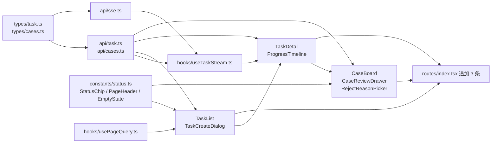

# 前端合并批（T07-3 + T08 前端）实施顺序与依赖清单

> 状态：**规格草案，未开工**。本文只回答"先做什么、按什么契约做、怎么验"，不含代码。
>
> 命名说明：不叫 `03-frontend-plan.md` —— `docs/` 下 `02/03/04` 三个编号已由 **T14** 预留（`02-api.md` / `03-runbook.md` / `04-interview-notes.md`，见 §6 T14 行），占用会让 T14 交付时编号打架。
>
> 依据来源：现场核过的代码路径（每条结论后标注）+ `docs/01-architecture.md` §2.3 / §4.2 / §4.3 / §6 / §8.5 / §11.1。

---

## 0. 一句话结论

**地基（`types/*` + `api/task.ts` + `api/cases.ts` + `api/sse.ts` + `hooks/useTaskStream.ts`）必须先于任何页面落地，但它有三个后端前置缺口**：`GET /api/tasks`、`GET /api/tasks/{id}/items`、`POST /api/tasks/{id}/retry` 目前**都不存在**（`GenTaskController` 只有 `create` / `get` / `cancel` / `stream` 四个端点，见 `generation/controller/GenTaskController.java:93-167`）。因此本批的开工顺序不是"页面先做简单的"，而是**先做不依赖缺失端点的部分**（SSE 地基 + 建任务 + 进度条），把 `TaskList` / `TaskDetail` 的明细表格卡在 `/items` 端点之后。

---

## 1. 现状核实（先确认，不假设）

### 1.1 前端已有

```
frontend/src/
├── api/{http,auth,doc,testpoint,prompt,system}.ts     # 6 个，全部走 http.ts 统一出口
├── types/{common,doc,testpoint}.ts                    # 无 task.ts / cases.ts
├── store/authStore.ts                                 # token 持久化，getState() 可取
├── utils/toast.ts                                     # 模块级 toast 桥
├── theme.ts                                           # 已导出 STATUS_COLORS（12 个键，含 SKIPPED）
├── pages/{Login,Home}.tsx + docs/ + prompts/ + testpoints/
└── routes/index.tsx                                   # 守卫 + 懒加载唯一入口
```

**`frontend/src/hooks/` 与 `frontend/src/components/` 两个目录都还不存在**（`ls` 实测）。这与 §11.1 D-33 的记录一致（"三个前端 SSE 文件仍未交付"），也意味着 **本批要新建这两个目录树**。

### 1.2 后端已有 / 缺失（决定前端能做什么）

| 前端需要 | 端点 | 现状 | 依据 |
|---|---|---|---|
| 建任务 | `POST /api/tasks` | ✅ 已交付，**返回 `{taskId,taskNo}` 两个字符串** | `GenTaskController.java:93` |
| 任务详情 | `GET /api/tasks/{id}` | ✅ 已交付，返回 `GenTaskVO`（18 字段） | `GenTaskController.java:111`、`dto/GenTaskVO.java:54` |
| 订阅进度 | `GET /api/tasks/{id}/stream` | ✅ 已交付 | `GenTaskController.java:166` |
| 取消任务 | `POST /api/tasks/{id}/cancel` | ✅ 已交付，返回 `Map<String,Object>` | `GenTaskController.java:122` |
| 任务列表 | `GET /api/tasks` | ❌ **不存在** | 全局 `grep` 无 `GetMapping` 无参映射 |
| 逐 item 明细 | `GET /api/tasks/{id}/items` | ❌ **不存在**（且无 `GenTaskItemVO`） | `generation/dto/` 只有 2 个文件 |
| 重试 | `POST /api/tasks/{id}/retry` | ❌ **不存在** | 同上 |
| 用例列表/详情/编辑/评审/批量 | `/api/cases*` | ⚠️ **T08 后端已落地但未提交**（撰写时工作区已有 `testcase/controller/CaseController.java` + `service/{CaseService,CaseReviewService}.java` + `BatchReviewReq`/`BatchReviewResult`），**5 个端点动词已逐个核实**，见 §7.2 | `git status` 未跟踪目录 |
| 驳回原因字典 | `GET /api/dict/reject-reasons?enabledOnly=` | ✅ 已交付，返回 `CodeLabel[]`（`{code,label,sortNo}`） | `system/DictController.java:51` |

> 结论：**`cases.ts` / `types/cases.ts` 按 §7.2 已核实的端点写**（撰写时 `CaseController.java:73-135` 已存在，动词与出参形状逐个对过）。风险提示：T08 **尚未提交**，交付前仍可能改 —— 唯一需要当天复核的是 §7.2 表格里"已核实"三行的注解有没有变。

---

## 2. 文件清单与分层

### 2.1 地基层（先行，页面全部依赖它）

| 文件 | 行数量级 | 职责（一句话） |
|---|---|---|
| `src/types/task.ts` | ~120 | `GenTaskVO` 18 字段 + **SSE 五类帧各自的载荷类型**（与 REST VO 不同，见 §4.2） |
| `src/types/cases.ts` | ~110 | `TestCaseVO`（19 字段 + `reviews`）/ `TestCaseStep` / `CaseReviewItem` / `CaseUpdateReq` / `ReviewReq` / `BatchReviewReq` / `BatchReviewResult`（`{updated, skipped:[{id,reason}]}`）/ `CaseListQuery`（只 3 个筛选，见 §7.2） |
| `src/api/task.ts` | ~110 | `createTask` / `getTask` / `listTasks` / `listTaskItems` / `cancelTask` / `retryTask`（后三者中两个是占位，见 §7.1） |
| `src/api/cases.ts` | ~110 | `listCases` / `getCase` / `updateCase` / `reviewCase` / `batchReviewCases` / `fetchRejectReasons` |
| `src/api/sse.ts` | ~180 | **传输层**：拼 URL、`EventSource` 生命周期、帧解析、**两种 error 帧的形状判别**、断线退避重连；**不含 React** |
| `src/hooks/useTaskStream.ts` | ~150 | **状态层**：把帧序列折叠成 `{snapshot, items[], terminal, connection}`；挂 watchdog；终态后 `close()` |
| `src/hooks/usePageQuery.ts` | ~40 | 分页状态 ↔ `PageQuery` 参数的双向映射（`page 0-based → 后端 1-based` 的换算只允许在这一个文件里） |

**为什么 `sse.ts` 与 `useTaskStream.ts` 要分两层**：`EventSource` 的帧序列（snapshot 覆盖、item 追加、终态关闭、退避序列）是**纯逻辑**，分出来后可以用假 `EventSource` 在 `vitest` 里跑完整个重连剧本，不需要渲染 React；混在一个 hook 里，每一个"断线三次后恢复"的场景都要 `renderHook` + 假定时器 + 假 EventSource 三件事同时对齐，成本高十倍，最后通常就不测了。

### 2.2 公共组件层（本批**只提前做 3 个**）

| 文件 | 行数量级 | 为什么提前 |
|---|---|---|
| `src/components/common/StatusChip.tsx` | ~60 | `theme.ts:25-38` 的 `STATUS_COLORS`（注释在 :23）写着"**StatusChip 组件在 T12 消费它**"——色板已经躺在那儿等这个组件。本批有 **5 处**要显示状态（任务列表/任务详情/进度条/item 明细/用例看板），不抽就是 5 份本地 `Record<string,{label,color}>`，`TestPointReviewPage.tsx:43` 已经是这个模式的第 1 份 |
| `src/components/common/PageHeader.tsx` | ~50 | 4 个页面顶部都是"标题 + 副标题 + 右侧操作按钮"；不抽则每个页面重复 20 行，T12 统一时改 4 处 |
| `src/components/common/EmptyState.tsx` | ~40 | T12 验收②要求"所有异步请求有 loading / error / **empty** 三态"，本批的 4 个列表都会碰到空态；这一条是 T12 的硬验收，提前做不会返工 |
| `src/constants/status.ts`（不是组件，但同批） | ~50 | 三个状态域的 `code → {label, color}` 映射，**StatusChip 的唯一数据源**，也是单测断言的对象 |

**明确不提前做的**（留给 T12，理由写在 §2.4）：

- `DataTable.tsx`：泛型列定义 + 分页 + 排序 + 骨架屏，本批只有 3 张表用它，而 T12 验收④"排序/筛选与后端 `PageQuery` 严格对齐"是 T12 的活。现在抽，抽象方向大概率为 T12 推翻重写。
- `ConfirmDialog.tsx`：本批只有"取消任务""批量驳回"两处需要二次确认，各就地 15 行 MUI `Dialog` 即可。**经验判据：使用点 < 3 个不抽组件**。
- `JsonViewer.tsx`：编辑抽屉里的 steps diff 用 `<pre>` + `JSON.stringify(…, null, 2)` 就够了，等 T09 导出预览再抽。
- `ErrorBoundary.tsx` / `AppShell` / `SideNav` / `TopBar` / `useDict`：全部属 T12，本批页面各自用 MUI `Container` 包裹（`TestPointReviewPage.tsx:9` 已是这个写法）。

### 2.3 页面层

| 文件 | 行数量级 | 依赖的地基 | 备注 |
|---|---|---|---|
| `src/pages/tasks/TaskList.tsx` | ~220 | `api/task.ts#listTasks`（**缺端点**）、`usePageQuery`、`StatusChip`、`EmptyState`、`PageHeader` | 列表 + 状态筛选 + 跳详情 |
| `src/pages/tasks/TaskCreateDialog.tsx` | ~200 | `api/task.ts#createTask`、`api/testpoint.ts#listTestPoints` | 选文档 → 选测试点 → 建任务。**不依赖 `useTaskStream`** |
| `src/pages/tasks/TaskDetail.tsx` | ~260 | `useTaskStream`、`api/task.ts#getTask` + `#listTaskItems`（**缺端点**）、`ProgressTimeline` | 顶部汇总 + 进度条 + item 明细表 + 取消/重试按钮 |
| `src/pages/tasks/ProgressTimeline.tsx` | ~120 | `types/task.ts` 的帧类型 | **纯展示**：吃 `snapshot` + `items[]`，不自己发请求（便于单测） |
| `src/pages/cases/CaseBoard.tsx` | ~300 | `api/cases.ts`、`StatusChip`、`CaseReviewDrawer`、`RejectReasonPicker` | 列表 + 批量选择 + 键盘评审（A/R/E）+ 自动下一条 |
| `src/pages/cases/CaseReviewDrawer.tsx` | ~240 | `api/cases.ts#updateCase` / `#reviewCase` | 详情 + steps 编辑 + 保存（走 `PUT`，见 §7.2） |
| `src/pages/cases/RejectReasonPicker.tsx` | ~90 | `api/cases.ts#fetchRejectReasons` | 受控组件：`value/onChange/onConfirm`，不自己提交 |

### 2.4 路由登记（**必须改既有文件**）

`src/routes/index.tsx`：新增 `/tasks`、`/tasks/:id`、`/cases`（`/cases` 用查询串接 `taskId`，理由同 `/testpoints/:docId` 的反例 —— 用例看板可以跨任务看，`taskId` 是**筛选条件**不是**路径身份**）。**只允许追加**，`/login`、`/`、`*` 三条不得改动（§2.3 纪律 + T03/T04/T05 已有约定的同一条）。

---

## 3. 依赖顺序

### 3.1 依赖图



### 3.2 线性顺序（每步结束后必须能跑通什么）

| 步 | 内容 | 结束标志（可运行、可验证） |
|---|---|---|
| **S1** | `types/task.ts` + `types/cases.ts` + `constants/status.ts` | `tsc --noEmit` 零错误；`STATUS_COLORS` 的 12 个键与 `constants/status.ts` 的三个域**双向覆盖无缺漏**（单测断言键集合） |
| **S2** | `api/task.ts` + `api/cases.ts` | 在 `/tasks/new` 之外的临时探针里能建出一个任务并读出详情（`createTask` → `getTask`）；`listTasks` / `listTaskItems` 先按 §7.1 写成**明确抛 `501` 的占位**，不静默返回空数组 |
| **S3** | `api/sse.ts` | 纯函数 `buildStreamUrl` / `classifyFrame` / `nextBackoff` 单测全绿；在浏览器控制台手工 `new EventSource` 能收到 `snapshot` 帧（这是**本批第一个可肉眼验收的点**） |
| **S4** | `hooks/useTaskStream.ts` | 在 `TaskDetail` 的骨架页上看到"进度条从 0 走到 100 + 终态文案"，**且浏览器 Network 面板里 EventSource 在终态后不再重连**（这是全批最容易漏的一条，见 §4.5） |
| **S5** | 3 个公共组件 | Storybook 不存在，用 `Home.tsx` 临时挂一行三种状态的 Chip 目测色板；`tsc` 零错误 |
| **S6** | `TaskList` + `TaskCreateDialog` | **卡在 `/api/tasks` 端点**：端点未交付则 `TaskList` 只渲染"端点待交付"的 `EmptyState`，不许用假数据糊过去 |
| **S7** | `TaskDetail` + `ProgressTimeline` | 逐 item 明细**卡在 `/items` 端点**；SSE 增量部分可先做（`item` 事件本身带 `latencyMs` / `errorCode`，见 §4.2） |
| **S8** | `CaseBoard` + `CaseReviewDrawer` + `RejectReasonPicker` | 端点形态已在 §7.2 核实（`PUT` 编辑 / `POST` 评审 / `batch-review` 带 `skipped` 明细），可先写类型与 `api/cases.ts` 并用 mock 数据跑通快捷键与自动下一条；**联调要等 T08 提交** |
| **S9** | 路由追加 + 端到端手点 | 四条路径可直达可刷新 |

### 3.3 三条关系上的判断

1. **`useTaskStream` 与 `TaskCreateDialog`：无依赖。** 建任务只调 `POST /api/tasks` 拿 `{taskId,taskNo}`（`GenTaskController.java:93`），拿完 `navigate('/tasks/'+taskId)`，订阅发生在详情页。让创建弹窗"建完就地订阅"会把 SSE 生命周期塞进一个会被卸载的 Dialog 里，是纯粹的麻烦。
2. **`useTaskStream` 与 `TaskDetail`：`TaskDetail` 依赖它，但它不许依赖 `TaskDetail`。** 钩子的输入只有 `taskId`，输出只有 `{snapshot, items, terminal, connection, errorFrame}`，**不 setQueryData、不 navigate、不 toast**。副作用（写缓存、跳登录、弹提示）全部留在页面里——否则钩子无法在单测里跑（一 setQueryData 就要 `QueryClientProvider`）。
3. **`CaseBoard` 不必须等任务终态。** `test_case` 行是**逐 item 落库**的（`CaseGenerateHandler` 在 item 收尾时就 `upsertBatch`），所以 RUNNING 的任务已经有部分用例。**建议**：允许打开，顶部提示"任务执行中，已产出 N 条，列表会自动增长"，`refetchInterval: 5000` 仅在 `status` 非终态时开启，终态后关掉。理由：强行等终态会让用户在一个空白页干等 1~2 分钟，而这段等待恰好是他最想看到"已经有东西了"的时候。

---

## 4. SSE 契约（本批最容易出错的地方）

### 4.1 传输层事实（全部现场核过）

| 事实 | 依据 |
|---|---|
| 鉴权走 `?token=`，不带 header | `GenTaskController.java:166-167` |
| **服务端从不发 `id:` 行** | `SseEmitterRegistry.java:86` 只有 `.name(event).data(payload)`，无 `.id(...)` |
| 每次订阅**必先推一帧 `snapshot`** | `GenTaskController.java:192-193`：`register(id)` 后立刻 `pushSnapshot(id)` |
| 终态任务：推完 snapshot **同步 `complete()`**，流毫秒级关闭 | `GenTaskController.java:197-200` |
| 心跳是 **20s 常驻 `@Scheduled`**，与订阅起点不对齐，只对有订阅者的任务发；载荷 `{ts}` | `SseEmitterRegistry.java:121-130` |
| 推送失败（客户端已断）**只清理连接、不重投** | `SseEmitterRegistry.java:88-93` → **SSE 是有损通道**，见 §4.6 |

### 4.2 六类帧的**实际**载荷（与 §4.3 有 2 处不一致，见 §7.3 第 1、2 行；另有一处 §4.2 #23 在 §7.3 第 3 行）

| 事件 | 实际载荷 | 说明 |
|---|---|---|
| `snapshot` | `{taskId, taskNo, scene, status, progress, done, total, success, failed, produced, startedAt, finishedAt, errorCode}` | 从 DB 现读（`ProgressPublisher.snapshotOf`），**比 §4.3 多 `taskNo/scene/produced/finishedAt/errorCode`** |
| `progress` | 同 `snapshot`，但 `progress` 按 `done/total` 现算 | 节流 ≥200ms（`ProgressPublisher.java:48`） |
| `item` | `{itemId, testPointId, unitRef, status, caseCount, attempts, errorCode, errorMsg, latencyMs}` | 逐条 item 终态，不节流 |
| `item`（被取消跳过） | **只有** `{itemId, unitRef, status:"SKIPPED"}` | `onItemSkipped` 只放 3 个键 → 前端**必须**容忍 `caseCount/attempts/errorCode/latencyMs` 为 `undefined` |
| `done` | **完整 snapshot**（`status` ∈ {`SUCCESS`,`PARTIAL`}） | §4.3 声称的 `summary:{totalCases,totalCostMicro,avgLatencyMs}` **不存在** |
| `error`（执行失败） | `{taskId, errorCode, errorMsg, summary:<snapshot>}` | `ProgressPublisher.finish` 的 `status` ∈ {`FAILED`,`CANCELED`} |
| `error`（订阅被拒） | `{code, message, data:null, traceId}` | `SseErrorResponder.writeError` 复用 `ApiResponse.fail`；`code` ∈ {40101,40102,40301,40401} |
| `heartbeat` | `{ts}` | 每 20s |

> **`error` 帧有两种形状**，判别方式是 `'code' in payload`：有 `code` → 订阅被拒（要跳登录/报权限）；有 `errorCode` → 执行失败（正常业务终态）。写成 `payload.code === 0` 之类的判断会两种都判错。**这是本批第一号坑**。

### 4.3 `heartbeat` 怎么处理

**结论：只重置本地静默计时器，不触发任何 `setState`。**

- 不做 UI 反馈：每 20s 一次的无意义重渲染会打断用户正在看的表格（尤其 `CaseBoard` 上正在敲快捷键）。
- 但它必须有用：`useTaskStream` 维护 `lastEventAtRef`，**每收到任何帧（含 heartbeat）都刷新**；一个 45s 的 `setInterval` 检查 `now - lastEventAt > 45_000` 即判定"连接假死"，主动 `close()` 并进入重连流程。
- **阈值必须是 45s 而不是 20s**：心跳与订阅起点不对齐，最坏情况订阅后要等满 20s 才收到第一帧心跳；取 2×20s 留半拍余量。取 20s 会在正常连接上误杀。
- **这个常量不许散落成字面量**：`sse.ts` 导出 `SERVER_HEARTBEAT_TICK_MS = 20_000` 与 `SILENCE_TIMEOUT_MS = 2 * SERVER_HEARTBEAT_TICK_MS`，注释写明"后者恒等于服务端 tick 的 2 倍"。服务端将来改 tick 只需改前者。**写成 `45_000` 的那份代码一定会有一处忘改**——而漏改的表现是"连接好好的却每 45s 重连一次"，没人会想到是常量没跟着变。
- **反例警示**：不要用"`progress` 事件是否还在来"当存活判据。一个 60s 的慢 item（LLM 单次调用）期间 `progress` 可能一次都不来，但连接是好的；用 45s 静默 + 心跳才成立，因为心跳只依赖"有订阅者"这个条件，与任务是否在推进无关。

### 4.4 `error` 帧怎么展示

| 形状 | 判别 | 处置 |
|---|---|---|
| 订阅被拒 `{code,message,traceId}` | `40101` / `40102` | 清 token（`useAuthStore.getState().clear()`）+ 跳登录（带 `redirect`）。**注意 `http.ts` 的 `handleAuthExpired` 是私有函数**，两条路径处置必须一致 → 建议把它 `export`（1 行改动，不改行为），见 §7.4 |
| 同上 | `40301` / `40401` | 页面级 `EmptyState`："无权查看该任务" / "任务不存在"，**不弹 toast**（这是页面状态，不是用户动作失败） |
| 执行失败 `{taskId,errorCode,errorMsg,summary}` | 恒真 | 用 `summary.status` 定终态（`FAILED` / `CANCELED`），提示语用 `errorMsg`（后端已是中文）。**不要翻译 `errorCode`** —— 任务级恒为 `E_INTERNAL`（`D-42` 未修），写"系统内部错误"会与下方 item 明细的 `E_LLM_TIMEOUT` **自相矛盾** |

### 4.5 断线重连：退避 + 终态必须主动 `close()`

```
onerror(readyState === CLOSED 且 !terminalRef) → close() → 退避后重连
退避：1s → 2s → 4s → 8s → 8s …（上限 8s，总尝试 6 次）
第 6 次仍失败 → 置 connection='lost'，页面显示"连接已断开 · 重新连接"按钮，停止自动重试
```

三条硬约束：

1. **终态后必须 `es.close()`。** 服务端对终态任务的处理是"推一帧 snapshot 然后 `complete()`"（`GenTaskController.java:197-200`），流随即 EOF。浏览器 `EventSource` 在 EOF 后会**自动重连**，于是变成「重连 → 1 帧 snapshot → EOF → 重连」的无限循环（默认 ~3s 一次，每次都在服务端打一条 `[SSE] 新订阅`/`[SSE] 任务已终态` 日志）。所以：**收到 `done`、或收到 `error`、或收到 `snapshot` 且 `snapshot.status` 已终态 → 立刻 `close()`**。`onerror` 里也要判 `terminalRef`，否则那一次 EOF 会被当成"断线"再重连一轮。
2. **重连不需要 `Last-Event-ID`，也不可能用到它**：服务端从不发 `id:`，浏览器手里永远是空 `lastEventId`。**不要**实现"按事件 id 补增量"——补不了，也没有缺口要补：每次重连服务端都会先推一帧从 DB 现读的 `snapshot`（`ProgressPublisher.pushSnapshot`），进度靠它重建。**但 `items[]` 重建不了**（snapshot 只有计数），见 §4.6。
3. **不要依赖浏览器自带重连**。它在 `readyState===CONNECTING` 时自己重试，前端既不知道重试了几次也无法退避；`onerror` 里分不清"网络抖了一下"和"服务端 401"。统一改成：`onerror` → 自己 `close()` → 自己算退避 → 自己 `new EventSource`。

### 4.6 SSE 是有损通道 → `/items` 必须存在

`SseEmitterRegistry.send` 对 `IOException` 只打 DEBUG 并移除连接，**不重投、不排队**（`SseEmitterRegistry.java:88-93`）。所以：

- `item` 事件**可能永久丢失**（网络抖动、标签页切后台被限流、重连窗口内产生的 item）。
- 因此 `TaskDetail` 的明细表**权威来源是 `GET /api/tasks/{id}/items`**，SSE 只做"实时增量加速"。具体：挂载时拉一次 `/items`，收到 `item` 帧按 `itemId` 合并覆盖，收到 `done` 后再 `refetch` 一次 `/items` 兜底。
- **渲染顺序不能反**：先 `GET /items` 拿到全量再叠加 SSE 增量，**不要**先渲染 SSE 累积再让 `/items` 覆盖。反过来的后果是"页面先显示 3 条、200ms 后突然变成 40 条"——用户会以为刚才那 3 条是错的。
- **这直接决定 `/items` 端点不是"锦上添花"，而是 T07-3 ⑥「任务详情页能看到逐 item 的耗时与错误码」的**唯一**可靠实现**：任务终态后再打开页面，SSE 只有一帧 snapshot，逐 item 明细一条都拿不到。

### 4.7 React 18 StrictMode 的双订阅

`main.tsx:36` 包了 `<React.StrictMode>`，dev 下 effect 会执行两次 → **开发环境会看到 2 个并发订阅、心跳成对到达**。这不是 bug，但：

- effect 的 cleanup **必须** `close()`，否则 HMR 热更新会累积连接（服务端 `emitters` 里越堆越多，最后心跳 20s 发 N 次）。
- 单测里模拟 StrictMode 双挂载，断言 `EventSource` 实例被 `close()` 且最终只剩 1 个活连接。

---

## 5. 状态映射

### 5.1 任务状态（6 个，**没有 SKIPPED**）

| code | 文案 | Chip color | 依据 |
|---|---|---|---|
| `PENDING` | 排队中 | `default` | `common/enums/TaskStatus.java:12` |
| `RUNNING` | 执行中 | `info` | 同上 |
| `SUCCESS` | 成功 | `success` | 同上 |
| `PARTIAL` | 部分成功 | `warning` | 同上 |
| `FAILED` | 失败 | `error` | 同上 |
| `CANCELED` | 已取消 | `default` | 同上 |

> ⚠️ **`SKIPPED` 不是任务状态**。`TaskStatus` 枚举里没有它（实测 6 个常量）；`SKIPPED` 只出现在两处：**item 状态**（`GenTaskItem.java:87` 注释里的字符串字面量）与**执行结果状态**（`common/enums/ExecutionStatus.java:17`）。把它当任务状态写进映射表，会让"任务详情页顶部的状态 Chip"永远匹配不到一个真实值。
>
> `theme.ts` 的 `STATUS_COLORS` 把三类状态塞在一张表里（12 个键，含 `SKIPPED`），组件层要按域取子集，**不要**直接拿整表当任务状态白名单。

### 5.2 item 状态（5 个，**字符串字面量，无枚举类**）

`PENDING` 待执行 / `RUNNING` 执行中 / `SUCCESS` 成功 / `FAILED` 失败 / `SKIPPED` 已跳过。

item 级 `errorCode` **是准的**（`D-44` 已修复并复跑验证：`E_LLM_*` 原样透传）。展示规则：

- `E_LLM_*`（50001~50006）→ "上游模型异常" + 括号内原码，允许复制。
- `E_INTERNAL` → "系统内部错误"。
- 空串 → 正常，不显示。

### 5.3 用例状态（4 个）

| code | 文案 | color | 依据 |
|---|---|---|---|
| `DRAFT` | 待评审 | `default` | `CaseStatus.java:14` |
| `ACCEPTED` | 已采纳 | `success` | 同上 |
| `EDITED` | 编辑后采纳 | `info` | 同上 |
| `REJECTED` | 已驳回 | `error` | 同上 |

### 5.4 任务级错误文案的硬规则（`D-42`）

`gen_task.error_code` **现恒为 `E_INTERNAL`**（`GenTaskWorker` 收尾处 `failed > 0 ? "E_INTERNAL" : ""` 是硬编码，`D-42` 仍是观测项）。所以：

- 任务详情页顶部**只显示"有 N 条子项失败，详见下方明细"**，不显示任务级 `errorMsg`。
- 若要显示，必须附一句"（任务级错误码聚合规则未定，见 D-42）"，否则用户会拿"系统内部错误"去追问一个其实是上游超时的问题。
- **`CaseBoard` 不受影响**：用例列表只有 `status`，没有错误码。

---

## 6. 验收口径

### 6.1 能靠 `tsc --noEmit` + 单测覆盖（**必须覆盖**）

| 验收项 | 手段 | 断言要点 |
|---|---|---|
| T07-3 ⑥ 的**类型完备性** | `tsc --noEmit` | `GenTaskItemVO` 的 9 个字段全部有消费点；`item` 帧的 `SKIPPED` 变体不许用非空断言 `!` 骗过编译器（用 `??` 兜底） |
| SSE 帧的形状判别 | `sse.test.ts` | 两种 `error` 帧分别喂进去，断言分类结果不同；`snapshot.status=SUCCESS` 时 `classifyFrame` 返回终态 |
| 退避序列 | `sse.test.ts` | `nextBackoff(0..6)` = `[1,2,4,8,8,8,null]`（纯函数，无定时器） |
| 终态后不重连 | `useTaskStream.test.tsx` | 假 EventSource 喂 `done` → 断言 `close()` 被调用、`onerror` 不得再触发 `new EventSource`（这是 §4.5 那条无限重连的回归测试） |
| 双挂载清理 | 同上 | StrictMode 双跑后 `constructor` 调用 2 次、`close` 调用 1 次、活连接数 1 |
| 状态映射完整性 | `status.test.ts`（T13 ④ 要求 StatusChip 色板） | 三个域的键集合与 `TaskStatus`/`ItemStatus`/`CaseStatus` 逐一对应，**且任务域不含 `SKIPPED`** |
| T08 ⑥ 快捷键 | `CaseBoard.test.tsx`（T13 ④ 点名） | `fireEvent.keyDown(document, {key:'a'})` → `reviewCase(id,{action:'ACCEPT'})` 被调；`{key:'r'}` → 打开 `RejectReasonPicker` 且**未**立即提交；`{key:'e'}` → 打开抽屉；焦点在 `<input>`/`<textarea>` 时三键**全部忽略** |
| 自动下一条 | 同上 | 提交后 `selectedIndex` 前进 1；到最后一条时停在原地并提示"已是最后一条" |
| 分页换算 | `usePageQuery.test.ts` | MUI `TablePagination` 的 0-based `page` ↔ 后端 1-based `page` 只在这一处换算（错一次就是**整页数据错位**，且看上去像"后端数据乱序"） |

> ⚠️ **前置**：`frontend/vitest.config.ts` **当前不存在**（`package.json` 有 `vitest`/`jsdom`/`@testing-library/react` 依赖和 `"test": "vitest run --passWithNoTests"` 脚本，但没有配置文件，跑起来是 0 个测试）。这个文件在 §6 T13 的交付清单里。**本批要写单测就必须先落它**（约 15 行：`environment:'jsdom'` + `@` alias + `setupFiles`）。这是"提前交付 T13 资产"，需要拍板，见 §7.5。

### 6.2 只能人工点（写清楚点哪几下）

| # | 动作 | 通过判据 |
|---|---|---|
| M1 | 真任务跑到 `SUCCESS` 后**刷新页面** | 逐 item 明细仍在（证明走的是 `/items` 而不是 SSE 累积残留） |
| M2 | 断网 30s 再恢复 | 进度条跳变一次（snapshot 重建）后继续推进；控制台无报错；Network 面板显示退避间隔递增 |
| M3 | 任务终态后**保持页面打开 2 分钟** | Network 面板里**没有**新的 `stream` 请求（§4.5 无限重连的肉眼版；`t06sse` 的断言按事件名过滤，抓不到客户端侧的重连风暴） |
| M4 | 构造上游失败（provider 指到坏 base_url） | item 明细里 `errorCode` 属 `E_LLM_*`；任务级提示不显示"系统内部错误" |
| M5 | 用例看板上按 `A` 连按 5 次 | 5 条变 ACCEPTED、焦点依次下移、无重复请求、无跨条串号 |
| M6 | 按 `R` 后不选原因直接确认 | 前端拦住（或后端回 `40002`）并高亮原因选择器 |
| M7 | 编辑一条用例保存 | 状态变 `EDITED`；后端留 `old_content`/`new_content`（T08 ②③ 的验收，前端只验状态跳变） |
| M8 | 四条路由直接粘 URL 刷新 | 均能直达（`/tasks`、`/tasks/:id`、`/cases?taskId=`） |

---

## 7. 待校准 / 待决（**开工前必须消掉**）

### 7.1 后端三个端点缺口（阻塞 S6/S7）——**已裁决：由工程师补，标「依赖 T05-补漏」**

`GET /api/tasks`、`GET /api/tasks/{id}/items`、`POST /api/tasks/{id}/retry` 在 §4.2 里有编号（#24/#26/#28），但**代码里不存在**（`GenTaskController` 只有 create/get/cancel/stream 四个，属 T05/T06 的遗留）。

**裁决（2026-11-08）**：由工程师补，附在 T08 之后，标记「**依赖 T05-补漏**」。因此本批 `api/task.ts` 的写法调整为：

- **签名按 §4.2 的最终形态写正常调用**（`listTasks` / `listTaskItems` / `retryTask` 就是不折不扣的 `get` / `post`），**不写 `throw new Error('端点待交付')` 的永久占位**——占位一旦进了主干，端点补上后没人回来删它。
- **但保留一句防御性说明**（写在注释里，不写在代码路径里）："若返回 40401，先确认 `GET /api/tasks` 是否已随 T05-补漏交付，而不是先怀疑筛选条件"。理由是**静默空列表**会被误读成"筛选条件写错了"，而实际情况是端点没实现——这两种情况排查方向完全相反。
- **S6/S7 的联调验收沿用这条依赖**：端点未交付时 `TaskList` 用 `EmptyState` 显示"任务列表接口待交付（T05-补漏）"，**不放假数据**。

### 7.2 用例接口：**已逐个核实**（T08 工作区已有 controller，但未提交）

| 端点 | 实际签名（已核） | 前端写法 |
|---|---|---|
| 列表 | `GET /api/cases`，参数 **仅** `taskId?` / `status?` / `keyword?` / `page` / `size` / `sort`，返回 `PageResult<TestCaseVO>`（列表里 `reviews` 恒空数组） | `CaseBoard` **只做这 3 个筛选**（任务 / 状态 / 关键词）。§4.2 #30 写的 `docId` / `priority` / `caseType` **没实现**，做了就是"筛选条件不生效" |
| 详情 | `GET /api/cases/{id}` → `TestCaseVO`，`reviews` 按 `created_at` 升序 | 抽屉打开时按 id 拉详情（列表里没有 `reviews`） |
| 编辑 | **`PUT`** `/api/cases/{id}`（`CaseController.java:103`，不是 §4.2 #32 写的 `PATCH`），入参 `CaseUpdateReq`（**六个字段全部可选，`null` = 不改**，注意 `CaseUpdateReq` 字段名是 camelCase：`caseType` / `priority`），返回更新后的 `TestCaseVO` | 抽屉"保存"走 `PUT`；**只提交用户真正改过的字段**（传 `null` 语义是"不动"，全量回传会把服务器上别人刚改的字段覆盖回去） |
| 评审 | `POST /api/cases/{id}/review`，只接受 `ACCEPT` / `REJECT`，**返回 `TestCaseVO`（不是状态字符串）**；驳回缺 `rejectReasonCode` → `40002`；允许"改主意"重复评审 | 快捷键 A/R 走这里；用返回的 `TestCaseVO.status` 直接替换本地行，不要再发一次 GET |
| 批量 | `POST /api/cases/batch-review`，入参 `{ids[], action, rejectReasonCode?, reasonText?}`（**上限 200 条**，超了 `40001`），返回 **`{updated:int, skipped:[{id,reason}]}`**（`skipped` 永不 `null`）；**只处理 `DRAFT`**，非 DRAFT 计入 skipped | 渲染成"已更新 17 条，3 条被跳过：已评审（当前状态 ACCEPTED）。"并**按 `id` 把跳过的行标黄**（`skipped.id` 提供就是为了这个，下标对不上） |

> 三个"没实现"或"形状不同"的地方都不改变本批的文件清单，但会改变**页面能画什么**：`CaseBoard` 的筛选栏就 3 个控件，不要照 §4.2 画 6 个。
>
> **一处需要当天确认的遗留**：`CaseController` 与 `CaseService` 目前还在工作区未提交（`git status` 显示为未跟踪目录）。上面五行按"撰写时的实际代码"写；T08 提交后若动过注解，以提交版为准 —— 但**不要**因为"T08 还没提交"就把 `cases.ts` 写成 `PATCH`，代码现在就是 `PUT`，`PATCH` 会 405。

### 7.3 文档与代码的 5 处不一致（**编号已定：D-47~D-51，T08 收口时一起改**）

| 编号 | §4.2 / §4.3 的写法 | 代码实际 | 影响（对本批） |
|---|---|---|---|
| **D-47** | §4.3 事件 4 `done` → `{taskId,status,summary:{success,failed,totalCases,totalCostMicro,avgLatencyMs}}` | `ProgressPublisher.finish` 推**完整 snapshot**：没有 `summary` 子对象，也没有 `totalCases/totalCostMicro/avgLatencyMs` 三个字段 | 照文档写 `payload.summary.totalCases` 得到 `undefined`，页面显示"产出 0 条"；且 `status` 判不出来 → 终态判不出 → **无限重连** |
| **D-48** | §4.3 事件 5 `error` → "**执行失败**与**鉴权/归属/找不到**都是这个帧、同形"，靠 `code` 区分 | **两种形状**：执行失败 `{taskId,errorCode,errorMsg,summary}`；订阅被拒 `{code,message,data,traceId}`（`ApiResponse.fail` 同形）。判别方式是 `'code' in payload` | 按"同形"写一个解析分支：一半场景读不到文案（`message` 在拒绝帧、`errorMsg` 在失败帧），且有 `code` 的那支会把执行失败当鉴权失败 |
| **D-49** | §4.2 #23 `POST /api/tasks` 入参 `{docId, templateCode, provider, model, testPointIds?, timeoutSec?}` | `GenTaskCreateReq` = `{scene(@NotBlank), docId, provider, model, unitRefs?, testPointIds?}`：**多必填 `scene`**、`unitRefs` 与 `testPointIds` 二选一、**无 `templateCode`/`timeoutSec`**；且 `FAIL_ON_UNKNOWN_PROPERTIES` 已关 → 多传的 `templateCode` **被静默忽略** | 缺 `scene` 直接 `40001`「场景不能为空」；就算补了 `scene`，"选模板"也是**假控件**——用户以为选了，后端按 `scene` 自己取 |
| **D-50** | §4.2 用例模块四行：#30 筛选 `taskId,docId,status,priority,caseType,keyword`；#32 动词 `PATCH`；#33 入参含 `content?`；#34 入参 `caseIds[]` | 实际：#30 只有 `taskId/status/keyword`；#32 是 **`PUT`**（`CaseController.java:103`）；#33 `ReviewReq` **无 `content` 字段**（编辑走 PUT）；#34 字段名是 **`ids[]`**，出参 `{updated, skipped:[{id,reason}]}` | 筛选栏画 6 个控件会有 3 个**永远不生效**；`PATCH` 会 **405**；按 `caseIds` 传后端收不到（`ids` 为空 → 走 `40002`） |
| **D-51** | §4.2 #25 `GET /api/tasks/{id}` → "任务详情 + 汇总（items 计数、**tokens**、**cost**）" | `GenTaskVO` 18 个字段里**没有 tokens / cost**（`dto/GenTaskVO.java:54`），`ProgressPublisher.snapshotOf` 也没有 | `TaskDetail` 顶部汇总**不能显示 tokens/成本**；要显示只能从 `/items` 或将来 `llm_call_log` 聚合接口取 |

> **这五条的同族特征**：都不是"文档笔误"，而是**设计原样 vs 实施结果**的偏差（按 §11.3 的口径登记，不写产品缺陷）。危害等级分两档：
>
> - **静默档（D-47 / D-48）**：`tsc` 不报错、`t06sse`（按事件名过滤断言）也不红，表象是"任务结束后页面一直转圈"——**故障现象在网络层、根因在契约层**。
> - **可见档（D-49 / D-50 / D-51）**：会 40001 / 405 / 显示空值，第一次点就暴露，**排查成本低**，但会让人误判"后端没做"而不是"文档写错"。
>
> **对本批的直接动作**：`TaskCreateDialog` 请求体固定 `{scene:'CASE_GENERATE', docId, provider?, model?, testPointIds:[…]}`，**不设模板下拉、不设超时输入**；`createTask` 的类型里不要出现 `templateCode`（类型里没有的东西，将来不会有人顺手传）。`CaseBoard` 筛选栏只放 3 个控件。`TaskDetail` 顶部汇总只显示 `done/total/success/failed/produced`。
>
> **改文档的时机**：T08 收口提交时一起改，**现在不动 `01-architecture.md`**。精确替换文本见本文 **§9 附录**（已按"原句 → 改后句"写好，可直接贴）。

### 7.4 `http.ts` 的 401 处置需要被复用（**已裁决：export，1 行改动**）

`sse.ts` 收到 `code=40101/40102` 的 error 帧时，处置必须与 `http.ts` 完全一致（清 token → toast → `replace('/login?redirect=…')`）。`handleAuthExpired` 现在是 `http.ts` 的模块私有函数（`http.ts:44`）。两个选择：

- **结论：`export function handleAuthExpired`**（改 1 个词，行为零变化），`sse.ts` 直接复用。理由：两个"token 失效出口"必须同源，否则哪天加了 refresh 逻辑只会有一边被改。
- **已否决的备选**：在 `sse.ts` 里复制那 8 行。它正是 `http.ts` 当初抽这个函数要解决的问题本身。

### 7.5 `vitest.config.ts`（**已裁决：本批落地，排在 `sse.ts` 之前**）

它属 T13 文件清单，但没有它本批一个单测都跑不起来（`npm test` 是 `--passWithNoTests`，**0 个测试也算绿**）。

**裁决（2026-11-08）：本批落地**，约 15 行（`environment: 'jsdom'` + `@` alias + `setupFiles`），**排在本批第一个可交付物（`sse.ts` 形状判别）之前**。

判据不是"顺手"，而是：`--passWithNoTests` 把"0 个测试"算成绿，**跟 D-46 那个"探针永远判不出失败"是同一类问题——绿得没有信息量**。不落它，§4.5「终态后不重连」与 §4.4「两种 error 帧」这两条最容易回归的契约就完全无自动化保护，而它们恰好是"错了不报错、只表现为一直转圈"的那种。

### 7.6 一个不做的事（明确留痕）

**不做"任务列表的 5 秒轮询兜底"**。`GET /api/tasks` 端点交付后，列表页用 react-query 默认策略（`staleTime: 30s`、`retry: 0`、无 focus refetch，见 `main.tsx:17-28`）+ 手动刷新按钮即可。理由：任务列表是"我要看有哪些任务"，不是监控大屏；给列表加轮询会让一个开着的标签页每秒打一次后端，而收益只是让"别的窗口新建的任务"早 5 秒出现。

### 7.7 团队裁决记录（2026-11-08）与三条实施注意

| # | 事项 | 裁决 | 落点 |
|---|---|---|---|
| 1 | 3 个缺失端点 | 工程师补，附在 T08 之后，标「**依赖 T05-补漏**」 | §7.1（已改为"按最终形态写正常调用 + 保留防御性注释"） |
| 2 | 5 处文档不一致 | 登记 **D-47~D-51**，T08 收口时一起改 | §7.3（已编号）+ §9 附录（已备好替换文本） |
| 3 | `vitest.config.ts` | **本批落**，排在 `sse.ts` 之前 | §7.5 |
| 4 | `handleAuthExpired` | **export 复用**，不复制 | §7.4 |
| 5 | `SKIPPED` 归属 | 团队承认清单写错，以 `TaskStatus` 的 6 个常量为准 | §5.1 |

**三条要写进代码注释的注意**（团队特别强调，别只写在文档里）：

1. **`/items` 必须先于 SSE 增量**（§4.6）：终态后打开页面时 SSE 只有一帧 snapshot、明细一条都拿不到。**渲染顺序反了**会出现"先 3 条、200ms 后变 40 条"。
2. **45s 不许写成字面量**（§4.3）：从 `sse.ts` 导出 `SILENCE_TIMEOUT_MS = 2 * SERVER_HEARTBEAT_TICK_MS`，注释写明它恒等于服务端 tick 的 2 倍。散落的 `45_000` 一定有一处忘改，而漏改的表现是"连接好好的却每 45s 重连一次"。
3. **"`progress` 是否还在来"不能当存活判据**（§4.3）：必须把这条**写进 `useTaskStream` 的注释**，否则后来人"优化"成 progress 超时就重连，60s 的慢 item 会被反复重连打断——而慢 item 恰恰是最需要安静等待的那种。

---

## 8. 一句话风险

**最大的风险不是"SSE 难写"，而是"前端照着 §4.3 写、服务端发的不是那个形状"**：`done` 帧没有 `summary`、`error` 帧有两种形状却只有一种被写进文档。这两处都不会让 `tsc` 报错、不会让 `t06sse`（按事件名过滤断言）变红，只会让页面在任务结束后一直转圈重连——**故障现象与根因隔了两层**（表象在网络层、根因在契约层）。所以本批的**第一个可交付物必须是 `sse.ts` 的形状判别 + 单测**，而不是页面。

（§7.3 第 3 行是另一类风险：请求体字段对不上，表现为"建任务点了没反应"。它**可控**——S6 一跑就暴露 `40001`，不会拖到联调后期；真正会拖的是上面那两处静默的。）

---

## 9. 附录：T08 收口时的精确替换文本（**现在不改，T08 提交时直接贴**）

> 用法：`01-architecture.md` 的行号以**本次撰写时**为准（§4.2 表 875 行起、§4.3 表 968 行起），T08 收口前若有人改过这两个表，行号会漂，**按原文匹配而不是按行号定位**。
>
> 改完必须复核三件事：① `grep -c "^| \*\*D-" docs/01-architecture.md` 应等于 §10 声明的条数；② §12 新增 5 行后条数自洽；③ 三个校验器（`checktables.py` / `checkdeps.py` / `validate2.mjs`）全绿。

### 9.1 §4.3 SSE 表：3 行

#### A. 事件 4（D-47）

**原句**

```markdown
| 事件 4 | `event: done` → `{taskId,status,summary:{success,failed,totalCases,totalCostMicro,avgLatencyMs}}`，随后服务端 `complete()` |
```

**改后**

```markdown
| 事件 4 | `event: done` → **完整 snapshot**（字段同事件 1：`taskId/taskNo/scene/status/progress/done/total/success/failed/produced/startedAt/finishedAt/errorCode`，其中 `progress` 按 `done/total` 现算），`status` ∈ {`SUCCESS`,`PARTIAL`}，随后服务端 `complete()`。**没有 `summary` 子对象**，也没有 `totalCases` / `totalCostMicro` / `avgLatencyMs` 三个字段（见 `D-47`） |
```

#### B. 事件 5（D-48）

**原句**

```markdown
| 事件 5 | `event: error` → data 为 `ApiResponse.fail(...)` 同形：`{code,message,data:null,traceId}`，随后 `complete()`。**执行失败**（`ProgressPublisher` 推）与**鉴权/归属/找不到失败**（`GenTaskController#reject` 推）都是这个帧、同形，前端靠 `code` 区分：`40101/40102`→跳登录、`40301`→无权限、`40401`→任务不存在、其余→展示 `message` 并按执行失败处理（D-37）。**不发 `id:` 行**（服务端从不发 id 是既有契约） |
```

**改后**

```markdown
| 事件 5 | `event: error` → **两种形状，靠有无 `code` 字段判别**（见 `D-48`）。**① 执行失败**（`ProgressPublisher.finish` 推，`status` ∈ {`FAILED`,`CANCELED`}）：`{taskId,errorCode,errorMsg,summary:<snapshot>}`；**② 订阅被拒**（`GenTaskController#reject` → `SseErrorResponder` 推）：`ApiResponse.fail(...)` 同形 `{code,message,data:null,traceId}`，`code` ∈ {`40101`,`40102`,`40301`,`40401`}，前端据 `code` 跳登录 / 报无权限 / 报不存在（`D-37`）。两条路径随后都 `complete()`。**不要**把执行失败当 `ApiResponse` 解析——它的字段名是 `errorCode`/`errorMsg`，不是 `code`/`message`。**不发 `id:` 行**（服务端从不发 id 是既有契约） |
```

#### C. 断线重连（顺带改，不单独登记）

**原句**

```markdown
| 断线重连 | 浏览器自带重连会带 `Last-Event-ID`；服务端收到后**先推 snapshot 再续推增量**（单机内存不保存完整事件历史，故用 DB 快照重建，这是刻意的简化） |
```

**改后**

```markdown
| 断线重连 | 服务端**不发 `id:` 行**，浏览器手里永远没有 `Last-Event-ID`，因此**不可能靠事件 id 补增量**；恢复进度靠"**每次订阅必先推一帧从 DB 现读的 `snapshot`**"（单机内存不保存完整事件历史，这是刻意的简化）。**逐 item 明细不在 snapshot 里**，恢复只能走 `GET /api/tasks/{id}/items`——SSE 是有损通道：`send` 失败只清理连接、**不重投** |
```

> 为什么顺带改：原文"服务端收到后先推 snapshot"与同表"从不发 id"并不冲突，但"浏览器会带 `Last-Event-ID`"这句是错的，留着会让前端去实现一个**永远拿不到值**的增量补齐逻辑。

### 9.2 §4.2 接口清单：5 行（D-49 / D-51 / D-50）

#### D. #23 建任务（D-49）

**原句**

```markdown
| 23 | 任务 | POST | `/api/tasks` | `{docId, templateCode, provider, model, testPointIds?, timeoutSec?}` | `{taskId, taskNo, totalItems}` |
```

**改后**

```markdown
| 23 | 任务 | POST | `/api/tasks` | `{scene, docId, provider?, model?, unitRefs?, testPointIds?}`——`scene` 必填（`TESTPOINT_EXTRACT` / `CASE_GENERATE`）；`unitRefs` 与 `testPointIds` **二选一**，都传或都不传 → `40001`；**没有 `templateCode` / `timeoutSec`**（模板由 `scene` 决定；多传的未知字段会被**静默忽略**，见 `D-49`） | `{taskId, taskNo}` |
```

#### E. #25 任务详情（D-51）

**原句**

```markdown
| 25 | 任务 | GET | `/api/tasks/{id}` | — | 任务详情 + 汇总（items 计数、tokens、cost） |
```

**改后**

```markdown
| 25 | 任务 | GET | `/api/tasks/{id}` | — | 任务详情 `GenTaskVO`（18 字段：`taskId/taskNo/scene/status/progress/done/total/success/failed/produced/provider/model/docId/errorCode/errorMsg/startedAt/finishedAt/createdAt`；**不含 tokens / cost**，要成本请走 `llm_call_log` 聚合或 §4.2 #46，见 `D-51`） |
```

#### F. #30 用例列表（D-50）

**原句**

```markdown
| 30 | 用例 | GET | `/api/cases` | `taskId,docId,status,priority,caseType,keyword,page,size` | 分页列表 |
```

**改后**

```markdown
| 30 | 用例 | GET | `/api/cases` | `taskId,status,keyword,page,size,sort`（**仅这 3 个筛选**；`docId`/`priority`/`caseType` 未实现，见 `D-50`） | 分页列表（`steps` 已解析成 `[{no,action,data}]`；列表 `reviews` 恒为空数组） |
```

#### G. #32 编辑用例（D-50）

**原句**

```markdown
| 32 | 用例 | PATCH | `/api/cases/{id}` | `{title?,precondition?,steps[]?,expected?,priority?,caseType?}` | 更新后内容（不改 status，需再提交评审） |
```

**改后**

```markdown
| 32 | 用例 | **PUT** | `/api/cases/{id}` | `{title?,precondition?,steps[]?,expected?,priority?,caseType?}`（全部可选，`null` = 该项不改；`steps` 的 `no` 由服务端按数组顺序重排） | 更新后的 `TestCaseVO`；**状态置 `EDITED`** 并写 `old_content` / `new_content` 快照（"编辑后采纳"的唯一入口，见 `D-50`） |
```

#### H. #33 单条评审（D-50）

**原句**

```markdown
| 33 | 用例 | POST | `/api/cases/{id}/review` | `{action, rejectReasonCode?, reasonText?, content?}` | 评审后的用例状态；`action=EDIT` 时 `content` 必填 |
```

**改后**

```markdown
| 33 | 用例 | POST | `/api/cases/{id}/review` | `{action, rejectReasonCode?, reasonText?}`——**只接受 `ACCEPT` / `REJECT`**；传 `EDIT` → `40001`（编辑必须带内容，走 #32）；`REJECT` 缺 `rejectReasonCode` → `40002`，码不存在/已停用 → `40001`；`ACCEPT` 时传了原因码 → **忽略并落 NULL**（见 `D-50`） | 评审后的 `TestCaseVO`；允许"改主意"重复评审，台账只追加不覆盖 |
```

#### I. #34 批量评审（D-50）

**原句**

```markdown
| 34 | 用例 | POST | `/api/cases/batch-review` | `{caseIds[], action, rejectReasonCode?}` | `{updated, skipped}` |
```

**改后**

```markdown
| 34 | 用例 | POST | `/api/cases/batch-review` | `{ids[], action, rejectReasonCode?, reasonText?}`——字段名是 **`ids`** 不是 `caseIds`；上限 **200 条**；`ids` 为空 → `40002`（语义是"必填缺失"，不是 `40001`）；**不支持 `EDIT`** | `{updated:int, skipped:[{id, reason}]}`（`skipped` 永不 `null`）；**只处理 `DRAFT`**，非 DRAFT 计入 `skipped` 并带中文原因（见 `D-50`） |
```

### 9.3 §11.1 追加 5 行（6 列，粘在 D-46 之后）

```markdown
| **D-47** | `generation/service/ProgressPublisher#finish()` 的 `done` 分支<br/>同步 §4.3 事件 4、§12 | §4.3 事件 4 写：`done` → `{taskId,status,summary:{success,failed,totalCases,totalCostMicro,avgLatencyMs}}` | **推的是完整 snapshot**（`snapshotOf` 的 13 个字段，`progress` 现算），**没有 `summary` 子对象**，也没有 `totalCases`/`totalCostMicro`/`avgLatencyMs` | 实现时按"前端只要汇总"简化成了复用 `snapshotOf`，漏改文档 | **静默错**：照文档写 `payload.summary.totalCases` 恒 `undefined`（显示"产出 0 条"）；`status` 取不到 → 终态判不出 → 前端无限重连。`tsc` 不报错、`t06sse`（按事件名过滤）也不红 |
| **D-48** | `generation/service/ProgressPublisher#finish()`（失败分支）<br/>`generation/service/SseErrorResponder#writeError()`<br/>`generation/controller/GenTaskController#reject()`<br/>同步 §4.3 事件 5、§12 | §4.3 事件 5 写：执行失败与鉴权/归属/找不到失败"**都是这个帧、同形**"，前端靠 `code` 区分 | **两种形状**：① 执行失败 `{taskId,errorCode,errorMsg,summary}`；② 订阅被拒 `ApiResponse.fail` 同形 `{code,message,data:null,traceId}`。判别方式只能是 `'code' in payload` | `D-35` 把拒绝路径改成 error 帧时只改了拒绝侧，执行失败侧沿用旧载荷，文档被写成"同形" | 一个解析分支有一半读不到文案；更糟的是"有 `code` 才跳登录"的写法会把**执行失败**误判成鉴权失败，把用户踢回登录页 |
| **D-49** | `generation/dto/GenTaskCreateReq`<br/>同步 §4.2 #23、§6 T07-3、§12 | §4.2 #23 入参：`{docId, templateCode, provider, model, testPointIds?, timeoutSec?}` | 实际 `{scene(@NotBlank), docId, provider, model, unitRefs?, testPointIds?}`：**多必填 `scene`**、`unitRefs` 与 `testPointIds` 二选一（`@AssertTrue` 校验）、**无 `templateCode` / `timeoutSec`**；且 `JacksonConfig` 关了 `FAIL_ON_UNKNOWN_PROPERTIES` → 多传的 `templateCode` **被静默忽略** | 模板由 `scene` 决定（一个场景一个活跃模板），创建表单不该出现"选模板"；`timeoutSec` 未纳入本期 | 缺 `scene` → `40001`「场景不能为空」（建任务直接失败）；补了 `scene` 后"选模板"是**假控件**：用户以为选了，后端按 `scene` 自己取，界面上"选了没反应" |
| **D-50** | `testcase/controller/CaseController`<br/>`testcase/dto/{CaseUpdateReq,ReviewReq,BatchReviewReq,BatchReviewResult}`<br/>同步 §4.2 #30/#32/#33/#34、§6 T08 ⑥、§12 | §4.2 用例四行：`GET /api/cases` 筛选含 `docId/priority/caseType`；`PATCH /api/cases/{id}`；review 入参含 `content?`；batch 入参 `caseIds[]`、出参 `{updated, skipped}` | 实际：列表只有 `taskId/status/keyword`；编辑是 **`PUT`**；`ReviewReq` **无 `content`**（编辑走 PUT）；批量字段名 **`ids[]`**、出参 `{updated:int, skipped:[{id,reason}]}`、**只处理 `DRAFT`**、上限 200 条 | 编辑必须带内容才能写可 diff 的快照，所以拆成 PUT（与 review 分离）；`skipped` 带 `id` 是为了让前端按 id 标黄行 | 筛选栏 6 个控件有 3 个**永远不生效**；`PATCH` 会 **405**；按 `caseIds` 传 → 后端收不到 → `40002`；把 `skipped` 当数字渲染会在"全部成功"路径上 `TypeError` |
| **D-51** | `generation/dto/GenTaskVO`（18 字段）<br/>`generation/service/ProgressPublisher#snapshotOf()`<br/>同步 §4.2 #25、§12 | §4.2 #25 出参写"任务详情 + 汇总（items 计数、**tokens**、**cost**）" | `GenTaskVO` 与 `snapshotOf` 里**都没有 tokens / cost**（成本只在 `llm_call_log` 与 §4.2 #46 的指标接口里） | T06 只做到"计数聚合"，token/成本聚合落在 T11 的指标接口，未回写任务详情 | `TaskDetail` 顶部汇总**不能显示 token/成本**；照文档写会渲染空值，被误判成"后端没算成本" |
```

### 9.4 连带改动（改上面 9 处后必须同步，否则计数自相矛盾）

| 位置 | 原句（片段） | 改为 |
|---|---|---|
| §10「实施偏差是否留档」行 | `§11 逐项记录 **46 条**偏差（D-01~D-46：……）` | `§11 逐项记录 **51 条**偏差（D-01~D-51：……、**5 处契约形状漂移（D-47~D-51：`done` 帧载荷、`error` 帧双形状、建任务入参、用例四行 CRUD、任务详情无 token/成本）**）` |
| §10「验收条目的隐性依赖」行 | `§12 登记 **68 条**依赖（约束 14 / 口径 27 / 前置条件 27）` | 条数按新增 5 行重算（**别手数**，用原有统计脚本），三个分类计数同步 |
| §12 表尾 | 追加 5 行（见下） | — |

**§12 待追加的 5 行**

```markdown
| T06 | ③ `progress`/`item`/`done` 事件齐全 | §11.1 `D-47`（`done` 帧实际是完整 snapshot，无 `summary`） | 口径 | 照文档写 `summary.totalCases` 恒 `undefined`，把"产出 0 条"当真实结果；`status` 判不出 → 终态判不出 → 前端无限重连 |
| T06 | ③ 同上（`error` 帧） | §11.1 `D-48`（`error` 有两种形状） | 口径 | 单一解析分支有一半读不到文案；"有 `code` 才跳登录"会把执行失败误判成鉴权失败 |
| T07 | T07-3 建 `CASE_GENERATE` 任务 | §11.1 `D-49`（入参多必填 `scene`、无 `templateCode`） | 前置条件 | 请求体缺 `scene` → `40001`，**任务建不出来**，后续 FAILED/PARTIAL/降级断言全部无从谈起 |
| T07 | ⑦ 任务详情页逐 item 耗时与错误码 | §11.1 `D-51`（任务级 VO 无 tokens/cost） | 口径 | 顶部汇总显示空值，被误判成"后端没算成本"，进而去查 T11 的接口 |
| T08 | ⑥ A/R/E 快捷键 + 自动下一条 | §11.1 `D-50`（`PUT` 不是 `PATCH`；`ids` 不是 `caseIds`；只 3 个筛选） | 前置条件 | `PATCH` → 405、`caseIds` → `40002`，评审走不通，快捷键无从验收 |
```

### 9.5 提交信息建议

```
docs(T08): 用例评审与前端规格收口，登记 D-47~D-51 契约漂移，同步 §4.2/§4.3/§10/§12
```

> 与 `docs/05-frontend-merge-plan.md` 一起提交即可（该文件目前未跟踪，正好进这一个 commit）。
