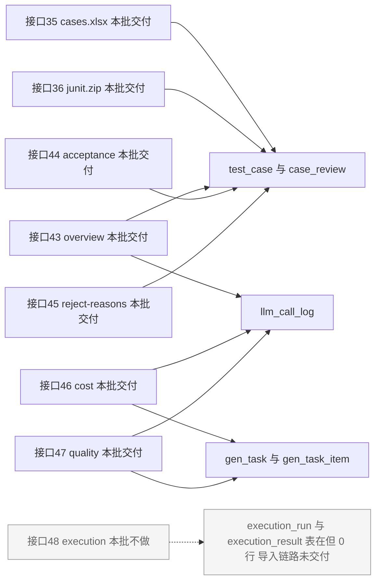

# 增量 PRD：T09 用例导出 + T11 指标与成本看板

> **文档性质**：增量 PRD，只描述本次变更，**不重写** `docs/01-architecture.md`。架构文档是需求基线，本文只做「范围裁决 + 口径补充 + 验收对照」；凡与 §6 / §4.2 / §8.3 冲突之处，以架构文档为准并在 §5 登记待确认。
>
> | 项 | 值 |
> |---|---|
> | 撰写人 / 角色 | 许清楚（产品经理） |
> | 版本 | **v1.2（2026-11-11 事实订正）**；v1.0 基于分派说明；v1.1（2026-11-09）依据 QA 只读连库 + PM 复核改写 Q1/Q2/Q3 前提；**v1.2 只订正事实与同步裁决状态，不新增/删减任何 P0 需求与验收项** |
> | 语言 | 简体中文 |
> | 技术栈 | 沿用 §0 第 3 行基线（Java 17 + Spring Boot 3.3 + MyBatis-Plus + MySQL 8 / Vite + React 18 + MUI + Tailwind + TS），本批不引入新依赖；**T09 依赖已齐**：EasyExcel 4.0.3 / POI 5.4.1 / JavaPoet 1.13.0 / JDK 17 `javax.tools.JavaCompiler` |
> | 项目名 | `ai_testcase_platform` |
> | 基线提交 | `3c6f86c`（主干闭环已交付；后端单测 226 / 前端 37 全绿） |
> | 需求基线 | §6 T09 行（1266 行）、§6 T10 行（1267 行）、§6 T11 行（1268 行）、§6.1 依赖图（1280–1303 行）、§4.2（875–926 行）、§8.3（1469–1488 行） |
> | 本批一句话结论 | 交付 **7 个端点**（#35 / #36 / #43–#47）；**#48 因「表在但导入链路无数据」跳过**；`40003` 已存在；**成本口径不改（按落库值聚合），看板如实显示 0 并标注成因**；验收靠 fixture，产品交付允许空态/0 值 |
>
> **v1.1 四条事实修订**（推翻 v1.0 的前提，全文以此为准）：
>
> 1. `execution_run` / `execution_result` **表在 V1 就已建好**（`V1__schema.sql:353–372` / `:382–400`，V2 补 `fk_execution_result_failure_category`），不是 schema 缺失；但两表 **0 行**（T10 导入链路未交付）。
> 2. `llm_call_log` 158 行、`SUM(cost_micro)=0` 是**按现行口径正确算出的结果**，不是回写链路故障（三成因见 4.3(3)）。
> 3. 现有数据**落在近 7 天内** → 问题不是「空态还是全量」，而是「**有数据但指标为 0/空时的展示口径**」。
> 4. `@@sql_mode` **含 `ONLY_FULL_GROUP_BY`**、现有 4 个 mapper XML 的 `sql_mode` 计数为 **0** → §6 T11 ⑦ 基线成立。
>
> **v1.2 修订范围**（只订正事实 + 同步裁决状态）：
>
> | # | 改动 | 位置 |
> |---|---|---|
> | 1 | **订正事实错误**：指标源表无 `deleted` 列，v1.1 的「手写 XML 聚合必须自己加 `deleted = 0`」会报 `Unknown column`；改为「不加 `deleted` 条件，仅按 `docId` 排除软删文档时显式 `JOIN doc_source ... AND d.deleted = 0`」 | ⑤-7 / ✅-6 / 1.6 |
> | 2 | **同步已裁决项状态**：§5.2 由「待确认」改为「已裁决 / 已定方向」，结论写进对应需求条目（裁决 2~8、⑤-5、⑤-13、⑤-14） | §5.2 / ③ 需求池 / 4.1 / 4.2 |
> | 3 | **新增事实差异登记**（`docs/01:834` 的 `doc_id` 表述与 DDL 不符；V1 不是最终 schema，V5/V6 有追加） | 1.6 |
> | 4 | 7 个端点范围、#48 延后、成本口径、8 项裁决、13 条 §6 验收项**全部不变** | 全文 |

---

## ① 本次范围与不做的事

### 1.1 范围边界

| 维度 | 本批做 | 本批不做 |
|---|---|---|
| 后端模块 | 新建 `export/`（§6 T09 文件清单）、`metrics/`（§6 T11 文件清单） | 不新建 `execution/` 模块；`execution_run` / `execution_result` **表已在 V1 建好**（V1:353–372 / 382–400，V2 补 FK），**无需新建迁移或实体** |
| 端点 | #35、#36、#43、#44、#45、#46、#47（共 7 个） | **#48 `/api/metrics/execution`**（Q1 裁决） |
| 前端 | `cases/CaseExportDialog.tsx`、`api/exportApi.ts`、`metrics/{OverviewDashboard,AcceptanceChart,CostChart}.tsx`、`api/metrics.ts`；路由最小接入 | 不做 T12 的全局组件/路由打磨、不做全局图表库选型 |
| 数据 | 只读 `test_case` / `case_review` / `llm_call_log` / `gen_task` / `gen_task_item` / `model_price` / 字典表 | 不重复创建 `LlmCallLog` 实体与 mapper（§6 T11 行**注**）；不改任何既有表结构；**不改 `model_price` 定价与 `llm_call_log` 写入链路；不在 T11 读取侧重算成本**（4.3(5)） |
| 文档 | 只新建本文 | 不改 `docs/01-architecture.md`、不改任何 `src/`、不 commit / push |
| 演示数据 | 把「**验收 fixture**」列为交付前置（4.3(3)）；产品交付允许空态 / 0 值 + 显式标注（4.3(2)） | 不把 fixture 当产品数据入库；`V100__demo_data.sql` 属 T14（§6 1276 行 ②），本批不造产品 demo 数据 |

### 1.2 依赖现状核对（Q1 的事实基础，v1.1 修订）

| §6 声明的依赖 | 交付状态 | 对本批的实际影响 |
|---|---|---|
| T09 ← T08 | ✅ 已交付（`3c6f86c`） | `test_case.status`、`case_review` 台账、四态枚举全部可用 |
| T11 ← T07 | ✅ 已交付 | `gen_task_item`（`attempts` / `status` / `latency_ms` / `degraded`）、`llm_call_log` 逐次记账可用 |
| T11 ← T08 | ✅ 已交付 | 采纳率分母、驳回原因 `code` 聚合可用；**但当前库 `case_review` 0 行**，见下 |
| T11 ← **T10** | ❌ **导入链路未交付**（§6.1 依赖图 1296 行 `T10 --> T11`） | **表在、0 行**：`execution_run` / `execution_result` 已由 V1 建好且迁移已 apply，接口可基于现有 schema 写、**不需要新建迁移**；阻塞点是 **无数据 → 默认近 7 天必然空态** → 仅 #48 受阻 |

**库内实测底数（QA 只读连库 + PM 复核，UTC 2026-11-09 15:22）**

| 对象 | 实测 | 对本批的含义 |
|---|---|---|
| `execution_run` / `execution_result` | **0 行 / 0 行** | #48 交付即空态，不能制造「通过率 0%」的假数据 |
| `test_case` | **16 行**：DRAFT 15 / ACCEPTED 1（`created_at` 2026-11-08） | 落在近 7 天内；已评审数仅 1 |
| `case_review` | **0 行** | §6 T11 ① 的 3/1/2/4 是**构造数据断言**，当前库跑不出来；驳回分布为空 |
| `llm_call_log` | **158 行**，SUM(prompt)=120962、SUM(completion)=21065、**SUM(cost_micro)=0**、`cost_micro>0` 行数 **0**（2026-11-07 05:18 ~ 11-08 10:34） | 成本曲线贴地 0 线，成因与裁决见 4.3(3)/4.3(5) |
| `model_price` | 4 行全 `enabled=1`：`mock-model 0/0`、`deepseek-chat 1000000/2000000`、`qwen-plus 800000/2000000`、`gpt-4o-mini 11000000/44000000` | 定价齐全，不是「缺单价表」 |
| `@@sql_mode` / mapper XML | 含 `ONLY_FULL_GROUP_BY`；现有 4 个 mapper XML 的 `sql_mode` 计数 **0** | §6 T11 ⑦ 基线成立 |

### 1.3 端点清点（以 §4.2 为准）

> 说明：§4.2 中导出 2 个（#35/#36）+ 指标 6 个（#43–#48）= **8 个**；本批落地 7 个，#48 延后。任务分派里「共 6 个新端点」应理解为「6 个指标端点」。
>
> **裁决 8（v1.2 同步）**：#36 路径以 `/api/export/junit.zip` 为准；§2.2 目录树 270 行注释写成 `junit.java` 属文档笔误，由架构师订正，**不改 §4.2 端点表、不属本批代码范围**（原 ⑤-11 已裁决）。

| # | 端点 | 本批 | 优先级 | 主要数据源 |
|---|---|---|---|---|
| 35 | `GET /api/export/cases.xlsx` | ✅ | P0 | `test_case` / `case_review` |
| 36 | `GET /api/export/junit.zip` | ✅ | P0 | `test_case` |
| 43 | `GET /api/metrics/overview` | ✅ | P0 | `test_case` + `llm_call_log` |
| 44 | `GET /api/metrics/acceptance` | ✅ | P0 | `test_case` |
| 45 | `GET /api/metrics/reject-reasons` | ✅ | P0 | `case_review` + `reject_reason` |
| 46 | `GET /api/metrics/cost` | ✅ | P0 | `llm_call_log` + `gen_task` |
| 47 | `GET /api/metrics/quality` | ✅ | P1 | `gen_task_item` + `llm_call_log` |
| 48 | `GET /api/metrics/execution` | ❌ 延后 | — | `execution_*`（**表在、0 行**，导入链路未交付 → 交付即空态） |

### 1.4 端点 — 数据源依赖图

> 实线 = 数据源已存在且有行（本批 7 个端点全部走已存在的表）；虚线 = 唯一指向 T10 的 #48，其**表结构存在但 0 行**，见 1.2 / 4.1。

### 1.5 明确不做的事（留痕）

1. **不做接口占位**（含「返回空数组/空对象」）：见 4.1 对选项 (c) 的否决。
2. **不把 T10 顺带做进来**：见 4.1 对选项 (b) 的否决。
3. **不重复设计既有资产**：`StatusChip` / `PageHeader` / `EmptyState` / `usePageQuery` / `api/{http,task,cases,sse}.ts` 直接复用；中文状态 label 由后端枚举/`config/public` 提供，前端不另存一份（JOURNAL 181 行）。
4. **不在统计 sheet 里复刻指标看板**：见 4.2。
5. **不改 §8.3 口径、不改 §6 验收标准**；若实读代码与文档分叉，走 §5 待确认或 1.6 事实差异登记，不擅自改口径。
6. **不在 T11 读取侧按 `model_price` 重算成本**：写入侧 `LoggingLlmProvider.java:162` 已算过，重算会拆成两套口径并与 §6 T11 ③ 冲突（4.3(5) / ⑤-12）。
7. **不新建迁移、不改 `model_price`、不修 `llm_call_log` 写入链路**：execution 表已在 V1 建好；成本 0 是正确记账结果，不是待修缺陷。

### 1.6 文档事实差异登记（v1.2 新增，只登记、不改 `docs/01`）

> 以下两条是**文档表述 vs DDL/迁移最终态**的差异，会影响 T11 手写 SQL 的写法。按 §11.3 的纪律登记留痕；**本批不改 `docs/01-architecture.md`**，由架构师决定订正时机。

| # | 文档表述 | 实测事实 | 对本批 SQL 的影响 |
|---|---|---|---|
| 1 | `docs/01-architecture.md:834` 称「`llm_call_log` / `test_case` **都挂在 `doc_id` 上**」 | `llm_call_log`（`V1:303–329`）**无 `doc_id` 列**，`LlmCallLogMapper.xml:24–39` 的 insert 列清单亦无；仅 `test_case.doc_id`（`V1:245`）、`gen_task.doc_id`（`V1:168`）存在（另有 `metric_snapshot.doc_id`，`V1:412`） | 按 `docId` 归集成本 **must** 走 `llm_call_log → gen_task → doc_source` 两级 join，**禁止** `WHERE llm_call_log.doc_id = ?`（会 `Unknown column`）。与 ⑤-7 / ✅-6 是同一处事实 |
| 2 | `V1__schema.sql` 容易被当成最终 schema | **V1 不是最终态**：`V5__gen_task_item_unit_ref.sql` 追加 `gen_task_item.unit_ref` / `kept_hashes` 及唯一索引 `uk_gen_task_item_task_unit`；`V6__gen_task_unit_ref_and_produced.sql` 追加 `gen_task.produced_items`，并把 `unit_ref` 从 `VARCHAR(64)` 改为 `VARCHAR(200)` | 写 `MetricsMapper.xml` / 实体时**以 Flyway 迁移后的最终表结构为准**，不要照 V1 抄列清单；`unit_ref` 列宽按 200 而非 64 |

---

## ② 用户故事

### 2.1 T09 用例导出

| ID | 用户故事 |
|---|---|
| US-1 | As a 测试开发，I want 把**评审通过**的用例一键导出成 Excel 交付给执行团队，so that 不用手工复制，也不会把「还没人看」和「已判定不可用」的用例混进交付物 |
| US-2 | As a 复盘者，I want 在导出对话框里显式勾选「已驳回 / 待评审」并看到本次生效的筛选条件，so that 能拿到一份用于归因复盘的完整样本，且拿到文件的人知道它不是全量 |
| US-3 | As a 测试开发，I want 把已采纳用例导出成能直接编译、且在 fat-jar 环境下 classpath 自洽的 JUnit 5 骨架，so that 导出的用例能进 CI，而不是只躺在数据库里 |

### 2.2 T11 指标与成本看板

| ID | 用户故事 |
|---|---|
| US-4 | As a 使用者，I want 打开看板第一眼就看到生成量 / 采纳率 / 总成本，且能分清「真的没数据」与「数据为 0」，so that 不会把「人还没评审」误读成「模型全错了」 |
| US-5 | As a 复盘者，I want 按天看采纳率趋势和驳回原因分布，so that 能定位是哪一版模板、哪一类原因拉低了质量（对应 §1.1 难点 4「评估可观测」） |
| US-6 | As a 成本负责人，I want 按任务 / 天 / 模型三个视角看 token 与成本并看到单用例成本，且成本为 0 时能看到**为什么是 0**，so that 能回答「一条可用用例花了多少钱」而不是盯着一条莫名的贴地 0 线（§8.3 1483 行） |

---

## ③ 需求池（逐条可验收）

> 优先级定义：**P0 = 本批必做**（对应 §6 T09/T11 验收项或首屏可见）；**P1 = 本批应做**（不进首屏，但覆盖 §6 验收项或补齐口径一致性）；**P2 = 可延后**（不进本批）；**延后 = 明确不在本批**。
>
> **v1.2 只把已裁决结论写进下列条目的验收判据/依据列，未新增或删减任何 P0 需求。**

### 3.1 T09 需求池

| ID | 优先级 | 需求（must / should / could） | 验收判据 | 依据 |
|---|---|---|---|---|
| T09-P0-1 | P0 | `cases.xlsx` **must** 含「用例」「统计」两个 sheet，中文不乱码，可被 Excel/WPS 打开 | 用 Excel + WPS 各打开一次，两个 sheet 名正确、中文列头无乱码 | §6 T09 ① |
| T09-P0-2 | P0 | 默认**只导 ACCEPTED / EDITED**；`statuses` 覆盖规则按 4.2 表 | 不传参导出的行数 = 该任务下 ACCEPTED+EDITED 行数；DRAFT / REJECTED 不出现 | §6 T09 ② |
| T09-P0-3 | P0 | **【裁决 4】**`statuses` **must** 为单个逗号分隔字符串；后端 `trim` 后按 `CaseStatus` 白名单校验；空值回落默认 `ACCEPTED,EDITED`，非法值/部分非法 **整单 `40001`**、不静默丢弃、不部分导出 | 传 `ACCEPTED,EDITED` / `ACCEPTED, DRAFT` / 大小写不符 / 非法值四类，断言回落、过滤与 `code=40001`；`message` 列出可选值 | §6 T09 ② + CaseService.java:88–91 / 221–232 + 4.2(2) |
| T09-P0-4 | P0 | 空用例集 / 超过 `EXPORT_MAX_ROWS` **must** 返回 `40003`，**不产生可下载文件** | 响应 **HTTP 200** + `code=40003`（**不按 HTTP 4xx 断言**）、`Content-Type: application/json`、无 `Content-Disposition`；不落盘空 xlsx | §6 T09 ⑤ + §8.1 1402 行 + ExportProperties.java:12–13 |
| T09-P0-5 | P0 | **【裁决 5 · 写死】**`exportApi.ts` **must** 采用「`blob.type` / `Content-Type` 判别 + 补 `API_CODE.EMPTY_RESULT(40003)`」；**不采用单独探测请求**（如先发 HEAD/元数据请求再下载）。后端导出端点 **must not** 声明固定二进制 `produces` | 见 4.2(3) 的两种 `Content-Type` 契约表；造 `40003` 场景断言**没有**触发文件下载、toast 出现且文案来自 `message`；成功场景文件名正确 | http.ts:71–75（blob 不解包）；`GenTaskController.java:66–73`（同一 `produces` 陷阱，D-35）；裁决 5 |
| T09-P0-6 | P0 | 导出文件名 **must** 带任务号与时间戳 | 文件名形如 `T2026…-…_20261107-….xlsx`，与 `gen_task.task_no` 一致 | §6 T09 ⑥ + §8.2 1462 行 |
| T09-P0-7 | P0 | 「统计」sheet **must** 只含 4.2 定义的最小 5 字段，且与「用例」sheet **同一批快照** | 5 字段齐全、无采纳率/成本列；统计行数 == 「用例」sheet 数据行数 | 4.2 |
| T09-P0-8 | P0 | JUnit `.java` **must** 能被**真实编译**，中文 `@DisplayName` 正确转义 | 解压 zip 后用 `javax.tools.JavaCompiler` 编译**全部** `.java`，诊断无 ERROR；**禁止**只断言「文件已生成」 | §6 T09 ③ / 4.2(5)；A/B 方案待架构师 `docs/07` 落定（⑤-14），**共同硬要求不变** |
| T09-P0-9 | P0 | 类名/方法名 **must** 符合 Java 标识符规范（中文标题转拼音或 `case_001`） | 生成物中无非法字符、无重复类名 | §6 T09 ④ |
| T09-P0-10 | P0 | **must** 明确 JUnit 编译的 classpath 方案（A 纯 JDK + 极简 runner / B 显式带 `junit-jupiter-api` jar），并在 `README.txt` 写明 | 方案落地后，在**无 test-scope 依赖的 fat-jar 运行环境**下编译仍通过；**A/B 二选一待架构师在 `docs/07` 落定**（⑤-14），共同硬要求按 T09-P0-8 不变 | 4.2(5) / lead 事实 6 / ⑤-14 |
| T09-P1-1 | P1 | `CaseExportDialog` **should** 提供四状态多选（默认勾选 ACCEPTED/EDITED）+ 生效条件回显 | 打开对话框可见 4 个状态、默认 2 个勾选；导出后 Toast/文件名可辨条件 | US-2 |
| T09-P1-2 | P1 | **【裁决 6】**允许 #36 `junit.zip` 增可选 `statuses`、默认值与 #35 同源（登记偏差，不改 §4.2 入参表） | 同一任务下 xlsx 与 zip 的用例条数一致；对话框/统计 sheet 回显生效条件 | 4.2 派生 / 裁决 6（原 ⑤-4 已裁决） |
| T09-P2-1 | P2 | 导出产物落盘到 `EXPORT_TEMP_DIR` 并纳入 `.gitignore` | `git status` 不出现 `exports/` | §8.8 1588 行 / §12 验收依赖索引 1864 行（D-20 已补，登记规则不重复实现） |

### 3.2 T11 需求池

| ID | 优先级 | 需求（must / should / could） | 验收判据 | 依据 |
|---|---|---|---|---|
| T11-P0-1 | P0 | #43 overview **must** 严格按 §8.3 口径，分母 = 已评审数（**不含 DRAFT**），EDITED 算改后采纳；**【裁决 3】出参「失败率」= `reject_rate = REJECTED / 已评审数`，前端卡片中文标「驳回率」，不引入第三个失败率** | 4.3(4) 的 Given/When/Then 全部满足（**用 fixture**，当前库跑不出来）；卡片文案为「驳回率」且数值 = `2/6`（fixture 场景） | §6 T11 ① / §8.3 1471–1486 行 / 裁决 3 |
| T11-P0-2 | P0 | #44 acceptance **must** 输出按天采纳率趋势，口径与 #43 同源 | 同时间窗下趋势点加权口径与 overview 卡片不矛盾 | §6 T11 ① / §4.2 920 行 |
| T11-P0-3 | P0 | #45 reject-reasons **must** 只按 `code` 聚合，未知归 `OTHER`；自由文本 `reason_text` 永不参与聚合 | 造一条未知 code 与一条仅填自由文本的记录，前者计 OTHER、后者不出现 | §6 T11 ② / §8.3 1488 行 |
| T11-P0-4 | P0 | **【裁决 2】**#46 cost **must** 支持 `groupBy=task/day/model` 三视角，各自求和与 `llm_call_log` 直接 `sum(cost_micro)` **差值严格为 0**；**严格按落库值求和，不按 `model_price` 现算、不改 T04 记账链路** | 三视角分别断言差值 `== 0`；**样本必须含 `cost_micro ≠ 0` 的行**，否则是 0=0 假绿 | §6 T11 ③ / 4.3(5) / 裁决 2（原 ⑤-12 已裁决） |
| T11-P0-5 | P0 | 单用例成本 **must** = 总成本 / `max(已采纳数, 1)`；分母 0 返回 `0` 而非 `NaN` | 造「已采纳数=0」场景，字段为数值 0、非 `null`/`NaN`、不抛异常 | §6 T11 ④ / §8.3 1483 行 |
| T11-P0-6 | P0 | 本批所有已交付指标端点 **must** 支持 `from/to`，默认近 7 天；日期按 `Asia/Shanghai` 本地日解析后转 UTC 查库 | 不传 from/to 时窗口 = 近 7 天；跨日数据不落错日 | §6 T11 ⑤ / §8.2 1467 行 |
| T11-P0-7 | P0 | 窗口真的无数据时 **must** 显示空态 + 显式范围切换，**不放假数据、不静默回落全量** | 见 4.3(2)；界面标签与实际查询窗口一致 | 4.3(2) + 05-frontend-merge-plan §7.1 315 行 |
| T11-P0-8 | P0 | 指标 SQL **must** 在 `ONLY_FULL_GROUP_BY` 下直接可执行：非聚合列显式进 `GROUP BY` 或 `ANY_VALUE()`；禁止改写 `sql_mode`；**【v1.2】聚合 SQL 不加 `deleted` 条件（源表无该列，见 ✅-6 / 1.6）** | 在含 `ONLY_FULL_GROUP_BY` 的会话逐条跑 `MetricsMapper.xml`；`grep -c 'sql_mode' backend/src/main/resources/mapper/` 期望 **0**；`grep -c 'deleted' backend/src/main/resources/mapper/` 期望 **0** | §6 T11 ⑦ / §8.2 1464 行；**基线已实测成立** / ✅-6 |
| T11-P0-9 | P0 | 首屏 6 卡片 + 趋势 + 成本图 **must** 有内容，且 **0 值有成因标注**；不因成本为 0 而空白或假造曲线；**【裁决 3】「驳回率」卡片按 T11-P0-1 口径命名** | 见 4.3(2)/4.3(3)；`OverviewDashboard` / `AcceptanceChart` / `CostChart` 三页均可渲染 | US-4 / US-6 / 裁决 3 |
| T11-P0-10 | P0 | 成本为 0 但 token ≠ 0 时 **must** 显式标注成因（mock 单价 0 / 失败调用无 token / 模型无单价行），**不隐藏、不现算、不伪造** | #46 出参含可判别的标注字段；看板显示「成本 0（原因：…）」，不是一条无说明的贴地 0 线 | 4.3(5) 裁决 (ii) / US-6 |
| T11-P0-11 | P0 | **分母为 0 时前端 must 不渲染「采纳率 0%」**，改为「暂无评审数据」+ 引导；后端数值口径仍返回 0（与 P0-5 不冲突） | `case_review` 0 行 / 全 DRAFT 场景下，界面不出现「0%」字样、出现「暂无评审数据」与引导动作 | 4.3(2) / §8.3 1486 行 |
| T11-P0-12 | P0 | **【v1.1 已定方向，v1.2 强化】**§6 T11 ① 与 ③ 的断言 **must** 用 **fixture** 构造数据；fixture **仅用于验收/演示脚本，不作为产品数据入库**；**must** 造非 0 成本数据验 ③，**不允许 `0=0` 假绿** | 验收脚本造 3/1/2/4 用例 + 台账 + 至少 1 行 `cost_micro≠0` 的调用日志，时间戳落在近 7 天内 | 4.3(3) / 1.2 实测底数 / 原 ⑤-5 已定方向 |
| T11-P1-1 | P1 | #47 quality **should** 给出首次通过率 / 解析失败率 / `p50` `p95` 耗时；**不依赖 T10** | 数据源仅 `gen_task_item` + `llm_call_log`；`p50/p95` 出现 | §6 T11 ⑥ / §8.3 1481–1484 行 |
| T11-P1-2 | P1 | #44 的 `groupBy=template/model/category` **should** 可用；首屏只用 `day` | 三个分组各自可返回 | §4.2 920 行 |
| T11-P2-1 | P2 | `strict_accept_rate`、测试点覆盖率、按 `degraded` 拆分采纳率 **could** 延后 | — | §8.3 1476/1479 行、GenTaskItem.java:35（见 ⑤-9） |
| T11-延后 | 延后 | #48 execution（通过率趋势 + 失败分类 Top）**不在本批**；两表 0 行，交付即空态 | 端点不存在，不注册路由，不写占位实现；**【裁决 7】在 PRD / CHANGELOG / §4.2 #48 三处留痕，不改 §6 T11 依赖列** | 4.1 / 裁决 7（原 ⑤-10 已裁决） |

> **P1 不可整批砍掉的边界**：若 T11-P1-1 因排期被压缩，`p50/p95` **必须**并入 #43 overview 出参，否则 §6 T11 ⑥ 漏项（见 §6 对照表）。

---

## ④ 范围裁决（Q1–Q4）

### 4.1 Q1｜T11 依赖缺口怎么裁（v1.1 按实测事实重写）

**推荐不变：(a) 本批直接跳过 execution 相关指标，标注「T10 交付后补」。但理由从「schema 缺失」改为「数据源链路缺失」。**

**事实前提修订**

| 项 | v1.0 假设 | v1.1 实测 | 对裁决的影响 |
|---|---|---|---|
| execution 表 | 不存在 | **V1 已建**（`V1__schema.sql:353–372` / `:382–400`），V2 补 `fk_execution_result_failure_category`；两表 **0 行** | #48 的接口**可以基于现有 schema 写、不需要新建迁移**；「做不了」不再成立，阻塞点是**导入链路无数据 → 默认近 7 天必然空态** |
| T11 ① 的数据 | 库里可跑 | `test_case` 16 行（DRAFT 15 / ACCEPTED 1）、`case_review` **0 行** | 3/1/2/4 → 4/6 是**构造数据断言**，必须造 fixture（T11-P0-12） |

| 选项 | 结论 | 理由（v1.1） |
|---|---|---|
| **(a) 跳过，标注后补** | ✅ **推荐** | ① §6 T11 验收 ①–⑦ **没有任何一条**依赖 `execution_result`（逐条核对见 §6 对照表），跳过 #48 **不漏任何验收项**；② #48 是 8 个端点中**唯一**真依赖 T10 的；③ **阻塞点已改为「数据源链路缺失」**：表在、0 行，做一个只能返回空数组的端点既不满足任何验收项，又制造「通过率 0%」的假数据，与项目「不放假数据」纪律冲突；④ **T10 交付后补 #48 不需要任何 schema 变更**，只需 service/controller + 前端页 → 后补成本很低，支持「现在跳过」；⑤ 与 4.3(2) 的 0 值展示叠加：若 #48 现在交付，看板会同时出现「采纳率 0 / 成本 0 / 通过率 0」三块零值区，演示时无法区分「没数据」与「全失败」；⑥ 不引入任何占位端点 |
| (b) 顺带把 T10 做了 | ❌ | 范围从 2 个模块扩到 3 个，验收面从 13 条扩到 19 条；把两个可独立验收的纵向切片捆成一个，直接违背 §6 1252 行「一个任务 = 一个可独立启动、可独立验收的纵向切片」。且 (a)④ 已说明后补无需迁移，捆做没有额外收益 |
| (c) 接口占位返回空数据 | ❌ **明确否决** | 05-frontend-merge-plan §7.1（311–315 行）已裁决：**「不写永久占位——占位一旦进了主干，端点补上后没人回来删它」**、**「静默空列表会被误读成筛选条件写错了，排查方向完全相反」**、**「端点未交付时用 `EmptyState` 显示待交付，不放假数据」**。v1.1 更直接：**两表 0 行意味着占位端点必然返回空数组**，而空数组会被误读成「导入过但全失败」；属本项目反复登记的静默假绿（D-39 恒 null 字段 / D-41 空产出记成功 / D-46 假绿探针） |

**必须同时澄清的一处口径混淆**（避免把该做的也砍掉）：

| 指标 | §8.3 定义 | 实际数据源 | 依赖 T10？ |
|---|---|---|---|
| 首次通过率 | `count(item.attempts=1 and status=SUCCESS) / total_items`（1481 行） | `gen_task_item.attempts` / `status`（GenTaskItem.java:87–91，**已存在**） | ❌ 否 |
| 生成成功率 / p50·p95 耗时 | 1480 / 1484 行 | `gen_task_item.status` / `latency_ms` | ❌ 否 |
| 解析失败率 | 1482 行 | `llm_call_log.error_code` | ❌ 否 |
| **通过率趋势 + 失败分类 Top** | #48（924 行），**测试执行**通过率，与上面「模型一次输出可用率」是两回事 | `execution_run` / `execution_result`（**表在、0 行**）/ `failure_category` 字典 | ✅ **是** |

→ 结论：**只砍 #48；#47 quality 保留（P1）**，其三个指标全部有现成数据源。#48 推迟到 T10 交付、有真实执行数据后一起交付。

> **风险一句 + 裁决 7（v1.2 同步）**：本批交付后 T11 处于「部分交付」状态，而 §6 1268 行依赖列与 §4.2 924 行仍写着 `T10` / #48；若不显式登记边界，对外讲「指标看板已交付」会被追问出 execution 缺口，且 #48 容易被后来人误读成"已实现"。**已裁决：在 PRD（本文）、CHANGELOG、§4.2 #48 三处留痕；不改 §6 T11 依赖列；并需登记「两表 0 行」这一事实**，否则后来人看到表存在、却查不到数据，会朝 schema/迁移方向排查（原 ⑤-10 已裁决）。

### 4.2 Q2｜T09 的导出范围与默认口径

**(1) 默认只导 ACCEPTED / EDITED —— 合理，确认为 P0**

| 用户场景 | 判断 |
|---|---|
| 导出物的下游是「交付给执行团队 / 归档为可复用测试资产」 | `DRAFT` = 人还没看、`REJECTED` = 人已判定不可用；混进交付物等于**把评审结论丢了**，下游会拿到未确认用例 → 默认排除正确 |
| 与 §8.3「评审动作即标注」同源 | 导出是**标注结果的下游消费**，不是「原始生成结果的搬运」；默认口径与采纳率分子 `(ACCEPTED+EDITED)` 同形，两份产物可互相对账 |
| 反面场景（复盘要看被驳回样本）确实存在 | 所以 `statuses` 覆盖是 **P0 而非"以后再说"**：对话框四状态可见、默认勾选 2 个、导出条件回显（T09-P1-1）。当前库仅 1 条 ACCEPTED，导出默认口径**有数据可导**，不阻塞 |

**(2) `statuses` 行为定义（裁决 4 已落进 T09-P0-3）**

| 传参 | 行为 | 依据 / 反例 |
|---|---|---|
| 未传 / 空串 / 空数组 | **回落默认** `ACCEPTED,EDITED`，不解读为「全量」；传参格式为**单个逗号分隔字符串** | §6 T09 ② / 裁决 4；"不传"必须与"全选"可区分 |
| 全为合法值（四值子集） | 按传入集合过滤；后端 `trim` 后按 `CaseStatus` 白名单校验 | 合法值唯一真源 = `common/enums/CaseStatus.java`（11–23 行） |
| 含任一非法值 / 大小写不符 | **整单 `40001`**，`message` 列出可选值；不静默丢弃、不部分导出 | `CaseService.java:88–91 / 221–232` 的 `requireEnum` 现成范式（注释明写「脏值直接 40001，而不是静默返回空列表」）；D-49 的教训是多传字段被 `FAIL_ON_UNKNOWN_PROPERTIES` 静默忽略 → 变成假控件 |
| 显式四值全选 | 导全量，界面须回显「全部状态」 | 用户主动行为，与默认区分 |

**(3) 错误码 `40003` 核实结论 + 裁决 5 的双形态契约**

| 项 | 结论 | 证据 |
|---|---|---|
| 是否存在 | ✅ **已存在**，T09 验收⑤无前置阻塞 | `common/ErrorCode.java:28` → `E_EMPTY_RESULT(40003, "没有可处理的数据", HttpStatus.OK)`；§8.1 表 1416 行同值；§6 T09 ⑤ 引用正确 |
| HTTP 形态 | **HTTP 200 + `code=40003`**，不是 4xx | §8.1 1402 行 / `ErrorCode.java:9–11`。**验收禁止按 HTTP 400 断言**（T09-P0-4） |
| 共用场景 | 空集 **与** 超过 `EXPORT_MAX_ROWS`（默认 5000）都返回 40003 | `ExportProperties.java:12–13`、§8.8 1587 行 → `message` 需按场景给可读中文（「没有符合条件的用例」vs「超出单次上限，请加筛选条件」），**前端不硬编码文案** |
| **不要与 `50006` 合并** | `E_LLM_EMPTY(50006, "模型未产出任何内容")` 是**模型侧空产出**（5xxxx 段），`40003` 是**请求侧无可处理数据**（4xxxx 段） | `ErrorCode.java:91–103` 的注释、D-41 / JOURNAL 506 行。合并会让「上游模型问题显示成用户操作问题」，并在监控里消失 |
| **实读发现的前端缺口** | `responseType:'blob'` 下，`http.ts:71–75` 因 `typeof payload.code !== 'number'` 把错误 JSON **原样返回**，拦截器不 toast、不抛 `ApiError` → 40003 响应会被当 xlsx 下载下来 | 故 T09-P0-5 定为 **P0**：先按 `blob.type` / `Content-Type` 判别再决定解包或下载；`types/common.ts:86–94` 的 `API_CODE` 目前**没有 40003**，需补常量 |

**裁决 5（v1.2 写死）— 导出端点成功/失败两种 `Content-Type` 契约**

| 场景 | `Content-Type` | 响应体 | 其它响应头 | 前端判别动作 |
|---|---|---|---|---|
| **成功**（#35） | `application/vnd.openxmlformats-officedocument.spreadsheetml.sheet` | xlsx 二进制流 | `Content-Disposition: attachment; filename=…` | `blob.type` 为二进制 → `URL.createObjectURL` 触发下载 |
| **成功**（#36） | `application/zip` | zip 二进制流 | 同上 | 同上 |
| **失败**（空集 / 超限） | **`application/json`** | `{code:40003, message, data:null, traceId}` | **HTTP 200；无 `Content-Disposition`** | `blob.type` 含 `json`（或按 `Content-Type` 判别）→ `await blob.text()` → `JSON.parse` → 按 `code` 分支（补 `API_CODE.EMPTY_RESULT(40003)`）→ toast `message`、**不下载** |

| 裁决 5 的三条硬约束 | 说明 |
|---|---|
| 采用「`blob.type` / `Content-Type` 判别 + 补 `API_CODE.EMPTY_RESULT(40003)`」 | **不采用单独探测请求**（如先发 HEAD / 元数据请求再下载），避免两次请求间状态漂移与额外端点 |
| 后端导出端点 **不得声明固定二进制 `produces`** | `@GetMapping` 不写 `produces = "application/vnd..."`。否则 `BizException` 经 `@RestControllerAdvice` 想吐 JSON 时会内容协商失败（`HttpMediaTypeNotAcceptableException`）→ 客户端只看到 **500 空 body**；SSE 端点 `GenTaskController.java:66–73` 已记录**同一陷阱**（D-35）。让 Spring 按实际返回值协商，两种 `Content-Type` 才能共存 |
| 前端不得硬编码错误文案 | 40003 的 `message` 由后端按场景给可读中文；前端只负责解包与 toast |

**(4) 「统计」sheet 最小可用集合（5 字段，不再加）**

| 字段 | 来源 | 为什么必须有 |
|---|---|---|
| 导出时间 | 应用侧生成时刻（标注时区） | 判断这份快照新旧 |
| 任务号 `taskNo` | `gen_task.task_no`（§8.2 1462 行） | 与文件名（§6 T09 ⑥）对齐，可追溯回任务 |
| 生效导出条件 | 本次实际生效的 `statuses`（+ `taskId` / `docId`） | 让拿到文件的人知道**是否被筛过**，避免误当全量 |
| 导出用例数 | 「用例」sheet 数据行数 | 与用例表自证一致 |
| 状态分布 | 同一快照按 `CaseStatus` 四值计数（本次未导的状态写 0） | 口径自证，可与 §8.3「已评审数」对账 |

- **不放**：采纳率、驳回率、成本、token、驳回原因明细、测试点覆盖率 —— 那些是 T11 看板的职责；统计 sheet 只回答「这份文件是什么」，不复刻看板。
- **硬约束**：5 个统计值 **must** 从「用例」sheet 那批已取出的行在内存里算，**禁止二次查库**（两次查询之间有人评审，统计与明细就会对不上）。

**(5) JUnit 编译验收的 classpath 方案（v1.1 新增，Q2 补充裁决；A/B 待 `docs/07` 落定）**

| 事实 | 风险 |
|---|---|
| JDK 17 自带 `javax.tools.JavaCompiler`；**JUnit 5 只在 `test scope`，fat-jar 运行时没有 `junit-jupiter`**；T09 依赖已齐（EasyExcel 4.0.3 / POI 5.4.1 / **JavaPoet 1.13.0** / JDK 17 编译器） | 若生成的 `.java` 直接 `import org.junit.jupiter.api.*`，在 fat-jar 运行时编译会因 classpath 缺 jar 失败；而验收若只断言「生成了 .java 文件」，**完全测不到这一点**——又是一个「测错对象」（§3.2.1.1 同型） |

| 裁决 | 内容 |
|---|---|
| 方案 A（PM 推荐，待架构师定） | 生成的 `.java` **只依赖 JDK**（不 import JUnit），zip 内附一个极简 runner + `README.txt` 写明编译/运行命令；fat-jar 环境下 `JavaCompiler` 无需外部 jar 即可编译 |
| 方案 B（待架构师定） | 保留 JUnit 5 注解，但验收脚本**显式把 `junit-jupiter-api` jar 加入 `JavaCompiler` 的 classpath**（从 `pom.xml` test scope 解析路径），并断言该 classpath 非空 |
| **共同硬要求（不变）** | 验收 **must** 真正调用 `JavaCompiler` 编译全部 `.java` 并断言诊断无 ERROR；**禁止**只断言「文件已生成 / 文件名合法」。**A/B 二选一仍待架构师在 `docs/07` 落定**（⑤-14），落 T09-P0-8 / P0-10 |

### 4.3 Q3｜T11 看板的最小可演示集（v1.1 按实测事实重写）

**(1) 6 个指标端点的 P0 / 延后划分**（判据 = 「打开看板第一眼要能看到东西」+「§6 T11 验收①–⑦ 不漏项」）

| 端点 | 首屏 | 优先级 | 理由 / 覆盖的验收项 |
|---|---|---|---|
| #43 overview | ✅ 卡片 | **P0** | 第一眼就是它（§5.3 时序图 1240–1245 行看板入口即 overview）；覆盖 ①④⑤，并承载 ⑥ 的 `p50/p95`；**0 值按 4.3(2) 分类展示**；「驳回率」按裁决 3 命名 |
| #44 acceptance | ✅ 折线 | **P0** | 覆盖 ①⑤⑦；`groupBy=day` 为 P0，其余分组 P1；分母为 0 时按 T11-P0-11 不画 0% |
| #45 reject-reasons | ✅ 分布 | **P0** | 覆盖 ②⑤⑦；当前 `case_review` 0 行 → 空态而非空饼图（4.3(2) D 类） |
| #46 cost | ✅ 成本图/卡 | **P0** | 覆盖 ③④⑤⑦；**三视角全做**（③ 要求差值 0）；**严格按落库 `cost_micro` 求和**，0 值须标注成因（T11-P0-10） |
| #47 quality | ❌ 二级页 | **P1** | 覆盖 ⑥⑦；数据源已存在、不依赖 T10；不进首屏但**本批仍交付** |
| #48 execution | ❌ 不做 | **延后** | 4.1 裁决 (a)：两表 0 行，交付即空态 |

> 若资源压缩，**唯一允许的顺序**是：先保 #43/#44/#45/#46 全部 P0 → 再保 #47 或把 `p50/p95` 并入 #43 → 最后才是 P2。**不允许**砍掉 #46 的三视角（③ 会漏项），也不允许砍掉 T11-P0-10 的成因标注（否则成本图是一条无解释的 0 线）。

**(2) 问题改写：从「空态还是全量」改为「有数据但指标为 0/空时的展示口径」**

> 事实：当前 UTC 2026-11-09 15:22；`test_case.created_at` = 2026-11-08、`llm_call_log.created_at` = 2026-11-07 05:18 ~ 11-08 10:34 → **全部落在近 7 天内**。默认窗口**不是空态**，而是「有 16 条用例 / 158 条调用日志，但采纳率、驳回分布、成本全是 0/空」。**切换范围（近 30 天 / 全部）解决不了这个问题**，必须靠展示口径 + fixture。

| 层 | 裁决 |
|---|---|
| 后端（数值口径） | 严格按 `from/to` 过滤（§8.2 1467 行）；分母 0 时比率返回 **0** 而非 `NaN`（§6 T11 ④ / §8.3 1483 行）—— 保证不炸、可序列化，**这是数值口径，不是展示口径** |
| 前端 A · 有值 | 分子分母都有值 → 显示真实值（生成用例数 16、token 120962 等） |
| 前端 B · 分母为 0 | 已评审数 = 0 / `case_review` 0 行 → **不渲染「采纳率 0%」**，显示「**暂无评审数据**」+ 引导（去评审用例 / 造 fixture）。理由：把「人还没评审」渲染成 0% 会被读成「模型全错了」，与 §8.3 1486 行「未评审不代表模型失败」的立场直接相反——**口径正确但表达误导** |
| 前端 C · 成本为 0 | token ≠ 0 而成本 = 0 → 显示 0 且**显式标注成因**（4.3(3) 三成因），不隐藏、不现算、不伪造 |
| 前端 D · 分布为空 | 驳回原因 0 行 → 空态「暂无驳回记录」，**不画空饼图** |
| 否决「统一显示 0」 | 见 B：把未评审误表达为质量失败；且与 4.1 否决占位是同一条「不放假数据」纪律 |
| 否决「统一显示暂无数据」 | 库里确实有 16 条用例 / 158 条日志，全遮掉等于把真实产出也藏了，`generatedCount` 卡片会与明细对不上 |
| 窗口真的无数据时 | 仍按原裁决：`EmptyState`「近 7 天没有数据」+ **显式**范围切换（近 7 天 / 近 30 天 / 全部）；**不放假数据、不静默回落全量**（标签写「近 7 天」却给全量 = 欺骗性 UI，且违反 §6 T11 ⑤；同源依据 05-frontend-merge-plan §7.1 315 行） |

> **一句话结论**：后端数值口径与前端展示口径**分层** —— 后端保证「不炸、返回 0」，前端保证「不误导、说清为什么是 0」。

**(3) 演示前置、成本三成因与 fixture 裁决**

| 数据 | 实测值 | 含义 |
|---|---|---|
| `test_case` | 16 行：DRAFT 15 / ACCEPTED 1 | 已评审数 1；3/1/2/4 构造断言跑不出来 |
| `case_review` | **0 行**（旧的 REJECTED + 3 行台账已被 FK 级联清理） | 不要再假设台账还在；驳回分布为空 |
| `llm_call_log` | 158 行，SUM(prompt)=120962、SUM(completion)=21065、**SUM(cost_micro)=0**、`cost_micro>0` 行数 0 | token 有、成本全 0 |
| `model_price` | 4 行全 enabled=1，含 3 个非 0 定价 | **不是「缺定价」** |
| 时间 | log 11-07 05:18 ~ 11-08 10:34；case 11-08 10:34；当前 UTC 11-09 15:22 | 全在近 7 天内 → 不是空态 |

**成本归零的三成因（PM 复核连库 + 源码，本批最实质的一条）**

| 分组 | 行数 | token | 单价 | 为什么是 0 |
|---|---|---|---|---|
| `mock-model` / SUCCESS | 131 | 119331 / 20691 | **0/0**（`V2:91`） | `ModelPriceCache.java:27` 明写「单价为 0（如 mock-model）→ 成本 0，**不 WARN**，这是正常配置」→ **正确** |
| `deepseek-chat` / FAILED | 24 | **0 / 0** | 1000000/2000000 | `costMicro()` 第 68–70 行 `usage.totalTokens()==0` 直接返回 0 → **正确**（失败调用无 usage 回显） |
| `deepseek-flash` / SUCCESS | 3 | 1631 / 374 | **单价表无此行** | `priceOf()` 返回 null + 每模型只 WARN 一次 → 记 0（`ModelPriceCache.java:92–97`）→ **配置缺口**，已定方向见 ⑤-13 |

> **`LoggingLlmProvider.record()` 第 162 行每次调用都执行 `modelPriceCache.costMicro(model, usage)` 并落库；`ModelPriceCache` 三条失败方向都明确「记 0、不阻断」。所以回写链路没坏，`SUM(cost_micro)=0` 是按现行口径正确算出来的结果。**

**「验收造 fixture 还是允许空态交付」的明确裁决（v1.1 已定方向，v1.2 同步）**

| 问题 | 裁决 |
|---|---|
| §6 T11 ① 的 3/1/2/4 断言 | **必须造 fixture**：它是构造数据断言，当前库跑不出来（16 行 DRAFT 15 / ACCEPTED 1、`case_review` 0 行） |
| 产品交付能否以空态 / 0 值交付 | **允许**：看板按 4.3(2) 分类展示 + 显式标注，不放假数据即可 |
| 两者是否矛盾 | 不矛盾 —— fixture **仅用于验收 / 演示脚本，不作为产品数据入库**；`V100__demo_data.sql` 属 T14（§6 1276 行 ②），本批不造产品 demo 数据 |
| fixture 最小集 | ① `test_case` 10 行（3/1/2/4）+ 对应 `case_review` 台账（含 1 条未知 code 验 §6 T11 ②）；② `llm_call_log` 至少 1 行 `model='deepseek-chat'`、`prompt_tokens>0`、`cost_micro` 按 1000000/2000000 算出**非 0** 值；③ 时间戳落在近 7 天内 → 否则 §6 T11 ③「差值 0」退化为 **0=0 的假绿**（与 D-46 同型）。**不允许用全 0 成本数据验 ③**（T11-P0-12） |

**(4) §6 T11 ① 的验收场景（转成场景描述，不写测试代码）**

| 步骤 | 内容 |
|---|---|
| **Given（fixture）** | 某时间窗内 `test_case` 共 10 条，`status` 分布 = ACCEPTED 3 / EDITED 1 / REJECTED 2 / DRAFT 4；`case_review` 有对应台账；`llm_call_log` 总成本 `C ≠ 0`；时间戳落在近 7 天内。**当前库不满足，必须由验收脚本构造**（T11-P0-12） |
| **When** | 请求 `GET /api/metrics/overview` 与 `GET /api/metrics/acceptance?groupBy=day`，`from/to` 覆盖该窗口 |
| **Then** | 生成用例数 = **10**（含 DRAFT）；已评审数 = **6**；`accept_rate = (3+1)/6 = 4/6 ≈ 0.6667`；`edited_rate = 1/6 ≈ 0.1667`；`reject_rate = 2/6`；`strict_accept_rate = 3/6`；**#43「驳回率」= `2/6`**（裁决 3） |
| **And** | 4 条 DRAFT **不进任何比率的分子或分母**，但计入「生成用例数」；`accept_rate + reject_rate = 1`（§8.3 1478 行） |
| **边界 A** | 全部为 DRAFT / 已评审数 = 0 → 后端比率返回 **0**（不 `NaN`、不抛异常）；**前端按 4.3(2) B 类显示「暂无评审数据」，不显示 0%** |
| **边界 B** | 已采纳数 = 0 → 单用例成本返回 **0**（§8.3 1483 行 / §6 T11 ④） |
| **边界 C** | `groupBy=task/day/model` 各自求和 == `llm_call_log` 直接 `sum(cost_micro)`，差值**严格为 0**；且 `C ≠ 0`（§6 T11 ③） |

**(5) 成本口径裁决：(i) 按 `model_price` 现算 vs (ii) 不改口径 —— 选 (ii)，但理由要修正**

> **裁决 2（v1.2 同步）**：本批不改成本口径，严格 `SUM(llm_call_log.cost_micro)`，不在读取侧按 `model_price` 现算，**不改 T04 记账链路**；§6 T11 ③ 保持原样并用非 0 fixture 验收。

| 选项 | 结论 | 理由 |
|---|---|---|
| **(i) T11 按 `model_price` 现算成本** | ❌ **否决** | ① **算不出非 0**：131 行 mock-model 单价 0/0 → 仍 0；24 行 deepseek-chat token=0 → 仍 0；3 行 deepseek-flash 单价表无此行 → 无价可依。对当前 158 行数据，现算与直接求和**结果完全相同（都是 0）**，救不了演示效果。② **重复实现**：`ModelPriceCache.costMicro()` 已在写入侧做过同样计算，读取侧再算一遍等于把「`llm_call_log` 是成本与质量的唯一真源」（`LlmCallLog.java:12`）拆成两套口径。③ **与 §6 T11 ③ 直接冲突**：③ 要求「三视角求和与 `llm_call_log` 直接求和完全相等、差值为 0」，现算值 ≠ 落库值时该断言必红；选 (i) 必须先改 §6 验收标准（见 ⑤-12），**本批不改架构文档**。④ 真问题是**输入数据**（mock 单价 0 / 模型名不在价表 / 失败调用无 token），不是计算逻辑 —— 在计算层打补丁是修错了地方 |
| **(ii) 不改口径、把「产生非 0 成本的输入数据」列为独立前置项** | ✅ **推荐 / 已裁决** | ① 口径保持 §8.3 1483 行 / §6 T11 ③ 不变，`SUM(llm_call_log.cost_micro)` 是唯一真源；② 看板**如实显示 0 并显式标注成因**（T11-P0-10），不隐藏、不伪造，符合项目「不放假数据」纪律；③ 验收③ 用 fixture 造 `cost_micro≠0` 样本（T11-P0-12），让「差值 0」有判别力，避免 0=0 假绿；④ 真实成本曲线需要「用有单价的真实 provider 跑一轮」或「补 `deepseek-flash` 单价行」，属独立前置项，**不在本批改任何 `src/`** |

> **与 项目负责人 倾向的差别（不照抄）**：负责人的表述是「先修数据链路、别在计算层打补丁」，方向一致；但**「回写链路」并没有坏** —— `LoggingLlmProvider.java:162` 每次都算并落库。因此本 PRD 把前置项表述为「**产生非 0 成本的输入数据**」，而不是「修回写链路」。措辞会影响排查方向：照「链路坏了」去查会翻 `record()`，而它是对的；照本 PRD 去查会直接落到「mock 单价 0 / `deepseek-flash` 无价 / 失败调用无 token」三处输入。

### 4.4 Q4｜与「测试开发工具」定位的一致性

> 只给「问题 → 方案 → 取舍」的结论，不写空泛经验。共同点：**都能被追问，且都能落到一条可执行的断言**。

| # | 问题 | 方案 | 取舍 | 可量化落点 |
|---|---|---|---|---|
| 1 | 采纳率分母怎么定？生成量越大，指标越容易被稀释 | 分母锁定「已评审数」= ACCEPTED+EDITED+REJECTED，**不含 DRAFT**；EDITED 算「改后采纳」，另设 `strict_accept_rate`（§8.3 1471–1486 行、JOURNAL 43 行） | 指标只反映「人看过的那部分」：新生成未评审期间看板不波动，必须与「生成用例数」卡片**并列**，且分母为 0 时前端不能渲染 0%（4.3(2)） | 4.3(4) 的 3/1/2/4 → `4/6` 与 `1/6`（§6 T11 ①，fixture） |
| 2 | 指标 SQL 为什么非要在 `ONLY_FULL_GROUP_BY` 下能跑？ | 多表按 `day/model/task` 聚合时，所有非聚合列显式进 `GROUP BY`，需「随便取一个」写 `ANY_VALUE()`；**禁止** `SET sql_mode` 绕过（§6 T11 ⑦ / §8.2 1464 行） | SQL 啰嗦、不能靠改会话模式省事；换来「开发机绿、RDS/PolarDB 不炸」——而看板恰是演示时第一个被打开的页面 | 验收跑在 `@@sql_mode` 含 `ONLY_FULL_GROUP_BY` 的会话（**实测已含**）+ `grep -c 'sql_mode' mapper/` 期望 **0** |
| 3 | 导出空集为什么要报错而不是给空文件？ | 返回业务码 `40003`（HTTP **200** + `code!=0`），前端按 `code` toast 引导，**不产生文件**（§6 T09 ⑤ / §8.1 1402 行） | 用户下载到「能打开但 0 行」的 xlsx 会以为导出成功；代价是 `exportApi.ts` 不能盲设 `responseType:'blob'` 直接下载，必须先判别 blob 形态（4.2(3) 裁决 5）。且与 `E_LLM_EMPTY(50006)` 严格分段，不合并 | T09-P0-4 / P0-5；与 D-41、D-46、4.1 否决占位是**同一条纪律**：宁可显式失败，不给静默的成功 |

> **延伸（T11 独有，本批最值得追问的一条）**：成本 0 的取舍 —— 问题「158 行调用、12 万 token，成本却是 0」；方案「不动口径、按落库 `cost_micro` 聚合，看板如实显示 0 并标注三成因，验收用非 0 fixture」；取舍「放弃一条好看的成本曲线，换来台账唯一真源不被拆成两套口径，且不与 §6 T11 ③ 冲突」；量化落点「三视角求和与直接求和差值 0，且 `C ≠ 0`」（4.3(5) / ⑤-12）。
>
> 备选：成本按 `llm_call_log → task_item → task → doc` 四级归集（§0 第 18 行），但 `llm_call_log` **没有 `doc_id`**，按文档看成本必须跨表 join；方案是 T11 **只读聚合、不重复建实体**（§6 T11 行注），取舍是成本不回写任务详情（D-51），避免两处口径分叉。**注意**：`docs/01:834` 关于「都挂在 `doc_id` 上」的表述与 DDL 不符，见 1.6 事实差异登记第 1 条。

---

## ⑤ 待确认问题清单

### 5.1 已销项（实读代码 / 只读连库核实，不需再确认）

| 编号 | 问题 | 结论 |
|---|---|---|
| ✅-1 | `40003` 是否已在后端 `ErrorCode` 中存在？ | **存在**，`ErrorCode.java:28` = `E_EMPTY_RESULT(40003, "没有可处理的数据", HttpStatus.OK)`，§8.1 1416 行一致。T09 验收⑤**无前置阻塞**；但 4.2(3) 的 HTTP 200 / 与超限共用 / 不与 50006 合并 / blob 不解包四点须落进实现（裁决 5 已把 blob 方案写死） |
| ✅-2 | `E_LLM_EMPTY(50006)` 能否复用 40003？ | **不能**。`ErrorCode.java:91–103` 明写 4xxxx 是「请求侧无可处理数据」、5xxxx 是「模型空产出」，合并会让上游问题显示成用户操作问题（D-41 / JOURNAL 506 行） |
| ✅-3 | `ONLY_FULL_GROUP_BY` 基线是否成立？ | **成立**：`@@sql_mode` 实测含 `ONLY_FULL_GROUP_BY`；现有 4 个 mapper XML 的 `sql_mode` 计数 **0**。§6 T11 ⑦ 无需额外准备 |
| ✅-4 | T09 依赖是否齐？ | **齐**：EasyExcel 4.0.3 / POI 5.4.1 / JavaPoet 1.13.0 / JDK 17 `javax.tools.JavaCompiler` 均在；剩余风险是 classpath（见 ⑤-14），不是缺依赖 |
| ✅-5 | execution 表是否需要本批新建迁移？ | **不需要**：V1 已建（V1:353–372 / 382–400），V2 补 FK，迁移已 apply；两表 0 行是导入链路未交付，不是 schema 缺失 |
| ✅-6 | **【v1.2 事实订正】指标聚合 SQL 要不要加 `deleted = 0`？** | **不要**。`deleted` 在 `V1__schema.sql` 中**仅 `doc_source:48` 一列**（另 33 行是注释），§3.2.2（794 行）原文「`doc_source` 是**唯一带软删**的表」；`gen_task` / `gen_task_item` / `test_case` / `case_review` / `llm_call_log` 五张指标源表**全部无 `deleted` 列**，全部 migration 与现有 4 个 mapper XML 中 `deleted` 命中数均为 **0**（本轮 grep 复核）。照 v1.1 ⑤-7 原文写会直接 `Unknown column 'deleted' in 'where clause'`。**正确写法**：聚合 SQL 不加 `deleted` 条件；仅当按 `docId` 维度需排除已软删文档时，显式 `JOIN doc_source d ON ... AND d.deleted = 0`。`application.yml:96` 的全局 `logic-delete-field: deleted` **只对含该列的实体生效**，手写 XML 不自动注入。前半句「`llm_call_log` 无 `doc_id` / 需 join `gen_task`」正确，保留（另见 1.6 第 1 条） |

### 5.2 已裁决 / 已定方向（v1.2 同步 项目负责人 裁决，不再是待确认）

> 本节各项**已由 项目负责人 拍板**，状态由「待确认」改为「已裁决 / 已定方向」，结论已写进 ③ 需求池对应条目。编号按「分组」而非「顺序」：裁决 2~8 与 ⑤-5 / ⑤-13 / ⑤-14 曾在 v1.1 列在「开工前必须消掉」，现全部同步状态；⑤-10 / ⑤-11 从原 5.3 移入本节。

| 编号 | 议题 | 证据 | 裁决结论（v1.2） | 落地位置 |
|---|---|---|---|---|
| ⑤-1 | #43 出参「失败率」口径歧义：§8.3 无该定义，只有 `reject_rate` / 生成成功率 / 解析失败率 | §4.2 919 行 vs §8.3 1471–1484 行 | **裁决 3**：「失败率」= `reject_rate = REJECTED / 已评审数`，前端中文标「**驳回率**」，**不引入第三个失败率** | T11-P0-1 / T11-P0-9 / 4.3(1) / 4.3(4) Then |
| ⑤-2 | `statuses` 的传输格式与大小写策略 | §4.2 911 行只写 `statuses?` | **裁决 4**：单个**逗号分隔字符串** + 后端 `trim` 后按 `CaseStatus` 白名单校验；非法值**整单 `40001`** | T09-P0-3 / 4.2(2) |
| ⑤-3 | 二进制流端点的错误响应处置方案 | `http.ts:71–75`、`types/common.ts:86–94`、`GenTaskController.java:66–73` | **裁决 5**：明确采用「**`blob.type` / `Content-Type` 判别 + 补 `API_CODE.EMPTY_RESULT(40003)`**」，**不采用单独探测请求**；后端导出端点**不得声明固定二进制 `produces`**（否则 `BizException` 经 `@RestControllerAdvice` 吐 JSON 会内容协商失败 → 500 空 body，与 SSE 端点 D-35 同一陷阱）；成功/失败两种 `Content-Type` 见 4.2(3) 契约表 | T09-P0-5（写死）/ 4.2(3) 契约表与三条硬约束 |
| ⑤-4 | #36 `junit.zip` 入参无 `statuses`，会让 xlsx 与 zip 口径分叉 | §4.2 911–912 行、§6 T09 ② | **裁决 6**：**允许** #36 增可选 `statuses`、默认值与 #35 同源，**登记偏差**（不改 §4.2 入参表） | T09-P1-2 |
| ⑤-5 | fixture 归属；「验收造 fixture / 产品交付空态」是否并存 | 1.2 实测底数；`V100__demo_data.sql` 属 T14 未交付 | **已定方向（v1.1 T11-P0-12）**：fixture 只进验收/演示脚本**不入库**；**必须造非 0 成本数据**验 §6 T11 ③；**不允许 `0=0` 假绿** | T11-P0-12 / 4.3(3) fixture 最小集 |
| ⑤-12 | **【冲突单列】§6 T11 验收③ 与「按 `model_price` 现算成本」方案冲突** | §6 T11 ③（1268 行）要求「三视角求和与 `llm_call_log` 直接求和完全相等、差值为 0」；现算值 ≠ 落库值时该断言必红；且违反 `LlmCallLog.java:12` 台账唯一真源 | **裁决 2**：本批**不改成本口径**，严格 `SUM(llm_call_log.cost_micro)`，**不在读取侧按 `model_price` 现算、不改 T04 记账链路**；③ 保持原样并用非 0 fixture 验收。若将来要改现算，**必须**由架构师先改 §6 T11 ③ + 同步 §8.3 + 登记偏差；**本文不改 `01-architecture.md`** | T11-P0-4 / 4.3(5) / 6.2 ③ |
| ⑤-13 | `deepseek-flash` 不在 `model_price`，3 行 SUCCESS 被 `priceOf()` 判无单价 → 记 0 + WARN | 连库实测 + `ModelPriceCache.java:92–97` + `V2:90–94`；全项目 grep 仅命中本 PRD → 非代码写死，是外部请求/历史脚本传入的 `model` 值 | **已定方向**：属**配置缺口**，登记为**独立前置项**，**本批不改 `src/`**；排查方向落在 `.env` 的 `AI_MODEL` 或历史验收脚本，**不是** `MockLlmProvider`。**措辞统一为「产生非 0 成本的输入数据」，不是「修回写链路」** | 4.3(3) 三成因表 / 4.3(5) 裁决 (ii) |
| ⑤-14 | JUnit 编译验收的 classpath 二选一：A 纯 JDK + 极简 runner / B 显式带 `junit-jupiter-api` jar | 4.2(5)：JUnit 5 仅 test scope，fat-jar 运行时无该 jar | **⚠️ 仅此项仍待定**：**方向已定，A/B 待架构师在 `docs/07` 落定**；PM 推荐 A。**共同硬要求不变**：真调 JDK 17 `JavaCompiler` 编译**全部 `.java`**，**禁止**只断言文件生成 | T09-P0-8 / T09-P0-10 / 4.2(5) |
| ⑤-10 | 跳过 #48 后「T11 部分交付」的边界登记位置；两表 0 行的留痕 | 4.1 风险句、1.2 实测底数 | **裁决 7**：在 **PRD / CHANGELOG / §4.2 #48 三处留痕**，**不改 §6 T11 依赖列**；并登记「两表 0 行」这一事实 | 4.1 风险句 / T11-延后 / 1.3 |
| ⑤-11 | #36 路径内部不一致：§4.2 912 行 `junit.zip` vs §2.2 目录树 270 行 `junit.java` | 实读两处 | **裁决 8**：以 **`junit.zip`** 为准，由架构师订正 §2.2 目录树注释；**不改 §4.2 端点表、不属本批代码范围** | 1.3 端点清点表上方说明 / 6.1 |

### 5.3 实施中确认（不阻塞开工）

> v1.2 保留 ⑤-6 / ⑤-8 / ⑤-9 三项「实施中确认」；⑤-7 的**事实错误已订正并销项**（见 ✅-6），此处只留订正索引，不再是待确认；⑤-10 / ⑤-11 已移入 5.2（裁决 7 / 裁决 8）。

| 编号 | 待确认问题 | 证据 | 建议 |
|---|---|---|---|
| ⑤-6 | §8.3 解析失败率分子写 `error_code like 'E_LLM_PARSE%'`，但代码里的模型输出族是 `E_LLM_PARSE_EXHAUSTED` / `E_SCHEMA_INVALID` / `E_LLM_EMPTY`，且落库值是枚举 `name()`（D-44） | §8.3 1482 行、`ErrorCode.java:86–103`、`LoggingLlmProvider.java:202–209` | 核实分子是否应含 `E_SCHEMA_INVALID`；口径以 §8.3 为准，若确需扩展先登记偏差，**不擅自改 §8.3** |
| ⑤-7 | **【v1.2 已订正 → ✅-6，此处只留索引】**v1.1 原文后半句「手写 XML 聚合必须自己加 `deleted = 0`」是**事实错误**：五张指标源表均无 `deleted` 列 | ✅-6 / 1.6 第 1 条 / `V1:48` / §3.2.2 794 行 / `application.yml:96` | 前半句「`llm_call_log` 无 `doc_id` / 需 join `gen_task`」**正确，保留**；后半句改为「聚合 SQL 不加 `deleted` 条件；仅按 `docId` 排除已软删文档时显式 `JOIN doc_source d ON ... AND d.deleted = 0`」。落地进 T11-P0-8 验收判据 |
| ⑤-8 | `from/to` 的边界语义（是否含 `to` 当日、闭/半开区间、`to < from` 时行为） | §8.2 1467 行只规定「按本地日期解析后转 UTC」 | 建议左闭右开 `[from, to+1day)`；`to < from` 返回 `40001` |
| ⑤-9 | `GenTaskItem.java:35` 注释要求「指标按 `degraded` 拆开看（采纳率分开算）」，但 §8.3 未定义该口径 | GenTaskItem.java:34–35、§8.3 | 本批 **不纳入**（T11-P2-1 延后）；若要做须先补 §8.3，不能只在代码里分叉 |

---

## ⑥ 与架构文档 §6 验收标准的对照表

> 目的：**确认没有漏项**。§6 T09 验收 ①–⑥（1266 行）+ §6 T11 验收 ①–⑦（1268 行）共 **13 条**，逐条落点如下。**v1.1 未删任何验收项；v1.2 只订正事实与同步裁决状态，同样未新增/删减任何 P0 需求与验收项。**

### 6.1 T09 验收对照

| §6 T09 验收项 | 摘要（不复制原文） | 承载需求 | 本批覆盖 | 备注 |
|---|---|---|---|---|
| ① | xlsx 两 sheet / 中文不乱码 / 可打开 | T09-P0-1 | ✅ | 统计 sheet 字段见 4.2(4) |
| ② | 默认只导 ACCEPTED/EDITED，`statuses` 可覆盖 | T09-P0-2 / P0-3 / P1-1 | ✅ | 空值/非法值行为见 4.2(2)；**裁决 4** 已写死逗号分隔字符串 + 白名单 + 整单 40001；当前库 1 条 ACCEPTED 可导 |
| ③ | JUnit `.java` 可编译，中文 `@DisplayName` 转义 | T09-P0-8 / **P0-10** | ✅ | v1.1 补 classpath 方案；**A/B 待 `docs/07` 落定（⑤-14）**，共同硬要求「真调 `JavaCompiler`」不变，见 4.2(5) |
| ④ | 类名/方法名符合 Java 标识符规范 | T09-P0-9 | ✅ | |
| ⑤ | 空用例集返回 `40003` 而非空文件 | T09-P0-4 / **P0-5** | ✅ | `40003` 已存在（5.1 ✅-1）；**HTTP 200 + code!=0**；**裁决 5** 已写死双 `Content-Type` 契约与「不得声明固定二进制 `produces`」，见 4.2(3) |
| ⑥ | 文件名带任务号与时间戳 | T09-P0-6 | ✅ | #35 / #36 均适用 |
| — | （本批新增）#36 与 #35 口径一致性 | T09-P1-2 | ✅ **裁决 6 已定** | 允许 #36 增可选 `statuses`、默认与 #35 同源，登记偏差；不属 §6 验收项 |

### 6.2 T11 验收对照

| §6 T11 验收项 | 摘要（不复制原文） | 承载需求 | 本批覆盖 | 备注 |
|---|---|---|---|---|
| ① | 采纳率分母不含 DRAFT；3/1/2/4 → `4/6`、`1/6` | T11-P0-1 / P0-2 / **P0-12** | ✅ | **当前库跑不出来**（16 行 DRAFT 15 / ACCEPTED 1、`case_review` 0 行）→ 必须造 fixture；场景见 4.3(4)；**裁决 3** 已定「失败率 = 驳回率」 |
| ② | 驳回原因只按 `code` 聚合，未知归 `OTHER` | T11-P0-3 / **P0-12** | ✅ | fixture 需含 1 条未知 code；依赖 §12 验收依赖索引中 T08 ② 的约束（1862 行） |
| ③ | 成本 task/day/model 三视角求和与 `llm_call_log` 直接求和差值 0 | T11-P0-4 / **P0-12** | ✅ | **裁决 2 已定**：严格按落库值求和、不现算、不改 T04 记账链路；需 `cost_micro ≠ 0` 样本否则 0=0 假绿；与「现算」方案的冲突单列 ⑤-12，**本批不改架构文档** |
| ④ | 单用例成本分母 0 返回 0，不返回 NaN | T11-P0-5 | ✅ | **后端数值口径**；前端展示另按 4.3(2) B 类，不渲染「0%」 |
| ⑤ | 所有指标接口支持 `from/to`，默认近 7 天 | T11-P0-6 / P0-7 | ✅ | 「所有」= 本批已交付的 5 个端点；**当前数据落在近 7 天内，不是空态** → 0 值展示口径见 4.3(2) |
| ⑥ | 耗时给出 `p50/p95` | T11-P1-1（或并入 T11-P0-1 的 #43 出参） | ✅ | **不可整批砍掉 P1 而不补 p50/p95** |
| ⑦ | 指标 SQL 在 `ONLY_FULL_GROUP_BY` 下可执行，禁止绕过 | T11-P0-8 | ✅ | `grep -c 'sql_mode' mapper/` 期望 0（§12 验收依赖索引 1866 行）；**基线实测已成立**（✅-3）；**v1.2 追加 `grep -c 'deleted' mapper/` 期望 0**（✅-6 事实订正） |
| — | （本批不覆盖）#48 execution | T11-延后 | ❌ **明确不做** | §6 T11 验收 ①–⑦ **无任何一条**依赖 `execution_result`（表在、0 行，导入链路未交付），故跳过 #48 **不构成漏项**，见 4.1；**裁决 7** 已定三处留痕 |

### 6.3 漏项结论

| 结论 | 说明 |
|---|---|
| ✅ **§6 已写的 13 条验收项，本批 100% 有承载需求**，无漏项 | 6 条 T09 + 7 条 T11 全部落在 ③ 需求池，且 ⑥ 表逐条给出落点。**v1.2 未新增/删减任何 P0 需求与验收项** |
| ⚠️ 「非 §6 但本批新增」的 P0 | T09-P0-5（blob 错误响应判别）、T09-P0-10（JUnit classpath）、T11-P0-10（成本 0 成因标注）、T11-P0-11（分母 0 不渲染 0%）、T11-P0-12（fixture 纪律）；均为 v1.1 事实修订后补的**可达性/不误导**要求，不新增验收项；**v1.2 只把这些条目的「依据/判据」换成已裁决结论** |
| ⚠️ 唯一「§4.2 有、§6 无验收」而不做的是 **#48** | 依据 4.1；登记为「T10 交付后补」，**裁决 7** 已定 PRD / CHANGELOG / §4.2 #48 三处留痕 |
| ⚠️ 唯一「与 §6 验收条目可能冲突」的候选方案是成本现算 (i) | **裁决 2 已否决 (i)**，选 (ii) 保持 ③ 原样；冲突点与处置**单列 ⑤-12**，**不自行改 `docs/01-architecture.md`** |
| ⚠️ **v1.2 订正的事实错误** | v1.1 ⑤-7 后半句「手写 XML 聚合必须自己加 `deleted = 0`」错误 → ✅-6 已销项；结论已落进 T11-P0-8 验收判据与 6.2 ⑦ 备注 |
| ⚠️ 交付前置（非验收项但决定演示成败） | 近 7 天 fixture + `cost_micro ≠ 0` 样本 + 0 值成因标注，见 4.3(2)/4.3(3)/⑤-5 |

---

## 附录：引用索引（便于工程师核对，均为 `docs/01-architecture.md`，除非另注）

| 引用 | 行号 / 位置 | 用途 |
|---|---|---|
| §0 一页速览 · 核心难点 4 | 18 行 | Q4 成本四级归集 |
| §1.1 技术难点 4 | 34 行 | Q4 采纳率分母叙事 |
| §2.2 目录树 | 270 行 | 裁决 8 路径不一致（`junit.java` → `junit.zip`） |
| §3.2.2 软删 | 794 行 | ✅-6「`doc_source` 是唯一带软删的表」 |
| §4.2 接口清单 #35/#36、#43–#48 | 911–924 行 | 1.3 端点清点、Q1/Q3、裁决 7/8 |
| §5.3 流程三时序图 | 1240–1245 行 | 首屏入口 = overview |
| §6 T09 / T10 / T11 行 | 1266 / 1267 / 1268 行 | 需求基线、⑥ 对照表 |
| §6.1 依赖图 | 1292–1296 行 | T10 → T11 |
| §8.1 错误码表 / HTTP 策略 | 1402、1411–1416 行 | Q2 `40003`、HTTP 200 |
| §8.2 `sql_mode` / 软删 / 统计口径时间 | 1464–1467 行 | Q3/Q4、✅-6、⑤-8（**软删一行的正确读法见 ✅-6**） |
| §8.3 指标口径（唯一真源） | 1469–1488 行 | Q1/Q3/Q4、⑤-12 |
| §8.8 `.env` 的 `EXPORT_*` | 1587–1597 行 | T09 落盘、上限 |
| §11.1 D-41 / D-47–D-51 | 1744、1752–1756 行 | 「不静默成功」纪律、5 处形状不一致 |
| §12 验收依赖索引 | 1862、1864–1866、1878–1882 行 | T08 ② 约束、T09 落盘规则、T11 ①⑦ 依赖登记、D-47~D-51 五行 |
| **`docs/01-architecture.md`** | **834 行** | **1.6 事实差异第 1 条**：「`llm_call_log` / `test_case` 都挂在 `doc_id` 上」与 DDL 不符 |
| `docs/05-frontend-merge-plan.md` §7.1 / §7.3 / §9 | 307–315 / 331–348 / 395 行起 | Q1 否决占位、D-47~D-51 |
| `docs/JOURNAL.md` | 28、43–45、181、506、509、514 行 | Q3 假绿风险、Q4 叙事、mock 单价 0 的既有记录 |
| `db/migration/V1__schema.sql` | **48（`doc_source.deleted`，唯一软删列）**、**168（`gen_task.doc_id`）**、**245（`test_case.doc_id`）**、303–329（`llm_call_log`，无 `doc_id`）、332–347（`model_price`）、353–372（`execution_run`）、382–400（`execution_result`）、412（`metric_snapshot.doc_id`） | ✅-5 / ✅-6 / 1.6 |
| `db/migration/V2__dict_and_config.sql` | 90–94（`model_price` 4 行种子） | 4.3(3) 定价齐全 |
| `db/migration/V5__gen_task_item_unit_ref.sql` | 23–28（`unit_ref` / `kept_hashes` / 唯一索引） | 1.6 事实差异第 2 条 |
| `db/migration/V6__gen_task_unit_ref_and_produced.sql` | 29–36（`produced_items`；`unit_ref` → VARCHAR(200)） | 1.6 事实差异第 2 条 |
| `backend/src/main/resources/mapper/LlmCallLogMapper.xml` | 24–39（insert 列清单，无 `doc_id`） | 1.6 事实差异第 1 条 |
| `backend/src/main/resources/application.yml` | 96–97（`logic-delete-field: deleted`） | ✅-6 全局软删配置只对含该列的实体生效 |
| `backend/.../common/ErrorCode.java` | 9–11、28、86–103 行 | `40003` 已存在、`50006` 不合并 |
| `backend/.../config/ExportProperties.java` | 12–13、24–34 行 | 上限与 40003 共用 |
| `backend/.../generation/controller/GenTaskController.java` | 66–73（`produces` 内容协商陷阱，D-35） | 裁决 5「后端导出端点不得声明固定二进制 produces」 |
| `backend/.../aicore/provider/LoggingLlmProvider.java` | 140–170（**162 行** `costMicro`）、202–209 | 4.3(3) 回写链路没坏、⑤-6 错误码落 name |
| `backend/.../aicore/log/ModelPriceCache.java` | 21–29、67–100 行 | 4.3(3) 三成因、现算等价性 |
| `backend/.../aicore/provider/MockLlmProvider.java` | 66–67、100–101 行 | mock-model 固定回显 |
| `backend/.../aicore/log/LlmCallLog.java` | 11–19、41–84 行 | 台账唯一真源、无 `doc_id` |
| `backend/.../testcase/service/CaseService.java` | 88–91、221–232 行 | 脏值 40001 范式（裁决 4） |
| `backend/.../common/enums/CaseStatus.java` | 11–23、57–59 行 | 合法状态真源、`isReviewed()`（裁决 4） |
| `backend/.../generation/domain/GenTaskItem.java` | 34–35、87–115 行 | 首次通过率数据源、⑤-9 |
| `backend/.../testcase/domain/{TestCase,CaseReview}.java` | 全文 | 导出快照字段 |
| `backend/pom.xml` | EasyExcel 4.0.3 / POI 5.4.1 / JavaPoet 1.13.0 / junit-jupiter(test scope) | ✅-4、4.2(5) classpath |
| `frontend/src/api/http.ts` | 71–75 行 | Q2 blob 不解包缺口（裁决 5） |
| `frontend/src/types/common.ts` | 86–94 行 | 缺 `EMPTY_RESULT` 常量（裁决 5 补齐） |
| 只读连库实测（QA + PM，2026-11-09 UTC 15:22） | `llm_call_log` 按 model/status 分组、`model_price` 全表、`execution_*` / `case_review` 计数、`@@sql_mode` | 1.2 底数、4.3(3) 三成因、✅-3 |
