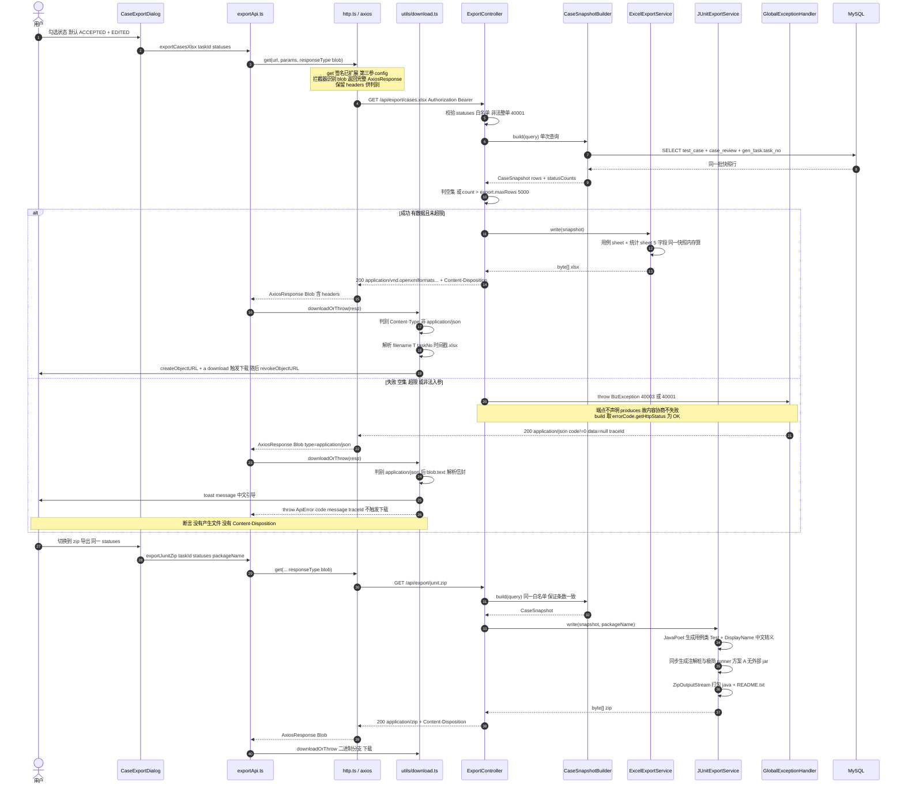
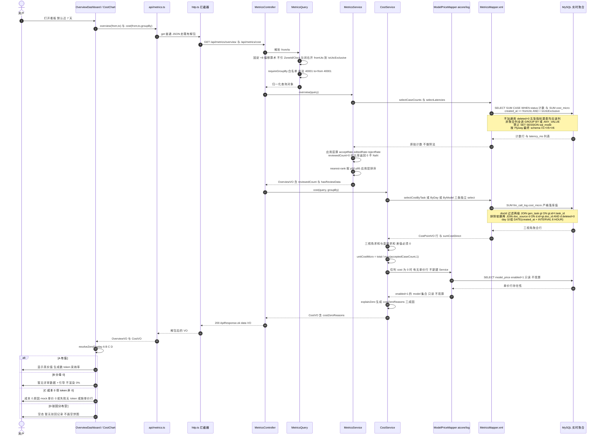
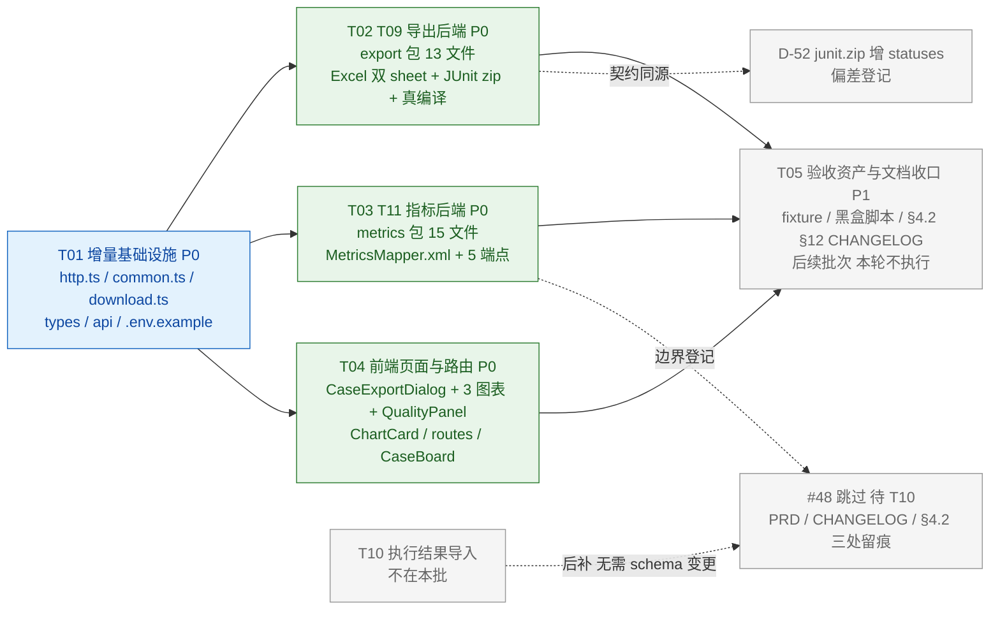

# T09 用例导出 + T11 指标与成本看板 · 增量设计与任务分解

> | 项 | 值 |
> |---|---|
> | 撰写人 / 角色 | 高见远（架构师） |
> | 文档性质 | **增量设计 + 任务分解**，只描述「怎么实现 / 怎么拆任务」；`docs/01-architecture.md` 是唯一架构真源，本文不重写它 |
> | 需求基线 | `docs/06-incremental-prd-t09-t11.md` **v1.2**（2026-11-09 事实订正，521 行；v1.1 六项要求 + v1.2 四条订正全部并入） |
> | 架构基线 | `docs/01-architecture.md`（**当前工作区有未提交修改** `M docs/01-architecture.md`，HEAD `5f73481`）；`docs/05-frontend-merge-plan.md` |
> | 语言 | 简体中文 |
> | 技术栈 | 沿用 §0 基线，本批**零新增依赖** |
> | 本批交付 | **7 个端点**：`#35/#36`（导出）+ `#43/#44/#45/#46/#47`（指标）；`#48` 跳过并标注「待 T10」 |
> | 边界（硬） | **只新建本文件**；不应用到 `docs/01-architecture.md` / PRD / 任何 `src/`；不写实现代码、不启动服务、不跑测试、不 commit / push。§11 的精确文本是「拟追加」，等工程师交付并验收通过后由架构师统一落盘 |
> | 图 | `classDiagram` 与两张 `sequenceDiagram` **内嵌于本文**（本轮只落一个文件，不另存 `.mermaid`；需要时可从 §3.3 / §5 直接抽取） |

---

## 0. 输入基线、已拍板裁决、后发纠偏与事实底数

### 0.1 六份权威输入与优先级（按时间顺序，第 6 条最新）

| 序 | 来源 | 内容 | 优先级 |
|---|---|---|---|
| 1 | 项目负责人「下达增量设计与任务分解要求（含 8 项已拍板裁决）」 | 8 项裁决 + 产出物 8 项要求 | 有效 |
| 2 | 项目负责人「重新下发 T09/T11 增量设计完整任务」 | 会话中断后完整 spec；当时 PRD 为 v1.1；列出产出清单 | 有效，作为 spec 正文（PRD 版本以第 6 条为准） |
| 3 | 项目负责人「**设计纠偏 · 3 条会改变结论的事实**」 | **纠正 2 号 spec 的一处错误** + 补 2 条落地前提 | 有效，覆盖第 2 条中的对应表述 |
| 4 | 项目负责人「补充设计定稿前的最后一批事实输入」 | §2.2 命名复用与裁剪、V5/V6 最终 schema、#47 三项指标与 ⑤-6/⑤-8/⑤-9、时区口径、PRD/文档自身错误、recharts / `<if>` 首次使用 | 有效，改变部分结论 |
| 5 | software-product-manager「PRD v1.2 事实订正」 | v1.2（521 行）4 处影响设计的订正；⑤-14 classpath 仍待架构师落定 | 有效，需求基线的最终版本 |
| 6 | 项目负责人「输入已完结，请撰写 docs/07 并反馈」 | **PRD v1.2 为最终需求基线**；**⑤-14 落定方案 A**；全部输入已发完 | **最新，冲突时以本条为准** |

> **覆盖声明（必须记牢）**：① 第 2 条 spec 的「`MetricsMapper.xml` SQL 设计要点」里写了「手写 XML 自加 `deleted=0`」，第 3 条消息开头即「**纠正我的错误：删掉『手写 XML 自加 `deleted=0`』这条**」；PRD v1.2 ✅-6 / 1.6 又从 DDL 侧确认这是**事实错误**（会 `Unknown column 'deleted' in 'where clause'`）。本文 §6.4 按**纠正后**口径落地，spec 与 PRD v1.1 ⑤-7 后半句均**作废**。② 第 6 条把 ⑤-14 的 classpath 从本文初稿的「方案 B」**改判为方案 A（纯 JDK + 极简 runner）**，§1.5 / §12.1 已按 A 重写，B 不再作为结论。③ 第 4 条以 §2.2 规划命名为准裁剪文件清单、以 Flyway 最终 schema 为 SQL 依据、补齐 #47 三项指标与三条实施口径、写死时区。**其余 8 项裁决、PRD v1.1 六项新增要求、7 个端点范围全部不变**。

### 0.2 8 项已拍板裁决（直接落地，不重开讨论）

| # | 裁决 | 本文落点 |
|---|---|---|
| ① | Q1 采纳 (a)：跳过 `#48 /api/metrics/execution`，保留 `#47 quality`（P1），本批交付 7 个端点 | §2 文件清单、§4 端点表、§11.1 #48 行、§11.5 CHANGELOG |
| ② | 成本口径 (ii)：严格 `SUM(llm_call_log.cost_micro)`，**不在 T11 读取侧按 `model_price` 现算，不改 T04 记账链路** | §4.6、§6.6、§9 |
| ③ | `#43`「失败率」语义 = `reject_rate`，中文标签「**驳回率**」，不引入第三个失败率 | §4.3、§11.1 #43 行 |
| ④ | `statuses` 逗号分隔 + `CaseStatus` 白名单，非法值**整单 `40001`** | §4.1/§4.2、§6、§9 |
| ⑤ | blob 判别 **P0 必做**：按 `blob.type` / `Content-Type` 判别；补 `API_CODE.EMPTY_RESULT = 40003` | §1.3、§2、§4.0、§5.1 |
| ⑥ | 允许 `#36 junit.zip` 增可选 `statuses`、与 `#35` 同源，并**登记偏差** | §4.2、§11.4 D-52、§11.1 #36 行 |
| ⑦ | 跳过 `#48` 在 **PRD（v1.2 已有）/ CHANGELOG / §4.2 #48 三处留痕**；**不改 §6 T11 依赖列** | §11.1 #48 行、§11.5、§12.7 |
| ⑧ | 以 `junit.zip` 为准，订正 §2.2 目录树 270 行注释里的 `junit.java` | §11.2 |

### 0.3 PRD v1.2 需求基线（v1.1 六项 + v1.2 四条订正，逐条落点）

| PRD 要求 | 本文落点 |
|---|---|
| T11-P0-10 成本 0 显式标注**三成因**：(a) mock-model 单价 0/0；(b) 失败调用 token=0；(c) `deepseek-flash` 无 `model_price` 单价行（**配置缺口，非代码缺陷**）。不隐藏、不伪造 | §3.2 `CostVO.costZeroReasons`、§4.6、§4.8 C 类、§6.6 |
| T11-P0-11 分母 0 不渲染「采纳率 0%」，改「暂无评审数据」；后端数值仍返回 `0`，不返回 `NaN` | §3.2 `OverviewVO.reviewedCount`、§4.3、§4.8 B 类、§6.7 |
| T11-P0-12 验收必须用**非 0 成本 fixture**，避免 `0=0` 假绿；措辞统一为「**产生非 0 成本的输入数据**」，不是「修回写链路」 | §6.6、§8 T05 完成判据、§9 |
| 0 值分层展示 **A/B/C/D** 写进前端 VO / 展示契约 | §4.8（含前端判定字段） |
| T09-P0-10 JUnit 编译 classpath **二选一并落定**，共同硬要求真调 `JavaCompiler` 编译全部 `.java` | §1.5 **落定方案 A（纯 JDK + 极简 runner，项目负责人 终裁）** + classpath 组装，§5.1、§6 附注 |
| T09 预置资产 `ExportProperties.java` 已存在，设计**复用而非重造** | §2.1、§7 |
| v1.2 ✅-6 / 1.6 ① 指标 SQL **不加 `deleted = 0`**；`docId` 归集成本走 `llm_call_log → gen_task → doc_source` 两级 join（禁止 `l.doc_id`） | §6.4 / §6.5 / §11.3 |
| v1.2 1.6 ② `V1__schema.sql` **不是最终 schema**（V5 加 `unit_ref`/`kept_hashes` + 唯一索引；V6 加 `produced_items`、`unit_ref` → `VARCHAR(200)`） | §6.1 / §9.5 / §12.12 |
| v1.2 4.2(3) 导出端点**不声明固定二进制 `produces`**，成功/失败两种 `Content-Type` 共存 | §4.0.3 / §4.0.4 |
| v1.2 ⑤-14 classpath A/B 待架构师落定（已由第 6 条终裁 **A**） | §1.5 / §12.1 |

### 0.4 后发纠偏 3 条（最新口径，改变结论）

| # | 纠偏 | 本文落地 |
|---|---|---|
| ① | **删掉「手写 XML 自加 `deleted=0`」**。`deleted` 只在 `doc_source:48`；`gen_task` / `test_case` / `case_review` / `llm_call_log` / `gen_task_item` 四（五）表**均无该列**；指标 SQL 写 `WHERE deleted=0` 会直接 `Unknown column 'deleted' in 'where clause'`。正确做法：**指标聚合 SQL 不加 `deleted` 条件**；仅当按 `docId` 维度需要排除已软删文档时，显式 `JOIN doc_source d ON ... AND d.deleted = 0`。`ONLY_FULL_GROUP_BY` 合规要求保留 | **§6.4**（专门一节，含 §8.2 1465 的正确读法） |
| ② | **导出端点的错误响应契约必须写死**：端点**不声明固定二进制 `produces`**（或同时声明 `application/json`），保证 `BizException` 经 `GlobalExceptionHandler.build()` 正常转成 JSON `ApiResponse`；成功二进制流，失败 `application/json` 的 `40003` / `40001` JSON body；`E_EMPTY_RESULT(40003,...,HttpStatus.OK)` 是 **HTTP 200 + `code!=0`** | **§4.0.3 / §4.0.4**、每个导出端点的「失败」栏、§5.1 |
| ③ | **前端 `get` 无法传 `responseType`**：`http.ts:121-123` 的 `get<T>(url, params?)` 只发 `{ params }`，不接受 `AxiosRequestConfig`；若 `#35` 保持 GET + `responseType:'blob'`，必须**扩展 `get` 签名**或改用 POST。前端 `responseType\|Blob\|createObjectURL\|download` 全量 grep **0 命中**，需从零落下载工具模块并列进文件清单 | **§1.3 决策（落定扩展 `get`、保留 GET）**、§2.2（`http.ts`、`download.ts` 均入清单）、§4.1 |

> **与 PRD v1.2 的关系**：纠偏 ① 已在 v1.2 ✅-6 / 1.6 / ⑤-7 索引中从 DDL 侧正式订正（v1.1 ⑤-7 后半句是事实错误）；纠偏 ② 已写进 v1.2 4.2(3) 的「裁决 5 契约表」；纠偏 ③ 对应 v1.2 ⑤-3 / T09-P0-5。三条均已被 PRD 追认，不是设计单方面解释。

### 0.5 只读核实的事实底数（本轮实读，非转述）

| 类别 | 事实 | 证据 |
|---|---|---|
| 错误码 | `E_EMPTY_RESULT(40003,"没有可处理的数据",HttpStatus.OK)` **已存在**，全仓库零使用，本批首次启用；业务错误统一 HTTP 200 + `code!=0` | `common/ErrorCode.java:27-28`；§8.1 `1402/1416` |
| 异常转换 | `GlobalExceptionHandler.build()` = `ResponseEntity.status(errorCode.getHttpStatus()).body(ApiResponse.fail(...))` | `GlobalExceptionHandler.java:349-355` |
| 内容协商陷阱 | `GenTaskController#stream` 声明 `produces = text/event-stream`，注释明确警告「异常处理器要吐 JSON 时内容协商失败 → 客户端只看到 500 空 body」 | `GenTaskController.java:67-72, 218-228`；§11.1 D-35 |
| `get` 签名 | `get<T>(url, params?)` → `instance.get(url, { params })`；**只有** `post<T>(url, data?, config?)` 收 config | `frontend/src/api/http.ts:121-135` |
| 拦截器 | `responseType:'blob'` 下 `typeof payload.code !== 'number'` → 错误 JSON **原样返回，不解包不 toast** | `frontend/src/api/http.ts:68-86` |
| `API_CODE` | 仅 7 键，无 `40003` | `frontend/src/types/common.ts:85-94` |
| 下载能力 | `frontend/src/` 全量 grep `responseType` / `Blob` / `createObjectURL` / `download` = **0 命中**；`utils/` 只有 `toast.ts` | 本轮 grep |
| 软删列 | `deleted` 在 migration 与 mapper XML 中**仅** `V1__schema.sql:48`（`doc_source`）；四张指标表全部无该列 | `grep -rn deleted backend/src/main/resources/db/migration/` |
| `llm_call_log` 键 | 有 `task_id` / `task_item_id` / `model` / `status` / `error_code` / `latency_ms` / `cost_micro` / `created_at`；**无 `doc_id`** | `V1__schema.sql:303-325` |
| docId 路径 | `gen_task.doc_id`（`V1:168`，`idx_gen_task_doc`）、`test_case.doc_id`（`V1:245`，`idx_test_case_doc`） | 同上 |
| 驳回字典 | `reject_reason(code,label,category,sort_no,enabled)`；`('OTHER','其他原因','OTHER',999,1)` 已在 V2 种子；FK `fk_case_review_reject_reason` | `V2__dict_and_config.sql:16-23,47-49,71` |
| `metric_snapshot` | 表已存在（`V1:409-424`），DDL 注释明写「**MVP 不物化（全部实时聚合），表先建好但不写入**」 | `V1__schema.sql:405-424` |
| 依赖 | EasyExcel 4.0.3 / JavaPoet 1.13.0 / POI 5.4.1 已在 pom；`java.util.zip` / `ZipOutputStream` 全 0 命中，无 zip4j / commons-compress → **ZIP 与 Excel 写出均从零实现** | `backend/pom.xml:28-32,101-116`；本轮 grep |
| 配置 | `export.*` 已在 `application.yml:131-135`；`exports/` 已在 `.gitignore:39`；`ConfigService.publicConfig()` 已出参 `Limits.exportMaxRows`；`.env.example` **只有** `EXPORT_MAX_ROWS=5000`（另 3 个 `EXPORT_*` 漏登记，§8.8 已记录） | 实读 |
| 上限区分 | `PageQuery.MAX_SIZE=100`（分页）≠ `export.maxRows=5000`（导出） | `PageQuery.java:25,54`；`ExportProperties.java:25` |
| 鉴权 | `/api/**` 默认受保护，导出/指标**不在白名单** → 走 header token；`TraceFilter` 不包装 response body | `WebMvcConfig.java:39-53` |
| Mapper 现状 | 4 个 XML 全部 `resultType`、**零 `resultMap`**、动态 SQL 仅 `<foreach>`、`sql_mode` 计数 **0**；`map-underscore-to-camel-case: true` 已开 | `application.yml:85-88`；本轮 grep |
| 状态真源 | `CaseStatus` = `DRAFT/ACCEPTED/EDITED/REJECTED`，`isReviewed()` 返回后三者 | `common/enums/CaseStatus.java` |
| 脏值范式 | `CaseService.requireEnum()`：非法值直接 `40001` 并列出可选值，注释明写「脏值直接 40001，而不是静默返回空列表」 | `testcase/service/CaseService.java` |
| 前端资产 | `EmptyState/StatusChip/PageHeader`、`usePageQuery`、`recharts ^2.13.0`（`frontend/src` **零 import**，T11 首次使用）、`vitest ^2.1.2`、`jsdom`、`@testing-library/react` 均已存在；**无 AppShell**（`App.tsx` 只有 `RouterProvider`）；`Home.tsx:134-149` 临时按钮组**本批不改** | 实读 |
| 测试基线 | 后端 24 个 `*Test.java` + 1 支持类，JUnit5 + Mockito + AssertJ，无共享基类；前端 2 个测试文件；黑盒脚本在仓库外 `t<NN><主题>.py`，仓库内**无 `scripts/`** | 实读 |
| §2.2 规划命名 | `docs/01:269-275` export 包 6 文件、`docs/01:410/416/418` `ChartCard.tsx` / `CaseExportDialog.tsx` / `metrics` 三页；路由纪律 `docs/01:420-424`「加一条路由 + `pages/` 建组件，两步缺一不可」；`CaseBoard.tsx:185-211` `PageHeader.actions` 已有「批量驳回 / 批量采纳」两 Button | 实读 |
| 最终 schema | migration 共 6 个：`V5` 追加 `gen_task_item.unit_ref` / `kept_hashes` + `uk_gen_task_item_task_unit`；`V6` 追加 `gen_task.produced_items`、`unit_ref` `VARCHAR(64)→(200)` | 实读 `V5*.sql` / `V6*.sql` |
| 时区链 | JDBC `connectionTimeZone=UTC&forceConnectionTimeZoneToSession=true`（`application.yml:37`）、`jackson.time-zone: UTC`（`:62`）、`logic-delete-field: deleted`（`:96`）；Java 源码 `ZoneId` / `Clock` / `Asia/Shanghai` **0 命中**；`IdGen` 用 `LocalDate.now(ZoneOffset.UTC)` | 实读 + grep |
| 前端图表 | `recharts ^2.13.0` 在 `package.json:26`；`vite.config.ts:47-51` 已配 `charts` manualChunks；`frontend/src` 零 import | 实读 |
| mapper XML 现状 | 4 个 XML 全部 `resultType`、**零 `resultMap` / `<if>` / `<where>`**，仅 4 处 `<foreach>`；`sql_mode` / `deleted` 命中 0 | 本轮 grep |

### 0.6 定稿前补充事实（项目负责人 第 4 条 + PM v1.2）：会改变结论的六项

| # | 新事实（实读） | 本文落点 |
|---|---|---|
| ① | **§2.2 早已规划好文件清单**：`docs/01:269-275` 的 export 包 6 文件与本文 §2.1 命名一致（注释里的 `junit.java` 按裁决 ⑧ 订正为 `junit.zip`）；`docs/01:410/416/418` 已列 `charts/ChartCard.tsx`、`cases/CaseExportDialog.tsx`、`metrics/{OverviewDashboard,AcceptanceChart,CostChart}.tsx`；路由纪律 `docs/01:420-424`「新增页面 = `routes/index.tsx` 加一条 + `pages/` 下建组件，两步缺一不可」；导出入口插 `CaseBoard.tsx:185-211` 的 `PageHeader.actions`（已有「批量驳回 / 批量采纳」两个 Button），**不要改 `Home.tsx` 的临时按钮组**。**但 `docs/01:287-291` 的 metrics 规划已过时，不照搬**：其中 `ModelPriceService` / `domain/MetricSnapshot` 是早期设计，T04 已把单价缓存落到 `aicore/log/ModelPriceCache`，且 `metric_snapshot` 表 DDL（`V1:405-407`）明写「MVP 不物化（全部实时聚合），表先建好但不写入」。本批**不新建 `ModelPriceService` / `MetricSnapshot` 实体、不写 `metric_snapshot` 表**，指标一律实时聚合 | §2.1 / §2.2（含「按现状裁剪」显式标注）/ §2.4 / §2.5 / §6.9 / §12.2 |
| ② | **`V1__schema.sql` 不是最终 schema**：`V5__gen_task_item_unit_ref.sql` 追加 `gen_task_item.unit_ref` / `kept_hashes` + 唯一索引 `uk_gen_task_item_task_unit`；`V6__gen_task_unit_ref_and_produced.sql` 追加 `gen_task.produced_items`，并把 `unit_ref` 改为 `VARCHAR(200)`。指标 SQL 按**最终 schema** 写，别只查 V1 | §6.1 / §9.5 / §12.12 |
| ③ | **#47 quality 完整指标范围（前两条 spec 漏项）**：§4.2:923 + §8.3:1481/1482/1484 定义 #47 含三项——**首次通过率** `count(item.attempts=1 and status=SUCCESS)/total_items`、**解析失败率** `count(llm_call_log.error_code like 'E_LLM_PARSE%')/count(llm_call_log)`、**耗时 `p50`/`p95` of `item.latency_ms`（不用 avg）**。三条实施口径：**⑤-6** 分子 `E_LLM_PARSE%` 与实际枚举族 `E_LLM_PARSE_EXHAUSTED` / `E_SCHEMA_INVALID` / `E_LLM_EMPTY` 不一致 → **口径以 §8.3 为准，若需扩展先登记偏差，不擅改 §8.3**；**⑤-8** `from/to` 左闭右开 `[from, to+1day)`、`to < from` → `40001`；**⑤-9** `GenTaskItem.java:34-35` 提到按 `degraded` 拆采纳率，**本批不纳入**（T11-P2-1 延后） | §4.7 / §6.10 / §4.0.2 / §12.3 |
| ④ | **时区口径写死，别引入第二条时间真源**：`metric_snapshot.stat_date` 注释（`V1:411`）写「按用户本地日期 Asia/Shanghai」，但全链路 UTC（JDBC `connectionTimeZone=UTC&forceConnectionTimeZoneToSession=true`、`jackson.time-zone: UTC`、`AuditMetaObjectHandler` 用 `LocalDateTime.now(ZoneOffset.UTC)`、`TimezoneGuard` 期望 `+00:00`），Java 源码**无 `ZoneId` / `Clock` / `Asia/Shanghai`**。`from/to` 日期边界按 Asia/Shanghai 民用日（固定 UTC+8、无 DST）解释，但**不为指标新增 `ZoneId` 分叉**，用固定 `+8` 偏移算术，与 SQL `INTERVAL 8 HOUR` 同源 | §4.0.2 / §1.2 / §9.5 / §6.2 |
| ⑤ | **PRD / 架构文档自身有错，已订正**：`docs/06:389`（v1.1 ⑤-7）「手写 XML 聚合必须自己加 `deleted = 0`」是 PRD 事实错误，v1.2 ✅-6 已订正（以 DDL 为准）；另 `docs/01:834` 称「`llm_call_log` / `test_case` 都挂在 `doc_id` 上」也与 DDL 不符（`llm_call_log` 无该列），由 项目负责人 在统一落盘时登记为文档偏差——**设计不引用 §3.2.2 / §8.2 那两句作为 SQL 依据** | §6.4 / §6.5 / §0.1 |
| ⑥ | **两个可直接用的现成资产**：`recharts ^2.13.0`（`frontend/package.json:26`）+ `vite.config.ts:47-51` 的 `charts` manualChunks 已配，但 `frontend/src` **零 import** → T11 首次使用，**不需要新增依赖**；`MetricsMapper.xml` 若用 `<if>`，是仓库**首次引入动态 SQL**（现有 4 个 XML 只有 4 处 `<foreach>`、零 `<resultMap>` / `<if>` / `<where>`），须在文件清单标注 | §2.5 / §7 / §2.2 |

> **⑤-14 终裁（项目负责人 第 6 条）**：落定 **方案 A（纯 JDK + 极简 runner）**——fat-jar 运行时不含 `junit-jupiter-api`，A 无外部依赖且能真调 JDK17 `JavaCompiler` 编译全部生成的 `.java`。classpath 组装见 §1.5；共同硬要求「**禁止只断言文件生成**」不变。本文初稿的「方案 B」结论**作废**。

---

# Part A · 系统设计

## 1. Implementation Approach（实现方案）

### 1.1 核心技术难点

| # | 难点 | 结论 |
|---|---|---|
| N1 | **一个端点两种响应形态**：成功 `xlsx/zip` 二进制流，失败 `application/json` 的 `ApiResponse`。声明固定二进制 `produces` 会复现 SSE 的 `HttpMediaTypeNotAcceptableException` → 500 空 body（D-35） | 端点**不声明 `produces`**（成功时由 `ResponseEntity` 显式设 `Content-Type`）；异常一律抛 `BizException` 交 `GlobalExceptionHandler.build()`。**不引入 `SseErrorResponder` 式旁路**——JSON 是默认可协商类型，不需要旁路 |
| N2 | **`responseType:'blob'` 下错误 JSON 不解包**：`40003` 会被当 xlsx 下载，用户得到「能打开但无内容」的文件，且 T09 ⑤「不产生可下载文件」这条验收**永远不会红**（测错对象，同 D-46 / §3.2.1.1） | P0 落地 blob 判别工具：先按 `blob.type` / `Content-Type` 判别，`application/json` → 读文本解包成 `ApiError` + toast，**不下载**；二进制 → 触发下载 |
| N3 | **`ONLY_FULL_GROUP_BY` 下可执行**且不得 `SET SESSION sql_mode` 绕过 | 非聚合列**全部**进 `GROUP BY` 或 `ANY_VALUE()`；`groupBy` 三视角**不用字符串拼接 SQL**（`${}`），改为三条独立 `<select>` 由 Service 白名单分派 |
| N4 | **`llm_call_log` 无 `doc_id`**；成本与质量端点又要支持 `docId` | 显式 `JOIN gen_task gt ON gt.id = l.task_id AND gt.doc_id = #{docId}`；不给台账表加列 |
| N5 | **软删列误用**（后发纠偏 ①） | 指标 SQL **不加**通用 `deleted=0`；排除软删文档只在 `docId` 语义下写成 `JOIN doc_source d ON d.id = ... AND d.deleted = 0`。详见 §6.4 |
| N6 | **成本全 0 不是缺陷**：158 行台账、`SUM(cost_micro)=0` 是按现行口径正确算出的结果 | 严格 `SUM(llm_call_log.cost_micro)`；0 值用 `costZeroReasons` 三成因标注，不隐藏/不现算/不伪造；验收靠**非 0 成本 fixture** |
| N7 | **分母 0 的表达误导**：后端返回 0 是对的，前端渲染「采纳率 0%」是错的 | 后端数值口径与前端展示口径**分层**：后端保证不炸返回 0；前端按 A/B/C/D 分类，B 类显示「暂无评审数据」 |
| N8 | **JUnit 骨架在 fat-jar 环境的编译自洽**：JUnit 5 只在 test scope，fat-jar 运行时无 `junit-jupiter` | 见 §1.5 落定**方案 A**（纯 JDK + 极简 runner + zip 内注解桩，无外部 jar）；**真调 `JavaCompiler` 编译全部 `.java`** 是硬要求 |
| N9 | **口径一致性**：xlsx 默认只导 4 条，zip 默认全量会生成含 DRAFT/REJECTED 的 10 个 `.java` | `#36` 增可选 `statuses` 与 `#35` 同源，共用同一段白名单校验；登记偏差 D-52 |

### 1.2 框架与库选型（零新增依赖，全部复用）

| 能力 | 选型 | 理由 |
|---|---|---|
| Excel 双 sheet | `EasyExcel 4.0.3` + `poi-ooxml 5.4.1`（已在 pom） | §6 T09 ①；中文列头不乱码靠显式 UTF-8 与 `@ExcelProperty` |
| JUnit 源码生成 | `JavaPoet 1.13.0`（已在 pom） | 保证类名/方法名合法、中文字符串字面量自动转义，避免手写字符串拼接（T09-P0-9） |
| ZIP 打包 | **JDK `java.util.zip.ZipOutputStream` / `ZipEntry`** | 无第三方 ZIP 库、无现成下载端点；JDK 自带足够，且引入新依赖违背 PRD「本批不引入新依赖」 |
| 真编译验收 | **JDK 17 `javax.tools.JavaCompiler`**（`ToolProvider.getSystemJavaCompiler()`）+ `DiagnosticCollector` | PRD T09-P0-8 硬要求；不依赖 `javac` 外部进程，可在单测内断言无 ERROR |
| 指标 SQL | `MyBatis-Plus` + **手写 `MetricsMapper.xml`** | §6 T11 ⑦ 要求在 `ONLY_FULL_GROUP_BY` 会话逐条可跑；`resultType` 映射（已开驼峰）足够，零 `resultMap` |
| 时间窗 | `dayjs ^1.11.13`（前端展示）+ `java.time.LocalDate/LocalDateTime`（后端） | §8.2 1467 本地日 → UTC；**不引入 `ZoneId` / `Clock` / `Asia/Shanghai` 字面量**，用固定 `+8` 偏移算术（§4.0.2），与 SQL `INTERVAL 8 HOUR` 同源单一常量 |
| 图表 | `recharts ^2.13.0`（`package.json:26`） | 折线/柱/饼；`vite.config.ts:47-51` 已配 `charts` manualChunks、`frontend/src` 零 import → **T11 首次使用，不新增依赖**（§0.6 ⑥） |
| 下载 | `axios ^1.7.7` `responseType:'blob'` + 原生 `URL.createObjectURL` | 从零落 `utils/download.ts` |
| 配置 | 复用 `config/ExportProperties.java`（`export.*`） | **不重造**；`maxRows=5000` / `tempDir=exports` / `junitPackage` / `junitTimeoutSeconds` 全部已存在 |

### 1.3 关键设计决策（落定，不再是选项）

| # | 决策 | 被否决的替代 | 理由 |
|---|---|---|---|
| D-1 | **导出端点不声明 `produces`**；成功用 `ResponseEntity<byte[]>` 显式设 `Content-Type` + `Content-Disposition`，失败抛 `BizException` | 声明 `produces = application/vnd...` / 同时声明两种 MIME | 前者会内容协商失败（D-35 同型）；后者让 Spring 按 `Accept` 猜，axios 默认 `Accept: application/json, text/plain, */*` 时二进制分支反而选不中。**不声明最稳** |
| D-2 | **保留 GET**（§4.2 已定 `#35/#36` 为 GET），**扩展 `api/http.ts` 的 `get` 签名**为 `get<T>(url, params?, config?: AxiosRequestConfig)` | 改成 POST | 改 POST 会让 §4.2 两行契约漂移，需再登记一条偏差；扩展 `get` 是向后兼容的纯增量（现有 5 个 `api/*.ts` 调用零改动、零回归） |
| D-3 | 拦截器**新增 blob 分支**：`response.config.responseType === 'blob'` 时**返回完整 `AxiosResponse`**（保留 `headers` 供 `Content-Disposition` / `Content-Type` 判别），优先于「非统一响应体原样返回」 | 只返回 `response.data`（Blob） | 只返回 Blob 会丢 `Content-Disposition`，文件名无从解析；前端 blob 用例当前 0 处，此分支零回归风险 |
| D-4 | **落定 JUnit classpath 方案 A（纯 JDK + 极简 runner）**，zip 内自带 `@DisplayName` / `@Test` 注解桩，classpath 见 §1.5 | 方案 B（显式带 `junit-jupiter-api` jar，本文初稿） | 项目负责人 终裁：fat-jar 运行时无 `junit-jupiter-api`，A 无外部依赖；**注解桩变体**保留 §6 T09 ③「中文 `@DisplayName` 正确转义」的验收对象，避免「测错对象」，且**不改 `docs/01` 验收文字**。B 需解析 `~/.m2` 4 个 jar、与运行环境耦合，作废 |
| D-5 | **成本严格 `SUM(llm_call_log.cost_micro)`**；`CostService` **只读** `aicore/log/ModelPriceMapper.selectEnabledOrderByEffectiveFromDesc()` 判定「单价行是否存在」用于 `costZeroReasons` 标注，**不新建 `ModelPriceService`**，不得用单价 × token 回写或替换 `cost_micro` | T11 读取侧按 `model_price` 现算 | 裁决 ②；会拆成两套口径、§6 T11 ③「差值 0」必红；`LoggingLlmProvider:162` / `ModelPriceCache` 实读确认回写链路存在且正确；§2.2 早期规划的 `ModelPriceService` 已按现状裁剪（§0.6 ①） |
| D-6 | **比率在应用层算，不在 SQL 除**；SQL 只返回计数与 `SUM(cost_micro)` | SQL 里 `a/NULLIF(b,0)` | SQL 除法在分母 0 时得 `NULL`，序列化后前端拿到 `null`，与「返回数值 `0`」口径冲突；集中应用层可单测、口径唯一 |
| D-7 | **p50/p95 用应用层排序，不用 SQL 近似** | `SUBSTRING_INDEX(GROUP_CONCAT(...))` / `ROW_NUMBER()` 窗口嵌套 | MySQL 8 无 `percentile_cont`；`GROUP_CONCAT` 受 `group_concat_max_len=1024` 截断，**长尾正好被截掉**（与 §8.3「不用 avg（长尾会骗人）」直接相反）；窗口嵌套在 `ONLY_FULL_GROUP_BY` 下更易错。Java 侧 `nearest-rank`：`ceil(p*N)` 位，空集返回 0 |
| D-8 | **实时聚合，不写 `metric_snapshot`** | 落快照表 + `@Scheduled` | `V1:409-424` DDL 注释明写「MVP 不物化（全部实时聚合），表先建好但不写入」 |
| D-9 | **`groupBy` 三视角 = 三条独立 `<select>` + Service 白名单分派**；可选过滤用 `<if>` | `${groupBy}` 动态拼 `GROUP BY` / `SELECT` | 防 SQL 注入；且每条 SQL 的 `SELECT` 与 `GROUP BY` 静态对齐，可在 `ONLY_FULL_GROUP_BY` 会话逐条验收。`<if>` 是**仓库首次引入动态 SQL**（现有 4 个 XML 仅 4 处 `<foreach>`、零 `<resultMap>` / `<if>` / `<where>`），在 §2.5 标注（§0.6 ⑥） |
| D-10 | **day 分组用 `DATE(created_at + INTERVAL 8 HOUR)`** | `CONVERT_TZ(...)` | 会话时区已钉 `+00:00`、`created_at` 存 UTC；`Asia/Shanghai` 自 1991 年无 DST，固定 +8 正确，且避开 `CONVERT_TZ` 对 `mysql.time_zone_name` 表的依赖（该表未填充时返回 `NULL`）。与 §4.0.2 的 `SHANGHAI_OFFSET_HOURS = 8` **同源同一常量**，不构成第二条时间真源 |
| D-11 | **统计 sheet 5 字段同一批快照在内存算，禁止二次查库** | 再查一次库算统计 | 两次查询之间有人评审，统计与明细就对不上（PRD 4.2(4) 硬约束） |

### 1.4 架构模式

沿用既有 **分层 + 模块化单体**：`controller → service → mapper(手写 XML) → MySQL`。新增 `export/` 与 `metrics/` 两个**互不依赖**的包（可并行开发），二者只共享 `common/`（`BizException` / `ErrorCode` / `ApiResponse` / `CaseStatus` / `PageQuery`）与 `aicore/log/`（只读复用 `LlmCallLog` / `ModelPrice` / `ModelPriceMapper`，**不新建实体**，见 §6 T11 行注 / D-10）。前端按 `api/ → types/ → utils/ → pages/` 分层，图表组件只消费 VO，不做口径计算（口径唯一真源在后端 §8.3）。

**依赖方向**：`metrics/` **只读**引用 `aicore/log/` 的 `ModelPriceMapper`（不反向依赖）；`export/` 只读引用 `testcase/` 的查询能力（不反向依赖）；前端两模块通过 `types/` 与 `api/` 解耦。

### 1.5 JUnit classpath 方案 A · 落定与组装方式（PRD T09-P0-10 / ⑤-14，项目负责人 终裁）

> **终裁**：项目负责人 第 6 条把 ⑤-14 落定为 **方案 A（纯 JDK + 极简 runner）**。理由：JUnit 5 只在 test scope，**fat-jar 运行时不含 `junit-jupiter-api`**；A 无外部依赖且能真调 JDK17 `JavaCompiler` 编译全部生成的 `.java`。本文初稿的「方案 B」结论作废，不再保留为备选。
>
> **硬要求（不可打折）**：验收脚本解压 zip 后**真正调用** `ToolProvider.getSystemJavaCompiler()` 编译**全部** `.java`，用 `DiagnosticCollector` 断言 `Diagnostic.Kind.ERROR` 数 = 0；**禁止**只断言「文件已生成 / 文件名合法」（T09-P0-8）。

**方案 A 的注解桩变体（消解 §6 T09 ③ 与 A 的张力）**：A 的字面形态是「生成的 `.java` 不 import JUnit」，但 §6 T09 ③ / T09-P0-8 的验收文字写死「含中文 `@DisplayName` 正确转义」。若直接去掉注解，该条变成**无对象的假绿**（与 D-46 few-shot 探针同型）。因此采用 **A 的注解桩变体**——zip 内自供两个纯 JDK 注解定义，生成物仍写 `import org.junit.jupiter.api.Test;` / `import org.junit.jupiter.api.DisplayName;`，但**编译期不依赖任何外部 jar**：

| 生成物（`JUnitExportService` + `JavaPoet`，全部 UTF-8 写出） | 作用 |
|---|---|
| `org/junit/jupiter/api/Test.java`、`org/junit/jupiter/api/DisplayName.java` | **注解桩**：`@interface Test {}`、`@interface DisplayName { String value(); }`，`@Retention(SOURCE)`；仅用于编译期解析注解，**不是 JUnit 引擎**。与用例 `.java` 一起作为 compilation units 编译 |
| `GeneratedCase_*.java`（每用例一个；包名 `export.junitPackage`，默认 `com.aittest.generated`，可被 `packageName` 覆盖，非法 Java 包名 → `40001`） | 每个用例一个 `@Test` 方法，方法名 `case_001` 递增（中文标题不进标识符，规避 T09-P0-9）；中文标题进 `@DisplayName("…")`，JavaPoet `Literal` 对 `"` / `\` / `\n` / `\r` 正确转义；`@Timeout(export.junitTimeoutSeconds)`（默认 30）由 `ExportProperties` 提供 |
| `GeneratedCaseRunner.java` | **极简 runner**：纯 JDK `main()`，反射枚举 `case_NNN()` 并逐个调用，打印用例号 + `@DisplayName` 值；不依赖 JUnit 引擎 |
| `README.txt` | 编译/运行命令、注解桩说明（**运行真实 JUnit 引擎时删除 `org/junit/jupiter/api/*.java` 并改用真实 `junit-jupiter-api` jar**）；明确「编译通过是硬要求、运行引擎是可选」 |

**classpath 组装（方案 A 核心）**——`JUnitCompileSupport.resolveClasspath()` / `compileAll()`：

| 步 | 动作 |
|---|---|
| 1 | 解压 zip 到 `outDir/<zipName>/`，**递归枚举全部 `.java`**（用例类 + 2 个注解桩 + runner）得 `List<File> units`；断言 `units.size() >= caseCount + 3`（`caseCount` 来自同一份 `CaseSnapshot`）——**防 `0=0` 假绿**：0 个编译单元时 `getDiagnostics()` 天然无 ERROR |
| 2 | **classpath 只含 JDK**：不解析 `~/.m2`、不拼 `junit-jupiter-api` / `apiguardian-api` / `opentest4j` / `junit-platform-commons` 四个 jar、不做 `Files.exists()` 校验。不设置 `-classpath`（或仅显式设为 `outDir`），改以 `-sourcepath <解压根>` + **全量 compilation units** 让 `JavaCompiler` 在同一批源码内解析注解桩与 runner；`-encoding UTF-8`、`-source 17 -target 17`、`-proc:none`、`-d <classesDir>` |
| 3 | `JavaCompiler.getTask(null, fileManager, diagnostics, options, null, units).call()` 断言返回 `true`；`DiagnosticCollector.getDiagnostics()` 中 `Diagnostic.Kind.ERROR` **必须为 0**；再断言 `classesDir` 下 `.class` 数 ≥ `units.size()`（每个顶层类型各产出 1 个 class，`@Retention(SOURCE)` 只影响注解保留策略、不阻止注解类型自身出 class），确保「真的编译了」而非空跑 |
| 4 | 单测另造一条**负例**：故意把某个 `@DisplayName("…")` 写成未转义的 `"` → 同一编译链必须出现 `ERROR`，证明编译断言有判别力（同 D-46 的探针有效性要求） |

> 与方案 B 的唯一差别：B 把 4 个 test-scope jar 拼进 `-classpath`；A 把注解定义**随 zip 一起生成**，编译期零外部依赖。两者都满足「真调 `JavaCompiler` 编译全部 `.java`、诊断无 ERROR」的硬要求；A 额外满足 fat-jar 可复现与「不改 §6 T09 ③ 验收文字」。`JUnitCompileSupport` 仍**只在测试期调用，生产不调用**（§2.1）。

---

## 2. File List（完整文件清单）

> 标注：**[新]** 新建 / **[改]** 修改既有 / **[复用]** 只读引用，不改文件。路径均相对仓库根。

### 2.1 后端 · T09 导出（`com.aittest.export`）

| 文件 | 状态 | 职责 |
|---|---|---|
| `backend/src/main/java/com/aittest/export/controller/ExportController.java` | [新] | `#35` / `#36`；**不声明 `produces`**；成功 `ResponseEntity<byte[]>`，失败抛 `BizException` |
| `backend/src/main/java/com/aittest/export/service/CaseSnapshotBuilder.java` | [新] | 单次查询组装 `CaseSnapshot`（用例行 + 任务号 + 状态分布 + 统计 5 字段），**禁止二次查库** |
| `backend/src/main/java/com/aittest/export/service/ExcelExportService.java` | [新] | EasyExcel 双 sheet（「用例」/「统计」），中文 UTF-8 |
| `backend/src/main/java/com/aittest/export/service/JUnitExportService.java` | [新] | JavaPoet 生成用例 `.java` + **注解桩 / 极简 runner** + `README.txt`，`ZipOutputStream` 打包（方案 A，§1.5） |
| `backend/src/main/java/com/aittest/export/support/JUnitNaming.java` | [新] | 类名/方法名/包名规则、非法字符转义、`case_NNN` 去重 |
| `backend/src/main/java/com/aittest/export/support/ExcelColumnDef.java` | [新] | 「用例」sheet 表头常量与列宽/样式；「统计」sheet 5 字段定义 |
| `backend/src/main/java/com/aittest/export/support/JUnitCompileSupport.java` | [新] | 供测试用的 `JavaCompiler` 全量编译（方案 A：**无外部 jar**、断言编译单元数 + `.class` 产出 + 负例，§1.5），**生产不调用** |
| `backend/src/main/java/com/aittest/export/dto/ExportQuery.java` | [新] | `taskId` / `docId` / `statuses` / `packageName` 入参 + 归一化 |
| `backend/src/main/java/com/aittest/export/dto/CaseRow.java` | [新] | 导出快照行（§3.2） |
| `backend/src/main/java/com/aittest/export/dto/CaseSnapshot.java` | [新] | 快照聚合根 |
| `backend/src/main/java/com/aittest/export/dto/ExportStats.java` | [新] | 统计 sheet 5 字段 |
| `backend/src/main/java/com/aittest/config/ExportProperties.java` | **[复用]** | **已存在，不重造不改**：`maxRows=5000` / `tempDir=exports` / `junitPackage` / `junitTimeoutSeconds` |
| `backend/src/main/java/com/aittest/common/ErrorCode.java` | **[复用]** | `E_EMPTY_RESULT(40003)` 已存在，本批首次启用，**不改文件** |
| `backend/src/main/java/com/aittest/common/enums/CaseStatus.java` | **[复用]** | `statuses` 白名单唯一真源 |
| `backend/src/test/java/com/aittest/export/JUnitExportServiceTest.java` | [新] | 真编译断言（§1.5） |
| `backend/src/test/java/com/aittest/export/ExcelExportServiceTest.java` | [新] | 双 sheet / 中文 / 统计同快照 / 空集 `40003` |

> **命名复用**：以上 `controller` / `service` / `support` 六个文件与 `docs/01:269-275` §2.2 export 规划**逐字一致**（注释里的 `junit.java` → `junit.zip` 精确订正见 §11.2），仅额外补 `JUnitCompileSupport`（验收期）与 4 个 dto，不另起一套命名（§0.6 ①）。

### 2.2 后端 · T11 指标（`com.aittest.metrics`）

| 文件 | 状态 | 职责 |
|---|---|---|
| `backend/src/main/java/com/aittest/metrics/controller/MetricsController.java` | [新] | `#43–#47`；统一 `from/to` 解析与 `groupBy` 白名单 |
| `backend/src/main/java/com/aittest/metrics/service/MetricsService.java` | [新] | 计数 → 应用层算比率（分母 0 → 0）、p50/p95 排序、VO 组装 |
| `backend/src/main/java/com/aittest/metrics/service/CostService.java` | [新] | 三视角求和、单用例成本、`costZeroReasons` 归因 |
| `backend/src/main/java/com/aittest/metrics/service/ModelPriceService.java` | **不新建**（§2.2 早期规划，按现状裁剪） | 单价行存在性判定改由 `CostService` **直接只读** `aicore/log/ModelPriceMapper`（`selectEnabledOrderByEffectiveFromDesc()`）完成；T04 已有 `ModelPriceCache`，不重建第二套单价读取链 |
| `backend/src/main/java/com/aittest/metrics/mapper/MetricsMapper.java` | [新] | `@Mapper` 接口，方法签名与 XML `id` 一一对应 |
| `backend/src/main/resources/mapper/MetricsMapper.xml` | [新] | **§6 全部 SQL**（以 Flyway 最终 schema V1+V5+V6 为准，§6.1）；`resultType` 映射、零 `resultMap`；**仓库首次引入 `<if>` 动态 SQL**（仅用于可选 `docId`/`taskId` 过滤，见 §2.5 注） |
| `backend/src/main/java/com/aittest/metrics/dto/MetricsQuery.java` | [新] | `from/to` → `fromUtc`/`toUtcExclusive`、`groupBy` 白名单 |
| `backend/src/main/java/com/aittest/metrics/dto/OverviewVO.java` | [新] | §3.2 |
| `backend/src/main/java/com/aittest/metrics/dto/AcceptancePointVO.java` | [新] | §3.2 |
| `backend/src/main/java/com/aittest/metrics/dto/RejectReasonPointVO.java` | [新] | §3.2 |
| `backend/src/main/java/com/aittest/metrics/dto/CostVO.java` / `CostPointVO.java` | [新] | §3.2 |
| `backend/src/main/java/com/aittest/metrics/dto/QualityVO.java` | [新] | §3.2 |
| `backend/src/main/java/com/aittest/metrics/dto/CostZeroReason.java` | [新] | 枚举：`MOCK_PRICE_ZERO` / `FAILED_CALL_NO_TOKEN` / `MODEL_PRICE_MISSING` |
| `backend/src/main/java/com/aittest/aicore/log/ModelPrice.java` / `ModelPriceMapper.java` | **[复用]** | T04 已交付（§11.1 D-10）；**不重建 `ModelPrice` 实体/mapper** |
| `backend/src/main/java/com/aittest/aicore/log/LlmCallLog.java` / `LlmCallLogMapper.java` | **[复用]** | 成本与质量唯一真源，只读聚合 |
| `backend/src/main/java/com/aittest/metrics/domain/MetricSnapshot.java` | **不新建** | `metric_snapshot` 表 DDL 明写「MVP 不物化」，见 §6.9 / §12.2 |
| `backend/src/test/java/com/aittest/metrics/MetricsServiceTest.java` | [新] | 采纳率 `4/6`、`1/6`；分母 0 返回 0；p50/p95 |
| `backend/src/test/java/com/aittest/metrics/CostServiceTest.java` | [新] | 三视角差值 0（**含 `cost_micro≠0` 样本**）、单用例成本分母 0 |

**§2.2 规划（`docs/01:287-291`）按现状裁剪，理由显式登记**：

| §2.2 早期规划 | 本批处理 | 理由 |
|---|---|---|
| `metrics/service/ModelPriceService.java` | **不新建** | T04 已把单价缓存落在 `aicore/log/ModelPriceCache`；`CostService` 直接只读 `ModelPriceMapper` 判定「有无单价行」即可，再建一层服务会拆出第二套单价读取链（项目负责人 第 4 条 ①） |
| `metrics/domain/ModelPrice.java` + `mapper/ModelPriceMapper.java` | **复用** `aicore/log/` 既有文件（D-10） | T04 已交付；`metrics/` 对 `aicore/log/` **单向只读** |
| `metrics/domain/MetricSnapshot.java` + `MetricSnapshotMapper.java` | **不新建、不写 `metric_snapshot` 表** | `V1:405-407` DDL 注释「**MVP 不物化（全部实时聚合），表先建好但不写入**」；本批 5 个端点一律实时聚合（§6.9） |
| `metrics/controller/MetricsController.java`、`metrics/service/{MetricsService,CostService}.java`、`metrics/mapper/MetricsMapper.java` | **保留（新建）** | 与规划一致，是本批 5 个端点的实现主体 |
| `metrics/dto/{OverviewVO,AcceptancePointVO,CostPointVO,QualityVO}.java` | **保留并补齐** | 按 §3.2 补 `MetricsQuery` / `CostVO` / `RejectReasonPointVO` / `CostZeroReason`，命名沿用规划前缀 |

### 2.3 前端 · 契约与下载地基（**[改] 项必须进清单**，后发纠偏 ③）

| 文件 | 状态 | 职责 |
|---|---|---|
| `frontend/src/api/http.ts` | **[改]** | ① `get<T>(url, params?, config?: AxiosRequestConfig)` 扩展签名；② 响应拦截器新增 `responseType === 'blob'` 分支返回**完整 `AxiosResponse`**；③ `API_CODE.EMPTY_RESULT` 的消费侧。**现有 5 个 `api/*.ts` 调用零改动** |
| `frontend/src/types/common.ts` | **[改]** | `API_CODE` 补 `EMPTY_RESULT: 40003`（其余 7 键不动） |
| `frontend/src/utils/download.ts` | **[新]** | **从零落**：blob 判别 / 错误 JSON 解包为 `ApiError` + toast / `Content-Disposition` 文件名解析 / `createObjectURL` + `<a download>` + `revokeObjectURL` |
| `frontend/src/utils/__tests__/download.test.ts` | [新] | 造 `40003` JSON blob → 断言**无下载** + toast + `ApiError`；造二进制 blob → 断言文件名与下载触发 |
| `frontend/src/api/exportApi.ts` | [新] | `#35/#36` 调用；统一走 `get(..., { responseType: 'blob' })` → `downloadOrThrow` |
| `frontend/src/api/metrics.ts` | [新] | `#43–#47` 调用（普通 JSON，走既有解包） |
| `frontend/src/types/export.ts` | [新] | `StatusFilter` / 导出请求参数 TS 类型；复用 `PublicConfig.limits.exportMaxRows` |
| `frontend/src/types/metrics.ts` | [新] | §3.2 全部 VO 的 TS 镜像 + `ZeroDisplayKind` |
| `frontend/src/utils/toast.ts` | **[复用]** | 既有 `toast()`，不重造 |
| `.env.example` | **[改]** | 补登记 `EXPORT_TEMP_DIR` / `EXPORT_JUNIT_PACKAGE` / `EXPORT_JUNIT_TIMEOUT_SECONDS`（`application.yml:131-135` 已有，§8.8 记录了 `EXPORT_TEMP_DIR` 漏登记）；`EXPORT_MAX_ROWS` 已有 |

### 2.4 前端 · 页面与路由

| 文件 | 状态 | 职责 |
|---|---|---|
| `frontend/src/pages/cases/CaseExportDialog.tsx` | [新] | 四状态多选（默认勾 `ACCEPTED/EDITED`）、生效条件回显、xlsx/zip 两个按钮共用同一 `statuses`（T09-P1-1/P1-2） |
| `frontend/src/pages/cases/CaseBoard.tsx` | **[改]** | 在 `PageHeader.actions`（`185-211`，已有「批量驳回 / 批量采纳」两个 Button）**并列追加**「用例导出」按钮，打开 `CaseExportDialog`；最小改动，不改评审逻辑（§0.6 ①） |
| `frontend/src/pages/metrics/OverviewDashboard.tsx` | [新] | 6 卡片 + `p50/p95`；A/B/C 三类 0 值渲染；范围切换 |
| `frontend/src/pages/metrics/AcceptanceChart.tsx` | [新] | 按天采纳率趋势（recharts），分母 0 的点不渲染 `0%` |
| `frontend/src/pages/metrics/CostChart.tsx` | [新] | task/day/model 三视角 + 单用例成本 + `costZeroReasons` 文案 |
| `frontend/src/pages/metrics/QualityPanel.tsx` | [新] | `#47` 二级页（P1，本批仍交付，不进首屏）；展示首次通过率 / 解析失败率 / `p50`·`p95`（不用 avg，§4.7） |
| `frontend/src/components/charts/ChartCard.tsx` | [新] | **§2.2 规划已有命名**（`docs/01:410`）：统一图表容器（标题/单位/加载/空态），3 个指标页共用；`recharts` 在此**首次 import**（§0.6 ⑥） |
| `frontend/src/routes/index.tsx` | **[改]** | 只**追加** `/metrics` 懒加载路由，不动 `/login`、`/`、`*` 兜底；与 `pages/metrics/` 组件**两步缺一不可**（`docs/01:420-424`） |
| `frontend/src/pages/Home.tsx` | **[不改]** | 项目负责人 第 4 条明确：**不要去改 `Home.tsx` 的临时按钮组**。导出入口插 `CaseBoard.tsx` 的 `PageHeader.actions`，指标看板走 `routes/index.tsx` 的 `/metrics` 路由（T12 才由真 AppShell 统一收口）；本文不再为此登记导航偏差 |
| `frontend/src/components/common/{EmptyState,StatusChip,PageHeader}.tsx`、`hooks/usePageQuery.ts` | **[复用]** | 直接复用，不重造 |
| `frontend/package.json`、`frontend/vitest.config.ts` | **[复用]** | 零新增依赖 |

### 2.5 文件清单注记

- **`MetricsMapper.xml` 引入 `<if>` 是仓库首次动态 SQL**：现有 4 个 XML（`GenTaskItemMapper` / `GenTaskMapper` / `LlmCallLogMapper` / `TestCaseMapper`）共 **4 处 `<foreach>`、零 `resultMap` / 零 `<if>` / 零 `<where>`**、`sql_mode` 命中 0（§0.6 ⑥）。本文把 `<if>` 的使用面**收窄到可选过滤条件**（`docId` / `taskId`），`groupBy` 三视角**不用**动态 SQL（§1.3 D-9）。
- **§2.2 规划命名复用 + 裁剪**：export 包 6 文件、`ChartCard.tsx`、`CaseExportDialog.tsx`、`metrics` 三页均沿用 `docs/01` 既有命名；`metrics` 早期规划的 `ModelPriceService` / `MetricSnapshot` 不新建，理由在 §2.2 裁剪表显式标注（§0.6 ①）。
- **`recharts` 首次使用、零新增依赖**：`package.json:26` 已有 `^2.13.0`、`vite.config.ts:47-51` 已有 `charts` manualChunks，但 `frontend/src` 零 import；T11 首次落图表组件，不动 `package.json` / `vite.config.ts`（§0.6 ⑥）。
- **SQL 以 Flyway 最终 schema 为准**：`V1__schema.sql` 不是最终态，`V5` / `V6` 追加列与改列宽见 §6.1；不照 V1 抄列清单（§0.6 ②）。
- **路由纪律**：新增页面 = `routes/index.tsx` 加一条 + `pages/` 下建组件，两步缺一不可；`Home.tsx` 本批零改动。
- **后发纠偏 ① 的清单影响**：§6 T11 文件清单里的 `metrics/domain/{ModelPrice,MetricSnapshot}.java` **不新建**——`ModelPrice` 复用 `aicore/log/ModelPrice.java`，`MetricSnapshot` 因实时聚合适用性为零。收窄点登记在 §12.2。
- **ZIP / Excel 写出从零实现**：无现成下载端点、无 zip4j / commons-compress、`java.util.zip` 全 0 命中，故 `ExcelExportService` / `JUnitExportService` 均为全新实现，不是「接壳」。

---

## 3. Data Structures and Interfaces（DTO / VO 定义）

### 3.1 入参 DTO

| 类 | 字段（类型） | 约束 |
|---|---|---|
| `ExportQuery` | `taskId: Long`（必填）、`docId: Long?`、`statuses: String?`、`packageName: String?` | `statuses` 逗号分隔，`trim` 后逐项按 `CaseStatus` 白名单校验；未传/空串 → 默认 `ACCEPTED,EDITED`；任一非法 → **整单 `40001`** 并列出可选值；**不静默丢弃、不部分导出**。`packageName` 非法 Java 包名 → `40001` |
| `MetricsQuery` | `from: LocalDate?`、`to: LocalDate?`、`docId: Long?`、`taskId: Long?`、`groupBy: String?` | 见 §4.0.2；派生用**固定 `+8` 偏移算术（不引入 `ZoneId` / `Clock`）**得 `fromUtc: Instant` / `toUtcExclusive: Instant`；`requireGroupBy(allowed...)` 白名单，非法 → `40001` |

### 3.2 出参 VO（字段 / 类型 / 口径）

> 所有 `Long` 型 ID 在 JSON 中序列化为**字符串**（`JacksonConfig` 全局）；TS 侧一律 `string`。比率均为 `double`（0~1），**分母 0 返回 `0`，不返回 `NaN` / `null`**。金额单位 **微元**（`1 元 = 1_000_000 微元`，BIGINT）。

**`OverviewVO`（#43）**

| 字段 | 类型 | 口径（严格引 §8.3，不自创） |
|---|---|---|
| `generatedCount` | `long` | `count(test_case)`，**含 DRAFT**（1473） |
| `reviewedCount` | `long` | `ACCEPTED+EDITED+REJECTED`，**分母基准**（1474）；**前端 B 类判定字段**：`==0` → 显示「暂无评审数据」 |
| `draftCount` / `acceptedCount` / `editedCount` / `rejectedCount` | `long` | 四态计数，`draftCount + reviewedCount = generatedCount` |
| `acceptRate` | `double` | `(ACCEPTED+EDITED)/reviewedCount`（1475） |
| `editedRate` | `double` | `EDITED/reviewedCount`（1477） |
| `rejectRate` | `double` | `REJECTED/reviewedCount`（1478）——**中文标签「驳回率」**，`acceptRate + rejectRate = 1` |
| `strictAcceptRate` | `double` | `ACCEPTED/reviewedCount`（1476） |
| `totalCostMicro` | `long` | `SUM(llm_call_log.cost_micro)`，**严格落库值** |
| `totalPromptTokens` / `totalCompletionTokens` | `long` | 前端 C 类判定：`tokens != 0 && totalCostMicro == 0` |
| `unitCostMicro` | `long` | `totalCostMicro / max(acceptedCaseCount, 1)`（1483），`acceptedCaseCount = ACCEPTED+EDITED`，分母 0 → `0` |
| `p50Ms` / `p95Ms` | `long` | 应用层 nearest-rank（§6.8）；**并入 #43 是防 T11-P1-1 被压缩时 §6 T11 ⑥ 漏项**（PRD ③ 需求池注） |
| `costZeroReasons` | `List<CostZeroReason>` | 三成因标注（T11-P0-10），见下 |
| `hasReviewData` | `boolean` | `reviewedCount > 0`，前端展示契约显式字段 |

**`CostZeroReason`（枚举，T11-P0-10 三成因）**

| 值 | 中文文案 | 判定 | 性质 |
|---|---|---|---|
| `MOCK_PRICE_ZERO` | 「mock-model 单价配置为 0/0」 | 窗口内存在 `model='mock-model'` 的 SUCCESS 行，且 `model_price` 该行 `input/output = 0/0` | 正常配置 |
| `FAILED_CALL_NO_TOKEN` | 「失败调用无 token 回显」 | 存在 `status='FAILED'` 且 `prompt_tokens+completion_tokens=0` 的行 | 正常 |
| `MODEL_PRICE_MISSING` | 「模型缺少 `model_price` 单价行（配置缺口）」 | 存在 `model` 在 `model_price` 中查不到 `enabled=1` 行（当前为 `deepseek-flash`） | **配置缺口，非代码缺陷**；排查方向是 `.env` 的 `AI_MODEL` 或历史验收脚本传参，**不是** `MockLlmProvider` |

**`AcceptancePointVO`（#44）**：`key: String`（day=`yyyy-MM-dd` / model / template / category）、`generatedCount`、`reviewedCount`、`acceptedCount`、`editedCount`、`rejectedCount`、`acceptRate`、`editedRate`、`rejectRate`、`hasReviewData: boolean`。口径与 `OverviewVO` 同源，分母 0 → 比率 `0` + `hasReviewData=false`。

**`RejectReasonPointVO`（#45）**：`code: String`、`label: String`、`count: long`、`ratio: double`。只按 `code` 聚合，未知 / 无法映射归 `OTHER`；`reason_text` **永不参与**；0 行 → `[]`（前端 D 类空态）。

**`CostVO`（#46）**：`groupBy: String`、`points: List<CostPointVO>`、`totalCostMicro`、`totalPromptTokens`、`totalCompletionTokens`、`unitCostMicro`、`acceptedCaseCount`、`costZeroReasons: List<CostZeroReason>`。
**`CostPointVO`**：`key: String`、`taskNo: String?`（`groupBy=task` 时由 `gen_task.task_no` 提供）、`promptTokens`、`completionTokens`、`costMicro`、`callCount`。

**`QualityVO`（#47）**：`firstPassRate`（`count(attempts=1 AND status='SUCCESS')/totalItems`，1481）、`generateSuccessRate`（1480）、`parseFailRate`（`count(llm_call_log.error_code LIKE 'E_LLM_PARSE%')/count(*)`，1482）、`p50Ms`、`p95Ms`、`totalItems`、`totalCalls`。**§4.2:923 + §8.3 三项必交付指标** = 首次通过率 / 解析失败率 / `p50`·`p95` of `item.latency_ms`（**不用 avg**，1484）；`generateSuccessRate` 为同数据源附带项。数据源仅 `gen_task_item` + `llm_call_log`，**不依赖 T10**；**不按 `GenTaskItem.degraded` 拆分采纳率**（⑤-9，T11-P2-1 延后）。

**导出快照 DTO**：`CaseRow`（`seqNo`、`title`、`precondition`、`steps`（JSON 字符串）、`expected`、`priority`、`caseType`、`status`、`confidence`、`model`、`promptVersion`、`createdAt`）、`CaseSnapshot`（`taskNo`、`rows: List<CaseRow>`、`statusCounts: Map<String,Integer>`、`exportedAt`、`criteria: String`）、`ExportStats`（导出时间带时区 / `taskNo` / 生效导出条件 / 导出用例数 / 状态分布 5 字段，**与「用例」sheet 同一批快照内存算**）。

**前端 TS 展示契约**（`types/metrics.ts`）：`ZeroDisplayKind = 'A_VALUE' | 'B_NO_REVIEW' | 'C_COST_ZERO' | 'D_EMPTY_DIST'`；判定逻辑集中在 `OverviewDashboard` / `AcceptanceChart` / `CostChart` 的一个 `resolveZeroDisplay(vo)` 纯函数里，避免散落。

### 3.3 classDiagram（数据结构 + 服务类 + 关系）

```mermaid
classDiagram
    direction LR

    class ExportQuery {
        +Long taskId
        +Long docId
        +String statuses
        +String packageName
        +normalizeStatuses() List~String~
        +requirePackageName() String
    }
    class CaseRow {
        +Integer seqNo
        +String title
        +String precondition
        +String steps
        +String expected
        +String priority
        +String caseType
        +String status
        +BigDecimal confidence
        +String model
        +String promptVersion
        +LocalDateTime createdAt
    }
    class CaseSnapshot {
        +String taskNo
        +List~CaseRow~ rows
        +StatusCounts statusCounts
        +LocalDateTime exportedAt
        +String criteria
    }
    class ExportStats {
        +LocalDateTime exportedAt
        +String taskNo
        +String criteria
        +Integer exportedCount
        +StatusCounts statusCounts
        +fromSnapshot(CaseSnapshot s) ExportStats
    }
    class ExportController {
        +exportXlsx(ExportQuery q) BinaryBody
        +exportJunitZip(ExportQuery q) BinaryBody
    }
    class CaseSnapshotBuilder {
        +build(ExportQuery q) CaseSnapshot
    }
    class ExcelExportService {
        +write(CaseSnapshot s) byte[]
    }
    class JUnitExportService {
        +write(CaseSnapshot s, String pkg) byte[]
    }
    class JUnitNaming {
        +methodName(int seq) String
        +className(String pkg, int seq) String
        +escapeDisplay(String title) String
    }
    class ExcelColumnDef {
        +StringList CASE_HEADERS
        +StringList STAT_HEADERS
    }
    class JUnitCompileSupport {
        +resolveClasspath() String
        +compileAll(Path dir) List~Diagnostic~
    }
    class ExportProperties {
        +int maxRows
        +String tempDir
        +String junitPackage
        +int junitTimeoutSeconds
    }

    class MetricsQuery {
        +LocalDate from
        +LocalDate to
        +Long docId
        +Long taskId
        +String groupBy
        +Instant fromUtc()
        +Instant toUtcExclusive()
        +requireGroupBy(String allowedCsv) String
    }
    class OverviewVO {
        +long generatedCount
        +long reviewedCount
        +long draftCount
        +long acceptedCount
        +long editedCount
        +long rejectedCount
        +double acceptRate
        +double editedRate
        +double rejectRate
        +double strictAcceptRate
        +long totalCostMicro
        +long totalPromptTokens
        +long totalCompletionTokens
        +long unitCostMicro
        +long p50Ms
        +long p95Ms
        +List~CostZeroReason~ costZeroReasons
        +boolean hasReviewData
    }
    class AcceptancePointVO {
        +String key
        +long generatedCount
        +long reviewedCount
        +double acceptRate
        +double editedRate
        +double rejectRate
        +boolean hasReviewData
    }
    class RejectReasonPointVO {
        +String code
        +String label
        +long count
        +double ratio
    }
    class CostVO {
        +String groupBy
        +List~CostPointVO~ points
        +long totalCostMicro
        +long totalPromptTokens
        +long totalCompletionTokens
        +long unitCostMicro
        +long acceptedCaseCount
        +List~CostZeroReason~ costZeroReasons
    }
    class CostPointVO {
        +String key
        +String taskNo
        +long promptTokens
        +long completionTokens
        +long costMicro
        +long callCount
    }
    class QualityVO {
        +double firstPassRate
        +double generateSuccessRate
        +double parseFailRate
        +long p50Ms
        +long p95Ms
        +long totalItems
        +long totalCalls
    }
    class CostZeroReason {
        <<enumeration>>
        MOCK_PRICE_ZERO
        FAILED_CALL_NO_TOKEN
        MODEL_PRICE_MISSING
    }
    class MetricsController {
        +overview(MetricsQuery q) ApiResponse~OverviewVO~
        +acceptance(MetricsQuery q) PointList
        +rejectReasons(MetricsQuery q) ReasonList
        +cost(MetricsQuery q) ApiResponse~CostVO~
        +quality(MetricsQuery q) ApiResponse~QualityVO~
    }
    class MetricsService {
        +overview(MetricsQuery q) OverviewVO
        +acceptance(MetricsQuery q) PointList
        +rejectReasons(MetricsQuery q) ReasonList
        +quality(MetricsQuery q) QualityVO
        +percentile(IntList xs, double p) long
    }
    class CostService {
        +cost(MetricsQuery q) CostVO
        +sumDirect(MetricsQuery q) long
        +explainZero(MetricsQuery q) List~CostZeroReason~
        +priceModels() Set
    }
    class MetricsMapper {
        <<interface>>
        +selectCaseCounts(MetricsQuery q) CaseCountRow
        +selectAcceptanceByDay(MetricsQuery q) List~Row~
        +selectRejectReasons(MetricsQuery q) List~Row~
        +selectCostByTask(MetricsQuery q) List~Row~
        +selectCostByDay(MetricsQuery q) List~Row~
        +selectCostByModel(MetricsQuery q) List~Row~
        +selectQuality(MetricsQuery q) QualityRow
        +selectLatencies(MetricsQuery q) List~Integer~
        +sumCostDirect(MetricsQuery q) Long
    }
    class ModelPriceMapper {
        <<interface>>
        +selectEnabledOrderByEffectiveFromDesc() List~ModelPrice~
    }

    ExportController --> ExportQuery : 绑定入参
    ExportController --> CaseSnapshotBuilder : build
    CaseSnapshotBuilder --> CaseSnapshot : 产出
    CaseSnapshot --> CaseRow : 聚合
    CaseSnapshot --> ExportStats : 同一快照内存算
    ExportController --> ExcelExportService : #35
    ExportController --> JUnitExportService : #36
    ExcelExportService --> CaseSnapshot : 读
    ExcelExportService --> ExcelColumnDef : 引用表头
    JUnitExportService --> CaseSnapshot : 读
    JUnitExportService --> JUnitNaming : 命名与转义
    JUnitExportService --> ExportProperties : 复用包名与超时
    ExcelExportService --> ExportProperties : 复用上限与落盘
    JUnitCompileSupport ..> JUnitExportService : 验收期编译其产物
    ExportController ..> BizException : 失败抛出
    BizException ..> GlobalExceptionHandler : build 转 JSON

    MetricsController --> MetricsQuery : 绑定与校验
    MetricsController --> MetricsService
    MetricsController --> CostService
    MetricsService --> MetricsMapper
    CostService --> MetricsMapper
    CostService --> ModelPriceMapper : 只读 aicore/log 判有无单价行
    MetricsService --> OverviewVO : 产出
    MetricsService --> AcceptancePointVO : 产出
    MetricsService --> RejectReasonPointVO : 产出
    MetricsService --> QualityVO : 产出
    CostService --> CostVO : 产出
    CostVO --> CostPointVO : 聚合
    CostVO --> CostZeroReason : 标注
    OverviewVO --> CostZeroReason : 标注
    MetricsQuery <.. MetricsMapper : 绑定 fromUtc 与 toUtcExclusive

    class BizException {
        <<existing>>
    }
    class GlobalExceptionHandler {
        <<existing>>
        +build(ErrorCode, String, Object) ResponseEntity
    }
    class ErrorCode {
        <<existing>>
        E_EMPTY_RESULT
    }
```



**关系说明**：`-->` 为调用/持有，`..>` 为依赖（验收期或异常路径）；`CaseSnapshot → ExportStats` 标「同一快照内存算」是 §1.3 D-11 的强约束，禁止 `ExportStats` 反查数据库；`CostService → ModelPriceMapper` **只读 `aicore/log` 判有无单价行，不现算成本、不新建 `ModelPriceService`**（§1.3 D-5 / §0.6 ①）；`metrics` 包对 `aicore/log` 是**单向只读**。

---

## 4. 七个端点的完整契约

### 4.0 通用约定

#### 4.0.1 鉴权与响应体

- 全部 7 个端点在 `/api/**` 下，**不在 `AUTH_WHITELIST`** → 走 header `Authorization: Bearer <token>`；`40101` / `40102` 由 `http.ts` 既有分支处理。
- 成功/失败统一 `{code, message, data, traceId}`（`data` 恒存在，即使 `null`）；**业务错误一律 HTTP 200 + `code != 0`**，`E_EMPTY_RESULT(40003)` 的 `HttpStatus.OK` 保证这一点。验收**禁止按 HTTP 4xx 断言**（T09-P0-4）。
- 所有 `Long` ID 在 JSON 里是字符串；比率分母 0 → `0`，不 `NaN` / 不 `null`。

#### 4.0.2 `from/to` 边界语义（#43–#47 全部适用，T11-P0-6）

| 项 | 规则 |
|---|---|
| 格式 | `yyyy-MM-dd`；**按 Asia/Shanghai 民用日解释**（固定 UTC+8、无 DST），见下方「时区口径写死」 |
| 缺省 | `to = LocalDate.now(ZoneOffset.UTC).plusHours(8).toLocalDate()`（Asia/Shanghai 当日），`from = to - 6 天`，即**近 7 天**；仍无 `ZoneId` / `Clock` |
| 转换 | 应用侧 `MetricsQuery` 用**固定 `+8` 偏移算术**解析：`fromUtc = LocalDate.parse(from).atStartOfDay().minusHours(8)`、`toUtcExclusive = LocalDate.parse(to).plusDays(1).atStartOfDay().minusHours(8)`，绑定两个 UTC `LocalDateTime` 参数；**不引入 `ZoneId` / `Clock` / `Asia/Shanghai` 字面量**（§0.6 ④） |
| 区间 | **左闭右开 `[from, to+1day)`**；SQL 用 `>= #{fromUtc} AND < #{toUtcExclusive}`，**不用 `BETWEEN`**（右边界会闭合） |
| 非法 | 格式错误 / `to < from` → **`40001`**；不静默回落全量 |
| SQL 纪律 | **SQL 内不求当前时间**（沿用 T06 ⑧）：禁 `NOW()` / `CURRENT_TIMESTAMP` / `DATE_ADD(NOW(),...)` 出现在过滤条件里；`day` 分组的 `+ INTERVAL 8 HOUR` 是对**已存列**的纯函数变换，不是「求当前时间」，允许 |
| 空窗口 | `EmptyState`「近 7 天没有数据」+ **显式**范围切换（近 7 天 / 近 30 天 / 全部）；**不放假数据、不静默回落全量**（标签写「近 7 天」却给全量 = 欺骗性 UI） |

> **时区口径写死（项目负责人 第 4 条 ④，#43–#47 全部适用）**：本批 `from/to` 的**唯一解释**是「Asia/Shanghai 民用日」；`datetime(3)` 全链路仍按 **UTC** 存/传（JDBC `connectionTimeZone=UTC&forceConnectionTimeZoneToSession=true`、`jackson.time-zone: UTC`、`AuditMetaObjectHandler` 用 `LocalDateTime.now(ZoneOffset.UTC)`、`TimezoneGuard` 期望 `+00:00`）。**不为指标新增 `ZoneId` / `Clock` 分叉**：Java 侧只用 `SHANGHAI_OFFSET_HOURS = 8` 一个固定常量做 `minusHours(8)` / `plusHours(8)` 算术，SQL 侧 day 分组用 `DATE(created_at + INTERVAL 8 HOUR)`，两者同源（§1.3 D-10）；Java 源码 `ZoneId` / `Clock` / `Asia/Shanghai` 命中须保持 **0**。`metric_snapshot.stat_date` 的「按用户本地日期 Asia/Shanghai」注释只说明那张**未物化**表的统计日期语义（§6.9），**不作本批 SQL 或时间边界依据**。前端 dayjs 转 Asia/Shanghai 展示属既有展示层约定，不是第二条时间真源。**⑤-8** 左闭右开 `[from, to+1day)` + `to<from → 40001` 已在上表落定。

#### 4.0.3 导出端点错误响应契约（**后发纠偏 ②，写死**）

| 形态 | HTTP | `Content-Type` | body |
|---|---|---|---|
| **成功** | `200` | `application/vnd.openxmlformats-officedocument.spreadsheetml.sheet`（#35）/ `application/zip`（#36） | 二进制流；`Content-Disposition: attachment; filename="..."` |
| **失败** | **`200`** | **`application/json;charset=UTF-8`** | `{code:40001\|40002\|40003\|40401, message:"面向用户的中文", data:null, traceId:"..."}`；**无 `Content-Disposition`** |

落地前提（三点缺一不可）：

1. `ExportController` 的两个方法**不声明 `produces`**（也不写 `produces = {json, binary}`）；成功时用 `ResponseEntity<byte[]>` 显式 `.header(HttpHeaders.CONTENT_TYPE, ...)` 与 `.header(HttpHeaders.CONTENT_DISPOSITION, ...)`。
2. 失败路径**一律抛 `BizException`**，交 `GlobalExceptionHandler.handleBizException()` → `build()` → `ResponseEntity.status(errorCode.getHttpStatus()).body(ApiResponse.fail(...))`。`E_EMPTY_RESULT` 与 `E_PARAM_INVALID` 的 `HttpStatus` 都是 `OK`，故 HTTP 200。
3. 前端 `exportApi.ts` **不得盲设 `responseType:'blob'` 直接下载**；必须经 `downloadOrThrow()` 判别（§4.0.4）。

> 反例（明令禁止）：照抄 `GenTaskController#stream` 的 `produces = MediaType.TEXT_EVENT_STREAM_VALUE` 写法声明二进制 MIME。这会复现 D-35：`@RestControllerAdvice` 想吐 JSON 时 `HttpMediaTypeNotAcceptableException` → **500 空 body**，`40003` 前端拿不到，blob 判别也就无从谈起。

#### 4.0.4 前端 blob 判别契约（裁决 ⑤，P0）

```
exportApi 调用链：
  get(url, params, { responseType: 'blob' })
    → http.ts 拦截器：responseType === 'blob' → 返回完整 AxiosResponse<Blob>（保留 headers）
    → download.ts#downloadOrThrow(resp)
        ├─ 判别：resp.data.type 或 resp.headers['content-type'] 命中 application/json
        │    → await blob.text() → JSON.parse → ApiEnvelope
        │    → code != 0：toast(message,'error') + throw new ApiError(code,message,traceId)，不下载
        │    → code == 0：抛明确异常（导出端点不该返回成功 JSON）
        └─ 否则（二进制）
             → 文件名从 Content-Disposition 解析 filename*=UTF-8''… 或 filename="…"
               （兜底 T{taskNo}_{yyyyMMdd-HHmm}.xlsx / .zip）
             → URL.createObjectURL(blob) + <a download> + URL.revokeObjectURL
```

文件名与文案**前端不硬编码**：`message` 由后端 `BizException` 给（空集「没有符合条件的用例」vs 超限「超出单次上限，请加筛选条件」），`filename` 由 `Content-Disposition` 给。`API_CODE.EMPTY_RESULT = 40003` 补进 `types/common.ts` 供判别分支使用。

#### 4.0.5 错误码总表（本批）

| code | 常量 | 触发 | 前端处置 |
|---|---|---|---|
| `40001` | `E_PARAM_INVALID` | `statuses` 非法值 / `packageName` 非法 / `from/to` 格式错 / `to<from` / `groupBy` 非法 | toast `message`（列出可选值） |
| `40002` | `E_REQUIRED_MISSING` | `taskId` 缺失 | 表单内联提示 |
| `40003` | `E_EMPTY_RESULT` | 空用例集 / 超过 `EXPORT_MAX_ROWS(5000)` | toast 引导，**不产生文件**（T09-P0-4） |
| `40401` | `E_NOT_FOUND` | `taskId` 对应任务不存在 | 空态/提示 |
| `40101` / `40102` | 鉴权 | token 缺失/过期 | `http.ts` 既有分支清 token 跳登录 |
| `50000` | `E_INTERNAL` | 未预期异常 | 通用提示 + traceId |

> **不与 `50006 E_LLM_EMPTY` 合并**：4xxxx 是「请求侧无可处理数据」，5xxxx 是「模型空产出」，合并会让上游模型问题显示成用户操作问题（§11.1 D-41）。

---

### 4.1 `#35 GET /api/export/cases.xlsx`（P0）

| 项 | 内容 |
|---|---|
| 入参 | `taskId`（`Long`，**必填**）、`docId?`（`Long`）、`statuses?`（`String`，逗号分隔） |
| `statuses` 行为 | 未传/空串/空数组 → **回落默认 `ACCEPTED,EDITED`**（不解读为全量）；全为合法值 → 按集合过滤；**含任一非法值/大小写不符 → 整单 `40001`**，`message` 列出 `DRAFT/ACCEPTED/EDITED/REJECTED`；显式四值全选 → 导全量，界面回显「全部状态」 |
| 校验顺序 | ① 参数（`40001`/`40002`）→ ② 任务存在性（`40401`）→ ③ 查用例集（**单次查询**）→ ④ 空集 / 超 `maxRows` → `40003` |
| 成功出参 | `200`，`application/vnd.openxmlformats-officedocument.spreadsheetml.sheet`，`Content-Disposition: attachment; filename="T{taskNo}_{yyyyMMdd-HHmmss}.xlsx"`；**「用例」「统计」双 sheet**，中文列头 UTF-8 不乱码 |
| 「用例」sheet | `seqNo / title / precondition / steps / expected / priority / caseType / status / confidence / model / promptVersion / createdAt`（`ExcelColumnDef.CASE_HEADERS`） |
| 「统计」sheet | **最小 5 字段**：导出时间（标时区）/ `taskNo` / 生效导出条件（`statuses` + `taskId` + `docId`）/ 导出用例数 / 状态分布（四值计数，未导的状态写 `0`）。**不放**采纳率、成本、token、驳回原因明细、测试点覆盖率（那是 T11 看板职责） |
| 失败出参 | **`200` + `application/json`** 的 `ApiResponse`；`40001`/`40002`/`40003`/`40401`；**不落盘空 xlsx、无 `Content-Disposition`** |
| 文件名 | 带任务号 + 时间戳，与 `gen_task.task_no` 一致（§6 T09 ⑥ / §8.2 1462） |

### 4.2 `#36 GET /api/export/junit.zip`（P0）

| 项 | 内容 |
|---|---|
| 入参 | `taskId`（必填）、`packageName?`（默认 `export.junitPackage = com.aittest.generated`）、**`statuses?`（本批新增可选，默认与 #35 同源）** ← 裁决 ⑥，登记偏差 **D-52**（§11.4） |
| `statuses` | **与 #35 共用同一段白名单校验逻辑**，保证「同一任务下 xlsx 与 zip 的用例条数一致」（T09-P1-2） |
| 成功出参 | `200`，`application/zip`，`Content-Disposition: attachment; filename="T{taskNo}_{yyyyMMdd-HHmmss}.zip"`；zip 内含用例 `*.java`（每个用例一个 `@Test` + 中文 `@DisplayName`）、**zip 内自供的 `Test`/`DisplayName` 注解桩 + 极简 runner**（方案 A，无外部 jar）、`README.txt`（§1.5 编译/运行命令与 classpath） |
| 命名 | 类名/方法名符合 Java 标识符规范，中文标题转拼音或 `case_NNN`，**无非法字符、无重复类名/方法名**（T09-P0-9） |
| 编译硬要求 | 生成物 **must** 能被 `javax.tools.JavaCompiler` 编译**全部** `.java` 且诊断无 ERROR；classpath **方案 A（纯 JDK + 极简 runner + 注解桩）**，见 §1.5（T09-P0-8 / P0-10 / ⑤-14 终裁）；**禁止只断言文件生成** |
| 失败出参 | 同 #35：`200` + `application/json` 的 `ApiResponse`；`40001`/`40002`/`40003`/`40401` |

### 4.3 `#43 GET /api/metrics/overview`（P0）

| 项 | 内容 |
|---|---|
| 入参 | `from,to`（默认近 7 天，见 §4.0.2）、`docId?`、`taskId?` |
| 出参 | `OverviewVO`（§3.2）。首屏 6 卡片：生成用例数 / **采纳率** / **编辑率** / **驳回率**（中文标签，= `reject_rate`，裁决 ③）/ 总成本 / 平均耗时（`p50`/`p95`） |
| 口径 | 严格 §8.3：分母 = 已评审数（**不含 DRAFT**），`EDITED` 算改后采纳；`accept_rate + reject_rate = 1`；`reviewedCount=0` 时所有比率返回 `0`（不 `NaN`） |
| 成本 | `totalCostMicro = SUM(llm_call_log.cost_micro)` 严格落库值；`unitCostMicro = totalCostMicro / max(acceptedCaseCount,1)`；分母 0 → `0` |
| 0 值 | `hasReviewData=false` → 前端 B 类「暂无评审数据」；`totalTokens!=0 && totalCostMicro==0` → `costZeroReasons` 三成因，前端 C 类「成本 0（原因：…）」 |
| 错误码 | `40001`（`from/to`） |

### 4.4 `#44 GET /api/metrics/acceptance`（P0）

| 项 | 内容 |
|---|---|
| 入参 | `from,to`、`groupBy=day`（P0 默认；`template/model/category` 为 **P1**）、`docId?`、`taskId?` |
| 出参 | `AcceptancePointVO[]` 或 `{points, groupBy}`；每点带 `hasReviewData` |
| 口径 | 与 #43 **同源**（同时间窗下加权口径不矛盾）；分母 0 的点比率返回 `0` + `hasReviewData=false`，前端**不渲染「0%」** |
| 错误码 | `40001`（`groupBy` 非法 / `from/to`） |

### 4.5 `#45 GET /api/metrics/reject-reasons`（P0）

| 项 | 内容 |
|---|---|
| 入参 | `from,to`、`docId?`、`taskId?` |
| 出参 | `RejectReasonPointVO[]`；`code`/`label`/`count`/`ratio` |
| 口径 | **只按 `reject_reason.code` 聚合**；未知 code / `NULL` / 字典已停用 → 归 `OTHER`（V2 已有 `OTHER` 行）；**`reason_text` 永不参与聚合**；`case_review.action='REJECT'` 限定 |
| 空集 | `0` 行 → 返回 **`[]`**（不是 `null`），前端 D 类空态「暂无驳回记录」，**不画空饼图** |
| 错误码 | `40001` |

### 4.6 `#46 GET /api/metrics/cost`（P0）

| 项 | 内容 |
|---|---|
| 入参 | `from,to`、`groupBy=task\|day\|model`（**三视角全 P0，缺一即 §6 T11 ③ 漏项**）、`docId?`、`taskId?` |
| 出参 | `CostVO`（§3.2） |
| 口径 | 严格 `SUM(llm_call_log.cost_micro)`，**不按 `model_price` 现算、不改 T04 记账链路**；三视角各自求和与「直接 `SELECT SUM(cost_micro) FROM llm_call_log WHERE ...`」**差值严格为 0**；验收样本**必须含 `cost_micro != 0` 的行**，否则是 `0=0` 假绿（T11-P0-12） |
| `docId` | `llm_call_log` **无 `doc_id`** → `JOIN gen_task gt ON gt.id = l.task_id AND gt.doc_id = #{docId}`（§6.5） |
| `day` | `DATE(l.created_at + INTERVAL 8 HOUR)`（§1.3 D-10） |
| 单用例成本 | `totalCostMicro / max(acceptedCaseCount, 1)`，`acceptedCaseCount=0` → `0` |
| 0 值 | `costZeroReasons` 三成因（T11-P0-10）；前端 C 类「成本 0（原因：…）」，**不隐藏、不现算、不伪造** |
| 错误码 | `40001` |

### 4.7 `#47 GET /api/metrics/quality`（P1，本批仍交付）

| 项 | 内容 |
|---|---|
| 入参 | `from,to`（§4.0.2：Asia/Shanghai 民用日、固定 `+8` 偏移算术、**左闭右开 `[from, to+1day)`**、`to<from` → `40001`；⑤-8）、`groupBy=day`、`docId?`、`taskId?` |
| 出参 | `QualityVO`（§3.2）：**首次通过率** / **解析失败率** / **`p50`·`p95` 耗时**（三项必交付，§4.2:923 + §8.3:1481/1482/1484）；另附 `generateSuccessRate`（1480）、`totalItems`、`totalCalls` |
| 口径 ① 首次通过率 | `count(gen_task_item.attempts = 1 AND status = 'SUCCESS') / total_items`（§8.3 1481）——模型一次输出可用率，最能体现编排质量；分母 0 → `0` |
| 口径 ② 解析失败率 | `count(llm_call_log.error_code LIKE 'E_LLM_PARSE%') / count(llm_call_log)`（§8.3 1482）。**⑤-6 落定**：分子以 §8.3 字面为准；代码枚举族 `E_LLM_PARSE_EXHAUSTED` / `E_SCHEMA_INVALID` / `E_LLM_EMPTY` 与字面不一致，**本批不擅自扩口径、不擅改 §8.3**；若确需扩展（如纳入 `E_SCHEMA_INVALID`）须先登记偏差并由架构师改 §8.3，见 §12.3 |
| 口径 ③ 耗时 | `p50` / `p95` of `gen_task_item.latency_ms`，**不用 avg**（§8.3 1484「长尾会骗人」）；应用层 nearest-rank（§6.8），空集 → `0` |
| 数据源 | **仅** `gen_task_item`（`attempts` / `status` / `latency_ms`）+ `llm_call_log`（`error_code` / `latency_ms`）；**不依赖 T10**（裁决 ①） |
| ⑤-9 不做 | `GenTaskItem.java:34-35` 注释要求「指标按 `degraded` 拆开看（采纳率分开算）」，§8.3 未定义该口径 → **本批不纳入**（T11-P2-1 延后）；不在代码里分叉，若要做得先补 §8.3 |
| 错误码 | `40001`（`from/to` 格式错 / `to<from` / `groupBy` 非法） |

### 4.8 0 值分层展示 A/B/C/D（写进展示契约，PRD v1.2）

| 类 | 触发条件（前端判定字段） | 展示 | 禁止 |
|---|---|---|---|
| **A 有值** | 分子分母都有值 | 显示真实值（生成用例数 16、token 120962…） | — |
| **B 分母 0** | `reviewedCount == 0` 或 `hasReviewData == false` | 「**暂无评审数据**」+ 引导（去评审用例 / 造 fixture） | **绝不显示「采纳率 0%」**（把「人还没评审」误读成「模型全错了」，与 §8.3 1486 立场相反） |
| **C 成本 0** | `totalTokens != 0 && totalCostMicro == 0` | 显示 `0` + `costZeroReasons` 中文成因 | 不隐藏、不现算、不伪造；不留一条无说明的贴地 0 线 |
| **D 分布 0 行** | `#45` 返回 `[]` | 空态「**暂无驳回记录**」 | **不画空饼图** |
| 窗口真无数据 | 所有计数为 0 且时间窗内无行 | `EmptyState`「近 7 天没有数据」+ **显式**范围切换 | 不放假数据、不静默回落全量 |

> **后端数值口径与前端展示口径分层**：后端保证「不炸、返回 0」，前端保证「不误导、说清为什么是 0」。两者不冲突（T11-P0-11 明确「与 P0-5 不冲突」）。

---

## 5. Program Call Flow（两张 Mermaid 时序图）

### 5.1 导出流程（`#35 cases.xlsx`，含 blob 判别与双响应形态）



### 5.2 指标聚合流程（`#43 overview` + `#46 cost`，含 0 值分层）



---

## 6. `MetricsMapper.xml` SQL 设计要点（重点）

> 以下 SQL 片段是**设计示意**（用于说明 `GROUP BY` 对齐、JOIN 路径与过滤绑定），不是最终落地代码；本轮不写实现代码。

### 6.1 文件形态与项目约定

| 项 | 约束 |
|---|---|
| 位置 | `backend/src/main/resources/mapper/MetricsMapper.xml`，`namespace = com.aittest.metrics.mapper.MetricsMapper`（`mapper-locations: classpath*:/mapper/**/*.xml` 自动扫描） |
| 映射 | 沿用现有 4 个 XML：**全部 `resultType`、零 `resultMap`**；`map-underscore-to-camel-case: true` 已开（`application.yml:88`），VO / Row 字段与列别名驼峰对齐 |
| 动态 SQL | `<if>` **仓库首次引入动态 SQL**（§2.5 / §0.6 ⑥），只用于可选 `docId` / `taskId` 过滤；`groupBy` 三视角用**三条独立 `<select>`** 由 `CostService` 白名单分派（§1.3 D-9，禁 `${}` 拼接） |
| 时间绑定 | 只用 `#{fromUtc}` / `#{toUtcExclusive}` 两个参数；**SQL 内禁求当前时间**（沿用 T06 ⑧）；过滤一律 `>= ... AND < ...` |
| `sql_mode` | `grep -c 'sql_mode' backend/src/main/resources/mapper/` **期望 0**（新增 XML 后仍须为 0）；验收在 `@@sql_mode` 已含 `ONLY_FULL_GROUP_BY` 的会话逐条跑全部语句 |
| 最终 schema | **以 Flyway 迁移后最终态为准，别只查 V1**：`V5__gen_task_item_unit_ref.sql` 追加 `gen_task_item.unit_ref` / `kept_hashes` + 唯一索引 `uk_gen_task_item_task_unit`；`V6__gen_task_unit_ref_and_produced.sql` 追加 `gen_task.produced_items`，并把 `unit_ref` 由 `VARCHAR(64)` 改为 `VARCHAR(200)`。本批指标 SQL **不读这些列**，但实体/列宽认知、验收库与 `ONLY_FULL_GROUP_BY` 逐条跑语句均按最终态（§0.6 ② / §12.12） |

### 6.2 `ONLY_FULL_GROUP_BY` 合规（保留不变，T11-P0-8 / §6 T11 ⑦）

```sql
-- 示意：#46 groupBy=day+model 的正确写法（非聚合列全部进 GROUP BY）
SELECT DATE(l.created_at + INTERVAL 8 HOUR)      AS dayKey,
       l.model                                   AS model,
       SUM(l.prompt_tokens)                      AS promptTokens,
       SUM(l.completion_tokens)                  AS completionTokens,
       SUM(l.cost_micro)                         AS costMicro,
       COUNT(*)                                  AS callCount
  FROM llm_call_log l
 WHERE l.created_at >= #{fromUtc}
   AND l.created_at <  #{toUtcExclusive}
 GROUP BY DATE(l.created_at + INTERVAL 8 HOUR), l.model
 ORDER BY dayKey
```

- `SELECT` 里每个非聚合列都必须出现在 `GROUP BY`；`dayKey` 用**完整表达式**而非别名（不同 MySQL 版本对别名支持不一致，写完整表达式最稳）。
- 确需「随便取一个」的非聚合列（如 `reject_reason.label`）用 **`ANY_VALUE(...)` 显式表态**，不靠 MySQL 宽容：

```sql
-- 示意：#45 未知 code 归 OTHER，label 用 ANY_VALUE 显式表态
SELECT COALESCE(r.code, 'OTHER')                       AS code,
       ANY_VALUE(COALESCE(r.label, '其他原因'))        AS label,
       COUNT(*)                                        AS count
  FROM case_review cr
  LEFT JOIN reject_reason r ON r.code = cr.reject_reason_code
 WHERE cr.action = 'REJECT'
   AND cr.created_at >= #{fromUtc}
   AND cr.created_at <  #{toUtcExclusive}
 GROUP BY COALESCE(r.code, 'OTHER')
 ORDER BY count DESC
```

- `reason_text` **不出现在 `SELECT` / `WHERE` / `GROUP BY` 任何位置**（§8.3 1488）。
- **禁止** `SET SESSION sql_mode = ''` / `SET sql_mode = REPLACE(@@sql_mode,'ONLY_FULL_GROUP_BY','')`。理由见 §6 T11 ⑦：开发机绿、RDS/PolarDB 报 `1055`，而看板是演示第一个被打开的页面。

### 6.3 计数与比率分离（D-6）

```sql
-- 示意：#43 只返回计数，不做除法；分母 0 由 MetricsService 处理
SELECT COUNT(*)                                                                   AS generatedCount,
       SUM(CASE WHEN status IN ('ACCEPTED','EDITED','REJECTED') THEN 1 ELSE 0 END) AS reviewedCount,
       SUM(CASE WHEN status = 'DRAFT'    THEN 1 ELSE 0 END)                        AS draftCount,
       SUM(CASE WHEN status = 'ACCEPTED' THEN 1 ELSE 0 END)                        AS acceptedCount,
       SUM(CASE WHEN status = 'EDITED'   THEN 1 ELSE 0 END)                        AS editedCount,
       SUM(CASE WHEN status = 'REJECTED' THEN 1 ELSE 0 END)                        AS rejectedCount
  FROM test_case
 WHERE created_at >= #{fromUtc} AND created_at < #{toUtcExclusive}
```

各计数用 `COALESCE(...,0)` 兜底（空结果集时 `SUM` 返回 `NULL`），但**比率一律在 Java 侧算**：`reviewedCount == 0 ? 0.0 : (accepted+edited)/(double)reviewedCount`。SQL 里写 `a/NULLIF(b,0)` 会得到 `NULL`，序列化后前端拿到 `null`，与「返回数值 0」口径冲突。

### 6.4 ⚠ 软删列：后发纠偏 ① 的**唯一正确口径**（本节取代 spec 2 的作废表述）

> **本节是全文最容易被写错的一处**。spec 2 曾要求「手写 XML 自加 `deleted=0`」，项目负责人 在消息 3 明确「**纠正我的错误：删掉这条**」；PRD v1.1 ⑤-7 后半句是同一处事实错误，v1.2 ✅-6 / 1.6 / ⑤-7 索引已从 DDL 侧正式订正。**项目负责人 第 4 条另指出 `docs/01:834`「`llm_call_log` / `test_case` 都挂在 `doc_id` 上」与 DDL 不符，由 项目负责人 在统一落盘时登记为文档偏差；本文不引用 §3.2.2 / §8.2 那两句作为 SQL 依据（§0.6 ⑤）。**

**事实**（实读 `V1__schema.sql` 与全部 mapper XML）：

| 表 | 是否有 `deleted` 列 |
|---|---|
| `doc_source` | ✅ 有（`V1:48`，`deleted TINYINT NOT NULL DEFAULT 0`） |
| `gen_task` | ❌ 无 |
| `test_case` | ❌ 无 |
| `case_review` | ❌ 无 |
| `llm_call_log` | ❌ 无 |
| `gen_task_item` | ❌ 无 |

- **指标聚合 SQL 一律不加 `WHERE deleted = 0`（也不加 `AND tc.deleted = 0` 等任何变体）**。写了就是 `Unknown column 'deleted' in 'where clause'`，且这条错误**不会被任何现有断言覆盖**（现有断言不跑新 XML）——典型的「测错对象」。
- **§8.2 1465 的正确读法**：那句「手写 XML 的聚合与存在性校验必须自己加 `deleted = 0`，否则会把已删文档的用例算进指标」，约束对象是**唯一带软删列的 `doc_source`**，且只针对「查询需要排除已软删文档」的语义。它的落地形式**只能**是显式 JOIN：

```sql
-- 示意：仅当按 docId 维度且语义要求排除已软删文档时
FROM test_case tc
JOIN doc_source d ON d.id = tc.doc_id AND d.deleted = 0
WHERE tc.doc_id = #{docId} ...
```

- **默认口径（不排除软删文档）不加该 JOIN**。本批 7 个端点的 `docId` 过滤语义是「按文档筛选」，**不是**「排除已删文档」，因此 §6.5 的 JOIN 路径**不带 `d.deleted = 0`**；若 PM 后续确认要排除，再加 `JOIN doc_source d ON ... AND d.deleted = 0`，并同步登记偏差。
- MyBatis-Plus 逻辑删除（`application.yml:96` `logic-delete-field: deleted`）**只对含该列的实体（`doc_source`）的 `BaseMapper` 生效**；`MetricsMapper.xml` 是**手写 XML**，不受 MP 自动补全，也不该假装受它保护（PRD v1.2 ✅-6）。
- **五张指标源表**（`gen_task` / `gen_task_item` / `test_case` / `case_review` / `llm_call_log`）均无 `deleted` 列；全部 migration 与现有 4 个 mapper XML 中 `deleted` 命中数均为 0。

### 6.5 `docId` 过滤的 JOIN 路径（`llm_call_log` 无 `doc_id`）

```sql
-- 示意：#46 / #47 按 docId 过滤台账（N4；PRD v1.2 1.6 ①）
-- 一级 JOIN 必做：llm_call_log 无 doc_id，禁止 WHERE l.doc_id = ?
FROM llm_call_log l
JOIN gen_task gt ON gt.id = l.task_id          -- V1:168 gen_task.doc_id 有 idx_gen_task_doc
<if test="docId != null">
WHERE gt.doc_id = #{docId}
</if>

-- 二级 JOIN（仅当按 docId 维度且语义要求排除已软删文档时；默认不加，见 §6.4 / §12.9）
-- FROM llm_call_log l
-- JOIN gen_task gt ON gt.id = l.task_id AND gt.doc_id = #{docId}
-- JOIN doc_source d ON d.id = gt.doc_id AND d.deleted = 0
```

> **PM v1.2 1.6 ① 的完整路径** = `llm_call_log → gen_task → doc_source` **两级 join**：`doc_source` 只用于「排除软删文档」这一语义（它是唯一带 `deleted` 列的表），**不是**每笔成本查询的必需 JOIN；默认口径不加，见 §6.4。**禁止** `WHERE llm_call_log.doc_id = ?`（`Unknown column`）与给台账表加 `doc_id` 列。

| 端点族 | 表 | `docId` 来源 | 索引 |
|---|---|---|---|
| `#43` / `#44` / `#45` | `test_case` / `case_review` | `test_case.doc_id`（`V1:245`）直接过滤；`case_review` 用 `JOIN test_case tc ON tc.id = cr.case_id` | `idx_test_case_doc` |
| `#46` / `#47` | `llm_call_log` | **必须** `JOIN gen_task gt ON gt.id = l.task_id AND gt.doc_id = #{docId}`；或 `JOIN gen_task_item gti ON gti.id = l.task_item_id JOIN gen_task gt ON gt.id = gti.task_id` | `idx_llm_call_log_task` / `idx_gen_task_doc` |
| `taskId` 过滤 | `llm_call_log` | `l.task_id = #{taskId}` 直接可用 | `idx_llm_call_log_task` |

**不给 `llm_call_log` 加 `doc_id` 列**（PRD §1.1「不改任何既有表结构」）。

### 6.6 成本口径（裁决 ② + T11-P0-10 / P0-12）

| 项 | 规则 |
|---|---|
| 唯一真源 | `SUM(llm_call_log.cost_micro)`；**不在 T11 读取侧按 `model_price` 现算，不改 T04 记账链路**（`LoggingLlmProvider:162` / `ModelPriceCache.costMicro()` 实读确认存在且正确） |
| 三视角 | `selectCostByTask`（`GROUP BY l.task_id`）/ `selectCostByDay`（`GROUP BY DATE(l.created_at + INTERVAL 8 HOUR)`）/ `selectCostByModel`（`GROUP BY l.model`）三条独立 select，聚合列集合完全一致 |
| 差值 0 | `selectCostDirect` = `SELECT COALESCE(SUM(cost_micro),0) FROM llm_call_log WHERE <同一窗口>`；Service 断言三视角各自 `SUM(points.costMicro) == selectCostDirect`，**差值严格 0**（§6 T11 ③） |
| 非 0 fixture | 验收**必须**构造至少 1 行 `model='deepseek-chat'`、`prompt_tokens>0`、`cost_micro != 0` 的调用日志，时间戳落在近 7 天内，否则「差值 0」退化为 `0=0` 假绿（T11-P0-12 / D-46 同型）。**措辞统一为「产生非 0 成本的输入数据」，不是「修回写链路」** |
| `costZeroReasons` | 三成因见 §3.2。`CostService.explainZero()` 只在 `totalCostMicro == 0 && totalTokens != 0` 时触发；判定需要 `GROUP BY l.model, l.status` 的辅助聚合 + `CostService.priceModels()`（`ModelPriceMapper.selectEnabledOrderByEffectiveFromDesc()` 的 `Set<String>`）；**允许读 `model_price` 判断「有无单价行」，但不得用单价 × token 回写或替换 `cost_micro`** |
| `deepseek-flash` | 属**配置缺口**（`model_price` 4 行种子无此模型），不是代码缺陷；排查方向 `.env` 的 `AI_MODEL` 或历史验收脚本传参，**不是** `MockLlmProvider`（PRD ⑤-13）；本批不改 `src/` |
| 复用 | **不新建 `ModelPriceService`**（§2.2 早期规划已按现状裁剪，§0.6 ①）：`CostService` **只读** `aicore/log/ModelPriceMapper.selectEnabledOrderByEffectiveFromDesc()` 构造「有单价行的 model 集合」，供 `costZeroReasons` 标注；**不新建 `ModelPrice` 实体/mapper、不调用 `ModelPriceCache.priceOf()`**（后者无单价时会打 WARN，标注路径不应有副作用）（§11.1 D-10 / §6 T11 行注） |

### 6.7 采纳率分母（T11-P0-1 / P0-11）

分母 = `reviewedCount = ACCEPTED + EDITED + REJECTED`，**不含 DRAFT**（§8.3 1474）。`DRAFT` 计入 `generatedCount` 但不进任何比率分子或分母。`reviewedCount == 0` → 所有比率 `0`（不 `NaN`、不抛异常），并置 `hasReviewData=false` 供前端 B 类展示。fixture 场景（PRD 4.3(4)）：10 条 `3/1/2/4` → `accept_rate=4/6≈0.6667`、`edited_rate=1/6≈0.1667`、`reject_rate=2/6`、`strict_accept_rate=3/6`。

### 6.8 p50/p95 结论（D-7：应用层排序，不用 SQL 近似）

`selectLatencies` 只取 `SELECT latency_ms FROM gen_task_item WHERE created_at >= #{fromUtc} AND created_at < #{toUtcExclusive} AND status IN ('SUCCESS','FAILED') AND latency_ms > 0 ORDER BY latency_ms`（或 `llm_call_log.latency_ms`，口径二选一在 Service 内固定、不混用），Java 侧排序后 `nearest-rank` 取 `ceil(p*N)` 位（`p=0.5/0.95`），空集返回 `0`。**否决** `SUBSTRING_INDEX(GROUP_CONCAT(...))`（`group_concat_max_len=1024` 会截断长尾，而长尾正是要看的）与 `avg`（§8.3 1484 明令不用）。`p50/p95` **并入 `OverviewVO`**，防 T11-P1-1 被压缩时 §6 T11 ⑥ 漏项。

### 6.9 实时聚合，不写 `metric_snapshot`（D-8）

`V1__schema.sql:409-424` 的 `metric_snapshot` 表已存在，但 DDL 注释明写「**MVP 不物化（全部实时聚合），表先建好但不写入**」。故：

- 全部 5 个指标端点**只读实时聚合**，`MetricsMapper.xml` **零 `INSERT`**；
- **不新建** `metrics/domain/MetricSnapshot.java`、不建对应 mapper、不加 `@Scheduled`；
- 与 §6 T11 文件清单的收窄点登记在 §12.2。

### 6.10 `#47` quality 数据源（不依赖 T10）

| 指标 | SQL 数据源 |
|---|---|
| 首次通过率 | `gen_task_item`：`SUM(CASE WHEN attempts=1 AND status='SUCCESS' THEN 1 ELSE 0 END) / COUNT(*)`（1481） |
| 生成成功率 | `gen_task_item`：`SUM(CASE WHEN status='SUCCESS' THEN 1 ELSE 0 END) / COUNT(*)`（1480） |
| 解析失败率 | `llm_call_log`：`SUM(CASE WHEN error_code LIKE 'E_LLM_PARSE%' THEN 1 ELSE 0 END) / COUNT(*)`（1482；落库值是枚举 `name()`，D-44） |
| p50/p95 | `gen_task_item.latency_ms`，§6.8 |

> **项目负责人 第 4 条补齐的 #47 完整范围**（本文 §4.7 已落契约）：必交付三项 = 首次通过率（1481）/ 解析失败率（1482）/ `p50`·`p95` of `item.latency_ms`（1484，**不用 avg**）；`generateSuccessRate`（1480）为同数据源附带项。三条实施口径：**⑤-6** 解析失败率分子以 §8.3 字面 `LIKE 'E_LLM_PARSE%'` 为准，实际枚举族 `E_LLM_PARSE_EXHAUSTED` / `E_SCHEMA_INVALID` / `E_LLM_EMPTY` 与字面不一致，**不擅改 §8.3**，若需扩展先登记偏差；**⑤-8** `from/to` 左闭右开 `[from, to+1day)`、`to<from → 40001`（§4.0.2）；**⑤-9** `GenTaskItem.java:34-35` 的按 `degraded` 拆采纳率**本批不纳入**（T11-P2-1 延后）。SQL 以 Flyway 最终态（V1+V5+V6）为准（§6.1）。

### 6.11 验收方式（T11-P0-8）

**以 Flyway 迁移后最终 schema（V1+V5+V6，§6.1）为准**，在 `@@sql_mode` 已含 `ONLY_FULL_GROUP_BY` 的会话里**逐条**跑 `MetricsMapper.xml` 的全部 `<select>`（含 `from/to` 绑定与 `docId` / `taskId` 两种可选分支）；`grep -c 'sql_mode' backend/src/main/resources/mapper/` **期望 0**；`grep -c 'deleted' backend/src/main/resources/mapper/` 中 `MetricsMapper.xml` **期望 0**（§6.4）。

---

# Part B · 任务分解

## 7. Required Packages（第三方包）

> **本批零新增依赖**。`backend/pom.xml` 与 `frontend/package.json` **均不改**。下表是复用清单，用于工程师确认「不用去装东西」。

| 包 | 版本 | 用途 | 状态 |
|---|---|---|---|
| `com.alibaba:easyexcel` | `4.0.3` | `cases.xlsx` 双 sheet | 已在 `backend/pom.xml:104-105` |
| `org.apache.poi:poi-ooxml` | `5.4.1` | xlsx 底层 | 已在 pom |
| `com.squareup:javapoet` | `1.13.0` | JUnit `.java` 生成、中文转义 | 已在 `backend/pom.xml:109-110` |
| `java.util.zip` / `javax.tools.JavaCompiler` | JDK 17 内置 | zip 打包、方案 A 真编译验收（编译全部 `.java`，§1.5） | 无需依赖 |
| ~~`org.junit.jupiter:junit-jupiter-api`~~ | 由 pom 管理（test scope） | **本批不需要**：方案 A 的 zip 内自带注解桩，编译期零外部 jar（§1.5） | 已在 pom，但**不加入 classpath、不解析 `~/.m2`** |
| `org.mybatis.spring.boot:mybatis-starter` / `mysql-connector-j` | 已在 pom | `MetricsMapper.xml` | 无需新增 |
| `axios` | `^1.7.7` | `responseType:'blob'` 下载 | 已在 `frontend/package.json` |
| `recharts` | `^2.13.0` | 折线 / 柱 / 饼 | 已在 `package.json:26`，`vite.config.ts:47-51` 已配 `charts` manualChunks；`frontend/src` 零 import → **T11 首次使用，不新增依赖**（§0.6 ⑥） |
| `dayjs` | `^1.11.13` | 本地日解析与格式化 | 已在 package.json |
| `@tanstack/react-query` / `zustand` / `notistack` | 已在 package.json | 数据获取 / 状态 / toast | 复用 |
| `vitest` / `jsdom` / `@testing-library/react` | `^2.1.2` / `^25.0.1` / `^16.0.1` | 前端单测 | 已在 package.json，`vitest.config.ts` 已存在 |

---

## 8. Task List（按依赖顺序，5 个任务，每个 ≥3 文件）

> 硬约束：不超过 5 个任务；按功能模块/层次分组，不按单文件拆分；第一个任务是本增量的**基础设施**（配置 + 契约地基 + 下载入口）；尽量只依赖 T01。

### T01 · 增量基础设施：共享契约、前端下载地基与配置登记

| 项 | 内容 |
|---|---|
| **Source Files** | `frontend/src/api/http.ts` **[改]**、`frontend/src/types/common.ts` **[改]**、`frontend/src/utils/download.ts` **[新]**、`frontend/src/utils/__tests__/download.test.ts` **[新]**、`frontend/src/types/export.ts` **[新]**、`frontend/src/types/metrics.ts` **[新]**、`frontend/src/api/exportApi.ts` **[新]**、`frontend/src/api/metrics.ts` **[新]**、`.env.example` **[改]**（`backend/.../config/ExportProperties.java` 与 `common/ErrorCode.java` 为 **[复用]**，不改） |
| **Dependencies** | 无（起始任务） |
| **Priority** | **P0** |
| **完成判据** | ① `get<T>(url, params?, config?)` 扩展后，现有 5 个 `api/*.ts` 调用**零改动零回归**（`tsc --noEmit` 通过）；② 拦截器 blob 分支返回完整 `AxiosResponse`，JSON 分支行为与改动前逐字节一致；③ `API_CODE.EMPTY_RESULT = 40003` 存在；④ `download.test.ts` 两条用例：造 `40003` 的 JSON blob → 断言**无下载**、toast 出现、`ApiError.code===40003`；造二进制 blob → 断言文件名正确、`createObjectURL`/`revokeObjectURL` 成对；⑤ `.env.example` 补齐 4 个 `EXPORT_*`；⑥ 不引入任何 npm 依赖 |

### T02 · T09 后端：用例导出（Excel 双 sheet + JUnit zip + 真编译）

| 项 | 内容 |
|---|---|
| **Source Files** | `export/controller/ExportController.java`、`export/service/{CaseSnapshotBuilder,ExcelExportService,JUnitExportService}.java`、`export/support/{JUnitNaming,ExcelColumnDef,JUnitCompileSupport}.java`、`export/dto/{ExportQuery,CaseRow,CaseSnapshot,ExportStats}.java`、`backend/src/test/java/com/aittest/export/{JUnitExportServiceTest,ExcelExportServiceTest}.java`（共 13 个 [新]；**注解桩与 runner 是 zip 内运行时生成物，不新增仓库源文件**） |
| **Dependencies** | **T01**（契约与 `statuses` 白名单约定；后端实际不依赖前端代码，但端点契约以 T01 定稿为准） |
| **Priority** | **P0** |
| **完成判据** | ① §6 T09 验收 ①–⑥ 全过：xlsx 双 sheet 用 Excel + WPS 各打开一次中文不乱码；② 不传参导出的行数 = `ACCEPTED+EDITED` 行数，DRAFT/REJECTED 不出现；③ `statuses` 非法值 → `40001` 且 `message` 列可选值，空值回落默认；④ 空集/超限 → **HTTP 200 + `code=40003`**，`message` 按场景可读，无 `Content-Disposition`、不落盘空文件；⑤ 失败响应 `Content-Type: application/json`（**端点未声明 `produces`**，用 `curl -i` 实测）；⑥ 文件名带 `taskNo` + 时间戳；⑦ 统计 sheet 5 字段且与「用例」sheet **同一批快照**（禁止二次查库）；⑧ `#36` 增可选 `statuses`，同任务下 xlsx 与 zip 条数一致；⑨ **`JUnitExportServiceTest` 真调 `ToolProvider.getSystemJavaCompiler()` 编译 zip 内全部 `.java`，`DiagnosticCollector` 中 ERROR=0，且断言编译单元数 ≥ 用例数+3、有 `.class` 产出、负例能报 ERROR**（**方案 A：纯 JDK + 注解桩，§1.5**）——**禁止**只断言文件生成；⑩ 中文 `@DisplayName` 转义正确、无重复类名/方法名 |

### T03 · T11 后端：指标聚合（`MetricsMapper.xml` + 5 端点）

| 项 | 内容 |
|---|---|
| **Source Files** | `metrics/controller/MetricsController.java`、`metrics/service/{MetricsService,CostService}.java`、`metrics/mapper/MetricsMapper.java`、`backend/src/main/resources/mapper/MetricsMapper.xml`、`metrics/dto/{MetricsQuery,OverviewVO,AcceptancePointVO,RejectReasonPointVO,CostVO,CostPointVO,QualityVO,CostZeroReason}.java`、`backend/src/test/java/com/aittest/metrics/{MetricsServiceTest,CostServiceTest}.java`（共 15 个 [新]：1 controller + 2 service + 1 mapper 接口 + 1 XML + 8 dto + 2 test；**不新建 `ModelPriceService` / `MetricSnapshot`**；`aicore/log/{LlmCallLog,ModelPrice,ModelPriceMapper}.java` 为 **[复用]**） |
| **Dependencies** | **T01**（`from/to` 与展示契约定稿）；**与 T02 完全并行**（不同包、不同 mapper、无共享写入） |
| **Priority** | **P0**（`#47 quality` 内为 P1，仍在本任务内交付） |
| **完成判据** | ① §6 T11 验收 ①–⑦ 全过；② fixture `3/1/2/4` → `accept_rate=4/6`、`edited_rate=1/6`、`reject_rate=2/6`、`strict=3/6`，4 条 DRAFT 不进任何比率；③ `#45` 造一条未知 code 与一条仅填 `reason_text` 的记录 → 前者计 `OTHER`、后者不出现；④ `#46` 三视角求和与 `llm_call_log` 直接 `SUM(cost_micro)` **差值严格 0**，且**样本含 `cost_micro != 0` 行**；⑤ 单用例成本分母 0 → 数值 `0`，非 `null`/`NaN`、不抛异常；⑥ 5 个端点全支持 `from/to`、默认近 7 天、`to<from` → `40001`；⑦ `p50/p95` 出现在出参（并入 `OverviewVO` 或 `#47`），且 **`#47` 三项（首次通过率 / 解析失败率 / `p50`·`p95`，不用 avg）齐全、⑤-9 `degraded` 拆分不纳入**；⑧ **在 `@@sql_mode` 含 `ONLY_FULL_GROUP_BY` 的会话逐条跑 `MetricsMapper.xml` 全部语句通过（以 Flyway 最终 schema V1+V5+V6 为准）**；⑨ `grep -c 'sql_mode' backend/src/main/resources/mapper/` = **0**、`MetricsMapper.xml` 中 `deleted` 命中 = **0**；⑩ `costZeroReasons` 三成因可判别、`deepseek-flash` 标为配置缺口而非代码缺陷；⑪ 全部端点只读实时聚合，`metric_snapshot` 零写入、**不新建 `ModelPriceService` / `MetricSnapshot` 实体**；⑫ `from/to` 用固定 `+8` 偏移算术、Java 源码 `ZoneId`/`Clock`/`Asia/Shanghai` 命中 0；`MetricsMapper.xml` 的 `<if>` 为仓库首次动态 SQL 且仅用于可选过滤 |

### T04 · 前端页面与路由（0 值分层 A/B/C/D + 范围切换）

| 项 | 内容 |
|---|---|
| **Source Files** | `frontend/src/pages/cases/CaseExportDialog.tsx` **[新]**、`frontend/src/pages/cases/CaseBoard.tsx` **[改]**（`PageHeader.actions` 185-211）、`frontend/src/pages/metrics/{OverviewDashboard,AcceptanceChart,CostChart,QualityPanel}.tsx` **[新]**、`frontend/src/components/charts/ChartCard.tsx` **[新]**、`frontend/src/routes/index.tsx` **[改]**（8 个文件；**`Home.tsx` 不改**，项目负责人 第 4 条 ①） |
| **Dependencies** | **T01**（api / types / download 地基）；页面骨架**可与 T02/T03 并行开工**，联调需 T02/T03 端点就绪 |
| **Priority** | **P0**（`QualityPanel` 为 P1） |
| **完成判据** | ① `CaseExportDialog` 四状态多选、默认勾 `ACCEPTED/EDITED`、生效条件回显，两个导出按钮共用同一 `statuses`；② 造 `40003` → **不下载文件** + toast；成功 → 文件名正确；③ Overview 6 卡片 + 趋势 + 成本图**均有内容**（可为空态但不空白、不假造曲线）；④ **A/B/C/D 四类逐一可复现**：B 类界面**不出现「0%」字样**、出现「暂无评审数据」+ 引导；C 类显示「成本 0（原因：…）」；D 类「暂无驳回记录」不画空饼图；⑤ 窗口真无数据时 `EmptyState` + **显式**范围切换，标签与实际查询窗口一致、不静默回落全量；⑥ 复用 `EmptyState/StatusChip/PageHeader/usePageQuery`，上限读 `PublicConfig.limits.exportMaxRows` 不硬编码；⑦ 路由只追加 `/metrics`，`/login`、`/`、`*` 兜底不变（与 `pages/metrics/` 两步齐备，`Home.tsx` 零改动）；⑧ `tsc --noEmit` 零错误 |

### T05 · 验收资产、文档精确文本落盘与偏差登记

| 项 | 内容 |
|---|---|
| **Source Files** | `backend/src/test/java/com/aittest/export/JUnitExportServiceTest.java`（补 fixture 断言）、`backend/src/test/java/com/aittest/metrics/{MetricsServiceTest,CostServiceTest}.java`（补非 0 成本 fixture）、`frontend/src/utils/__tests__/download.test.ts`（补 40001 分支）、仓库外 `t09t11.py` 黑盒脚本（**仓库内不建 `scripts/`**）、`docs/01-architecture.md`（§4.2 / §2.2 / §11.1 D-52 / §12）、`CHANGELOG.md`、`docs/JOURNAL.md` |
| **Dependencies** | **T02 + T03 + T04**（串行收口） |
| **Priority** | **P1** |
| **完成判据** | ① 7 端点黑盒脚本：成功二进制、失败 JSON、blob 不解包判定、三视角差值 0、`3/1/2/4` 口径、真编译；② fixture **含至少 1 行 `cost_micro != 0`**、时间戳落在近 7 天内，**仅用于验收/演示脚本、不入库**（PRD T11-P0-12）；③ §11 的精确文本**逐字应用**、替换前 `assert s.count(old)==1`；④ §12 计数**用脚本重算**（当前基线 74 条 = 约束 14 / 口径 31 / 前置条件 29），不手数；⑤ §10 摘要计数、`grep -c "^| \*\*D-"` 与 §11.1 对齐（当前 D-51，新增 D-52 → 52）；⑥ 三个校验器 `checktables.py` / `checkdeps.py` / `validate2.mjs` 全绿；⑦ 跳过 `#48` 三处留痕（PRD 已有 / CHANGELOG / §4.2 #48），**§6 T11 依赖列不改**；⑧ **本轮不执行本任务**——按边界，文档落盘等工程师交付且验收通过后由架构师统一进行 |

### 8.1 并行 / 串行边界（项目负责人 指定要回答）

| 边界 | 结论 |
|---|---|
| T02 ↔ T03 | **完全并行**：`export/` 与 `metrics/` 是互不依赖的两个包，各自独立 mapper XML，无共享写入、无共享表结构变更；共用 `common/` / `aicore/log/` 均为只读 |
| T04 ↔ T02/T03 | **可并行开工**（页面骨架、VO TS 类型、图表容器），**联调必须串行**（需真实端点）。契约以 §4 为准，联调前用 `EmptyState` 显示「接口待交付」，**不放假数据** |
| T01 → 全部 | **必须先完成**：`http.ts` 的 blob 分支、`download.ts`、`types/*` 是 T02/T03/T04 的共同契约前提 |
| T05 → 收口 | **必须串行在最后**：需要 T02/T03/T04 的真实产物与验收结果；且按 §11.3 纪律「只在验收通过后追加偏差」 |
| T10 | **不在本批**：`#48` 跳过；**§6 T11 依赖列 `T07, T08, T10` 不改**（T10 本来就是设计依赖，不是缺陷） |

---

## 9. Shared Knowledge（跨文件约定，工程师必读）

1. **响应体**：全部端点 `{code, message, data, traceId}`；`data` 恒存在（`@JsonInclude(ALWAYS)`）；**业务错误统一 HTTP 200 + `code != 0`**；`E_EMPTY_RESULT(40003)` 的 `HttpStatus.OK` 保证这一点，验收**禁止**按 HTTP 4xx 断言。
2. **导出端点双形态**：成功二进制流（`Content-Type` + `Content-Disposition`），失败 `application/json` 的 `ApiResponse`。**端点不声明固定二进制 `produces`**；异常一律抛 `BizException` 走 `GlobalExceptionHandler.build()`。
3. **blob 判别 P0**：`downloadOrThrow()` 先按 `blob.type` / `Content-Type` 判别，`application/json` → 读文本解包为 `ApiError` + toast、**不下载**；否则下载。`API_CODE.EMPTY_RESULT = 40003`。
4. **ID 类型**：所有 `Long` 在 JSON 里是字符串；TS 侧 `string`，不写 `number`。
5. **时间**：`datetime(3)` 全部存 UTC；`from/to` 按 **Asia/Shanghai 民用日（固定 UTC+8、无 DST）**解释，用**固定 `+8` 偏移算术**转 UTC（**不引入 `ZoneId` / `Clock` / `Asia/Shanghai` 字面量**，§4.0.2），**左闭右开 `[from, to+1day)`**，默认近 7 天，`to<from` → `40001`；SQL 内禁求当前时间；day 分组 `DATE(created_at + INTERVAL 8 HOUR)` 与 Java 的 `SHANGHAI_OFFSET_HOURS = 8` 同源；`metric_snapshot.stat_date` 注释不作 SQL 依据。
6. **金额**：`cost_micro` 是 **BIGINT 微元**（1 元 = 1_000_000 微元）；**严格 `SUM(llm_call_log.cost_micro)`**，不在读取侧现算、不改 T04 记账链路。
7. **比率**：分母 = 已评审数（不含 DRAFT），`EDITED` 算改后采纳；分母 0 → `0`（不 `NaN`）；`accept_rate + reject_rate = 1`；`#43`「失败率」= `reject_rate`，中文标签「**驳回率**」。
8. **0 值分层**：后端数值口径与前端展示口径分层；A/B/C/D 见 §4.8；B 类**绝不渲染「0%」**。
9. **`statuses`**：逗号分隔、`trim`、按 `CaseStatus` 白名单，非法值**整单 `40001`** 并列出可选值；默认 `ACCEPTED,EDITED`；`#35/#36` 共用同一段校验。
10. **SQL 纪律**：以 **Flyway 最终 schema（V1+V5+V6）**为准；`ONLY_FULL_GROUP_BY` 合规（非聚合列全进 `GROUP BY` 或 `ANY_VALUE()`）；**禁 `SET SESSION sql_mode`**；**指标 SQL 不加 `deleted=0`**（五张指标源表均无该列），排除软删文档只能 `JOIN doc_source d ON ... AND d.deleted = 0`；`llm_call_log` 无 `doc_id`，`docId` 过滤须 `JOIN gen_task`（完整两级路径 `llm_call_log → gen_task → doc_source`，见 §6.5）。
11. **实时聚合**：不写 `metric_snapshot`、**不新建 `ModelPriceService` / `MetricSnapshot` 实体**；`CostService` 只读 `aicore/log/ModelPriceMapper` 判单价行存在性用于标注，**不现算成本**。
12. **上限区分**：`PageQuery.MAX_SIZE = 100`（分页）≠ `export.maxRows = 5000`（导出）；前端读 `PublicConfig.limits.exportMaxRows`，不硬编码。
13. **落盘**：`export.tempDir = exports`（相对路径），按 §8.8 三条 `Path.of(dir).toAbsolutePath().normalize()` + 首次建目录打 INFO 绝对路径 + 兜空；`exports/` 已在 `.gitignore:39`。
14. **fixture 纪律**：仅用于验收/演示脚本，**不作为产品数据入库**；措辞统一「**产生非 0 成本的输入数据**」，不是「修回写链路」；`V100__demo_data.sql` 属 T14。
15. **不放假数据 / 不写永久占位**：端点未交付用 `EmptyState`，空窗口不静默回落全量（05-frontend-merge-plan §7.1）。
16. **文档纪律**：历史快照不追改；偏差编号接 `D-51` → **`D-52`**，编号不回收；§11.3「只在验收通过后追加偏差」；§12 计数**用脚本重算**；`docs/01-architecture.md` 当前有未提交修改，落盘前先 `git diff` 确认基线。
17. **最终 schema**：`V1__schema.sql` 不是最终态——`V5` 加 `gen_task_item.unit_ref`/`kept_hashes` + 唯一索引，`V6` 加 `gen_task.produced_items`、`unit_ref` 改 `VARCHAR(200)`；写 XML / 实体 / 验收库一律按迁移后最终态（§6.1）。
18. **#47 三项与 ⑤ 口径**：#47 必交付首次通过率 / 解析失败率 / `p50`·`p95`（**不用 avg**）；⑤-6 以 §8.3 字面为准、不擅改 §8.3；⑤-8 左闭右开 + `to<from → 40001`；⑤-9 按 `degraded` 拆采纳率本批不纳入（T11-P2-1 延后）（§4.7 / §6.10）。
19. **前端资产与路由**：`recharts` 首次 import、不新增依赖；`ChartCard.tsx` / `CaseExportDialog.tsx` / `metrics` 三页沿用 §2.2 规划命名；导出入口插 `CaseBoard.tsx` 的 `PageHeader.actions`；新增页面「加路由 + 建组件」两步缺一不可；**`Home.tsx` 零改动**。
20. **⑤-14 classpath 方案 A**：纯 JDK + 极简 runner + zip 内注解桩，编译期零外部 jar；真调 `JavaCompiler` 编译**全部** `.java`、断言诊断无 ERROR，**禁止只断言文件生成**（§1.5）。

---

## 10. Task Dependency Graph



> 绿色三个任务**可并行**（T02 与 T03 完全并行；T04 骨架并行、联调串行）；蓝色 T01 是所有任务的共同前置；灰色 T05 串行收口且**本轮不执行**。

---

## 11. §4.2 / §2.2 / §11.1 / §12 / CHANGELOG 的精确追加文本

> **纪律**：以下全是**拟追加 / 拟修改**文本，逐字可复制；**本轮不应用到 `docs/01-architecture.md`**。替换时用 `assert s.count(old) == 1` 精确子串替换（历史上有大段替换失败教训）。§12 计数落盘时用脚本重算，不手数。

### 11.1 §4.2 接口清单 · 修改 7 行（#35/#36/#43–#47）+ #48 标注行 + 尾注

**以下 7 行是 7 个交付端点的「改后文本」**（对应 §4.2 表 `875-926` 行，表头 6 列不变）：

```markdown
| 35 | 导出 | GET | `/api/export/cases.xlsx` | `taskId`（必填）,`docId?`,`statuses?`（逗号分隔 + `CaseStatus` 白名单，默认 `ACCEPTED,EDITED`，非法值整单 `40001`） | 成功：`application/vnd.openxmlformats-officedocument.spreadsheetml.sheet` 二进制流（「用例」「统计」双 sheet，`Content-Disposition` 带任务号+时间戳）；失败：`application/json` 的 `ApiResponse`（`40003` 空集/超限、`40001` 非法入参、**HTTP 200 + `code!=0`**）。**端点不声明固定二进制 `produces`**，见本节尾注 |
| 36 | 导出 | GET | `/api/export/junit.zip` | `taskId`（必填）,`packageName?`（默认 `export.junit-package`）,`statuses?`（**本批新增可选**，默认与 #35 同源，登记偏差 `D-52`） | 成功：`application/zip`（用例 `*.java` + zip 内自带 `Test`/`DisplayName` 注解桩与极简 runner + `README.txt`，中文 `@DisplayName` 转义）；失败同 #35。生成物 **must** 经 `javax.tools.JavaCompiler` 编译全部 `.java` 且诊断无 ERROR（classpath **方案 A：纯 JDK + 极简 runner，无外部 jar**，见 `docs/07-incremental-design-t09-t11.md` §1.5） |
| 43 | 指标 | GET | `/api/metrics/overview` | `from,to`（默认近 7 天，Asia/Shanghai 民用日→UTC **固定 `+8` 偏移算术、不引入 `ZoneId`**，左闭右开 `[from, to+1day)`，`to<from`→`40001`）,`docId?`,`taskId?` | `OverviewVO`：生成用例数（含 DRAFT）/已评审数/采纳率/编辑率/**驳回率**（= `reject_rate`，中文标签「驳回率」，**不引入第三个失败率**）/总成本/单用例成本/平均耗时 `p50`·`p95`；分母 0 比率返回 `0`（不 `NaN`）；成本严格 `SUM(llm_call_log.cost_micro)`，`0` 值带三成因标注 |
| 44 | 指标 | GET | `/api/metrics/acceptance` | `from,to`,`groupBy=day`（P0 默认；`template/model/category` 为 P1）,`docId?`,`taskId?` | `AcceptancePointVO[]` 采纳率/编辑率/驳回率趋势，口径与 #43 同源；分母 0 的点比率返回 `0` 并置 `hasReviewData=false`，前端显示「暂无评审数据」**不渲染 0%** |
| 45 | 指标 | GET | `/api/metrics/reject-reasons` | `from,to`,`docId?`,`taskId?` | `RejectReasonPointVO[]` 驳回原因分布，**只按 `code` 聚合**、未知归 `OTHER`、`reason_text` 永不参与；`0` 行返回 `[]`，前端空态「暂无驳回记录」 |
| 46 | 指标 | GET | `/api/metrics/cost` | `from,to`,`groupBy=task/day/model`（**三视角全 P0**）,`docId?`（`llm_call_log` 无 `doc_id`，须 `JOIN gen_task`）,`taskId?` | `CostVO`：`CostPointVO[]` + 总计 + 单用例成本（`totalCostMicro / max(已采纳数, 1)`，分母 0 返回 `0`）；严格 `SUM(llm_call_log.cost_micro)`，**不在读取侧按 `model_price` 现算**；三视角求和与直接求和差值 `0`；成本 `0` 但 token≠`0` 时带三成因标注 |
| 47 | 指标 | GET | `/api/metrics/quality` | `from,to`,`groupBy=day`,`docId?`,`taskId?` | `QualityVO`：**三项必交付** = 首次通过率（`count(attempts=1 AND status='SUCCESS')/total_items`）/ 解析失败率（`count(error_code LIKE 'E_LLM_PARSE%')/count(llm_call_log)`，⑤-6 以 §8.3 为准、不擅改）/`p50`·`p95` of `item.latency_ms`（**不用 avg**）；另附生成成功率；不按 `degraded` 拆分（⑤-9，T11-P2-1 延后）；数据源仅 `gen_task_item` + `llm_call_log`，**不依赖 T10**（P1，本批仍交付） |
```

**#48 行改后文本（裁决 ⑦ 的「待 T10」标注）**：

```markdown
| 48 | 指标 | GET | `/api/metrics/execution` | `from,to` | **【本批跳过，待 T10】**通过率趋势 + 失败分类 Top；`execution_run` / `execution_result` 表在 V1 已建（`V1__schema.sql:353-400`，V2 补 `fk_execution_result_failure_category`）但 **0 行**、T10 导入链路未交付，端点交付即空态且不满足 §6 T11 验收 ①–⑦ 任何一条；不注册路由、不写占位实现；留痕见 `docs/06-incremental-prd-t09-t11.md` §4.1、`CHANGELOG.md` 与本节 #48 行。**§6 T11 依赖列不改** |
```

**§4.2 尾注（`926` 行）改后文本**：

```markdown
> 上表共 **48 个端点** = 47 个 REST + 1 个 SSE。其中导出类（#35、#36）返回二进制流，`Content-Disposition` 带文件名。**本批交付 7 个**：#35 / #36 / #43–#47；#48 标注「待 T10」。**导出端点的错误响应契约**：成功为二进制流，失败为 `application/json` 的 `ApiResponse`（HTTP 200 + `code!=0`，`40003` 空集/超限、`40001` 非法入参），因此这两个端点**不声明固定二进制 `produces`**（也不声明 `{json,binary}` 二选一），否则 `BizException` 经 `GlobalExceptionHandler.build()` 转 JSON 时内容协商失败 → 500 空 body（同 §11.1 D-35 的 SSE 陷阱）；前端按 `blob.type` / `Content-Type` 判别解包，见 §8.1 与 `docs/07-incremental-design-t09-t11.md` §4.0.3。指标类 `from/to` 一律按 Asia/Shanghai 民用日（固定 UTC+8）解释、用固定 `+8` 偏移算术转 UTC（**不引入 `ZoneId` / `Clock`**，全链路存储与传输仍为 UTC）、左闭右开 `[from, to+1day)`、默认近 7 天。`MetricsMapper.xml` 以 Flyway 最终 schema（V1+V5+V6）为准，聚合 SQL 不加通用 `deleted=0`。
```

### 11.2 §2.2 目录树 270 行 · 精确订正（裁决 ⑧）

**old（逐字）**：
```
    │   │   │   ├── controller/ExportController.java        # /api/export/cases.xlsx, /api/export/junit.java
```
**new（逐字）**：
```
    │   │   │   ├── controller/ExportController.java        # /api/export/cases.xlsx, /api/export/junit.zip
```

> **§2.2 metrics 目录树（`docs/01:287-291`）按现状裁剪**：该处仍列 `ModelPriceService` / `domain/{ModelPrice,MetricSnapshot}.java` / `mapper/{ModelPriceMapper,MetricSnapshotMapper}.java`，属早期设计。本文 §2.2 已显式标注不新建理由（T04 单价缓存已在 `aicore/log/ModelPriceCache`、`metric_snapshot` DDL 明写「MVP 不物化」）。**本轮不给这部分的替换文本、不改 `docs/01`**；统一落盘时建议在该目录树旁补一行「T11 按实时聚合实现，未建 ModelPriceService / MetricSnapshot」，由架构师按 §11.3 纪律处理。

### 11.3 §12 验收依赖索引 · 拟追加行（精确文本，5 列）

> 当前基线 **74 条（约束 14 / 口径 31 / 前置条件 29）**。以下 **13 行**为拟追加（约束 2 / 口径 5 / 前置条件 6），`依赖方式` 只取「约束 / 口径 / 前置条件」三值；落盘时用脚本重算计数与 §10 摘要，**不手数**。

```markdown
| T09 | ⑤ 空集/超限返回 `40003` 且**不产生可下载文件** | §8.1 错误码表、`E_EMPTY_RESULT(40003,HttpStatus.OK)`、`http.ts` blob 判别 | 前置条件 | 若按 HTTP 4xx 断言，或前端盲设 `responseType:'blob'` 直接下载，错误 JSON 会被当 xlsx 存下来，「没有产生文件」这条**不会红**（测错对象，同 D-46）；`E_EMPTY_RESULT` 的 `HttpStatus.OK` 被改动则整条口径漂移 |
| T09 | ⑤ 导出端点失败响应真的是 `application/json` | `GlobalExceptionHandler.build()`、`ExportController` **不声明 `produces`**、§11.1 D-35 | 前置条件 | 声明固定二进制 `produces` 后 `@RestControllerAdvice` 吐 JSON 会内容协商失败 → **500 空 body**，前端拿不到 `code`，blob 判别无从谈起；`Accept: */*` 的 curl 复现不出，只有真实 axios 请求能暴露 |
| T09 | ③ JUnit `.java` 真编译且中文 `@DisplayName` 转义正确 | `javax.tools.JavaCompiler` + classpath **方案 A（纯 JDK + 极简 runner + zip 内注解桩）**（`docs/07` §1.5）、`JUnitCompileSupport` | 前置条件 | 只断言「文件已生成 / 文件名合法」在 fat-jar 下恒绿；编译单元清单为空也能「无 ERROR」就是 `0=0` 假绿（故断言 units ≥ 用例数+3、有 `.class` 产出、负例能报 ERROR）。**禁止**只断言文件生成 |
| T09 | ② #36 与 #35 用例条数一致（`statuses` 同源） | §4.2 #35/#36、§11.1 `D-52`（实现增可选 `statuses`） | 口径 | xlsx 默认只导 4 条已采纳、zip 若默认全量会生成含 DRAFT/REJECTED 的 10 个 `.java`；两份产物条数对不上且**不报错**，属于静默口径分叉 |
| T09 | ① 「统计」sheet 与「用例」sheet 同一批快照 | `docs/06` §4.2(4)、`CaseSnapshotBuilder` 单次查询 | 约束 | 二次查库时两次查询之间有人评审，统计行数与明细行数对不上；**不会有任何断言变红**，只有拿到文件的人发现 |
| T11 | ③ 成本严格 `SUM(llm_call_log.cost_micro)`、不现算 | §8.3 1483、`docs/07` §6.6、§11.1 D-10（台账唯一真源）、`docs/06` ⑤-12 | 口径 | 读取侧按 `model_price` 现算会拆成两套口径，现算值≠落库值时「三视角差值 0」必红；且违反 §6 T11 ③ 原样验收标准 |
| T11 | ③ 验收样本含 `cost_micro != 0` 的行 | `docs/06` T11-P0-12 / 4.3(3) fixture 最小集、§11.1 D-46 | 前置条件 | 当前库 158 行台账 `SUM(cost_micro)=0`，不用非 0 fixture 则「差值 0」退化为 `0=0` 假绿，与 D-46 few-shot 探针同型 |
| T11 | ④ 分母 0 比率/单用例成本返回数值 `0` | §8.3 1483/1486、`docs/07` §6.7 | 口径 | SQL `NULLIF` 除法在分母 0 时得 `NULL`，前端拿到 `null` 后 `toFixed` 抛异常；而「暂无评审数据」正是本批默认窗口的常态 |
| T11 | 分母 0 前端不渲染「采纳率 0%」 | `docs/06` T11-P0-11 / 4.3(2) B 类、`docs/07` §4.8 | 口径 | 把「人还没评审」渲染成 0% 会被读成「模型全错了」，与 §8.3 1486「未评审不代表模型失败」立场直接相反；**口径正确但表达误导**，且不报错 |
| T11 | ⑦ 指标 SQL 不加通用 `deleted=0` | PRD v1.2 ✅-6 / 1.6、`V1__schema.sql:48`（**只有 `doc_source` 带软删**）、`docs/07` §6.4 | 约束 | `gen_task` / `gen_task_item` / `test_case` / `case_review` / `llm_call_log` **五张指标源表均无 `deleted` 列**，写 `WHERE deleted=0` 直接 `Unknown column 'deleted' in 'where clause'`；PRD v1.1 ⑤-7 后半句是事实错误，v1.2 已订正；现有断言**不覆盖新 XML**，排查方向会跑偏 |
| T11 | ⑦ `docId` 过滤须两级 `JOIN gen_task → doc_source`（台账无 `doc_id`） | PRD v1.2 1.6 ①、`V1__schema.sql:168/245/303-325`、`docs/07` §6.5 | 前置条件 | 直接写 `l.doc_id` 报 `Unknown column`；`docs/01:834` 称「都挂在 `doc_id` 上」与 DDL 不符，不作 SQL 依据；为省事给台账表加 `doc_id` 列会违反 PRD「不改既有表结构」并拆出第二套 docId 口径 |
| T11 | 成本 0 三成因显式标注、`deepseek-flash` 记为配置缺口 | `docs/06` T11-P0-10 / ⑤-13、`ModelPriceCache.priceOf()`、`docs/07` §3.2 | 口径 | 隐藏 0 或按 `model_price` 伪造会得到一条无解释的贴地 0 线；把配置缺口误判成代码缺陷会把排查方向引向 `MockLlmProvider`，而真正方向是 `.env` 的 `AI_MODEL` 或历史验收脚本传参 |
| T11 | #48 跳过边界（T11 部分交付） | `docs/06` §4.1、§4.2 #48「待 T10」标注、`CHANGELOG.md` | 前置条件 | 不显式登记则 #48 会被后来人误读成「已实现」，且 `execution_*` 两表 0 行（表在、导入链路未交付）会被朝 schema/迁移方向排查；§6 T11 依赖列**不改**，本条只登记边界 |
```

> 追加 13 行后计数须用脚本重算（预期 87 条 = 约束 16 / 口径 36 / 前置条件 35，**仅为预估，以脚本结果为准**；`checktables.py` 的 `badrows` 必须为 0）。
>
> **落盘时一并处理 `docs/01:834`**：该句称「`llm_call_log` / `test_case` 都挂在 `doc_id` 上」与 DDL 不符（`llm_call_log` 无该列），由 项目负责人 登记为文档偏差；**本文不引用它作 SQL 依据**（§6.5）。§2.2 目录树 `287-291` 的 metrics 早期规划裁剪说明见 §11.2。

### 11.4 §11.1 偏差 D-52 · 精确文本（裁决 ⑥，编号接 D-51 之后）

```markdown
| **D-52** | `export/controller/ExportController.java` → `GET /api/export/junit.zip`<br/>同步 §4.2 #36、§12 | §4.2 #36 入参写 `taskId,packageName?`，**无 `statuses`**；§6 T09 ② 只约束 `cases.xlsx` 的默认导出口径 | #36 **增可选 `statuses`**，与 #35 同源（默认 `ACCEPTED,EDITED`、逗号分隔 + `CaseStatus` 白名单、非法值整单 `40001`），二者共用同一段校验逻辑 | 口径一致性：xlsx 按默认只导 4 条已采纳用例，zip 若默认全量会生成含 `DRAFT`/`REJECTED` 的 10 个 `.java`，同一任务两份产物条数对不上，T09-P1-2「xlsx 与 zip 条数一致」无从验收。**不改 §6 T09 ② 的验收文字**，只在本条登记实现增参（项目负责人 裁决 ⑥） | `CaseExportDialog` 的四状态勾选须同时作用于两个导出按钮；#35 与 #36 的 `statuses` 校验必须共用同一段白名单逻辑，否则两份产物再次分叉；§12 追加一行登记本依赖 |
```

### 11.5 CHANGELOG · #48 跳过留痕文本（裁决 ⑦，第三处）

```markdown
### Changed

- **T11 指标看板本批只交付 7 个端点（#35/#36 导出 + #43–#47 指标）**：`#48 GET /api/metrics/execution` **跳过、待 T10**。`execution_run` / `execution_result` 两表在 `V1__schema.sql:353-400` 已建（V2 补 `fk_execution_result_failure_category`）、当前 **0 行**，T10 执行结果导入链路未交付，端点交付即空态且不满足 §6 T11 验收 ①–⑦ 任何一条。按「不放假数据 / 不写永久占位」纪律不注册路由、不写占位实现；T10 交付后补，后补**无需 schema 变更**。边界同时在 `docs/06-incremental-prd-t09-t11.md` §4.1 与 `docs/01-architecture.md` §4.2 #48 行标注。**§6 T11 依赖列保持不变**（`T07, T08, T10` 是设计依赖，不是缺陷）。
```

> PRD **v1.2** 已在 §1.3 / §1.5 / §4.1 / §6.3 留痕（第一处，已有），CHANGELOG 为第二处，§4.2 #48 为第三处。

---

## 12. Anything UNCLEAR（待明确事项）

> **以下均不重开已拍板裁决**：8 项裁决、PRD **v1.2**（v1.1 六项 + v1.2 四条订正）、后发纠偏 3 条、定稿前补充事实 6 项，全文按已定稿执行。本节只登记**实现层面仍需 项目负责人 一句话知悉/确认**的收窄点、口径细节与落盘时机，均**不阻塞开工**；已由 项目负责人 终裁的条目（12.1 / 12.2 / 12.8 / 12.12 / 12.13）标为「已消解」。

| # | 事项 | 现状 / 建议 | 责任方 |
|---|---|---|---|
| 12.1 | **⑤-14 JUnit classpath（已由 项目负责人 终裁，不再是待明确）** | **落定方案 A（纯 JDK + 极简 runner）**。fat-jar 运行时不含 `junit-jupiter-api`，本文初稿的「方案 B」作废。与 §6 T09 ③「中文 `@DisplayName` 正确转义」的张力用 **A 的注解桩变体**消解：zip 内自带 `Test` / `DisplayName` 注解桩，生成物仍保留 `@DisplayName`，编译期零外部 jar，**不改 `docs/01` 验收文字、不产生无对象假绿**；classpath 组装与负例断言见 §1.5。共同硬要求「真调 `JavaCompiler` 编译全部 `.java`、禁止只断言文件生成」不变 | **已消解**（项目负责人 第 6 条终裁） |
| 12.2 | **§2.2 / §6 T11 文件清单按现状裁剪（已落定）** | 项目负责人 第 4 条：`docs/01:287-291` 的 metrics 规划已过时。本批 **不新建 `ModelPriceService` / `MetricSnapshot` 实体、不写 `metric_snapshot` 表**（`V1:405-407` 明写 MVP 不物化），指标一律实时聚合；`ModelPrice` 实体/mapper 复用 `aicore/log/`（D-10），单价行存在性由 `CostService` 直接只读 `ModelPriceMapper`。裁剪理由已在 §2.2 显式标注；**本批不改 §6 文件清单** | **已落定**（项目负责人 第 4 条 ①） |
| 12.3 | **⑤-6 解析失败率分子** | §8.3 1482 写 `error_code like 'E_LLM_PARSE%'`，代码里的模型输出族含 `E_LLM_PARSE_EXHAUSTED` / `E_SCHEMA_INVALID` / `E_LLM_EMPTY`，落库值是枚举 `name()`（D-44）。PRD ⑤-6 建议核实是否含 `E_SCHEMA_INVALID`。**项目负责人 第 4 条已落定**：口径以 §8.3 字面 `LIKE 'E_LLM_PARSE%'` 为准，**不擅改 §8.3**；若确需扩展（如纳入 `E_SCHEMA_INVALID`）须先登记偏差并由架构师改 §8.3。本文按字面实现（§4.7 / §6.10） | **已落定**（项目负责人 第 4 条 ⑤-6） |
| 12.4 | **#44 `groupBy=template/model/category` 的映射** | §4.2 920 行写了四个分组，但 `test_case` 无 `template` 列（只有 `prompt_version` / `model` / `case_type`）。`template` 分组映射到 `prompt_version` 还是 `prompt_template.code` 未定。本文 P0 只做 `day`，其余三个 P1 且 `template` 映射口径待定；`model` → `test_case.model`，`category` → `test_case.case_type` 为建议 | PM / 项目负责人 |
| 12.5 | **成本 0 三成因的判定精度与 UI 文案** | `costZeroReasons` 设计为「窗口内按 `llm_call_log.model/status/tokens` 分组 + 查 `model_price` 有无行」推导三成因标签（§3.2 / §6.6）。`deepseek-flash` 无单价行属**配置缺口**（⑤-13），排查方向是 `.env` 的 `AI_MODEL` 或历史验收脚本传参，不在本批改 `src/`。是否在 UI 直接暴露「请补 `model_price` 单价行」的引导文案，待 PM 定 | PM |
| 12.6 | **fixture 由谁造、放在哪** | PRD ⑤-5 责任方写「QA / 工程师」，§6 对照表明确 fixture **仅用于验收/演示脚本、不作为产品数据入库**，`V100__demo_data.sql` 属 T14；仓库内**无 `scripts/`**，黑盒脚本在仓库外 `t<NN><主题>.py`。本文按此（T05 落 `t09t11.py`，不新建 `scripts/`）；**具体由 QA 还是工程师造**，请 项目负责人 指派 | 项目负责人 指派 |
| 12.7 | **#48 三处留痕的落盘时机** | 裁决 ⑦ 要求 PRD（v1.2 已有）/ CHANGELOG / §4.2 #48 三处留痕；本文 §11.1 / §11.5 已给出精确文本，但按边界**本轮不应用到 `docs/01-architecture.md`**。CHANGELOG 是与 T09/T11 交付同批落还是提前落，请 项目负责人 定；§12 追加行同理，按 §11.3 只在验收通过后追加 | 项目负责人 定 |
| 12.8 | **导航入口是否改 `Home.tsx`（已消解）** | 项目负责人 第 4 条明确：**不要去改 `Home.tsx` 的临时按钮组**。导出入口插 `CaseBoard.tsx:185-211` 的 `PageHeader.actions`（与「批量驳回 / 批量采纳」并列），指标看板走 `routes/index.tsx` 追加 `/metrics` 懒加载路由 + `pages/metrics/` 组件（两步缺一不可）。`Home.tsx` **零改动**，不再为此登记实施偏差编号 | **已消解**（项目负责人 第 4 条 ①） |
| 12.9 | **`docId` 过滤是否要排除已软删文档** | §6.4 按后发纠偏 ① 定为**默认不排除**（本批 7 个端点的 `docId` 语义是「按文档筛选」，不是「排除已删文档」），故不加 `JOIN doc_source d ON ... AND d.deleted = 0`。若 PM 确认「已软删文档的数据不该出现在指标里」，需在该 JOIN 加 `AND d.deleted = 0` 并登记偏差——**这是唯一允许出现 `deleted` 的写法**；PM v1.2 1.6 ① 的完整两级路径是 `llm_call_log → gen_task → doc_source`（§6.5） | PM / 项目负责人 |
| 12.10 | **`#47 quality` 的 P1 压缩边界** | PRD ③ 需求池注：「若 T11-P1-1 因排期被压缩，`p50/p95` **必须**并入 #43 overview 出参，否则 §6 T11 ⑥ 漏项」。本文已在 `OverviewVO` 直接带 `p50Ms`/`p95Ms`（§3.2），两处都有，不依赖排期决策。若 项目负责人 选择「两处都保留」，无需改设计 | 已消解，仅告知 |
| 12.11 | **单用例成本「已采纳数」的取值** | §8.3 1483 写 `sum(cost_micro)/max(已采纳数,1)`、PRD T11-P0-5 同形。本文取 `acceptedCaseCount = ACCEPTED + EDITED`（EDITED 算改后采纳，与 `accept_rate` 分子同形，§3.2）。若 PM 意图是「只算 ACCEPTED（零修改采纳）」，请明确；当前按与采纳率分子一致处理，避免两处口径分叉 | PM 确认 |
| 12.12 | **V1 不是最终 schema（已落定）** | `V5` 追加 `gen_task_item.unit_ref` / `kept_hashes` + 唯一索引 `uk_gen_task_item_task_unit`；`V6` 追加 `gen_task.produced_items` 并把 `unit_ref` 改为 `VARCHAR(200)`。`MetricsMapper.xml`、实体认知与验收库一律按 Flyway 迁移后最终态，不照 V1 抄列清单（§6.1） | **已落定**（项目负责人 第 4 条 ②） |
| 12.13 | **#47 三项指标与 ⑤-9 边界（已落定）** | #47 必交付首次通过率 / 解析失败率 / `p50`·`p95`（**不用 avg**）；⑤-6 以 §8.3 字面为准、不擅改；⑤-8 左闭右开已落 §4.0.2；⑤-9 按 `degraded` 拆采纳率**本批不纳入**（T11-P2-1 延后）。契约见 §4.7、SQL 见 §6.10 | **已落定**（项目负责人 第 4 条 ③） |
| 12.14 | **`docs/01:834` doc_id 表述偏差** | 该句称「`llm_call_log` / `test_case` 都挂在 `doc_id` 上」与 DDL 不符（`llm_call_log` 无该列）。本文不引用它作 SQL 依据（§6.5）；由 项目负责人 在统一落盘时登记为文档偏差，**本批不改 `docs/01`** | 项目负责人 落盘时处理 |

---

## 13. 设计自检清单（交付前逐条核对，非产出物要求）

| # | 检查项 | 结论 |
|---|---|---|
| 1 | 7 个端点契约有无**口径冲突** | **无未裁决冲突**。3 处历史张力已消解：①「失败率」→ `reject_rate`/「驳回率」（裁决 ③）；② 成本现算 vs 严格 SUM → 严格 SUM（裁决 ②）；③ xlsx/zip `statuses` 分叉 → #36 增参 + D-52（裁决 ⑥）。⑤-14 已由 项目负责人 终裁**方案 A**（§1.5），不再是取舍 |
| 2 | 后发纠偏 3 条是否全部落地 | ✅ ① §6.4 删「自加 `deleted=0`」并给出唯一正确写法；② §4.0.3 写死双响应形态与「不声明 `produces`」；③ §1.3 D-2 落定扩展 `get`、`http.ts` 与 `download.ts` 均入 §2.3 清单 |
| 3 | spec 2 里作废的表述是否残留 | ✅ 全文检索：无「手写 XML 自加 `deleted=0`」作为**要求**出现；§0.1 覆盖声明与 §6.4 只在「纠正/禁止」语境下提及 |
| 4 | PRD v1.2（v1.1 六项 + v1.2 四条订正） | ✅ 全部有落点（§0.3 对照表 + §0.6 六项补充事实） |
| 5 | 8 项裁决 | ✅ 全部有落点（§0.2 对照表） |
| 6 | `ONLY_FULL_GROUP_BY` 合规 | ✅ §6.2，且明确「保留不变」（纠偏 ① 要求） |
| 7 | 任务数 ≤5、每任务 ≥3 文件、T01 为基础设施 | ✅ 5 个任务；最少 T01 9 文件 / T04 8 文件；依赖以 T01 为主，T02/T03 完全并行 |
| 8 | 边界纪律 | ✅ 只新建本文件；未改 `docs/01-architecture.md`、PRD、任何 `src/`；未写实现代码、未起服务、未跑测试、未 commit |
| 9 | §11 精确文本可用性 | ✅ 7 行 + #48 行 + 尾注 + §2.2 一行 + §12 十三行 + D-52 一行 + CHANGELOG 一段，均为可逐字复制的 markdown；落盘前用 `assert s.count(old)==1`，§12 计数用脚本重算 |
| 10 | 历史快照不追改 | ✅ 未改 §10 / §12 现有计数（74 条基线保留），§11.3 只给「拟追加行」 |
| 11 | 定稿前补充事实 6 项（§0.6） | ✅ ① §2.2 命名复用 + metrics 裁剪（§2.1/§2.2/§2.5）；② V5/V6 最终 schema（§6.1/§9.17）；③ #47 三项 + ⑤-6/⑤-8/⑤-9（§4.7/§6.10）；④ 时区写死无 `ZoneId`（§4.0.2/§1.2/§9.5）；⑤ PRD/文档自身错误不作 SQL 依据（§6.4/§6.5）；⑥ recharts 首次使用 / `<if>` 首次动态 SQL（§2.5/§7） |
| 12 | ⑤-14 classpath A 终裁 | ✅ §1.5 全节按 A 重写（含注解桩变体、classpath 组装、负例断言）；全文无「方案 B」作为结论残留 |
| 13 | `Home.tsx` 零改动 | ✅ §2.4 标 [不改]、T04 Source Files 移除；导出入口改 `CaseBoard.tsx` 的 `PageHeader.actions`，路由两步齐备 |
| 14 | `ModelPriceService` / `MetricSnapshot` 不新建 | ✅ §2.2 裁剪表、§6.6/§6.9、§3.3 classDiagram、§5.2 时序图、§8 T03、§9.11 全部同步 |
| 15 | 文件清单与 §2.2 规划命名一致 | ✅ export 包 6 文件 + `ChartCard.tsx` / `CaseExportDialog.tsx` / `metrics` 三页均沿用 `docs/01:269-275/410/416/418` 命名；`junit.java → junit.zip` 精确文本见 §11.2 |
| 16 | Mermaid / 表格结构 | ✅ 4 张图重新结构校验；§11.1 7 行 6 列、§11.3 13 行 5 列 pipe 数复核 |

> **本轮结束状态**：`docs/07-incremental-design-t09-t11.md` 已按 **PRD v1.2 + 项目负责人 定稿前补充事实 + ⑤-14 方案 A 终裁** 更新并落盘；`docs/01-architecture.md` 仍保持原有未提交修改（`M`），未被本轮触碰。等工程师交付 T09/T11 并经 QA 验收通过后，再由架构师按 §11 精确文本统一落盘 §4.2 / §2.2 / §11.1 D-52 / §12 与 CHANGELOG / JOURNAL。
